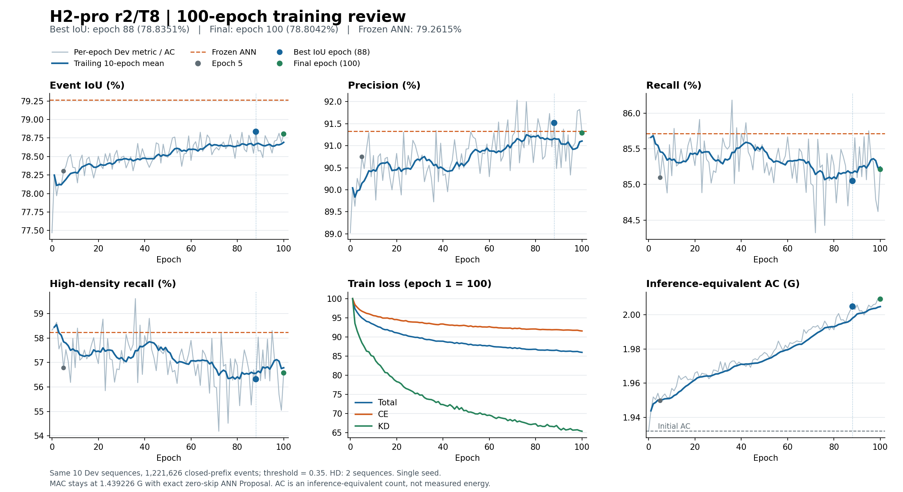
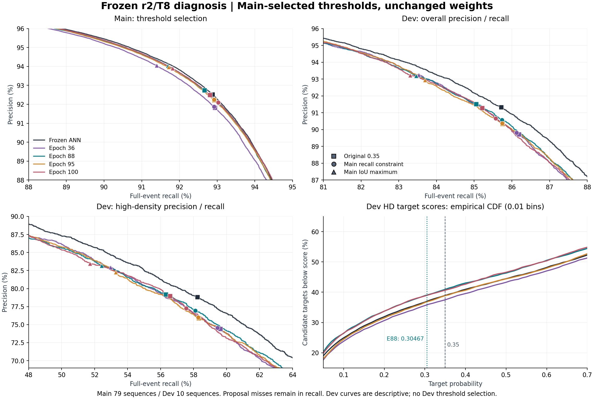
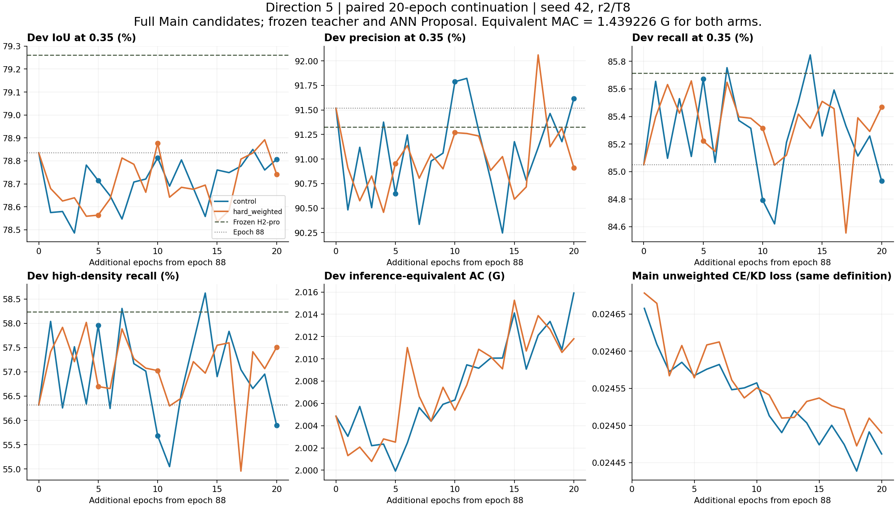
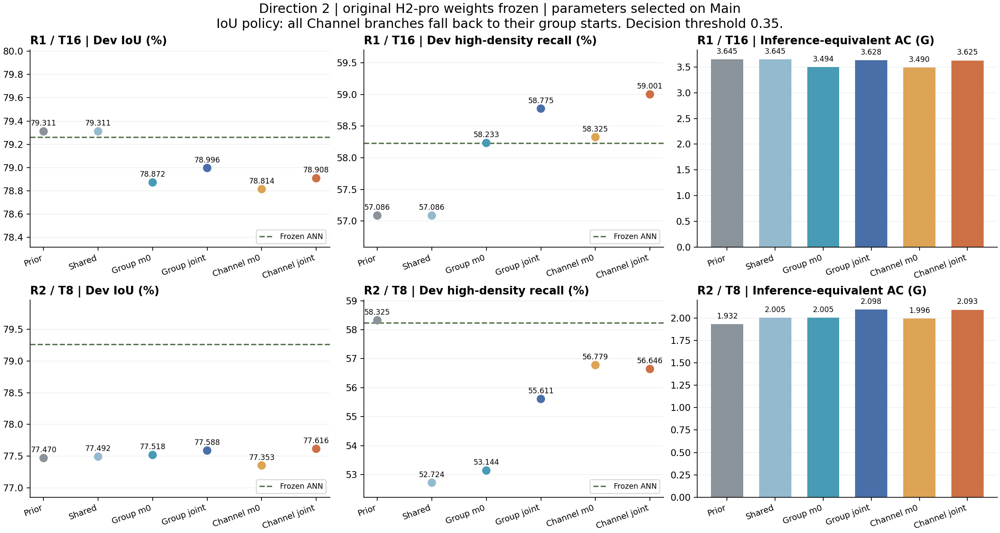
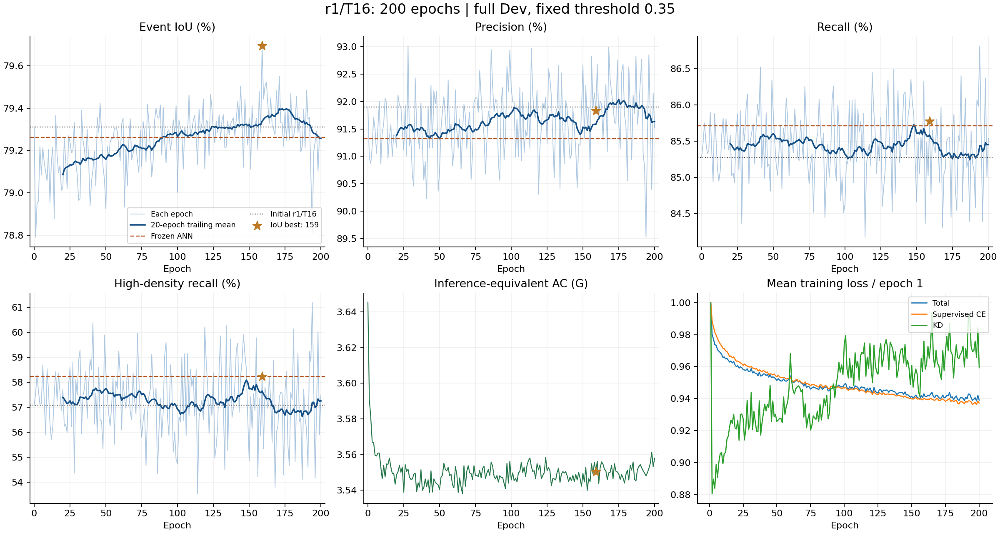

# ANN→SNN 实现状态与研究计划

更新：2026-10-16。本文是本子项目**唯一持续维护的实现状态文档**，集中记录当前结论、版本、有效计划、操作入口和变更。实验 JSON、训练日志与 checkpoint 是原始证据，不因整理本文而改写。上级 README 只导航，AGENTS 只保存协作规则。

导航：[当前结论](#current) · [评测口径](#protocol) · [版本状态](#versions) · [当前结果](#results) · [历史模型](#legacy) · [操作与恢复](#operations) · [文件索引](#artifacts) · [后续计划](#plan) · [变更记录](#history) · [文档维护](#documentation) · [本地提交与交接](#git-handoff-commits)

<a id="current"></a>
## 1. 当前结论

**Git整理期间观察到的新运行状态：两组已经累计追加50轮，等待专项复盘。** 两份进度均为`complete`、源159/等效209、Adam step56,639；本次只读取进度，不据此调整模型或参数。以下五轮指标与建议是续训前的历史复盘，不能当成50轮结果。整理任务没有启动真实训练，最新checkpoint和日志留在原目录。[本次本地提交及保留核对](#git-handoff-commits)

**已完成的五轮历史复盘（续训前）：T4有明确收益，T16和固定退出策略仍有代价，值得继续观察。** 同源159完整Adam/RNG、原结构/100 ms/特征/θ255/m0191、lr1e-4；各新增1,355次更新。联合组T4 IoU从75.5429%升至**76.8821%**，较同轮对照高1.5436个百分点；T8为78.7887%，较对照高0.1935。联合组第5轮T16／固定退出IoU为**79.0904%／79.1342%**，较源159低0.6037／0.5952个百分点，固定策略HD Recall56.9834%，AC1.143446G。源159仍保留为T16/固定策略最佳，尚未被新模型替换。T4损失持续下降，T16蒸馏项上升，提示多步目标取舍；建议两组原配置累计追加50轮，在10/20/50保留比较，不加AC或改门限。训练由用户启动，本轮无新训练、无Test调参。73运行文件保持，10断点/导出、11预测包/44模式、89缓存与294日志核验通过；allocated238.88/253.18 MiB。[五轮复盘](#multit-5-review) · [续训命令](#multit-commands) · [Git交接审查](#git-handoff-review)

**当前 Dev 最高 IoU 候选的一次冻结 Test 评测已完成（用户授权，无训练、无 Test 调参）。** 在读取 Test 前固定第159轮权重、T4`.01/.99`＋T8`.10/.95`、最终阈值0.35，并同场重放冻结ANN和固定T16。完整24条Test按原100 ms闭窗协议计分2,049,292事件：ANN／固定T16／自适应SNN的IoU分别为 **87.1383%／87.2800%／87.4568%**。自适应相对ANN的IoU高 **0.3185个百分点**、Precision高0.5403个百分点，Recall低0.1924个百分点、HD Recall低0.6960个百分点；公平MAC **2.456143 G**，比ANN少34.6508%，AC **1.785202 G**，比固定T16少67.1363%，平均4.8646步。收益在本次Test保留，但不是所有指标全面提升；序列配对区间仍跨0，且教师已有历史Test暴露，不能据此宣称统计显著或跨数据集通用性。8项新检查＋53项共享回归、全部643,002候选/每个SNN实际脉冲核验、独立源数据/指标/成本重计通过；1,138个受保护旧文件和55个完成后复用文件不变。[完整结果](#frozen-test-review) · [状态/恢复](#frozen-test-commands) · [复盘证据](results/h2pro_frozen_test_v1_review_20261016.json)

**方向8／J第三轮单因素对照已完成，无训练。** T4固定`.01/.99`，只改变T8负门限或正门限；Main每侧21点、59/20序列拟合/内部验证并先封存，Dev完整验证8种不同策略。归因明确：上一轮`.10/.95`新增的15个漏检和减少的35个误报，全部来自负门限`.01→.10`。Main选出的正门限`.95`（负门限保持`.01`）与旧共享规则的Dev最终分类逐事件相同，IoU **79.6898%**、Recall **85.7506%**、HD Recall **58.2122%**，AC **1.230133 G**，比共享少 **1.8905%**、比T16少 **65.3520%**；恢复上一轮15个额外漏检，但其35个已减少误报也返回。负门限`.015`单因素另保留：IoU **79.6922%**、召回不变、少1个FP、AC **1.238202 G**。Main召回目标还选出正门限`.40`：IoU **79.2583%**（比ANN低0.0032个百分点）、Recall **86.4679%**、HD Recall **60.1884%**、AC **1.198069 G**；较共享多检出217个目标（HD193），增加451个FP。保留同分类省算、微小误报改善、高召回和旧最低AC等多种取舍。53项测试、80个Main分数独立重计、8策略各438,966候选实际脉冲核验及恢复检查通过；第159轮权重/100 ms输入/特征和旧结果均保留。[第三轮完整结果](#adaptive-t-v3-review) · [状态/恢复](#adaptive-t-v3-commands) · [对比图](results/h2pro_adaptive_t_v3_comparison_20261015.png)

**ANN 动态窗口配对适配已由用户完成各200轮、各43,800次更新，复盘完成。** `H2-pro_dynamic_train_v1`保持2000事件＋计数归一化、冻结Proposal及原Refiner结构；动态int8最佳第118轮：**78.0488% IoU、90.8324% Precision、84.7227% Recall、54.7409% HD Recall**，比训练前IoU高0.7432个百分点、比第5轮高0.3829，补回约38%的初始IoU差距，但比冻结ANN仍低1.2128个百分点，HD Recall低3.4917个百分点。100 ms最佳第11轮IoU79.3801%，比冻结ANN高0.1186个百分点；两组last200为79.1644%/77.5068%。动态第200轮浮点IoU78.0002%，量化后低0.4934个百分点，新增387 TP和707 FP；导出符合原规则，后期量化偏移需要单独处理，浮点模型仍有召回缺口。公平MAC仍2.394416/3.488301 G、AC0，allocated峰值575.61/614.90 MiB、reserved658/702 MiB。400个断点/导出、804份全量预测、9,204条日志及全量覆盖核验通过；1,624个运行文件与64个五轮快照文件不变。保留该方向，建议先做固定权重量化诊断，再准备原浮点训练与QAT微调对照；未启动新训练。[200轮复盘](#ann-dynamic-train-200-review) · [五轮历史](#ann-dynamic-train-5-review) · [协议与恢复](#ann-dynamic-train)

**冻结权重动态窗口首轮历史保留。** 独立 `H2-pro_dynamic_window_v1`在Main选定2000事件归一化窗口后，Dev IoU77.3055%、P89.1753%、R85.3110%、HD R56.9834%；相对原100 ms ANN，恢复345个目标、丢失467个原TP并净增670 FP。平均闭窗等待从50.5103降至29.6653 ms（−41.2688%），公平MAC从2.394416升至3.488301 G、AC均0；这些窗口/候选和成本在当前Refiner训练中保持。输入侧改进独立于下述SNN编码步数自适应；原ANN、冻结窗口实验及旧SNN结果均保留。[冻结权重完整结果](#ann-dynamic-window)

**方向8／J第二轮独立门限已完成，无训练。** 第159轮权重、100 ms窗口及特征不变，T4/T8的正负门限分别搜索，共10,000组。预设Main流程的三种目标仍选中旧`.01/.99`；随后在Main内选出并在本轮Dev验证前另行封存两种不同门限作补充探索，未反改主选择。新候选 **T4 `.01/.99`、T8 `.10/.95`** 的Dev IoU **79.7294%**、Precision **91.9628%**、Recall **85.7011%**、HD Recall **58.1200%**，公平MAC **1.504114 G**、AC **1.156812 G**、平均 **4.7481步**。比旧规则IoU高 **0.0396个百分点**、AC少 **7.7383%**；代价是少检出15个目标（HD为9个），同时减少35个误报。相对固定T16，AC少 **67.4172%**、IoU高0.0353个百分点。保留为新的精度/AC开发候选，同时保留旧规则及固定T16；不称全面无损或独立验收通过。22项新测试＋45项共享回归、10,000组搜索独立重计、三种不同策略各438,966候选实际脉冲核验及恢复检查通过，旧文件保留。[第二轮完整结果](#adaptive-t-v2-review) · [复现/恢复](#adaptive-t-v2-commands) · [对比图](results/h2pro_adaptive_t_v2_comparison_20261015.png)

**方向8／J首轮及对照保留。** 共享`confidence(.01,.99)`的IoU **79.6898%**、Precision **91.8531%**、Recall **85.7506%**、HD Recall **58.2122%**，MAC **1.507218 G**、AC **1.253838 G**、平均 **5.1902步**；相对固定T16，AC少64.6844%、IoU低0.0044个百分点。它也是第二轮预设Main选参结果。首轮另保留`stable8(.30,.95)`：IoU79.6994%、HD Recall57.0960%。前两轮未提高HD召回，第三轮出现上述高召回取舍；三轮均保持原100 ms真实输入窗口。[首轮完整结果](#adaptive-t-review) · [首轮入口](#adaptive-t-commands)

**r1/T16 学习率配对续训已由用户完成，两组各追加50轮。** 同源第159轮、相同Adam/RNG，仅学习率为1e-4/3e-5，各新增13,550次更新。3e-5的50轮平均IoU **79.3315%**，对照为79.3066%；IoU波动标准差降低31.80%，后25轮均值高0.0967个百分点，但均未超过源159轮。新增训练内最佳分别为control +12（IoU79.5498%）和low_lr +44（79.4726%）；**两组best.pt仍为源159轮**。低学习率+28保留为召回取舍候选：IoU79.4336%、R86.1208%、HD R59.3488%。两组实测allocated峰值238.877 MiB/reserved258 MiB，无失败或早停；本次只读复盘，未启动新训练。[50轮复盘](#option-a-r1-lr-50-review) · [实现与检查](#option-a-r1-lr-ready) · [状态/恢复命令](#option-a-r1-lr-commands)

**探索 A 既有结果：r1/T16 原200轮、54,200次更新完整保留，固定T16训练点的Dev IoU最佳仍为第159轮。** IoU **79.6941%**、Precision **91.8324%**、Recall **85.7738%**、HD Recall **58.2429%**，相对冻结H2-pro ANN分别高 **0.4326/0.5065/0.0595/0.0102个百分点**；HD只多检出1个目标，宜解释为基本保持。公平MAC **1.495414 G**、AC **3.550378 G**，MAC比ANN少37.5458%，AC比训练前少2.6026%。原最后第200轮IoU **79.2546%**，后期仍有召回/误报摆动。原200轮运行、五轮快照和复盘完整保留。[200轮复盘](#option-a-r1-200-review) · [五轮历史](#option-a-r1-5-review) · [原训练实现](#option-a-r1-ready) · [原运行入口](#option-a-r1-commands) · [A–K菜单](#exploration-menu)

**2026-10-15 研究方向复审（历史判断）**：修正此前过于保守的继续/停止建议。未达到替换 ANN 的条件，不等于方向应退出研究。方向 4、5 重新列为优先优化路线，方向 2 保留不同精度/召回/AC 取舍的候选，方向 7 的训练适配仍有验证价值；复审当时方向6/8/9尚未试验，方向8随后已完成，见上文。以下各阶段“暂停”主要指原配置，不代表方向已经无效。复审的代码证据、未充分利用的结果和建议见[第 4.10 节](#research-reassessment)。该次复审只核对源码/记录及修订本文，没有新推理、训练或模型修改。

已完成两条独立对照：**原 H2-pro Refiner 的原结构/原权重转换与短时校准**，以及用户新选择的**方向 7：旧 S0-P/S1 Proposal＋冻结 H2-pro ANN Refiner**。前者保留原 Proposal，后者复用已有训练权重替换 Proposal，重建由它决定的候选、热图和历史特征。方向 7 没有重新训练，但不属于全网保持原 H2-pro 权重的转换。早期重新设计的网格 Refiner 已训练过，目前暂停。

**方向 4：原结构 r2/T8 已由用户完成 100 轮、27,100 次更新；固定权重诊断也已完成。** 原 0.35 阈值下最佳仍为第 **88** 轮，IoU **78.8351%**；最后一轮 **78.8042%**。此前冻结第 36/88/95/100 轮，在完整 Main 选阈值、Dev 验证：第 88 轮阈值降至 **0.30466962** 后，Recall **85.7374%**、HD Recall **58.0995%**，接近 ANN 的 85.7143%/58.2326%，但误报增加、IoU 降至 **78.7151%**，仍低于 ANN 0.5464 个百分点。**阈值能恢复部分漏检，不能单独补齐当前精确率/召回差距。** 第 88 轮 0.35 继续保留为方向 4 的 IoU 参考。[百轮复盘](#direction4-100-review) · [固定权重诊断](#direction4-fixed-diagnosis)

**方向 5：用户已完成两组各追加 20 轮，复盘完成；当前固定难例 2 倍加权未获得稳定的配对优势。** 两组均从第 88 轮相同主权重/Adam/RNG 开始，各新增 5,420 次更新，完成至等效第 108 轮。0.35 阈值下，加权组相对原损失组在追加 5/10/20 轮的 IoU 差为 **−0.1506 / +0.0638 / −0.0652 个百分点**。加权组最佳为追加第 **19** 轮（等效 107），IoU **78.8920%**，较源第 88 轮高 0.0569 个百分点，但仍低于 ANN 0.3695 个百分点。Main 校准阈值也未补齐整体差距。保留两组 best 与第 88 轮，暂停本配置续训。后续方向 2 固定权重校准现已完成，见下文；方向 6 尚未实施。[方向 5 实现](#direction5-ready) · [20 轮比较与判断](#direction5-20-review) · [查看/恢复入口](#direction5-commands)

**方向 2 第二轮已完成：原最佳 r1/T16 附近的少数组 m0 校准，无训练。** 保持结构、原权重、θ=255、T16 和 0.35 不变；Main 按序列划分 59 条拟合、20 条内部验证，扩大背景覆盖，统一以总体 Event IoU 选参并封存后再验证 Dev。预先指定的单组对照 IoU **79.3145%**，仅比原最佳高 **0.0037 个百分点**，AC 少 **0.1519%**；Main 选出的双组主候选 IoU **79.2958%**，低 **0.0149 个百分点**，HD Recall 高 **0.1638 个百分点**、AC 少 **0.1951%**。改善很小且 Main 优势未完整迁移，不根据 Dev 改选主候选，不替换冻结基线。首轮分组 θ/m0 的召回折中结果仍保留。[第二轮协议与结果](#direction2-m0-v2) · [第二轮复现](#direction2-m0-commands) · [首轮结果](#direction2-calibration)

- **冻结 ANN 基线不变**：H2-pro-Causal-ANN-v1，Train-dev Event IoU **79.2615%**、Precision **91.3259%**、Recall **85.7143%**。
- **保留原H2-pro权重、未训练的短时校准对照中最高观察IoU**：第二轮单组m0对照 **79.3145%**、Precision **91.8937%**、Recall **85.2813%**，比原r1/T16/task_rescore的 **79.3108%** 仅高0.0037个百分点（TP +2、FP +1）。它是Main预先指定的单组诊断点，Main主候选仍为双组；不借Dev回选。原最佳保留。单组总体/HD Recall仍比ANN低0.4330/1.0547个百分点，不能称全面无损或统计显著提升；训练后源159及本轮自适应T另列。
- **召回更接近 ANN 的候选**：r1/T16/task，IoU **79.1945%**、Recall **85.6680%**；总体/高密度 Recall 相对 ANN −0.0463/−0.1946 个百分点。两个候选都保留，尚未确定替代基线。
- **方向 7 无训练续验已完成，未达到无损目标**：Main 选择的独立门限组合（候选 0.6546188、连通域 0.55），Dev IoU **74.9317%**、Precision **91.2535%**、Recall **80.7298%**、HD Recall **45.5970%**。相对 ANN 的 IoU/Recall/HD Recall 低 **4.3298/4.9845/12.6357** 个百分点。原首轮 IoU 74.6893% 结果保留；诊断与范围限定见[续验](#direction7-diagnosis)。
- **成本须同时看公平执行对照**：原 ANN Proposal 跳零后输出完全不变，总 MAC 从 3.925152 G 降到 **2.394416 G**（−38.9981%）。方向 7 新门限组合为 **1.727447 G MAC＋0.537029 G AC**；比跳零 ANN 少 27.8552% MAC，未加权 MAC+AC 少 5.4268%，但精度下降。相对原 S1，IoU +0.2424 个百分点、MAC −25.3597%；保留为成本/精度折中，不称为无损节能。
- **Refiner 路线已得到精度改进，AC仍有优化空间**：原未训练 r1/T16/task_rescore 为3.6452 G AC；200轮中最佳第159轮为3.5504 G AC，减少2.6026%。相同跳零Proposal口径下MAC比ANN少37.5458%，稠密Proposal口径下少22.9036%；MAC削减来自转换结构，训练没有再次降低MAC。最佳轮MAC+AC是公平ANN的2.1073倍、稠密ANN的1.6755倍；AC与MAC单位能耗不同，这些等效操作数不能换算成实测节能，也不作为停止该方向的门槛。
- **两种转换范围分开**：r1/r2 是 ANN Proposal＋部分脉冲 Refiner；方向 7 是 SNN Proposal＋ANN Refiner。尚未组合成两级都脉冲化的模型；H2-pro 新分支已按用户授权完成本次冻结候选Test评测，尚无新的Validation验收、RTL或板级实测。
- **当前实验状态与研究判断**：方向4的r2/T8 100轮、探索A r1/T16 200轮及同源159学习率两组各50轮、方向5两组各追加20轮、方向2两轮校准、方向7无训练实验及方向8三轮自适应T均已完成。多T五轮复盘显示T4改善、T16/固定策略仍有代价；Git整理期间观察到两组累计+50已完成，当前待复盘10/20/50节点，暂不扩展训练预算。源159仍为精度参考，全部旧取舍保留。损失配比、渐进短步监督、Main门限适配、AC正则及编码改进作为后续独立因素，方向6/9尚未实施。

- **FRED 保留全部分类事件的统计适配已完成**：只调整 24 维邻域计数，原几何、全事件 ANN Proposal、其余 12 维特征、三模型权重/校准和 0.35 阈值不变。完整原计分集合上，ANN / r1-T16 / r2-T8 第 88 轮 IoU 从 **10.4896% / 9.4736% / 7.8448%** 提高到 **28.6822% / 27.2171% / 33.3738%**，Recall 达到 **64.1171% / 57.9878% / 73.5831%**；没有丢弃待分类事件。MAC 保持，r1/r2 等效 AC 下降 **19.2944% / 19.0198%**。开头背景误报增加，完整 Precision 仍仅 **34.1666% / 33.9023% / 37.9168%**；两条已分析记录及框派生弱标签仍限制外推。独立结果、8 项回归、全量重计和 1,139 原文件保留检查完成，未训练。[原基线](#fred-evaluation) · [输入诊断](#fred-input-diagnosis) · [本轮完整结果与后续判断](#fred-statistics-adaptation)

<a id="protocol"></a>
## 2. 冻结对象与评测口径

| 项目 | 当前约定 |
| --- | --- |
| ANN 身份 | H2-pro-Causal-ANN-v1；C1-proposal-motion；seed42、epoch10、exact-int8；最终判定阈值 0.35 |
| 来源 | [ANN 工程](../../1_H2_model_improvement/implementation/)；[冻结锁](software/wangdao/h2pro_snn/baseline_lock.json) |
| 原结构 | Proposal 128→48→24→16；Refiner 36→64→32→4，无偏置，每类两个原型取最大值读出 |
| 保持不变 | 零更新 Refiner 转换保留原 Proposal/特征/权重；方向 2 仅校准 IF θ/m0，原 int8 矩阵与 FP32 scale 不变，额外解码乘法单列；方向 4 训练保留原 Proposal/候选/特征/结构/scale/读出及 0.35 阈值，更新学生权重；其独立固定权重诊断只改变最终阈值，保留 0.35 对照；方向 7 保留 H2-pro Refiner 的特征定义、权重、scale、数值规则、原型读出及 0.35 阈值，Proposal 改用旧 SNN，候选及相关特征值重新生成 |
| 时间 | 100 ms 闭合窗口；尾部未闭合窗口舍弃。Refiner转换的T是人工编码步数；方向8按候选在4/8/16步退出，输入窗口仍100 ms。方向7的旧Proposal使用4个真实25 ms时间片。这些配置均不缩短原100 ms窗口等待 |
| Dev 与 ANN 对照 | 四组均为 10 条 Train-dev、1,221,626 个事件、30,254 个目标；其中 ANN 有 438,966 个候选、Proposal Recall 98.4200%，方向 7 候选数不同 |
| Train-main | 原结构方向 4 覆盖 79 条、7,154,631 个闭合前缀事件，全部 2,219,864 个 ANN 候选每轮访问一次；方向 1 抽取 12 条中的 24,081 个候选；方向 2 首轮在全部 79 条取 77,933 个分层候选。第二轮独立划分 59 条拟合/20 条内部验证，拟合 388,035 个候选（154,185 正例、233,850 背景），内部验证及完整 Main 均全量计分；方向 1/2 无权重训练 |
| 指标 | Event IoU、Precision、Recall、F1；单独报告高密度（HD）。百分数与百分点区别记录，Recall 不等于普通分类 Accuracy |
| 数据纪律 | Train-main 拟合/校准，Train-dev 开发选型，HW-calibration 用于后续数值设计；Validation 阶段冻结后复核，Test 最终使用 |
| 保留集边界 | 2026-10-16用户授权后，当前Dev最高IoU候选及两组固定对照已先封存、再完整读取Test24条，未用Test重新选参；Validation仍未在本阶段读取。原教师存在历史Test暴露，不能声称整个研究拥有全新盲测Test；后续开发继续使用Main/Dev，已查看的Test不能重命名为独立盲测 |
| 成本 | MAC与AC分列；G=10⁹次。覆盖Proposal+Refiner推理核突触计算。方向8包含每次检查的32→4读出MAC，IF/解码/量化/概率/判停标量分别列计；特征构建、路由、活动行压缩、访存及物理能耗尚未完整计入。参考核验开销不混入部署等效成本 |
| 正式评测 | [S01/S02 研究指标规则](../model_selection_metrics/README.md)；正式候选冻结后进入[目录 5](../../5_model_evaluation/README.md)的 A+B，板端另作 A+C |

原稠密 ANN 神经层总 MAC 为 **3.925152 G**，其中 Proposal 1.958584320 G、Refiner 1.966567680 G。新增同输出的跳零执行对照见第 4.4 节。MAC+AC 是未加权操作量比较，不能当成功耗或延迟；软件运行时间也不是 FPGA 时间。

<a id="versions"></a>
## 3. 各版本状态

### 3.1 当前原结构转换分支

下表包名均相对于 [software/wangdao/](software/wangdao/)。历史回归数量是各版本交付时的记录；方向 2 首轮执行 58 项相关回归，第二轮执行 69 项相关回归，均不等于整个仓库的全量回归。

| 版本 | 完成内容 | 权重更新/评估 | 当前状态与证据 |
| --- | --- | --- | --- |
| h2pro_multit_v1（方向4＋8／J训练适配） | 同源159完整Adam/RNG，固定T16与等权T4/8/16监督＋KD两组；原结构/窗口/特征/θ/m0/scale不变 | 五轮复盘完成；最新进度已累计各+50、step56,639，50轮效果待复盘；仅Main训练/Dev评估 | 联合组T4 IoU76.8821%、T8 78.7887%，同轮分别高1.5436/0.1935个百分点；T16 79.0904%、固定退出79.1342%，源159仍为二者best。allocated238.88/253.18MiB。73运行文件不变、10断点/导出与44模式重计通过；累计+50已完成，待复盘。[五轮复盘](#multit-5-review)、[历史预检](#multit-ready)、[命令](#multit-commands) |
| h2pro_frozen_test_v1（独立评测入口） | 在Test读取前固定Dev最高IoU的源159＋T8`.10/.95`及ANN/T16对照；原特征/窗口，完整序列恢复与来源封存 | 零训练、零Test选参；24条完整Test，643,002候选/每个SNN全量真实脉冲加法 | complete；自适应IoU87.4568%、P92.5285%、R94.1022%、HD R76.1786%、MAC2.456143G/AC1.785202G；8新＋53共享回归，完整源数据及保存预测重计、55文件完成后复用检查。[结果](#frozen-test-review)、[复盘](results/h2pro_frozen_test_v1_review_20261016.json) |
| h2pro_direct_v1 | 原特征重建与教师精确重放；ANN→r1→r2；可恢复多 T 评估，解析和真实脉冲加法后端 | 零更新；T=4/8/16/32/64/255 参考扫描，T=4/16/64 显式核验，T8 后续校准中核验 | 转换基线保留；338 项回归。[交付记录](results/h2pro_direct_v1_implementation_20261013.json) |
| h2pro_adaptive_t_v1（方向8／J） | 第159轮r1权重冻结；4→8→16增量编码，状态复用、逐候选退出、重复读出成本与序列恢复 | 零真实数据训练/权重更新；79条Main选参先封存，10条完整Dev；两种不同规则各438,966候选实际脉冲加法核验 | complete；`.01/.99` IoU79.6898%、HD R58.2122%、MAC1.507218G/AC1.253838G；20新测试＋67共享回归、228个Main分数独立重计、225运行文件复用不变。[结果](#adaptive-t-review)、[复盘](results/h2pro_adaptive_t_v1_review_20261015.json) |
| h2pro_adaptive_t_v2（方向8／J续验） | 同源159；T4/T8分别设置正负退出门限，原网格扩为10,000组合；原输入/权重/量化契约不变 | 零训练；Main59/20先选参封存、Dev完整验证。主选择仍共享门限；Main补充选择另立identity和运行目录，Dev前封存 | complete；新T4`.01/.99`＋T8`.10/.95` IoU79.7294%、HD R58.1200%、MAC1.504114G/AC1.156812G；比旧规则IoU+0.0396个百分点、AC−7.7383%，少15TP/35FP。67测试、10,000搜索独立复核、3策略全量脉冲验证。[结果](#adaptive-t-v2-review)、[复盘](results/h2pro_adaptive_t_v2_review_20261015.json) |
| h2pro_adaptive_t_v3（方向8／J单因素） | T4固定`.01/.99`，分别只改T8负/正门限；四固定点归因、每侧21点Main搜索，原数值核不变 | 零训练；预登记三种原目标及兼顾召回目标，Main先封存，8种不同策略完整Dev实际执行 | complete；T8`.01/.95`与旧共享分类相同、AC−1.8905%；`.015/.99`少1FP无新增漏检；`.01/.40` IoU79.2583%、HD R60.1884%、AC1.198069G。53测试、80Main重计、89缓存和167运行文件恢复核验通过。[结果](#adaptive-t-v3-review)、[复盘](results/h2pro_adaptive_t_v3_review_20261015.json) |
| h2pro_calibration_v1 | 每层共享 θ/m0；Train-main 无标签、分组平衡 margin-MSE 选参；accuracy/low_spike 两种候选 | 零更新；2,094 组参数，19 组完整 Dev 对照；粗/细网格均保留 | 未达到无损减算；352 项回归。[交付记录](results/h2pro_calibration_v1_implementation_20261013.json) |
| h2pro_task_calibration_v1 | 方向 1：同池任务重评、分类目标搜索、校准 AC 受限对照 | 零更新；使用 Train-main 标签，5,248 组参数，31 组完整 Dev 对照 | 已完成；保留两种 r1/T16 候选；366 项回归。[交付记录](results/h2pro_task_calibration_v1_implementation_20261014.json) |
| h2pro_r1_train_v1（探索 A） | 原最佳 r1/T16/task_rescore 上训练学生三层权重；编码/结构/scale 不变；冻结 Proposal/教师；GPU 常驻缓存、批次恢复、逐轮完整 Adam/RNG checkpoint | 用户完成200轮、54,200次更新；best第159轮，last第200轮；每轮完整断点/导出保留 | `complete`；best IoU79.6941%、P91.8324%、R85.7738%、HD R58.2429%，四项均略高于ANN；公平MAC1.495414G、AC3.550378G（较初始−2.6026%）。last IoU79.2546%；allocated峰值238.88MiB。609运行文件和24五轮快照保留；独立学习率续验已完成，源159仍是IoU最佳。[200轮复盘](#option-a-r1-200-review)、[五轮历史](#option-a-r1-5-review)、[开训前交付](results/h2pro_r1_train_v1_implementation_20261015.json) |
| h2pro_r1_lr_v1（探索A续验） | 从完整epoch159分支；control=1e-4、low_lr=3e-5，Adam动量/步数及RNG相同，其余条件不变；各追加50轮，10/25/50轮比较 | `complete`；各新增13,550次更新，Adam step56,639、last绝对209轮；best均为源159 | 新增最佳control +12 IoU79.5498%、low_lr +44 79.4726%；低学习率平均IoU小幅提高、波动缩小，+28为召回候选。两组allocated238.877MiB/reserved258MiB。100份逐轮断点/导出/指标核对、原160–200轮精确重现；326新运行文件及609原运行文件不变。本次无新训练。[50轮复盘](#option-a-r1-lr-50-review)、[实现](#option-a-r1-lr-ready)、[命令](#option-a-r1-lr-commands) |
| h2pro_proposal_transfer_v1（独立 Proposal 分支） | 方向 7：核对旧 S0-P/S1 来源，接入冻结 H2-pro Refiner；真实 S1 零输入 MAC/脉冲 AC，另设精确 ANN 跳零对照 | 无新训练/权重更新；四组完整 Dev、40 个序列点；旧 S0-P 已训练 20 轮 | 已完成首轮；S1 精度未达标；382 项回归。[交付记录](results/h2pro_proposal_transfer_v1_implementation_20261014.json) |
| h2pro_proposal_diagnosis_v1 / component_v1 | 方向 7 续验：Main 选召回门限；候选/上下文交叉对照、特征分组替换、热图尺度及独立连通域门限校准 | 无网络训练/权重更新；首阶段 17 组 Main＋17 组 Dev；追加 570,724 个 Main 组合与 327,536 个 Dev 诊断组合 | 已完成；未满足无损减算；386 项回归，898,260 组合独立重计分通过。[记录](results/h2pro_proposal_diagnosis_v1_implementation_20261014.json) |
| h2pro_distill_v1（方向 4） | 原结构 r2/T8、监督＋KD、固定尺度 int8 量化训练、GPU 常驻候选缓存、批次级恢复、每轮原核导出与精度/成本报告 | 用户完成 100 轮、27,100 次更新；best 第 88 轮、last 第 100 轮；100 份逐轮导出保留 | best IoU 78.8351%、Recall 85.0499%、HD Recall 56.3178%；部分恢复，未达全面无损目标。[百轮复盘](results/h2pro_distill_r2t8_v1_epoch100_review_20261014.json)、[曲线](results/h2pro_distill_r2t8_v1_epoch100_curves_20261014.png) |
| h2pro_fixed_diagnosis_v1（方向 3 / 方向 4 诊断） | 冻结 36/88/95/100 轮，完整 Main 精确阈值搜索，封存后 Dev 验证；两种单一全局阈值、0.35 对照、PR/分数及误差分解 | 零反向/零更新；79 Main＋10 Dev；原 0.35 精度与成本精确重现；19 项相关回归，5,927,303 个曲线点独立核对，恢复后 38 个结果文件不变 | 已完成；第 88 轮 0.30466962 恢复召回但增加 FP；两种规则均未全面达到 ANN，MAC/AC 不变。[记录](results/h2pro_fixed_diagnosis_v1_review_20261014.json)、[曲线](results/h2pro_fixed_diagnosis_v1_curves_20261014.png) |
| h2pro_hardcase_v1（方向 5） | 从 epoch88 同主权重/Adam/RNG 建立原损失与固定难正负例加权两组；全量缓存、批次恢复、追加 5/10/20 轮 Main 校准/Dev 配对比较 | 用户已完成各追加 20 轮、各 5,420 次更新；Main 难正例 1,656、难负例 2,266，权重 2，其余 1；不重采样，无 AC 正则 | `complete`；control best +18 IoU 78.8499%，hard_weighted best +19 IoU 78.8920%；未稳定优于对照，均低于 ANN。交付时 51 项回归通过；本次保存预测独立重计分通过。[20 轮复盘](results/h2pro_hardcase_v1_epoch20_review_20261014.json)、[曲线](results/h2pro_hardcase_v1_epoch20_curves_20261014.png)、[历史交付](results/h2pro_hardcase_v1_implementation_20261014.json) |
| h2pro_channel_calibration_v1（方向 2） | 原 H2-pro 权重冻结，r1/T16、r2/T8 五分支 θ/m0 校准；异阈值按原 int8 权重分桶加法后解码 | 无反向/权重更新；Main 77,933 分层样本搜索、38 个完整 Main 参数点选型；20 个独立 SNN＋ANN 完整 Dev | `complete`；58 项相关回归、10 个历史控制精确重放、恢复后 120 文件不变；未超过旧最佳，保留召回折中。[交付与审计](results/h2pro_channel_calibration_v1_implementation_20261015.json)、[结果](#direction2-calibration) |
| h2pro_m0_calibration_v2（方向 2 第二轮） | 原最佳 r1/T16 起点，只改最多两组 m0，θ/权重/结构不变；Main 按序列拟合/验证，增加背景覆盖、统一任务目标 | 无反向/更新；705 组参数、17 个完整 Main 点；封存后 4 个独立 Dev 配置含 ANN，双组为主候选 | complete；69 项相关回归，51 个 Main 分区分数及 4 个 Dev 结果独立重计；1,213 个旧文件保留、756 个新文件完成后复用不变。微小取舍，未证明稳定优势。[结果](#direction2-m0-v2)、[复盘](results/h2pro_m0_calibration_v2_review_20261015.json) |

**r1/r2 的含义**：r1 把第一隐藏层激活编码为 IF 二值脉冲，使 64→32 权重累加使用 AC；r2 再转换第二隐藏层传递，使 32→4 也使用 AC。36→64 仍使用 MAC；逐层独立编码、复位，不是整个网络同步运行 T 个真实事件时间步。

默认 θ=255、m0=127，每步最多一个二值脉冲、软复位。T=255 的解析端点可精确重现原 ANN；短 T 有量化误差。校准只改变编码参数，解码比例在原权重累加后应用，不把重缩放权重称作“权重不变”。θ 较低时的饱和另行报告，不作为任意硬停止条件。

count_reference 是矩阵运算的快速解析参考；spike_add 才执行脉冲触发的权重加法。零更新转换表使用显式后端计数；方向 4 的完整 Dev 使用解析参考，按全量脉冲计数计算推理等效 AC，每轮另抽取 640 个固定候选核验显式内核。方向 2 同样使用全量解析计数，并对每个独立配置的 640 个固定候选做原权重显式脉冲加法核验。参考后端的实际执行 MAC 不能伪装成显卡上执行的 AC。

外部验证新增独立入口 [evaluate_fred_frozen.py](software/scripts/evaluate_fred_frozen.py) 与 [review_fred_frozen.py](software/scripts/review_fred_frozen.py)，复用上述原模型实现。FRED 两条连续记录、三模型完整评测及来源/成本复核已完成，结果见第 8.5 节；没有新增模型版本或修改既有模型源码。5 项专项回归含完整原 Dev 重放，原 EV-UAV 结果保持。

随后完成独立的 `fred_input_diagnosis_v1`：原输入重放、固定四分区 2 倍尺度、原尺度 1/4 与 1/16 事件密度，三模型及阈值不变；来源标签核查、12 个案例和 6 项专项回归完成。它是输入侧诊断，不是新训练模型，也未替换原适配器。[诊断入口](software/scripts/diagnose_fred_inputs.py) · [结果与限制](#fred-input-diagnosis)

其后完成 `fred_statistics_adaptation_v1`：只用子集维护邻域计数，仍对全部原候选分类；只替换索引 4–27，原入口保持原行为，新策略由独立 FRED 入口调用。三模型两段完整推理、独立重计和恢复检查通过，无参数更新。[实现入口](software/scripts/adapt_fred_statistics.py) · [完整结果](#fred-statistics-adaptation)

新增ANN输入侧实验 `H2-pro_dynamic_window_v1` 的代码和证据位于[目录1研究区](../../1_H2_model_improvement/seven_step_improvement_study/H2-pro_dynamic_window_v1/)。状态为**已实现、已检查、完整Main/Dev评估，无训练、未替换部署ANN**；统一状态仍只维护在本文[第8.8节](#ann-dynamic-window)。

其配对适配版本 [H2-pro_dynamic_train_v1](../../1_H2_model_improvement/seven_step_improvement_study/H2-pro_dynamic_train_v1/) 状态为**两组各200轮已完成并复盘**：100 ms best第11轮IoU79.3801%、last79.1644%；动态best第118轮IoU78.0488%、last77.5068%，相对本组初始最佳IoU +0.7432个百分点，但HD Recall −2.2425个百分点。各43,800次更新，全量覆盖和逐轮浮点/int8与断点通过核验；两组allocated峰值575.61/614.90 MiB。动态后期出现明显浮点/int8分离，建议固定权重量化诊断后再设计QAT对照，同时保留召回目标优化的后续分支。未替换正式ANN或既有SNN，未启动新训练。见[200轮比较](#ann-dynamic-train-200-review)、[五轮历史](#ann-dynamic-train-5-review)与[原协议](#ann-dynamic-train)。

### 3.2 已暂停的网格 Refiner 与训练基础设施

这条分支是**冻结 Proposal＋新设计、重新训练的网格 Refiner**，采用相位编码、连续状态和 9,856 个可训练参数，内部时间 bin 为 10 ms。它不是将原 36→64→32→4 MLP 原样转化，也不是 H2-pro 教师 ANN。以下为各自当时选定阈值的完整 Dev 结果，不能与固定 0.35 的直接转换视为单因素实验。

| 版本/运行 | 实际完成情况 | 最佳 IoU / Precision / Recall（%） | 状态与原始证据 |
| --- | --- | --- | --- |
| h2pro_snn fixed v1 | 5 轮，最佳第 3 轮 | 28.6912 / 42.0915 / 47.4020 | 发放与损失增长，暂停；[复盘](results/h2pro_refiner_fixed_s42_review_20261011.json) |
| h2pro_snn_v2 | 首轮因有限 logit 82.2119 超过旧 80 限值中止 | 没有完成轮次指标 | 修订梯度/复位/电荷尺度的独立版本；[实现记录](results/h2pro_refiner_fixed_v2_implementation.json) |
| h2pro_snn_v2_1 | 1 轮完成；第 2 轮 burst=327 超过旧 256 限值中止 | 33.21 / 57.81 / 43.84（第 1 轮） | 仅修订诊断，失败现场不作新完整结果；[首轮](results/h2pro_refiner_fixed_v2_1_epoch1_review_20261011.json)、[故障](results/h2pro_refiner_fixed_v2_1_epoch2_failure_review_20261011.json) |
| h2pro_snn_v2_2 | 增加输出正负膜电位尾部损失，独立训练 1 轮 | 33.83 / 61.16 / 43.08 | 训练后固定权重扫描仍有 3 批超过旧 burst 限值（最大 268），暂停；[复盘](results/h2pro_refiner_fixed_v2_2_epoch1_review_20261012.json) |
| h2pro_ann_state_v1 初始对照 | 移除 floor 量化，保留状态/读出，独立训练 1 轮 | 33.71 / 67.43 / 40.26 | 不是原 H2-pro ANN，也不是完整常规 RNN 梯度基线；[状态诊断](results/h2pro_state_readout_diagnosis_20261012.json) |
| h2pro_ann_readout_v1 初始对照 | 正负对称归一化线性读出，独立训练 1 轮 | 37.22 / 68.85 / 44.76 | 训练后难例/全流检查通过，但差距仍大；[复盘](results/h2pro_ann_readout_v1_epoch1_review_20261012.json) |
| longtrain_v1_1 / ann_state | 完成 21 轮；第 22 轮 batch2800 已存档暂停，最佳第 21 轮 | 41.6692 / 63.3280 / 54.9217 | 不恢复；[状态](results/runs/h2pro_fulltrain_v1_1_s42/ann_state/progress.json)、[训练记录](results/runs/h2pro_fulltrain_v1_1_s42/ann_state/training.json) |
| longtrain_v1_1 / ann_linear | 累计 5 轮，最佳第 5 轮 | 45.8100 / 68.4730 / 58.0551 | 短预算完成，暂停追加；[配对复盘](results/h2pro_linear_pair_epoch5_review_20261013.json) |
| longtrain_v1_1 / snn_linear | 累计 5 轮，最佳第 4 轮；第 5 轮 IoU 44.5178% | 45.5788 / 70.5162 / 56.3099（最佳） | 隐藏层脉冲化、连续线性读出；[配对复盘](results/h2pro_linear_pair_epoch5_review_20261013.json) |

ANN-linear 五轮 IoU 为 **37.2217→42.4782→44.7524→45.7611→45.8100%**；SNN-linear 为 **36.2597→41.3771→43.9496→45.5788→44.5178%**。两者都有学习，但共同远落后于 H2-pro。同为第 4 轮且相同阈值时差距仅约 0.182 个百分点，不能把大部分失败归于脉冲量化；也不能凭一个 seed、五轮就证明最终收敛或所有 SNN 路线不可行。

第 5 轮两组峰值 allocated 约 **0.915 GiB**、reserved 约 **0.971/0.973 GiB**；ANN-state 第 21 轮约 **0.928/1.008 GiB**，设备为 RTX 4060 Laptop 8 GB。输入已经常驻 GPU，现有证据不支持“显存不够导致没训练”。网格 Refiner 的稠密仿真 MAC 约 **412.58 G**，还未包括冻结 Proposal，不能当作低 MAC 成果。

| 基础设施 | 已实现能力 | 当前用途 |
| --- | --- | --- |
| h2pro_snn foundation / 三种路由 | 教师身份锁、因果性/漏检诊断、成本参考；fixed / spike_route / membrane_route 流程 | [基础记录](results/h2pro_snn_foundation.json)、[闭环记录](results/h2pro_refiner_implementation.json)；迁移机制仅流程/合成验证，未完成正式配对训练 |
| h2pro_longtrain_v1 | 三组配对、GPU 常驻编码、原子批次断点、顺序训练和最终复盘 | 原目录保留；第 3 轮曾被有限幅值工程限值打断 |
| h2pro_longtrain_v1_1 | 不改模型/损失/优化公式；四项有限幅值改 advisory；旧完整断点零更新迁移 | 保留 NaN/Inf、身份与数据/状态完整性检查；旧源码不覆盖 |
| h2pro_shorttrain / short 启动器 | 只选择 ANN-linear/SNN-linear 各累计到 5 轮，复用 v1.1 状态和原学习率日程 | 已完成，无自动延长；不是新模型，也不是重新从头训练 |

<a id="results"></a>
## 4. 原结构转换的当前结果

所有表均为第 2 节同范围的 Train-dev；百分数保留四位，MAC/AC 单位 G。冻结 ANN 与所有 r1/r2 共用 Proposal，所以 Proposal Recall 均为 98.4200%。

### 4.1 原转换基线与两种短时候选

| 配置 | IoU % | Precision % | Recall % | F1 % | HD Recall % | MAC G | AC G |
| --- | ---: | ---: | ---: | ---: | ---: | ---: | ---: |
| 冻结 H2-pro ANN | 79.2615 | 91.3259 | 85.7143 | 88.4312 | 58.2326 | 3.925152 | 0 |
| r1/T16 未校准 | 78.8887 | 91.0213 | 85.5457 | 88.1986 | 57.9459 | 3.026150 | 3.499641 |
| r1/T16 MSE 参考 | 78.7296 | 90.5393 | 85.7870 | 88.0991 | 58.5398 | 3.026150 | 3.511151 |
| **r1/T16 task_rescore** | **79.3108** | **91.8964** | **85.2747** | **88.4618** | **57.0858** | **3.026150** | **3.645250** |
| **r1/T16 task** | **79.1945** | **91.2895** | **85.6680** | **88.3895** | **58.0381** | **3.026150** | **3.669135** |
| r1/T16 task_matched_ac | 78.9052 | 90.9611 | 85.6184 | 88.2090 | 58.1712 | 3.026150 | 3.499389 |

旧高 T 参考：r1/T64 IoU **79.2959%**、Precision **91.5714%**、Recall **85.5391%**，MAC/AC **3.026150/14.005144 G**；r2/T64 为 **79.2696% / 91.5629% / 85.5160%**，MAC/AC **2.969962/15.485208 G**。[原显式结果](results/runs/h2pro_direct_v1_spike_add/comparison.json)

r1/T16/task_rescore 相对同 T 未校准 IoU +0.4221 个百分点、AC +4.1607%；相对 ANN，TP 从 25,932 降为 25,799，FP 从 2,463 降为 2,275，FN 从 4,322 增为 4,455。它主要改善误报，存在漏检代价。task 候选召回更接近基线，因此二者都保留。

### 4.2 两隐藏层转换：短 T 的取舍

以下 r2 均为 **MAC 2.969962 G**，相对 ANN 降低 24.3351%。

| T | 配置 | IoU % | Precision % | Recall % | HD Recall % | AC G |
| ---: | --- | ---: | ---: | ---: | ---: | ---: |
| 4 | 未校准 | 70.3251 | 79.4098 | 86.0085 | 60.4956 | 0.960722 |
| 4 | MSE 参考 | 70.8288 | 79.7825 | 86.3225 | 60.6390 | 1.046230 |
| 4 | task | 71.9436 | 81.5986 | 85.8762 | 59.5433 | 1.084532 |
| 4 | task_matched_ac | 70.9121 | 85.0891 | 80.9744 | 49.3549 | 0.935690 |
| 8 | 未校准 | 77.4702 | 89.0236 | 85.6515 | 58.3248 | 1.931953 |
| 8 | MSE 参考 | 77.3637 | 88.3902 | 86.1142 | 59.6457 | 1.959123 |
| 8 | task / task_matched_ac（同一配置） | 76.9073 | 88.4433 | 85.4994 | 57.9050 | 1.838206 |
| 16 | 未校准 | 78.8585 | 90.9887 | 85.5391 | 57.8743 | 3.869585 |
| 16 | MSE 参考 | 78.7674 | 90.5782 | 85.7969 | 58.5603 | 3.875177 |
| 16 | task | 79.1736 | 91.5294 | 85.4333 | 57.3213 | 3.991386 |
| 16 | task_matched_ac | 78.7325 | 90.8284 | 85.5325 | 57.8128 | 3.781441 |

无标签版另有 r2/T16/low_spike：IoU **78.7656%**，AC **3.852857 G**，相对未校准脉冲量 −2.7404%、AC −0.4323%，未达到无损减少脉冲的目标。[MSE 版完整结果](results/runs/h2pro_calibration_v1_dev/comparison.json)

分类目标对 r2/T4、T16 的 IoU 有改善，但 AC 分别增加约 12.8871%、3.1476%；T8 少 AC 却掉 IoU。T4 的 AC 受限候选相对未校准总体/HD Recall 分别下降约 5.0340/11.1407 个百分点，不能作为无损替代。校准抽样上满足 AC 上限，也不保证 Dev 自动满足上限。

### 4.3 方向 1 已验证到哪里

固定使用上一版的 12 条 Train-main 序列（8 普通、4 高密度）与 24,081 个候选，其中目标 9,297 个。MSE 版不用标签；任务版使用这些 Train-main 标签，按抽样扩展权重和序列/密度组平衡计算分类目标，并计入 Proposal 固定 FN/TN。最终判定阈值始终为 0.35。

- task_rescore：重评旧 2,094 个候选，隔离“选参目标变化”。
- task：在相同参数范围追加分类目标坐标搜索，总计 5,248 个配置。
- task_matched_ac：另选校准样本 AC 不高于未校准的配置；这是选型条件，不是训练硬保护。
- r1/r2×T4/8/16 的六组选参先冻结，再做完整 Dev；共 31 个配置、310 个序列对照，包含 ANN 与旧控制。
- 记录显示：显式脉冲输出与解析参考一致，13 个旧控制点精确重放；366 项回归（14 项新增）、新代码类型检查通过，1,039 个旧文件哈希不变；重复执行复用 355 个完成文件，没有重复推理。[检查回执](results/runs/h2pro_task_calibration_v1_checks_20261014/ready.json)、[恢复回执](results/runs/h2pro_task_calibration_v1_checks_20261014/resume_verified.json)

完整参数、F1、普通/HD、逐序列、脉冲和额外乘法字段以 [comparison.json](results/runs/h2pro_task_calibration_v1_dev/comparison.json)、[comparison.csv](results/runs/h2pro_task_calibration_v1_dev/comparison.csv) 和 [calibration.json](results/runs/h2pro_task_calibration_v1_fit/calibration.json) 为准。校准分数最佳不等于 Dev 最佳，有限共享参数搜索也不能证明所有短 T 编码均不可行。

<a id="direction7"></a>
### 4.4 方向 7：旧 Proposal SNN＋冻结 H2-pro ANN Refiner

**来源已核实**：H2-pro Proposal 与旧 H2 导出的权重文件完全相同；旧 S0-P 从该教师训练 20 轮，S1 可由此 S0-P 逐项精确重新量化得到。三份导出也与用户原 Wangdao-project 仓库字节一致。本次仅加载它们推理，未进行新的训练、阈值搜索或权重适配。

新包保留 100 ms 闭合窗口，使用原 S0-P/S1 的 **4 个真实 25 ms 微时间片**、每窗膜电位复位、mean_membrane 连续读出和 0.51 Proposal 门限。Refiner 固定为 H2-pro 的 36→64→32→4、exact-int8、0.35 最终阈值。通过独立进程中的适配层调用原因果管线，原 ANN/SNN 源码均不改写。候选、当前热图、连通域、历史热图及 C1 运动特征全部来自当前 Proposal；没有沿用旧 ANN 候选/上下文来给 SNN 评分。与第 4.1 节 r1/r2 的人工速率编码 T 区分。

同一 **10 条 Train-dev、1,221,626 事件**的四组结果如下。MAC/AC 是目标推理核的突触操作计数，**不包含为核验而额外运行的稠密参考**；参考开销另记在 verification_dense_proposal_mac。

| 配置 | IoU % | Precision % | Recall % | F1 % | HD Recall % | Proposal Recall % | 候选数 | MAC G | AC G |
| --- | ---: | ---: | ---: | ---: | ---: | ---: | ---: | ---: | ---: |
| 原 H2-pro 稠密 ANN | 79.2615 | 91.3259 | 85.7143 | 88.4312 | 58.2326 | 98.4200 | 438,966 | 3.925152 | 0 |
| 原 ANN Proposal 跳零执行 | 79.2615 | 91.3259 | 85.7143 | 88.4312 | 58.2326 | 98.4200 | 438,966 | 2.394416 | 0 |
| 旧 S0-P＋H2-pro Refiner（稠密浮点仿真） | 74.4043 | 91.8257 | 79.6820 | 85.3239 | 44.9621 | 94.8932 | 458,548 | 9.888632 | 0 |
| 旧 S1＋H2-pro Refiner（显式稀疏核） | 74.6893 | 91.5052 | 80.2539 | 85.5110 | 45.3307 | 95.0651 | 473,313 | 2.314363 | 0.537029 |

ANN 跳零只改变 Proposal 的执行方法，每层跳过零激活对应的乘加，Refiner 仍走相同稠密核。它与原 ANN 的所有候选、36 维特征、热图和概率逐元素一致。S0-P 当前仍调用稠密 PyTorch 算子，表中如实统计四步 MAC；其理论脉冲 AC 在 JSON 中单列，不混入实际执行 AC。

S1 首层的非零 uint8 输入执行 MAC，后两层二值脉冲触发 AC；保留旧 S1 完整点积后的饱和、移位、泄漏、软复位与读出。759 个非空窗均与旧稠密整数模型的 logit、脉冲计数和饱和计数精确一致，实际数据无累加器/膜电位饱和。四组 Refiner 完全冻结，候选增加时其成本相应增加。

**当前判断**：直接迁入旧 Proposal 尚不能替换当前基线。S1 相对 ANN 多漏检 1,652 个目标，其中 Proposal FN 从 478 增至 1,493（+1,015），候选内 Refiner FN 从 3,844 增至 4,481（+637）；FP 从 2,463 降至 2,254。高密度 Recall 下降 12.9019 个百分点，HD Proposal Recall 下降 10.0143 个百分点，是后续诊断重点。

候选总量反而增加 34,347（+7.8245%），Refiner MAC 从 1.966568 G 增为 2.120442 G。S1 与 ANN 共有 266,963 个候选，其中 254,990 个运动特征、266,885 个当前上下文、263,385 个历史上下文发生变化；与 Proposal 无关的基础事件列仍完全一致。这里的 FN 分解与特征变化是诊断证据，尚未单独隔离候选变化和上下文分布变化的因果贡献。

S1 总 MAC 相对稠密 ANN −41.0376%，MAC+AC −27.3559%；但相对精确跳零 ANN，仅 MAC 再少 3.3433%，MAC+AC 多 19.0851%。同时还存在状态更新、编码、路由和访存开销，因此本轮不作节能/加速结论。原 r1/T16 的最佳开发精度候选继续保留，未自动与 S1 组合。

检查完成：**382 项回归（16 项新增）、类型检查 0 错误/警告、40 个点的保存预测独立重新计分、CSV/JSON 一致、85 个已完成文件重跑后字节不变、2,152 个旧文件哈希不变**。回归内的优化器测试仅使用可丢弃的合成样本，不是新正式训练。[交付汇总](results/h2pro_proposal_transfer_v1_implementation_20261014.json)、[完整对照](results/runs/h2pro_proposal_transfer_v1_dev/comparison.json)、[核验回执](results/runs/h2pro_proposal_transfer_v1_checks_20261014/results_verified.json)。

本节为首轮冻结迁移结果。用户随后授权的召回恢复及上下文续验见下一节；原结果、代码、权重及日志均保留。

<a id="direction7-diagnosis"></a>
### 4.5 方向 7 续验：召回恢复与候选/上下文分离

本轮不启动网络训练、不更新 Proposal 或 H2-pro Refiner 权重。使用全部 **79 条 Train-main、7,154,631 个事件**选参，再冻结参数，在原 **10 条 Train-dev、1,221,626 个事件**上检查。开发曲线不构成 Validation/Test 验收。最低精度目标为 IoU、Precision、总体 Recall、HD Recall 均不低于 ANN；计算同时对比稠密 ANN 和同输出的跳零 ANN，不将 MAC+AC 视为能耗。

**召回恢复**：固定原 S1 上下文，在 Main 遍历全部 51,884 种候选路由；选择能同时追平 Main 总体和 HD Proposal Recall 的最高门限 **0.3260031641**。Main 候选从 ANN 的 2,219,864 增到 4,158,147（+87.3154%）。这个门限迁移到 Dev 后，Proposal Recall 从 95.0651% 提高到 **97.4086%**，仍低于 ANN 的 98.4200%；候选从 ANN 的 438,966 增到 741,629。

候选门限也参与连通域大小特征（第 30 列，0 起始）的生成，因此分开测试：一组只扩大候选、上下文仍用 0.51；另一组按新门限同步重建连通域。其他热图、历史、运动特征均为 S1 自身输出。两组中 Refiner 都完全冻结。

| 可运行条件 | IoU % | Precision % | Recall % | HD Recall % | Proposal Recall % | MAC G | AC G |
| --- | ---: | ---: | ---: | ---: | ---: | ---: | ---: |
| 冻结 ANN（Proposal 跳零） | 79.2615 | 91.3259 | 85.7143 | 58.2326 | 98.4200 | 2.394416 | 0 |
| S1 原门限 0.51 | 74.6893 | 91.5052 | 80.2539 | 45.3307 | 95.0651 | 2.314363 | 0.537029 |
| Main 召回门限，保留 0.51 上下文 | 66.4194 | 78.3088 | 81.3942 | 48.7405 | 97.4086 | 3.516418 | 0.537029 |
| Main 召回门限，同步重建连通域 | 68.4325 | 93.5544 | 71.8186 | 44.4911 | 97.4086 | 3.516418 | 0.537029 |
| 全部事件入选，同步重建连通域 | 68.0466 | 93.8423 | 71.2269 | 44.3887 | 100.0000 | 5.666805 | 0.537029 |
| Main 选择的完整管线最佳门限 0.60 | 74.4114 | 90.3257 | 80.8554 | 45.5355 | 93.3166 | 1.932626 | 0.537029 |

降低门限后，固定上下文的版本增加误检；同步重建连通域的版本又增加漏检。跨过 0.5 会把零输入的 sigmoid(0)=0.5 单元纳入连通域，出现明显的特征突变。全部事件入选只是一项端点对照，不是准确率上界。

**候选/上下文交叉对照**（下表中的混合组合需要两套 Proposal，仅用于诊断，不能算作单 SNN Proposal 的部署结果）：

| 候选来源 | 上下文来源 | IoU % | Precision % | Recall % | TP | FP |
| --- | --- | ---: | ---: | ---: | ---: | ---: |
| ANN | ANN | 79.2615 | 91.3259 | 85.7143 | 25,932 | 2,463 |
| S1，0.51 | ANN | 75.7709 | 87.2605 | 85.1953 | 25,775 | 3,763 |
| ANN | S1，0.51 | 71.6022 | 84.7865 | 82.1577 | 24,856 | 4,460 |
| S1，0.51 | S1，0.51 | 74.6893 | 91.5052 | 80.2539 | 24,280 | 2,254 |
| S1，Main 召回门限 | ANN | 74.1103 | 84.5735 | 85.6945 | 25,926 | 4,729 |

固定 ANN 上下文、只换原 S1 候选，TP −157、FP +1,300；在这组 S1 候选上再换 S1 上下文，TP 再 −1,495、FP −1,509。两个因素存在交互，不能简单相加 IoU 变化。首轮 Proposal FN +1,015 / Refiner FN +637 是漏检位置分解，不是两者的因果贡献比例。恢复门限并保留 ANN 上下文虽让 Recall 接近 ANN，额外误检仍使 IoU 降低。

**只换一组特征**（始终使用原 ANN 候选，其余特征保持 ANN）：

| 换成 S1 的特征 | IoU % | Precision % | Recall % |
| --- | ---: | ---: | ---: |
| 运动列 2 | 79.0207 | 91.9762 | 84.8714 |
| 当前上下文列 28:32 | 72.5952 | 84.5063 | 83.7410 |
| 历史列 32:36 | 78.7378 | 91.5470 | 84.9111 |
| 仅连通域大小列 30 | 69.7585 | 77.7519 | 87.1554 |

连通域大小单列替换引起的误检最明显；其余当前热图特征又会部分抵消它，不能把各组损失累加。已完成的两参数尺度校准只在 Main 以事件位置加权拟合 `logit(h_new)=0.6050105168*logit(h_S1)-1.1262922199`，不使用优化器、不改网络权重。三种已冻结组合的 Dev IoU 为 61.0403%、64.8378%、52.2756%，均未改善，不能仅靠匹配总体分数尺度解决问题。

**曲线边界**：在 S1 原上下文保持 0.51 时，Dev 全部 29,776 种候选路由中，最高 IoU 仅 **74.8296%**，没有同时追平各项精度的门限。此处最优值是 Dev 诊断上限，不是 Main 选出的部署参数。若只为在 Dev 追平总体和 HD Proposal Recall，门限需降到约 0.26223，候选达到 890,727，神经层 MAC 达 4.184377 G，再另加 0.537029 G AC；这也是诊断信息，未据此选参。

**独立连通域门限追加验证已完成**：将候选门限与连通域门限分开，仅第 30 列允许变化，其余 S1 上下文、权重及最终 0.35 阈值不变。连通域门限为 0.5、0.50001、0.5001、0.501、0.502、0.505、0.508、0.51、0.52、0.55、0.6；各自与全部候选路由交叉。Main 共 570,724 个组合，Dev 共 327,536 个诊断组合；二者均没有满足各项精度保持的配置。

| Main 冻结的配置 | 候选门限 | 连通域门限 | Dev IoU % | Precision % | Recall % | HD Recall % | MAC G | AC G |
| --- | ---: | ---: | ---: | ---: | ---: | ---: | ---: | ---: |
| 原 S1 对照 | 0.51 | 0.51 | 74.6893 | 91.5052 | 80.2539 | 45.3307 | 2.314363 | 0.537029 |
| 仅改变连通域门限 | 0.51 | 0.55 | 72.9222 | 87.9024 | 81.0571 | 46.5083 | 2.314363 | 0.537029 |
| Main 最佳联合组合（MAC 预算内最佳也是同一组） | 0.6546188 | 0.55 | **74.9317** | **91.2535** | **80.7298** | **45.5970** | **1.727447** | **0.537029** |

联合组合有 342,305 个候选、Proposal Recall 93.0455%、F1 85.6697%。它在原 S1 内获得 IoU +0.2424 个百分点、MAC −25.3597% 的折中改进；但对 H2-pro 的 IoU/Recall/HD Recall 仍有 4.3298/4.9845/12.6357 个百分点差距。即便事后查看 Dev 诊断表面，最高 IoU 也只有 75.0439%（候选门限约 0.660884、连通域 0.52）；该事后组合未替代 Main 选择，也不能当成正式验收模型。

**本轮决定**：旧 S1 直接迁入、冻结 H2-pro Refiner，再仅做门限/分数尺度/连通域校准的已检验路径，不满足“不降低精度并减少计算”的目标。停止继续盲扫这组无训练参数；保留新的 S1 成本/精度折中作为对照，保留原 r1/T16 Refiner 转换候选。此结论只覆盖本轮模型与校准族，不证明所有 Proposal SNN 不可行。若继续这个研究方向，已有证据支持面向 H2-pro 的候选质量与上下文保真做 Proposal 训练适配；此项没有执行，Refiner 仍冻结，训练需由用户决定并启动。

最终检查：**386 项回归、类型检查 0 错误/警告**；首阶段 1,513 个序列点保存预测独立重计分、20 个原迁移点特征/预测一致、恢复门限/0/0.6 的 2,277 个窗独立重放一致。追加阶段以独立排序算法重新核对全部 **898,260 个组合**的 TP/FP/HD 计数；89 条原 0.51 预测精确不变，最佳联合组合在 759 个窗与原冻结管线一致；60 个合成及 1,703 个实际连通域掩码与原 BFS 一致。两次完整恢复分别保持 3,214 / 186 个完成文件字节不变，不重复数据集推理；2,217 个原文件哈希保持不变。回归含合成优化器单元测试，没有启动新正式训练。

证据：[选参与 Main 结果](results/runs/h2pro_proposal_diagnosis_v1/selection.json)、[完整 Dev 对照](results/runs/h2pro_proposal_diagnosis_v1/comparison.json)、[表格](results/runs/h2pro_proposal_diagnosis_v1/comparison.csv)、[连通域选参](results/runs/h2pro_proposal_component_v1/selection.json)、[连通域 Dev 结果](results/runs/h2pro_proposal_component_v1/comparison.json)、[交付记录](results/h2pro_proposal_diagnosis_v1_implementation_20261014.json)、[检查与独立重放日志](results/runs/h2pro_proposal_diagnosis_v1_checks_20261014/)。成本是由已核验 Proposal 内核计数和每候选 4,480 次 Refiner MAC 得到的目标推理账本，扫参额外的全事件 Refiner 执行、标量校准、特征/状态/访存开销另行记录或尚未完整计入。

<a id="direction4-training"></a>
### 4.6 方向 4：原结构 r2/T8 蒸馏与监督训练，已完成 100 轮

用户已允许更新 SNN 学生权重，要求冻结教师与 ANN Proposal，先不加入方向 5、6；用户先跑 5 轮，随后从断点续到 100 轮。独立实现位于 [h2pro_distill_v1](software/wangdao/h2pro_distill_v1/)，不修改旧转换器、网格模型、教师或既有实验。以下实现与零轮检查保留为训练前证据，5 轮历史复盘见 4.6.1，当前百轮结论见 4.6.3。

**模型与损失**：仍为 36→64→32→4，无新偏置、分支或网格状态。两个隐藏层独立按原 IF 规则编码：T=8、θ=255、初始膜电位 127、软复位。第一层仍使用 MAC，后两层的二值脉冲连接可由旧 `spike_add` 内核执行；四原型的每类取最大值读出及最终 0.35 阈值保持不变。FP32 主权重从冻结 int8 权重及原 scale 初始化，前向量化为 int8，固定原逐输出 scale，激活保留原 uint8 夹取/取整规则，反向通过取整和脉冲计数使用直通梯度。权重量化先取整后夹取，使仍落在合法边界量化格内的主权重保留梯度；整数前向结果不变。

损失为 `0.5 × CE + 0.5 × τ² × KL(teacher || student)`，蒸馏温度 τ=2，教师使用冻结四原型 logits 的原分类读出。Adam 学习率固定 1e-4、weight decay=0、seed=42、batch=8192；没有学习率随总轮数改变的调度，因此以后增加累计轮数不会改变已执行轨迹。全部 Main 候选每轮均匀打乱并访问一次，无正负重采样、难例/HD 加权、脉冲或 AC 正则，也不调判定阈值。只对 NaN/Inf、身份与完整性错误中止；没有新增有限幅值或显存占用硬停止。原 int8/uint8 数值范围属于原模型前向定义。

**缓存与 4060**：复用方向 7 诊断中已核验的 **ANN** 热图及基础特征，重新形成原 ANN 候选的 36 维特征与教师 logits，不使用 S1 候选或上下文。79 条 Main 的 7,154,631 个完整前缀事件中有 **2,219,864 个候选**；10 条 Dev 共 1,221,626 个事件、438,966 个候选，Proposal 拒绝的事件仍计入最终 FN/TN。所有教师概率逐项重放一致，Dev 特征与原转换缓存完全一致。两个角色的候选张量常驻 GPU 共 **140,917,990 字节（134.39 MiB）**；训练批次无磁盘读取、无特征 CPU 重算、无输入 CPU→GPU 搬运，仅每轮传一次约 17.76 MB 打乱索引。默认每轮 271 次更新，5 轮共 1,355 次更新。

GPU 前向用 FP64 表示精确整数累加并按原顺序解码，原输出仍为 FP32；不启用 AMP/TF32。这是高效的稠密脉冲计数参考训练，不冒充 GPU 上稀疏 AC 执行。已在 RTX 4060 Laptop 上做 8192 batch 的真实数据前向/反向检查，**没有 optimizer.step**；含缓存与整轮索引的峰值 PyTorch allocated **244,868,096 字节（233.52 MiB）**、reserved **272,629,760 字节（260 MiB）**。这些是预检查的进程张量占用，不是整卡占用，也不是五轮训练实测峰值。

零更新对齐结果如下；两行均为同批 Dev，非新训练效果：

| 模型 | IoU % | Precision % | Recall % | HD Recall % | 推理 MAC G（精确跳零 Proposal） | 推理 AC G |
| --- | ---: | ---: | ---: | ---: | ---: | ---: |
| 冻结 H2-pro ANN | 79.2615 | 91.3259 | 85.7143 | 58.2326 | 2.394416 | 0 |
| 新训练器初始化 r2/T8 | 77.4702 | 89.0236 | 85.6515 | 58.3248 | 1.439226 | 1.931953 |

新训练器全部 **438,966 个 Dev 候选 logits 与原 r2/T8 精确一致**，AC 全量重计数一致；另逐序列抽取共 640 个固定、与标签无关的候选核验显式脉冲内核。表中跳零 Proposal 账本来自已验证的等价 ANN 执行优化，不改变输出；采用原稠密 Proposal 时 r2/T8 总 MAC 仍为 **2.969962 G**。训练实际使用稠密参考计算，推理等效 AC 不能算作显卡实际执行的 AC；当前 MAC+AC 也没有低于精确跳零 ANN。标量解码、量化、IF 状态操作单列，特征/路由/访存与能耗仍未完整实测。

**恢复与记录**：`last.pt` 保存下一批位置、模型 FP32 主权重/scale、Adam 状态、RNG、当轮累计损失与样本数，以及完整历史。默认每 10 批原子保存一次，正常暂停会额外保存最新完成批次；强制关闭最多重算未保存的 10 批，不从头开始。评估时暂停只重做该轮评估，不重复该轮参数更新。`best.pt` 按完整 Dev IoU 选取，同分看 Recall，零轮也参与比较，避免把退化模型误当最佳；每轮同时导出兼容旧显式脉冲核的 int8 NPZ。原型输出与 AC 每轮在固定样本上核验；日志记录完整事件总体/普通/HD/逐序列精度、MAC/AC、CE/KD、梯度、改变的 int8 权重数和显存。若训练完成但写 JSON 汇总时断电，重启同一命令会从有效断点重建汇总。

检查通过 **405 项完整回归（19 项新增）**、类型检查 **0 错误/警告**，覆盖 CPU/GPU 合成优化器精确恢复、实际子进程强制终止后恢复、暂停文件、评估中断、异常后保留有效断点，以及已更新 int8 权重的原核重放。**3,955 个既有文件哈希不变**；重跑缓存准备后 **181 个缓存文件字节不变**。合成检查的较大学习率只用于跨越量化格验证导出，不改变真实训练配置，不构成数据集训练结果。[检查日志](results/runs/h2pro_distill_v1_checks_20261014/) · [正式目录的零轮检查](results/runs/h2pro_distill_r2t8_v1_s42/ready.json)

### 4.6.1 五轮训练复盘（2026-10-14）

读取 [training.json](results/runs/h2pro_distill_r2t8_v1_s42/training.json)、5 份逐轮记录、146 条进度日志、best/last 与各轮 int8 导出。状态为 `complete`，下一游标 `epoch=6, batch=0`；每轮 2,219,864 个 Main 候选、271 次更新，共 **1,355 次**。三层 Adam 的 step 都是 1,355，逐轮记录与两个断点历史一致；`best.pt` 与 `last.pt` 的模型及优化器一致，均为第 5 轮。进度末尾的当轮累计量清零是下一轮游标初始化，并非没有训练。

全部比较采用相同 10 条 Dev、1,221,626 个闭合前缀事件、0.35 判定阈值；HD 为其中 2 条序列、9,766 个目标。这里只报告开发集证据，没有新的 Validation/Test 结果。

| 模型/轮次 | IoU % | Precision % | Recall % | HD Recall % | 训练平均总损失 |
| --- | ---: | ---: | ---: | ---: | ---: |
| 冻结 H2-pro ANN | 79.2615 | 91.3259 | 85.7143 | 58.2326 | — |
| r2/T8 零轮 | 77.4702 | 89.0236 | 85.6515 | 58.3248 | — |
| 第 1 轮 | 78.2488 | 90.0424 | 85.6614 | 58.4477 | 0.0284851 |
| 第 2 轮 | 77.9702 | 89.6267 | 85.7044 | 58.6422 | 0.0277353 |
| 第 3 轮 | 78.1453 | 90.2576 | 85.3441 | 57.5568 | 0.0274560 |
| 第 4 轮 | 78.1117 | 90.0582 | 85.4829 | 57.8128 | 0.0272258 |
| 第 5 轮（最佳 IoU） | **78.3023** | **90.7473** | **85.0962** | **56.7786** | **0.0270487** |

**有学习，但收益主要来自抑制误报。** 第 5 轮相对零轮 IoU +0.8321、Precision +1.7236 个百分点，总体/HD Recall −0.5553/−1.5462 个百分点。TP 从 25,913 降到 25,745，FP 从 3,195 降到 2,625，FN 从 4,341 升到 4,509；新增 168 个漏检中有 **151 个来自 HD**，两条 HD 序列均有召回下降。Proposal 候选及漏检始终相同（总体 Proposal FN=478），本轮变化来自 Refiner。相对 ANN，第 5 轮仍低 **0.9593 IoU、0.5787 Precision、0.6181 Recall、1.4540 HD Recall** 个百分点；虽恢复了约 46.45% 的零轮 IoU 转换差距，尚不能替换基线。

**截至五轮，当时尚无延长训练的持续收益证据；后续百轮确实继续改善，见 4.6.3。** 在前 5 轮内，第 1 轮已取得大部分 IoU 改善；第 5 轮只比第 1 轮高 0.0535 个百分点，HD Recall 反而低 1.6691 个百分点。第 1 轮的 HD IoU 在这 5 轮中最高（48.9705%）；第 2 轮的总体/HD Recall 最高。第 5 轮被选为 best 是按预定的总体 IoU 优先规则，不代表各项指标都最佳。每轮 int8 导出均已保留，可直接用于后续冻结权重诊断；第 1/2 轮导出不含当时 Adam 状态，不能冒充精确续训断点。

训练总损失从 0.0284851 降至 0.0270487（−5.04%），CE 从 0.0448164 降至 0.0433436（−3.29%），KD 从 0.0121538 降至 0.0107539（−11.52%）。第 5 轮三层分别有 **1,305/890/72** 个 int8 权重不同于初始化，共 **2,267/4,480** 个；固定 scale 未变。梯度范数每轮最大值约 0.107–0.197，logit 绝对最大值约 17.77–17.83；没有失败记录或 NaN/Inf，显存峰值没有逐轮增长。

当前损失均匀平均全部候选，Main 候选中目标占 9.68%，HD 候选中目标仅占 2.93%；平均 CE/KD 下降并不保证最终 0.35 阈值下的 HD Recall 改善。这是需要检验的解释，不能只凭类别比例断定原因。日志未保存 Dev loss 或 PR/AP，当前不能确认是过拟合、分数校准漂移，还是短 T 表示/梯度近似导致的取舍。

| 同口径神经推理账本 | MAC G（精确跳零 ANN Proposal） | AC G | MAC G（原稠密 ANN Proposal） |
| --- | ---: | ---: | ---: |
| 冻结 ANN | 2.394416 | 0 | 3.925152 |
| r2/T8 零轮 | 1.439226 | 1.931953 | 2.969962 |
| r2/T8 第 5 轮 | 1.439226 | 1.949793 | 2.969962 |

结构和候选数未变，所以训练前后 MAC 相同。采用相同跳零 Proposal 时，比 ANN 少 **39.8924% MAC**；采用相同稠密 Proposal 时少 **24.3351% MAC**，不能跨执行口径归功于 SNN。第 5 轮 AC 比零轮 **增加 0.9234%**，没有减少脉冲计算。`32N1+4N2` 中 N1=55,155,561、N2=46,203,680；未加权 MAC+AC=3.389019 G，比跳零 ANN 多 41.5384%，不等于能耗一定更高或更低。显式 IF 还需各 337,125,888 次状态加法/比较、101,359,241 次复位；解码、量化及尚缺的特征/访存成本继续单列。训练与整 Dev 评估实际用稠密计数参考；本表是已抽样核对显式脉冲核的推理等效账本，不是 GPU/FPGA 能耗实测。

**实际显存与读取**：五轮的 PyTorch 峰值 allocated 均为 **250,350,080 字节（238.75 MiB）**，reserved **270,532,608 字节（258 MiB）**。GPU 常驻数据 134.39 MiB，每批无磁盘读取、特征 CPU 重算或输入 H2D；每轮仅传打乱索引。没有证据支持显存不足限制了本次训练。该数字不含 CUDA 上下文、驱动和其他进程，未测同口径完整 ANN 训练显存，不能作 ANN/SNN 显存优劣结论。日志从第一条 running 到 complete 为 11.33 秒，累计参数更新段 8.98 秒；不含先前原始数据准备及进程启动，也不是部署延迟。速度来自小模型、固定教师/特征缓存和解析计数训练，不能据此称为全流程实时执行。

**五轮复盘时的建议（后续用户选择先做长训对照）**：对已有第 1/2/5 轮做分数分布、PR 和阈值诊断，判断召回损失能否通过判定点恢复；任何新阈值只能在 Main 按预定规则选择，再到 Dev 复核，同时保留 0.35 对照。阈值扫描只是取舍诊断，不自动等于表示能力提升。若恢复召回必然带回大量误报，再提出独立版本的单因素损失/难例或 HD 适配；方向 5 需要用户另行确认范围，方向 6 仍分开，不同时改结构、T 和多个目标。当前 5 轮不足以证明完全收敛，用户因此选择先检查增加轮数的效果；上述诊断暂后置，现行预算与准备见 4.6.2。

本次只做 CPU 上的日志/断点读取、保存混淆计数与脉冲计数的独立重算。17 个运行源码身份、冻结教师身份、89 份特征 NPZ 哈希通过，5 轮导出及固定 scale 与断点对应；**19 个原运行文件哈希不变**。未重新推理、未跑训练、未重跑历史测试套件。证据：[5 轮复盘与核对结果](results/h2pro_distill_r2t8_v1_epoch5_review_20261014.json)、[原训练汇总](results/runs/h2pro_distill_r2t8_v1_s42/training.json)、[进度日志](results/runs/h2pro_distill_r2t8_v1_s42/progress.jsonl)。

### 4.6.2 长训练对照准备与速度说明（历史，100 轮已完成）

用户选择先长训练观察学习趋势。当时按**累计 100 轮**准备，随后用户已从有效 `last.pt` 的第 6 轮继续 95 轮，新增 25,745 次更新，总计 27,100 次；只改变命令中的总轮数。保持 seed42、batch8192、Adam lr=1e-4、CE/KD 各 0.5、蒸馏温度 2、T8、原结构/scale/0.35 阈值不变，教师和 ANN Proposal 继续冻结。没有按指标早停，也不增加方向 5、6。准备时代理没有修改训练器或启动训练，读身份及断点确认了续训兼容，没有重做 `prepare/check`。

已把 5 轮完整运行的 **19 个文件、537,921 字节**复制到 [epoch5_snapshot_20261014](results/runs/h2pro_distill_r2t8_v1_s42_epoch5_snapshot_20261014/)，包括 best/last、Adam/RNG、逐轮导出、指标和日志；逐文件 SHA256 与原目录一致。正式续训继续使用原运行目录，best/last 会随训练更新，历史 5 轮快照独立保留。来源、冻结教师、89 个缓存 NPZ 和 Adam 步数检查通过，原目录本次未改变。[准备记录](results/h2pro_distill_r2t8_v1_longtrain_preparation_20261014.json)

五轮很快有四个具体原因：原 Refiner 36→64→32→4 只有 **4,480 个可训练权重**；冻结 Proposal/教师和原特征在缓存准备时已计算，训练只更新 Refiner；全部候选输入驻留 GPU，以 8,192 个候选批量计算；静态输入、逐事件/逐层独立复位的 IF 编码可用 `floor((8*a+127)/255)` 精确计算脉冲数，避免逐时间步展开。学生输出没有缓存替代，每批都执行当前学生权重的前向、损失、反向和 Adam 更新。前向计数对应当前 IF 规则，反向用 STE 近似，**并非逐时间步展开的 BPTT**，也不代表任意有跨时状态的 SNN 都能如此简化。

没有抽取训练子集、限制每轮批次、GPU 显存分配比例/功率上限，或按有限 logit/激活幅值停止。Main 全部 2,219,864 个候选每轮访问一次，Proposal 拒绝的事件不进入 Refiner 训练，但评估仍计入其 FN/TN。明确保留的配置包括 T=8、batch=8192、原 int8/uint8 数值范围及 CPU `torch.set_num_threads(2)`；CPU 线程设置不限制 CUDA GPU 并行度，不是缩减样本或更新步数。NaN/Inf 与来源/断点完整性检查继续保留。低显存来自小模型和无逐时展开，不代表训练被显存上限截断。

百轮完成后已按第 0/1/2/5/10/20/50/100 轮及全程最佳 IoU/最佳召回轮次复盘，见下节；没有只看最后一轮或只看 best 的 IoU。训练仍由用户手动启动和暂停。

<a id="direction4-100-review"></a>
### 4.6.3 百轮训练复盘（2026-10-14）

**已完整结束**：进度为 `complete`，下一游标 epoch101/batch0，共 27,100 次更新。`best.pt` 对应第 88 轮（23,848 次 Adam 更新），`last.pt` 对应第 100 轮（27,100 次）；二者不能混称。100 份逐轮 JSON、100 份 int8 导出、2,902 条进度记录与汇总/断点一致；前 5 轮与独立历史快照完全相同，无失败记录。

所有指标都是相同 10 条 Dev、1,221,626 个闭合前缀事件、30,254 个目标、438,966 个 ANN 候选，阈值 0.35；HD 仍为 2 条序列中的 9,766 个目标。MAC 使用同输出的精确跳零 ANN Proposal，AC 为全量脉冲计数对应的推理等效值，G=10⁹。

| 模型/轮次 | IoU % | Precision % | Recall % | HD Recall % | MAC G | AC G |
| --- | ---: | ---: | ---: | ---: | ---: | ---: |
| 冻结 H2-pro ANN | 79.2615 | 91.3259 | 85.7143 | 58.2326 | 2.394416 | 0 |
| r2/T8 零轮 | 77.4702 | 89.0236 | 85.6515 | 58.3248 | 1.439226 | 1.931953 |
| 第 5 轮 | 78.3023 | 90.7473 | 85.0962 | 56.7786 | 1.439226 | 1.949793 |
| 第 88 轮（最佳 IoU） | **78.8351** | **91.5173** | **85.0499** | **56.3178** | **1.439226** | **2.004850** |
| 第 100 轮（最后） | 78.8042 | 91.2890 | 85.2119 | 56.5738 | 1.439226 | 2.009157 |
| 第 36 轮（最高总体/HD Recall） | 78.4416 | 89.7247 | 86.1836 | 59.6150 | 1.439226 | 1.972937 |
| 第 95 轮（两项 Recall 不低于 ANN 时的最高 IoU） | 78.5468 | 90.3343 | 85.7539 | 58.3043 | 1.439226 | 2.005621 |

最后两行是本次按已完成 Dev 结果做的诊断性比较，未改变原训练的 best 选择规则，也不是独立验证集上的新最优模型。第 36 轮的 HD IoU 也是本次最高（49.4731%），仍低于 ANN 的 50.3542%。100 轮中没有一轮同时达到 ANN 的 IoU、Precision、总体 Recall 和 HD Recall。

**长训练确实有效，五轮不能代表这条路线的最终表现。** 第 88 轮相对零轮 IoU +1.3650 个百分点，相对第 5 轮 +0.5329 个百分点，恢复了约 **76.20%** 的零轮 IoU 转换差距。与第 5 轮比，Precision +0.7700、总体 Recall −0.0463、HD Recall −0.4608 个百分点。与 ANN 比，IoU −0.4264、Precision +0.1913、Recall −0.6644、HD Recall −1.9148 个百分点：误报少 78 个，却多漏检 201 个目标，其中 **187 个为 HD**。Proposal 候选和 Proposal FN=478 始终不变，新增漏检来自 Refiner；这说明剩余误差主要集中在 HD，而不是 Proposal 在续训中改变。

第 100 轮只比最佳轮低 0.0310 个百分点 IoU；它相对 ANN 的差距为 IoU −0.4574、Precision −0.0370、Recall −0.5024、HD Recall −1.6588 个百分点。它与 ANN 的误报几乎相同（2,460 对 2,463），但多漏检 152 个目标；HD 多漏 162 个，普通序列少漏 10 个。因此只看总体 Precision 接近不能判定全面恢复。

**后段收益趋缓，但不声称数学收敛。** 第 64 轮 IoU 已为 78.8275%，到全程最佳只再增 **0.0076** 个百分点。61–80 与 81–100 轮的平均 IoU 分别为 78.6523% 和 78.6778%，仅增 0.0254 个百分点；两段平均 HD Recall 分别为 56.6153% 和 56.6854%，均低于 ANN。总体 loss 从第 1 轮 0.0284851 降至第 100 轮 0.0244904（−14.02%）；CE −8.44%、KD −34.60%。损失仍在下降，Dev 指标则随轮次波动；当前恒定学习率及量化 STE 可能影响波动，但未做隔离实验，不能当作已证明原因，也不能凭这些日志确认过拟合。

第 36 轮能达到更高 Recall，而第 88 轮更偏向抑制误报；第 95 轮两项 Recall 略高于 ANN，却多 313 个误报、IoU 低 0.7148 个百分点。这个现象支持先检查分数排序与判定点的取舍，而不是认定 T8 完全无法恢复召回。第 36/95 轮仅有 int8 模型导出，没有对应完整 Adam 断点；冻结推理可直接复用，不能把它们当作精确续训断点。

**成本没有随训练降低。** 原结构、候选数不变，MAC 始终为 1.439226 G，相比同样跳零 Proposal 的 ANN 减少 39.8924%；若都采用稠密 Proposal，则 ANN 为 3.925152 G、r2/T8 为 2.969962 G，减少 24.3351%。第 88/100 轮 AC 比零轮增加 **3.7732%/3.9962%**，比第 5 轮增加 2.8237%/3.0447%。对应未加权 MAC+AC 为 3.444076/3.448384 G，比跳零 ANN 多 43.84%/44.02%；不能据此直接推断能耗或硬件速度。训练并未加入 AC 正则，不能预期单靠当前 CE/KD 长训减少脉冲。显式 IF 状态、解码、量化及特征/访存成本仍需另算；整 Dev 是稠密计数参考，每轮 640 个固定候选通过显式脉冲核对齐，并非全量 GPU 稀疏 AC 执行或板测。

**稳定性与资源**：全部轮次 PyTorch 峰值 allocated 238.75 MiB、reserved 258 MiB；第 100 轮的 3,704/4,480 个 int8 权重不同于初始化，固定 scale 不变。没有 NaN/Inf 或失败记录。新增 95 轮的日志活动区间为 **320.56 秒（约 5 分 21 秒）**；加上前 5 轮为 331.89 秒，已排除两次启动间的闲置时间，不含先前缓存准备/进程启动，不能当作部署延迟。



**百轮复盘当时的建议**：保留原结构与教师，暂不原配置追加到 200/300 轮。冻结第 88/95/100 轮权重，以第 36 轮作高召回参考，进行分数分布、PR 和阈值诊断。任何新阈值在 Train-main 按事先确定的规则选择，再在 Dev 报告结果，并始终保留 0.35 对照；不能直接在 Dev 上挑一个好看的阈值当正式改进。若在相同 Recall 下 FP 仍高，再考虑独立版本的方向 5。该固定权重诊断现已完成，结果见下一节；随后方向 5 两组各完成追加 20 轮，见第 4.7.1 节，方向 6 仍未实施。

本次来源与保存结果检查通过：17 个源码身份、冻结教师身份、89 个缓存 NPZ；100 轮逐序列混淆计数、AC、导出尺度与权重变化重计数；best/last 与各自导出一致；**209 个原运行文件及 19 个五轮快照文件保持不变**。只做 CPU 读取与派生统计/绘图，没有重新推理、测试训练器或启动训练。单 seed、同一 10 条 Dev 上选过 100 个检查点，不能声称统计显著或正式无损验收。[百轮核对与详细比较](results/h2pro_distill_r2t8_v1_epoch100_review_20261014.json) · [原训练汇总](results/runs/h2pro_distill_r2t8_v1_s42/training.json) · [学习曲线](results/h2pro_distill_r2t8_v1_epoch100_curves_20261014.png)

<a id="direction4-fixed-diagnosis"></a>
### 4.6.4 固定权重诊断：Main 选阈值、Dev 验证（2026-10-14）

**结论：只调最终阈值能明显恢复第 88 轮的召回，但本次两种规则都未同时恢复 ANN 的 IoU、Precision、总体/HD Recall。** 继续保留原第 88 轮 0.35 参考和全部历史结果，暂不替换 ANN。下一项建议为方向 5 的单因素难例损失加权，配对同起点的原损失续训对照；本次未训练。

固定对象为四份原 int8 导出：36/88/95/100 轮。结构、权重、scale、原型读出、T8、θ255/m0=127、ANN Proposal 与候选/特征全部不变。Main 全量 79 条、7,154,631 个闭合事件（2,219,864 个候选）；Dev 全量 10 条、1,221,626 个事件（438,966 个候选）。Proposal 拒绝的目标仍计入 FN，不能靠降低 Refiner 阈值找回。

预先固定两个选择规则，在所有可达 FP32 分数判定点上精确搜索，相同分数整体通过/拒绝，判定为 `p >= threshold`；并列优先离 0.35 最近、其次阈值较高者。每个模型/规则只有**一个全局标量阈值**，没有按序列或 HD 使用不同阈值：

1. `main_iou`：最大化 Main 全事件 IoU，用于观察追求 IoU 的取舍。
2. `main_recall_matched`：要求 Main 总体 Recall 与 HD Recall 均不低于冻结 ANN 的 0.35 结果，再最大化 Main 全事件 IoU。HD 约束仅用于 Main 选参，不需要部署时的标签。

两种选择在 **13:58:08 UTC** 前写入并封存 [selection.json](results/runs/h2pro_fixed_diagnosis_v1/selection.json)，Dev 数据数组随后才加载。Dev 仅验证已选点，PR 曲线只作描述，没有根据 Dev 重新选阈值。Main 的约束不保证 Dev 也通过。四个 epoch 曾按历史 Dev 表现筛选，因此这里仍是开发验证，不是新独立测试。

以下均为 **Dev**，数值为百分比；“召回约束”表示 Main 的选择规则：

| 固定模型 | 阈值/选择 | IoU % | Precision % | Recall % | HD Recall % | FP |
| --- | --- | ---: | ---: | ---: | ---: | ---: |
| 冻结 H2-pro ANN | 0.35 原基线 | 79.2615 | 91.3259 | 85.7143 | 58.2326 | 2,463 |
| 第 36 轮 | 0.35 对照 | 78.4416 | 89.7247 | 86.1836 | 59.6150 | 2,986 |
| 第 36 轮 | 0.35321727，召回约束 | 78.4576 | 89.8139 | 86.1208 | 59.4512 | 2,955 |
| 第 88 轮 | 0.35 对照 | **78.8351** | **91.5173** | 85.0499 | 56.3178 | 2,385 |
| 第 88 轮 | **0.30466962，召回约束** | **78.7151** | **90.5755** | **85.7374** | **58.0995** | **2,699** |
| 第 95 轮 | 0.35 对照 | 78.5468 | 90.3343 | 85.7539 | 58.3043 | 2,776 |
| 第 95 轮 | 0.35145801，召回约束 | 78.5639 | 90.3679 | 85.7440 | 58.2736 | 2,765 |
| 第 100 轮 | 0.35 对照 | 78.8042 | 91.2890 | 85.2119 | 56.5738 | 2,460 |
| 第 100 轮 | 0.32208300，召回约束 | 78.6343 | 90.6570 | 85.5689 | 57.5466 | 2,668 |

仅最大化 Main IoU 得到更高的阈值，Dev 结果如下。第 36/95 轮 IoU 有小幅提升，但召回下降，不能作为无损恢复：

| 固定模型 | Main-IoU 阈值 | Dev IoU % | Precision % | Recall % | HD Recall % |
| --- | ---: | ---: | ---: | ---: | ---: |
| 第 36 轮 | 0.53372687 | 78.7658 | 93.2443 | 83.5328 | 52.9592 |
| 第 88 轮 | 0.45972887 | 78.6611 | 93.1840 | 83.4633 | 52.4370 |
| 第 95 轮 | 0.49093664 | 78.6904 | 92.9382 | 83.6947 | 53.2869 |
| 第 100 轮 | 0.47045183 | 78.5403 | 93.2165 | 83.3014 | 51.7203 |

**误差解释**：第 88 轮从 0.35 降至 0.30466962，多检出 **208** 个目标，其中 **174** 个为 HD；同时新增 **314** 个 FP，其中 **254** 个为 HD。相对 ANN，TP 多 7、FP 多 236，HD TP 仍少 13。总体召回已很接近，但 IoU/Precision 仍低 **0.5464/0.7505** 个百分点。它与 ANN 还存在逐事件交换：ANN 能检出而学生漏掉 308 个目标，学生能检出而 ANN 漏掉 315 个，不能把净差 7 理解为两者预测几乎完全相同。第 95 轮召回约束点两项 Recall 均略高于 ANN，但 FP 多 **302** 个、IoU 仍低 **0.6977** 个百分点；第 36 轮更高召回的代价更大。

分数分布也支持该判断：HD 候选目标的分数中位数，ANN 为 **0.6470**，第 88/100 轮为 **0.5905/0.5889**，有向低分移动；第 36 轮为 0.6678，但 HD 背景分数第 99 百分位为 **0.1956**，高于 ANN 的 **0.1481**。因此提高目标召回时也更容易放进背景。所绘工作区间内，Dev 总体与 HD 的 SNN PR 曲线落后于 ANN；证据支持改进区分难目标与难背景的能力，不能证明所有其他校准方法都不可能有效。Main ANN HD Recall 76.5587%，Dev 为 58.2326%，也说明不能直接把 Main 的约束当作 Dev 的保证。

**MAC/AC 完全不随最终阈值变化**，因为调整发生在全部 Refiner 计算之后；不会跳过已产生的脉冲。Dev 四个学生的 MAC 都是 **1.439226 G**（跳零 ANN Proposal＋Refiner 首层），第 36/88/95/100 轮分别为 **1.972937/2.004850/2.005621/2.009157 G AC**。冻结 ANN 为 2.394416 G MAC、0 AC；学生 MAC 下降 39.8924%，仍需额外 AC/状态/解码/访存成本。此次完整推理采用稠密计数参考，四个学生各抽取跨全部序列的 **5,696** 个候选通过显式脉冲加法核验；不宣称全量 GPU 稀疏 AC 执行或硬件节能。



**该诊断完成时的建议**：从同一第 88 轮权重/优化器状态建立独立的原损失对照与方向 5 实验。只改变 Main 上“教师正确、学生错误”难例的损失权重，难正例和难负例都覆盖；保持全量采样、结构、T8、scale、学习率与 KD 配置相同，HD 单独观察。预算为两组各追加 20 轮，在第 5/10/20 轮比较，不叠加方向 6。用户随后授权实现并完成两组训练，协议与复盘见下一节。

**核验与保留**：8 项新诊断测试＋11 项原转换回归全部通过，无训练测试。按独立分数直方图累计方法复核 **5,927,303** 个 Main/Dev 曲线点的三组 TP/FP/IoU/Recall；四个学生及 ANN 的 Dev 0.35 指标和成本精确重现旧记录。完成后再次执行恢复路径，禁止加载数据/推理的检查通过，**38 个诊断文件字节不变**。原训练 209 文件、五轮快照 19 文件、17 个训练来源文件及教师身份保持不变。此次推理 PyTorch Main 峰值 allocated 约 **124.48 MiB**、Dev 约 **64.27 MiB**，不是训练峰值；使用全量候选，没有抽样训练或显存占用上限。

证据：[完整诊断与比较](results/h2pro_fixed_diagnosis_v1_review_20261014.json) · [Main](results/runs/h2pro_fixed_diagnosis_v1/main_summary.json) · [Dev](results/runs/h2pro_fixed_diagnosis_v1/dev_summary.json) · [源码](software/wangdao/h2pro_fixed_diagnosis_v1/) · [回归/恢复/独立复核](results/runs/h2pro_fixed_diagnosis_v1_checks/) · [复现入口](#fixed-diagnosis-command)。训练目录中的 `best.pt`、`last.pt`、导出与 `training.json` 没有被新的阈值替换。

<a id="direction5-ready"></a>
### 4.7 方向 5：同起点原损失/难例加权两组协议

**状态为已实现、已检查、用户已完成两组各追加 20 轮，复盘见第 4.7.1 节**。独立源码 [h2pro_hardcase_v1](software/wangdao/h2pro_hardcase_v1/)，独立运行 [h2pro_hardcase_v1_s42](results/runs/h2pro_hardcase_v1_s42/)；旧方向 4、固定权重诊断及全部旧结果继续保留。下面的交付检查是开训前证据，不代表当前训练进度。

**两组起点**：读取旧第 88 轮 `best.pt` 的原 FP32 主权重、固定 scale、Adam 一/二阶动量、步数 **23,848** 与完整随机状态，分别保存为两组 `initial.pt` 和可恢复的 `last.pt`。逐内容摘要确认 model/optimizer/RNG 相同。没有从 int8 导出反量化后重置优化器；第 88 轮的历史轨迹仍在旧运行中，新组只记录追加轮次。`control` 原样调用旧方向 4 的更新函数，`hard_weighted` 只改变样本损失权重。

**固定配置**：36→64→32→4、原两原型/类读出、T8/θ255/m0=127、原 uint8/int8 数值规则和 STE、ANN Proposal 与教师均不变；seed42、batch8192、Adam lr=1e-4、weight_decay=0、原 betas/eps、CE/KD 各 0.5、蒸馏温度 2。每轮两组按同一绝对轮次 `88+追加轮次` 生成相同排列，全部 **2,219,864** 个 Main 候选各访问一次，没有重采样、HD 额外权重、样本截断、AMP 或 AC 正则。

**唯一实验因素**：开训前以 Main 真值和 ANN/第 88 轮学生的固定 0.35 判定，冻结“教师正确、学生错误”的候选集合。难正例指教师检出而学生漏掉的目标；难负例指教师正确拒绝而学生误报的背景。教师也判断错误的样本仍保留普通权重。类别图与源预测哈希固定，不在训练中重新挖掘，不使用 Dev 标签选择难例。

| Main 分组 | 普通候选（权重 1） | 难正例（权重 2） | 难负例（权重 2） |
| --- | ---: | ---: | ---: |
| 普通密度 | 511,634 | 576 | 906 |
| 高密度 | 1,704,308 | 1,080 | 1,360 |
| 合计 | 2,215,942 | **1,656** | **2,266** |

两种难例合计 **3,922**，占 Main 候选 **0.1767%**；所有普通候选仍参与训练。实验损失为 `sum(w_i × (0.5 CE_i + 0.5 × 2² KL_i)) / sum(w_i)`，在每个 batch 按权重和归一化。2 倍权重是本轮预定的单一配置，尚无证据表明它最优；不因看到 Dev 效果而临时修改。日志同时记录用于更新的损失和原未加权 CE/KD，后者用于跨组观察，不能直接把加权损失数值与对照损失当作同一目标比较。

**阶段运行**：两组先各完成追加 5 轮，再各到 10 轮，最后各到 20 轮；对应绝对第 **93/98/108** 轮。每组新增 **5,420** 次更新，最终 Adam step=**29,268**。不是从旧第 100 轮再加 20 轮。三个节点都会生成配对 JSON；默认连续推进到 20，不因某轮指标下降自动早停。需要先人工复盘时，可先指定 `-AdditionalEpochs 5`，再以同目录的 `10` 或 `20` 继续，总目标不是每次再加这些轮数。

每轮保留完整 Dev 的 0.35 精度、总体/HD/普通与逐序列 TP/FP/FN、MAC/AC、显式核对和显存。追加 5/10/20 轮另在 Main 按原固定诊断的 `main_iou` 与 `main_recall_matched` 两种规则选一个全局阈值，保存选择回执后才执行该节点的 Dev 推理；保存候选预测、阈值结果与配对差值。Proposal 拒绝目标继续计入 FN。两组各自 best 按原 0.35 Dev IoU、同分看 Recall 选择，追加 0 轮的源 epoch88 仍可保持为 best；校准阈值不改模型导出或 best 规则。

**4060 与恢复**：直接复用 89 条原特征/教师缓存；一次加载后输入驻留 GPU，每批不读盘、不在 CPU 构造特征、不重复搬运输入。每轮只搬运一次索引，难例类别图新增约 2.12 MiB。两组顺序运行，共用只读缓存；每 10 个 batch 原子保存 model/Adam/RNG/轮次/批次/累计样本与类别计数，另保存逐轮导出及阶段完整断点。暂停作用于整个 suite，恢复不重复已提交更新；评估中断仅重做未完成的评估。异常时保留最近有效 `last.pt`，不把无效参数写成恢复点。沿用 NaN/Inf 和数据/状态完整性检查，没有新增有限幅值硬停止阈值。

**交付检查**：51 项相关回归通过，其中 13 项为新方向 5 测试；覆盖损失/梯度、原更新逐位一致、非零 Adam 继承、两组恢复、评估暂停、失败恢复、强制终止进程后恢复、阶段顺序及整套暂停。另在 RTX 4060 Laptop GPU 上用合成数据核验两组断点恢复后权重/Adam 逐位一致和更新后显式脉冲核对齐。真实数据的 **2,219,864 个 Main 输出**与第 88 轮精确一致，完整 Dev 指标和成本精确重放；每组各做一个真实 batch 的无更新反向，三个矩阵梯度均有限且非零，未调用真实数据 optimizer.step。

开训前真实检查峰值 allocated **238.995 MiB**、reserved **260 MiB**；`ready.json` 的 `formal_training_started=false` 和零更新字段只描述这一准备阶段，不能作为当前未训练的证据。初始化指标沿用第 88 轮 IoU 78.8351%、Recall 85.0499%、HD Recall 56.3178%、1.439226 G MAC＋2.004850 G AC。正式训练两组现均完成 20 轮，日志峰值 allocated **241.824 MiB**、reserved **258 MiB**。旧训练 209 文件、五轮快照 19 文件、固定诊断 38 文件、17 个训练来源文件及教师身份核对保留。

交付证据：[交付与保存核对](results/h2pro_hardcase_v1_implementation_20261014.json) · [就绪检查](results/runs/h2pro_hardcase_v1_s42/ready.json) · [难例明细](results/runs/h2pro_hardcase_v1_s42/hard_mining.json) · [回归/4060 合成恢复日志](results/runs/h2pro_hardcase_v1_checks_20261014/) · [操作步骤](#direction5-commands)。预定的 5/10/20 轮比较现已全部完成，判断如下。

<a id="direction5-20-review"></a>
### 4.7.1 方向 5 两组追加 20 轮复盘（训练 2026-10-14，文档完成 2026-10-15）

**结论：当前“固定教师正确/学生错误集合、难正负例同为 2 倍权重”的版本没有获得稳定的配对提升，不建议原配置再追加长训练。** 它有少量最佳轮改善，但尚未满足保持 H2-pro 精度的目标，也没有进一步降低 MAC。这个结论仅针对本轮配置，不能推广为所有难例学习或 HD 适配都无效。

两组各完成 20 轮、5,420 次新增更新，最终 Adam step=29,268，游标均为追加 epoch21/batch0/train。每轮全部 2,219,864 个 Main 候选训练一次；Dev 始终覆盖 1,221,626 个完整闭窗事件、30,254 个目标、438,966 个候选，Proposal 拒绝的 478 个目标继续计入漏检。高密度分组是固定的两条 Dev 序列，共 9,766 个目标。5/10/20 分别对应等效第 93/98/108 轮。

**0.35 固定阈值对照**。精度指标均为百分数，MAC/AC 为同一完整 Dev 的神经推理等效操作量，G=10⁹；MAC 使用 ANN Proposal 跳零后的公平口径。

| 模型/追加轮次 | IoU % | Precision % | Recall % | HD Recall % | MAC G | AC G |
| --- | ---: | ---: | ---: | ---: | ---: | ---: |
| 冻结 H2-pro ANN | 79.2615 | 91.3259 | 85.7143 | 58.2326 | 2.394416 | 0 |
| 源第 88 轮 | 78.8351 | 91.5173 | 85.0499 | 56.3178 | 1.439226 | 2.004850 |
| 原损失 +5 | 78.7142 | 90.6481 | 85.6713 | 57.9562 | 1.439226 | 1.999919 |
| 难例加权 +5 | 78.5636 | 90.9550 | 85.2218 | 56.6967 | 1.439226 | 2.002519 |
| 原损失 +10 | 78.8135 | 91.7883 | 84.7921 | 55.6830 | 1.439226 | 2.006303 |
| 难例加权 +10 | 78.8772 | 91.2694 | 85.3143 | 57.0244 | 1.439226 | 2.005392 |
| 原损失 +20 | 78.8069 | 91.6173 | 84.9309 | 55.8980 | 1.439226 | 2.015906 |
| 难例加权 +20 | 78.7417 | 90.9116 | 85.4697 | 57.5056 | 1.439226 | 2.011802 |
| 原损失 best +18（等效 106） | 78.8499 | 91.4645 | 85.1127 | 56.6557 | 1.439226 | 2.013358 |
| 难例加权 best +19（等效 107） | 78.8920 | 91.3157 | 85.2912 | 57.0653 | 1.439226 | 2.010576 |

相同节点的加权−对照 IoU 为 **−0.1506 / +0.0638 / −0.0652 个百分点**；HD Recall 为 **−1.2595 / +1.3414 / +1.6076 个百分点**。第 20 轮加权组比对照多检出 **163** 个目标，同时多 **234** 个误报，其中 HD 分别占 **157/204** 个；召回增加没有转化成 IoU 增益。加权 best +19 比源 88 轮 IoU 高 **0.0569** 个百分点，但比 ANN 的 IoU/Recall/HD Recall 仍低 **0.3695/0.4231/1.1673** 个百分点；其 TP 比 ANN 少 128、FP 少 9。两个 best 所处轮次不同，只是候选模型比较，不能替代同预算配对消融。

**Main 校准阈值：召回约束策略**。`main_recall_matched` 在 Main 上要求总体和 HD Recall 均不低于冻结 ANN 的 0.35 结果，再选 IoU 最高的阈值；它不保证 Dev 也满足这两个约束。以下均为选择封存后在 Dev 的结果，同模型 MAC/AC 与上表相同。

| 模型/追加轮次 | Main 选定阈值 | Dev IoU % | Precision % | Recall % | HD Recall % |
| --- | ---: | ---: | ---: | ---: | ---: |
| 源第 88 轮 | 0.30466962 | 78.7151 | 90.5755 | 85.7374 | 58.0995 |
| 原损失 +5 | 0.33690572 | 78.6659 | 90.3561 | 85.8762 | 58.5296 |
| 难例加权 +5 | 0.32843414 | 78.4655 | 90.4437 | 85.5589 | 57.5875 |
| 原损失 +10 | 0.29994193 | 78.6499 | 90.6295 | 85.6118 | 57.7616 |
| 难例加权 +10 | 0.31810340 | 78.7075 | 90.5543 | 85.7473 | 58.1302 |
| 原损失 +20 | 0.29803988 | 78.6299 | 90.4589 | 85.7407 | 58.1098 |
| 难例加权 +20 | 0.33733323 | 78.6682 | 90.6315 | 85.6317 | 57.9255 |

第 20 轮在各自 Main 召回约束阈值下，加权组 IoU 比对照高 **0.0383** 个百分点，但总体/HD Recall 低 **0.1091/0.1843** 个百分点；相对源 88 轮相同策略，IoU 也低 **0.0470** 个百分点。第 10 轮加权组校准后已接近 ANN 召回，但 FP=2,706，比 ANN 的 2,463 多 243，IoU 仍低 0.5540 个百分点。阈值可改变检出/误报取舍，没有消除差距。

**Main 校准阈值：只最大化 Main IoU**。这是预先固定的第二种策略，不能事后挑选两种策略中 Dev 更好的一种当作新方法收益。

| 模型/追加轮次 | Main 选定阈值 | Dev IoU % | Precision % | Recall % | HD Recall % |
| --- | ---: | ---: | ---: | ---: | ---: |
| 源第 88 轮 | 0.45972887 | 78.6611 | 93.1840 | 83.4633 | 52.4370 |
| 原损失 +5 | 0.50014085 | 78.6836 | 93.3810 | 83.3311 | 52.1503 |
| 难例加权 +5 | 0.47164482 | 78.6667 | 93.1877 | 83.4666 | 52.2015 |
| 原损失 +10 | 0.44397175 | 78.6637 | 93.3240 | 83.3543 | 51.9865 |
| 难例加权 +10 | 0.46625164 | 78.7898 | 93.3274 | 83.4931 | 52.6316 |
| 原损失 +20 | 0.47161993 | 78.5319 | 93.5463 | 83.0303 | 51.3004 |
| 难例加权 +20 | 0.45807353 | 78.7890 | 92.8600 | 83.8699 | 53.3586 |

加权 +20 在此策略下比对照 IoU 高 0.2571 个百分点，但 HD Recall 只有 53.3586%，比 ANN 低 4.8741 个百分点；不符合保持召回的目标。所有 5/10/20 节点、两种校准规则均未达到 ANN IoU。

**学习趋势与难例检查**：两组相同定义的未加权训练损失分别由 **0.024658→0.024462**、**0.024678→0.024490** 小幅下降，Dev IoU 仍在窄幅波动。加权组 20 个配对轮次中只有 9 轮 IoU 更高，平均差 **−0.00395** 个百分点，最后 5 轮平均差 **−0.01671** 个百分点；轮次高度相关，这些均只是描述统计，不是显著性检验。加权组仅 +10、+19 超过源第 88 轮的 IoU，原损失组仅 +18 超过。

| Main 固定难例在 0.35 下被纠正的数量 | 原损失 +5 | 加权 +5 | 原损失 +10 | 加权 +10 | 原损失 +20 | 加权 +20 |
| --- | ---: | ---: | ---: | ---: | ---: | ---: |
| 难正例（总 1,656） | 710 | 700 | 585 | 677 | 598 | 765 |
| 难负例（总 2,266） | 724 | 846 | 1,090 | 1,051 | 1,143 | 999 |

难例加权在 +20 比对照多纠正 167 个固定难正例，却少纠正 144 个固定难负例；正例平均 CE 较低、负例平均 CE 较高，和 Dev 的召回/误报取舍一致。加权确实影响了学习，但没有同时改善两类。难例只占 Main 候选 0.1767%，固定集合、统一 2 倍、没有 HD 专项权重，是本轮作用范围；不能据此断言“再加大权重一定有效”或“T8 已到理论上限”。

**成本、速度、稳定性**：MAC 在所有轮次固定为 **1.439226 G**，相对跳零 ANN 少 **39.8924%**；这是既有 r2/T8 转换的收益，方向 5 没有新增 MAC 降幅。若按稠密 Proposal 口径，学生 2.969962 G、ANN 3.925152 G，降 24.3351%。+20 的 AC 比源 88 轮分别增加 **0.5515%/0.3467%**；没有证据表明本轮获得新的减脉冲效果。改变最终判定阈值不减少已执行的 Refiner 计算。

两组日志的 PyTorch allocated 峰值均为 **241.824 MiB**，reserved 均为 **258 MiB**；源第 88 轮的相应值为 **238.752/258 MiB**。ANN 没有本实验同口径训练显存，不能填 0 作比较。这些是分配器统计，不是整卡占用。两组无失败、NaN/Inf 记录；最大梯度范数约 0.0981/0.1279，最大绝对 logit 约 16.861/16.865。没有幅值硬停止、样本或 batch 截断、显存占用上限。

每轮训练段中位数为 **2.19/2.40 秒**，20 轮训练段合计 **43.29/47.25 秒**。整套首条至末条日志为北京时间 2026-10-14 **22:37:59.95–22:40:40.91**，约 **160.96 秒**，包括两组训练与中间评估/保存，不含此前缓存准备和进程启动。速度来自小 Refiner、GPU 常驻的原特征/教师输出和解析计数后端。实际 GPU Refiner 使用稠密参考乘加（每次完整 Dev 1.966568 G MAC），等效 AC、IF 状态/比较/复位、尺度解码及访存必须另计；以上不构成实测节能或板端时延证据。



**本次复盘当时的下一步建议（方向 2 现已实施，见第 4.8 节）**：保留源 88 轮与两组 best，停止延长本次固定难例权重配置。优先考虑方向 2：保持 H2-pro 原结构和选定基准权重不变，先检查 T8 的逐层/通道激活与编码误差，再在 Main 校准分组/逐通道 θ/m0，完整 Dev 验证精度与 AC；冻结 ANN、源 88 轮和本轮 best 作为固定参考。这是在检验另一种误差来源，不预先认定它能消除当前差距。该实验应独立版本化，不与方向 5 或方向 6 混合归因。若优先研究操作量，则另开方向 6 的受控 AC 正则实验，不能把它当作已验证的精度修复。任何后续训练仍由用户启动。

**核验与保留**：两组 initial 的 model/Adam/RNG 与源 88 轮完全一致；原损失组追加 1–12 轮的导出、损失、全部指标和成本精确复现旧第 89–100 轮。逐轮记录、best/last/三个 milestone 的权重导出、Adam step 和游标核对通过；从保存的 Main/Dev 原始预测独立重算 **36 个操作点**，复核 **12 次 Main 阈值选择**、Main 先封存后 Dev 的回执和所有 AC。原训练 209 文件、五轮快照 19 文件、固定诊断 38 文件、方向 5 的 **139 个运行文件**均保持字节不变；17 个原训练及 9 个方向 5 来源文件、89 个缓存、冻结教师身份通过核对。本次仅 CPU 读取、重计分和绘图，未改训练代码、未重新运行模型、无反向或参数更新，未读取 Validation/Test/HW-calibration。单 seed 且 Dev 已反复用于选型，不能声称统计显著或正式测试集提升。

证据：[完整复盘与文件哈希](results/h2pro_hardcase_v1_epoch20_review_20261014.json) · [5 轮](results/runs/h2pro_hardcase_v1_s42/comparison_added_005.json) · [10 轮](results/runs/h2pro_hardcase_v1_s42/comparison_added_010.json) · [20 轮](results/runs/h2pro_hardcase_v1_s42/comparison_added_020.json) · [CPU 复核脚本](results/runs/h2pro_hardcase_v1_review_20261014/review.py)。JSON/图文件名保留分析开始日期 20261014，本文于 2026-10-15 完成同步。

<a id="direction2-calibration"></a>
### 4.8 方向 2：分组／逐通道阈值与初始膜电位校准（2026-10-15）

**已实现并完成实际 Main/Dev 评估；本轮没有训练，也没有取得全面无损减算。** 原最佳 r1/T16/task_rescore 保留。分组参数能改变误报/漏检取舍，逐通道自由度在本次有限搜索中没有提供可靠的 IoU 增益；不能把这一结果推广为所有分组/通道校准都无效。

**冻结范围与数值规则**：使用原 H2-pro-Causal-ANN-v1 的 ANN Proposal、候选、36→64→32→4 Refiner、原 int8 权重、FP32 scale、uint8 量化与原型读出。最终判定阈值始终 **0.35**；这里校准的 θ 是 IF 发放阈值，m0 是初始膜电位，不是方向 3 的最终判定阈值。r1/T16 只转换第一隐藏层传递，r2/T8 转换两层传递，首层 36→64 仍为 MAC。第 88 轮及方向 5 best 只作对照，未用作本轮起点或教师。没有 optimizer、backward 或权重更新；未访问 Validation/Test/HW-calibration。

每事件、每层独立编码，二值脉冲、每步最多一次、软复位；计数为 `min(T, floor((T*a+m0)/θ))`。共享 θ 保持旧解码运算顺序；异 θ 时按相同 θ 的通道分桶，先以原 int8 权重累加，再算 `Σg θg·Σi∈g count_i·W_i`，最后用原 scale/T/255 解码。没有把乘 θ 后的新矩阵替换原权重。解析参考在 GPU 执行 FP64 矩阵计算；原权重逐脉冲加法用于固定候选核验，等效 AC 与实际 GPU 运算分开记录。

**Main 搜索与选参**：覆盖全部 79 条 Main，按每序列正/负候选各至多 512 个、seed42 固定抽样，实际 **77,933** 个候选（正例 **40,194**），按每序列正负分层的入样概率反权重计分，Proposal 固定漏检也计入。依据原 ANN 在该 Main 样本的通道平均激活排序，每 8 通道一组；同时保存逐通道均值、零值率及饱和率。不是只用旧 12 条校准样本。

两工作点均比较五分支：共享 θ/m0、分组只调 m0、分组联合 θ/m0、逐通道只调 m0、逐通道联合 θ/m0。固定两遍坐标搜索，θ 粗网格 128–510、m0 含 0/¼/½/¾ 相位和局部细调；共 **20,580 次候选评估（含 10 个初始化，可能重复参数）**。搜索目标为普通与 HD IoU 的平均值，保留分支初始化及每遍每层结束状态。

随后对 r1 的 **14** 个、r2 的 **24** 个不同参数配置进行完整 Main 推理，每个点覆盖 **7,154,631** 个事件、**2,219,864** 个候选。每分支预先声明两种规则：①整体 IoU 最大；②Main 总体与 HD TP 均不低于 ANN 后再最大化 IoU，无可行点就记为 `infeasible`，不放松约束。两工作点全部选择封存后才加载 Dev。全量 Dev 覆盖仍为 **1,221,626** 事件、438,966 候选、30,254 目标，拒绝的 478 个目标继续计入 FN。

分组从“共享样本搜索终点”初始化，逐通道从相应“分组样本搜索终点”初始化；它们不一定等于各分支的完整 Main IoU 最优点。以下是各分支按预定规则得到的操作点，不能把不同初始化及候选池的差异全部归因为参数粒度。Dev 仅报告封存点，没有看到结果后重新调参。

**固定参考**。精度均为百分数，MAC/AC 单位 G；本节统一使用 ANN Proposal 跳零后的公平 MAC 口径。

| 配置／Main IoU 策略 | IoU % | Precision % | Recall % | HD Recall % | MAC G | AC G |
| --- | ---: | ---: | ---: | ---: | ---: | ---: |
| 冻结 H2-pro ANN | 79.2615 | 91.3259 | 85.7143 | 58.2326 | 2.394416 | 0.000000 |
| 旧最佳 r1/T16 task_rescore | 79.3108 | 91.8964 | 85.2747 | 57.0858 | 1.495414 | 3.645250 |
| 原权重 r2/T8 未校准 | 77.4702 | 89.0236 | 85.6515 | 58.3248 | 1.439226 | 1.931953 |
| 方向 4 第 88 轮（已训练权重） | 78.8351 | 91.5173 | 85.0499 | 56.3178 | 1.439226 | 2.004850 |
| 方向 5 best +19（已训练权重） | 78.8920 | 91.3157 | 85.2912 | 57.0653 | 1.439226 | 2.010576 |

**五分支：完整 Main IoU 规则选出的参数，在 Dev 上验证。**

| 配置／Main IoU 策略 | IoU % | Precision % | Recall % | HD Recall % | MAC G | AC G |
| --- | ---: | ---: | ---: | ---: | ---: | ---: |
| r1/T16 共享 θ/m0 | 79.3108 | 91.8964 | 85.2747 | 57.0858 | 1.495414 | 3.645250 |
| r1/T16 分组 m0 | 78.8716 | 90.8606 | 85.6680 | 58.2326 | 1.495414 | 3.493865 |
| r1/T16 分组 θ/m0 | 78.9960 | 90.7919 | 85.8762 | 58.7753 | 1.495414 | 3.627717 |
| r1/T16 逐通道 m0（回退分组起点） | 78.8139 | 90.7433 | 85.7044 | 58.3248 | 1.495414 | 3.489958 |
| r1/T16 逐通道 θ/m0（回退分组起点） | 78.9076 | 90.5905 | 85.9523 | 59.0006 | 1.495414 | 3.625354 |
| r2/T8 共享 θ/m0 | 77.4919 | 91.4841 | 83.5162 | 52.7237 | 1.439226 | 2.005282 |
| r2/T8 分组 m0 | 77.5184 | 91.3825 | 83.6319 | 53.1436 | 1.439226 | 2.005474 |
| r2/T8 分组 θ/m0 | 77.5883 | 90.2731 | 84.6665 | 55.6113 | 1.439226 | 2.097796 |
| r2/T8 逐通道 m0（回退分组起点） | 77.3532 | 89.6179 | 84.9673 | 56.7786 | 1.439226 | 1.995794 |
| r2/T8 逐通道 θ/m0（回退分组起点） | 77.6155 | 89.8889 | 85.0400 | 56.6455 | 1.439226 | 2.093440 |

**需要特别区分“跑过逐通道搜索”和“最终选中了逐通道参数”。** 四个逐通道分支的 IoU 规则都选回分组初始化，因此表中的这些结果不能算逐通道新增收益。r2 分组 m0 分支也选回共享初始化。r1 逐通道 θ/m0 行与分组的召回约束行是同一参数；r2 77.6155% 行来自分组第二遍终点，而分组 IoU 行来自第一遍第二层终点。保留它们是为了完整呈现预声明分支结果，不根据 Dev 再做一次参数搜索。

- r1 分组 θ/m0 相对旧最佳：IoU **−0.3148**、Recall **+0.6016**、HD Recall **+1.6895** 个百分点，AC **−0.4810%**。相对 ANN：TP **+49**、FP **+172**，HD TP **+53**、HD FP **+167**；高密度多检出伴随更多误报，IoU 因此低 0.2655 个百分点。
- r2 本轮最高观察 IoU 77.6155%：相对未校准 **+0.1454** 个百分点，但总体/HD Recall **−0.6115/−1.6793** 个百分点，AC **+8.3588%**；比 ANN IoU 低 **1.6460**、比第 88 轮低 **1.2196**、比方向 5 best 低 **1.2765** 个百分点。没有替代现有最佳的依据。

**预声明的 Main 召回约束策略**。以下点在 Main 上可行，不代表每个点在 Dev 上自动满足召回约束，也不是依据 Dev 临时降低 θ。最终判定阈值仍为 0.35。

| 配置／Main 召回约束策略 | IoU % | Precision % | Recall % | HD Recall % | MAC G | AC G |
| --- | ---: | ---: | ---: | ---: | ---: | ---: |
| r1/T16 共享 θ/m0 | 78.7296 | 90.5393 | 85.7870 | 58.5398 | 1.495414 | 3.511151 |
| r1/T16 分组 θ/m0 | 78.9076 | 90.5905 | 85.9523 | 59.0006 | 1.495414 | 3.625354 |
| r1/T16 逐通道 m0 | 78.5206 | 89.5745 | 86.4183 | 60.5058 | 1.495414 | 3.475061 |
| r1/T16 逐通道 θ/m0 | 78.9076 | 90.5905 | 85.9523 | 59.0006 | 1.495414 | 3.625354 |
| r2/T8 逐通道 m0 | 75.9459 | 85.8155 | 86.8480 | 61.8677 | 1.439226 | 1.984220 |

r1 分组 m0，以及 r2 共享、分组 m0、分组联合、逐通道联合共 **5** 个分支没有可行保留点，已如实记录。真正逐通道 m0 点在 r1/r2 将 Dev HD Recall 提至 **60.5058%/61.8677%**，但 IoU 降到 **78.5206%/75.9459%**。r1 相对 ANN 多 TP 213、FP 580；r2 多 TP 343、FP 1,880，不能用提高召回来声称总体精度保持。

**MAC、AC 与额外成本**：本轮同一工作点神经层 MAC 恒定，r1 **1.495414 G**、r2 **1.439226 G**，相对公平 ANN 2.394416 G 分别少 37.5458%/39.8924%；这是已有转换范围产生的降幅，方向 2 没有新增 MAC 减少。按稠密 Proposal 则仍为 3.026150/2.969962 G，对应 ANN 3.925152 G。阈值不同需要额外解码乘法，不能藏进 AC：

| 工作点 | 编码分支（IoU 策略） | θ 桶数 | 额外解码乘法 G | 桶间加法 G |
| --- | --- | --- | ---: | ---: |
| r1/T16 | 共享 θ/m0 | 1 | 0.000000 | 0.000000 |
| r1/T16 | 分组 m0 | 1 | 0.000000 | 0.000000 |
| r1/T16 | 分组 θ/m0 | 3 | 0.042141 | 0.028094 |
| r1/T16 | 逐通道 m0（回退分组起点） | 1 | 0.000000 | 0.000000 |
| r1/T16 | 逐通道 θ/m0（回退分组起点） | 4 | 0.056188 | 0.042141 |
| r2/T8 | 共享 θ/m0 | 1 / 1 | 0.015803 | 0.000000 |
| r2/T8 | 分组 m0 | 1 / 1 | 0.015803 | 0.000000 |
| r2/T8 | 分组 θ/m0 | 4 / 1 | 0.057944 | 0.042141 |
| r2/T8 | 逐通道 m0（回退分组起点） | 1 / 1 | 0.015803 | 0.000000 |
| r2/T8 | 逐通道 θ/m0（回退分组起点） | 5 / 2 | 0.073746 | 0.057944 |

以上额外乘法是在原 scale 解码 **0.043897 G** 乘法之外，除法也单列于 JSON。r1 m0-only 在 θ=255 时不新增阈值解码乘法；r2 m0-only 继承共享非 255 θ，仍有额外尺度成本。按展开 int32 数组计，θ/m0 参数为 r1 **512 B**、r2 **768 B**，原 int8 Refiner 权重仍 **4,480 B**。同 θ 可压缩存储，部署方案尚未确定；桶累加器、IF 状态加法/比较/复位另计，完整访存与能耗未实测。MAC+AC 或软件时间不能直接当作 FPGA 节能。

**为什么样本改善没有成为最终收益**：r1 逐通道联合的样本平衡 IoU 从 **80.6784%→81.6226%**，但对应完整 Main 整体 IoU 从 **86.0236%→85.2983%**；r2 从 **79.8805%→82.4079%**，完整 Main 从 **85.0808%→84.6808%**。完整 Main 因而选择分组起点。样本与全量、平衡 IoU 与整体 IoU 两个因素同时存在，这支持“本轮样本目标的改善不能稳定转移”，不能单凭此断定全部由过拟合造成。这个版本只检验一套分组、一份固定样本、两遍有限搜索，不证明所有通道校准无效。

**检查与保存**：58 项相关回归通过，包括共享参数旧数值、异阈值显式脉冲加法、CPU/GPU 一致、成本分账、Main/Dev 边界及坐标中断恢复。完整 Dev 的 **10 个旧控制**精确重放；20 个独立 SNN 配置及 ANN 各核验 640 个显式候选，独立重计保存预测、38 个 Main 参数点和 20 次选择。完成后重跑 `all`，阻断数据加载/推理/搜索入口仍可复用，**120 个运行文件**哈希不变；受核对的 **1,091 个旧实验文件**不变。RTX 4060 本轮校准/评估 PyTorch 峰值 allocated **188.206 MiB**、reserved **256 MiB**；不是训练显存或整卡占用，没有显存上限或模型幅值硬停止。

**首轮结束时的决定**：保留原最佳及本轮所有参数、预测与日志，不替换教师或训练 best，不原样扩大此搜索。首轮可作召回取舍工具，未达到全面无损减算。随后按用户要求从原最佳起点改变采样与选参协议，只校准少数组 m0，第二轮已完成，见第 4.9 节；首轮结果不被覆盖。方向 6 仍未实施，没有开始新的训练。



证据：[Main 封存选择](results/runs/h2pro_channel_calibration_v1/selection.json) · [完整 Dev、参数与成本](results/runs/h2pro_channel_calibration_v1/comparison.json) · [交付与独立审计](results/h2pro_channel_calibration_v1_implementation_20261015.json) · [回归/控制台/恢复日志](results/runs/h2pro_channel_calibration_v1_checks_20261015/) · [复核脚本](results/runs/h2pro_channel_calibration_v1_checks_20261015/review.py)。当前仍是反复使用的开发集证据，无统计显著性或新保留集提升结论。

<a id="direction2-m0-v2"></a>
### 4.9 方向 2 第二轮：最佳 r1/T16 附近的少数组 m0 校准（2026-10-15）

**已完成实现、校准、完整 Main/Dev 验证和独立复核；没有训练。** 单组对照略高于原最佳，但增幅只有 0.0037 个百分点；Main 双组主候选未在 Dev 提高 IoU。这一轮修正了背景覆盖和选参协议，尚未证明有稳定的精度/计算量优势。保留原最佳和全部新结果。

本轮独立目录为 [h2pro_m0_calibration_v2](results/runs/h2pro_m0_calibration_v2/)。起点是方向 1 的原最佳 r1/T16/task_rescore，第一隐藏层 θ=255、m0=191；第二隐藏层继续 ANN 传递。冻结 ANN Proposal、原 36→64→32→4 结构、int8 矩阵、FP32 scale、原特征、T16、全部 θ 及最终 0.35 阈值。没有优化器、反向传播或权重更新，也未叠加方向 4/5/6。

**采样与选参协议在 Dev 前固定**：

1. 按普通/HD 序列分层，对 seed42 与序列名计算 SHA256 排序，每层取 ceil(n/4) 作内部验证。Main 共 79 条：拟合 59 条（普通 50、HD 9），内部验证 20 条（普通 17、HD 3），序列无交集。仅当前校准遵守此划分；原教师及历史研究使用过 Main，不能称新盲测。
2. 拟合保留全部候选正例，每序列最多 8,192 个背景，背景以逆抽样概率加权恢复总体计数；Proposal 漏检仍计入 FN。实际 388,035 个候选，正例 154,185、背景 233,850。相同 59 条若沿用每序列 512 背景上限只会得到 28,217 个，实际覆盖增加到 **8.2876 倍**。内部验证及完整 Main 评分使用全部候选，没有截断事件。
3. 只用拟合集按总体加权 ANN 第一隐藏层平均激活排序，固定 8 组、每组 8 通道；最多改两组 m0，每组相对 191 仅搜索 ±1…16。先试 256 个单组配置；每组依统一排名保留正/负方向各两个偏移，再试 448 个双组配置；含原点共 **705** 个唯一参数点。此范围是局部搜索，不是全部 m0 组合穷举。
4. 搜索、短名单和最终排名均以**总体 Event IoU**为目标，不再平均普通/HD 的 IoU。相对原点要求 IoU、总体 Recall、HD Recall 不下降，AC 不增加；精确率完整报告，但不另作硬性选参条件。并列时优先 AC 少、改组少、偏移小。它们是选型标准，不是训练中的幅值保护。
5. 拟合后各保留 8 个单组、8 个双组及原点，共 **17** 个参数；先封存短名单，再在完整内部验证与完整拟合集计分。最终需在拟合、内部验证、完整 Main 三个范围均达上述条件，再按内部验证 IoU 选主候选。预先指定单组、双组诊断点，连同原点一起写入 Main 封存文件后才加载 Dev。

完整 Main 结果（计入 Proposal FN）：

| Main 参数点 | 拟合集 IoU | 内部验证 IoU | 完整 Main IoU | 完整 Main Recall | 完整 Main HD Recall | 完整 Main AC/G |
| --- | ---: | ---: | ---: | ---: | ---: | ---: |
| 原最佳 r1/T16 | 86.4740% | 85.4316% | 86.1833% | 92.3277% | 74.9609% | 19.146797 |
| 单组 m0 对照 | 86.4786% | 85.4756% | 86.1990% | 92.3429% | 75.0265% | 19.120210 |
| 双组 m0（Main 主候选） | 86.4883% | 85.4863% | 86.2090% | 92.4032% | 75.1906% | 19.111829 |

以上单组、双组点在三个 Main 范围均合格。Main 双组主候选的内部验证 IoU 比原点高约 0.0546 个百分点，但增益很小。封存的单组为第 5 组 m0=182；双组为第 4 组 m0=189、第 5 组 m0=180，其余均 191（组号从 0 起）。第 4 组通道为 [61, 1, 19, 40, 53, 46, 43, 5]，第 5 组为 [36, 6, 63, 13, 24, 32, 38, 9]；分组只由 Main 拟合统计决定。

Dev 完整 10 条、1,221,626 个事件、30,254 个目标、438,966 个候选，统一 0.35：

| Dev 参数点 | IoU | Precision | Recall | HD Recall | 公平 MAC/G | AC/G |
| --- | ---: | ---: | ---: | ---: | ---: | ---: |
| 冻结 H2-pro ANN | 79.2615% | 91.3259% | 85.7143% | 58.2326% | 2.394416 | 0.000000 |
| 原最佳 r1/T16 | 79.3108% | 91.8964% | 85.2747% | 57.0858% | 1.495414 | 3.645250 |
| 单组 m0 对照 | 79.3145% | 91.8937% | 85.2813% | 57.1780% | 1.495414 | 3.639712 |
| 双组 m0（Main 主候选） | 79.2958% | 91.8342% | 85.3110% | 57.2496% | 1.495414 | 3.638137 |

**单组相对原最佳**：IoU +0.003710 个百分点、Precision −0.002696、Recall +0.006611、HD Recall +0.092156 个百分点，AC −0.151911%。整体仅 TP +2、FP +1；HD 是 TP +9、FP +7，普通部分 TP −7、FP −6。不能把极少数事件的净变化称作显著突破。

**双组 Main 主候选相对原最佳**：IoU −0.014938 个百分点、Precision −0.062223、Recall +0.036359、HD Recall +0.163834 个百分点，AC −0.195119%。整体 TP +11、FP +20；HD TP +16、FP +23，普通部分 TP −5、FP −3。Main 的增益未完整迁移到 Dev。仍如实保留双组主候选，不因为 Dev 单组较好而回头更改 Main 选择。

相对冻结 ANN，单组/双组的 IoU 分别高 0.0529/0.0343 个百分点，但总体 Recall 仍低 0.4330/0.4033、高密度 Recall 仍低 1.0547/0.9830 个百分点。第一轮分组 θ/m0 的 IoU 78.9960%、Recall 85.8762%、HD Recall 58.7753% 仍作为不同取舍点保留；本轮没有全面支配所有旧候选。

**成本与显存**：三种 r1 的公平 MAC 均为 1.495414 G（跳零 ANN Proposal），本轮没有新增 MAC 降幅。若 Proposal 稠密执行均为 3.026150 G。AC 由全量脉冲数×32 得到，降低比例也就是脉冲数降幅；它是推理等效操作量，不是 GPU 参考内核实际执行的 AC。θ 不变，新增异阈值解码乘法为 **0**；原 scale 解码乘法 0.0438966 G 仍单列，不能称所有非 MAC 计算免费。IF 状态、比较、复位、参数字节分别记在 cost，物理访存/能耗未测。PyTorch 本次峰值 allocated **709.355 MiB**、reserved **906 MiB**，属于校准/推理而非训练显存。

**验证与保留**：69 项相关回归全部通过（11 项新增，58 项既有相关测试）；17 个 Main 点×拟合/内部验证/全部 = 51 个分数独立按保存预测重计，4 个独立 Dev 配置含 ANN 也重计精度与成本，每配置另以 640 个固定候选核对原 int8 权重的显式二值脉冲加法。核对拟合短名单→内部验证→Main 封存→Dev 的时间顺序，冻结源码/教师身份一致。完成后重跑 all 只校验复用，756 个新运行文件字节不变；1,213 个纳入原保护清单的旧实验/日志/结果文件字节不变。

**交付时的判断（研究推进建议已由第 4.10 节复审更新）**：本轮完成用户要求的验证；保留原最佳及新候选，没有启动训练。当时建议先检查其他 Main 序列划分下的稳定性，再决定是否扩大范围；后续复审指出还应保留被严格联合条件排除的有价值候选，不能以此次局部收益较小否定校准方向。单次划分、有限局部搜索和历史 Dev 暴露仍限制结论，尚未证明统计显著性或全面无损减算。

证据：[序列划分](results/runs/h2pro_m0_calibration_v2/split.json)、[采样与分组](results/runs/h2pro_m0_calibration_v2/sample.json)、[拟合短名单](results/runs/h2pro_m0_calibration_v2/fit_selection.json)、[Main 封存](results/runs/h2pro_m0_calibration_v2/selection.json)、[完整比较](results/runs/h2pro_m0_calibration_v2/comparison.json)、[独立复盘](results/h2pro_m0_calibration_v2_review_20261015.json)、[回归及复核日志](results/runs/h2pro_m0_calibration_v2_checks_20261015/)。[查看与恢复命令](#direction2-m0-commands)。

<a id="research-reassessment"></a>
### 4.10 研究方向复审：探索价值与最终晋级条件分开（2026-10-15）

用户指出此前多次因未超过 ANN、AC 增加或收益较小而建议暂停，可能过早放弃有潜力的路线。重新读取历史 failure、实际训练配置、100 轮与追加 20 轮结果、Main 校准候选和选参源码后，修正研究判断：**已有若干值得继续优化的起点，当前证据不足以否定这些方向；探索阶段不应要求每个候选立即在所有指标上支配原基线。** 历史数字、原封存选择与实验状态不改写，后续方案尚未执行。

**确实发生过的人为限制与中断**：

- v2 因 logit 82.2119 超过 80 中断；v2.1 因单元 burst 327 超过 256 中断。原 longtrain v1 的 ANN-state、ANN-linear、SNN-linear 也分别因有限幅值 285.103、258.042、293.64 超过 256 而失败。这些是代理设置的工程硬限，不能由其触发直接推断模型不可训练；历史中断真实存在。
- longtrain v1.1 已把这类有限幅值停止改为只记录警告，旧版本保留原样。早期网格分支还存在 6 GiB 进程显存上限、梯度裁剪、脉冲/膜电位尾部惩罚及 100 ms 截断反传。这些会影响资源或优化过程，但没有完整消融证明它们是低精度的主要原因；旧训练约 1 GiB 峰值也不支持显存上限导致其低精度。
- 当前原结构方向 4/5 使用独立训练器，没有任意有限幅值停止、AC 超限停训、按低精度自动早停或进程显存上限。方向 4 的 100 轮每轮实际访问全部 2,219,864 个 Main 候选，共 27,100 次更新；方向 5 两组各追加 20 轮亦完成。当前不足不能统一归因于训练被保护中断。Dev 精度仍按完整 1,221,626 个闭合前缀事件统计；640 候选是额外的显式内核核验样本，不是精度评测范围。

证据：[v2 中断](results/runs/h2pro_refiner_fixed_v2_s42/stability_failure.json)、[v2.1 中断](results/runs/h2pro_refiner_fixed_v2_1_s42/stability_failure.json)、[原长训 SNN 中断](results/runs/h2pro_fulltrain_v1_s42/snn_linear/failure.json)、[v1.1 监控](software/wangdao/h2pro_longtrain_v1_1/monitor.py)、[原结构训练器](software/wangdao/h2pro_distill_v1/runtime.py)。

**方向 2 的选参条件确实压缩了探索空间**。第二轮要求 IoU、总体召回、HD 召回均不下降且 AC 不增加，还要在拟合、内部验证、完整 Main 三处同时成立；最多两组、m0±16 又只覆盖局部范围。705 个拟合点中 223 个满足四项条件，最终只保留 17 个点完整验证；这是有边界的实验，不是方向上限。第一轮也存在拟合用普通/HD 平均 IoU、最终用整体 IoU的目标差异；第二轮已统一目标，但严格可行性优先仍影响排序。

实际例子：Main 候选 11085bd91c514e921022（组 2 m0=186、组 5 m0=181）在内部验证中相对原点 TP −2、FP −48，IoU **+0.060154 个百分点**、总体召回 **−0.003232 个百分点**、HD 召回 **+0.064959 个百分点**、AC **−0.201739%**。它的完整 Main 四项条件全部通过、内部验证 IoU 也最高，却因内部验证总体召回这一个极小下降未成为主候选。它未在 Dev 评测，不能宣称泛化提升，但值得在新的 Main 协议中保留为精度/成本取舍候选。[该候选完整 Main 结果](results/runs/h2pro_m0_calibration_v2/main/11085bd91c514e921022.json)

此外，拟合样本最高 IoU 的一个点较原点 IoU +0.215569 个百分点、AC −0.297768%，同时总体/HD 召回低 0.083050/0.126684 个百分点，未进短名单。它只有抽样拟合证据，不能直接视为优于现有模型；同样不能仅因不满足全部严格条件就判为无研究价值。过去的“AC 受限”并非所有分支都有：方向 1 同时保留了不设 AC 上限的 task 分支，方向 2 首轮的 IoU 选参也没有硬 AC 门槛，不能把所有结果都归因于 AC 限制。

**方向 4 的收益应被正面保留**。r2/T8 从 77.4702% 提高到第 88 轮 78.8351%，恢复约 **76.20%** 的转换 IoU 差距。AC 相对未训练 r2/T8 增加 3.7732%，但仍比原最佳 r1/T16 少 **45.00%**（2.004850 G 对 3.645250 G），公平 MAC 也更低（1.439226 G 对 1.495414 G）。它是有价值的精度/成本起点，尚未超过 ANN 不构成淘汰理由。

现有方向 4 只试了 seed42、恒定 lr=1e-4、KD 权重 0.5、温度 2、固定 T8/θ/m0/量化 scale。100 轮不能代替学习率日程、蒸馏配比、分层特征匹配或转换参数适配的对照。只读第 88 轮 checkpoint 可见第一层 **83/2304** 个 FP32 主权重量化取整后超过 int8 区间（约 3.60%），第二层为 6/2048；当前 clamp 路径会把这些超界位置的量化梯度截为零。这是值得做尺度/量化梯度消融的线索，尚未证明是主要瓶颈。固定原 scale 和 [0,1] 激活范围服务于原数值对照，不能当作任意保护删掉；若试可学习尺度或其他量化梯度，须另立学生版本，教师基线继续冻结。[模型与损失](software/wangdao/h2pro_distill_v1/model.py)、[训练结果](results/h2pro_distill_r2t8_v1_epoch100_review_20261014.json)

**方向 5 有比原主结论更积极的证据**。固定 0.35 时，追加 20 轮加权组相对对照 HD Recall **+1.6076 个百分点**，整体 IoU −0.0652 个百分点；各自在 Main 以相同 IoU 规则选阈值后，追加 10/20 轮的配对 Dev IoU 为 **+0.1261/+0.2571 个百分点**，追加 20 轮 HD Recall **+2.0582 个百分点**。后者是相同校准政策下的配对收益，校准后的绝对召回仍低于各自 0.35 点，不等于该阈值最适合最终部署。追加 5 轮与其他阈值政策未稳定改善，单 seed 也不能确认稳定因果优势，但已有信号足以支持继续优化，而不是否定难例方法。

当前只对固定的 3,922/2,219,864 个候选（0.1767%）使用两倍权重，难例集合不更新；没有独立正/负权重、HD 重采样或密度损失。追加 20 轮在固定 Main 难正例上纠正 765 个，对照为 598 个；难负例则为 999 对 1,143。说明正负样本取舍值得继续研究。建议保留加权 best +19 与 last +20，验证正负分权、Main 难例刷新、HD 目标及阈值适配；结论严格限定在当前固定 2 倍方案。[原始配对与难例学习记录](results/h2pro_hardcase_v1_epoch20_review_20261014.json)

**值得继续使用的模型起点**：

| 起点 | 已有积极证据 | 新的研究判断 |
| --- | --- | --- |
| r1/T16/task_rescore 与单组 m0 对照 | IoU 79.3108% / 79.3145%，已略高于 ANN；只做过固定权重转换/校准 | 可从良好起点做同结构训练适配；不必只训练较难的 r2/T8 |
| r1/T16/task | IoU 79.1945%，总体/HD Recall 85.6680%/58.0381%，都接近 ANN | 作为均衡召回起点保留，不只留最高 IoU 点 |
| r1 分组 θ/m0 | IoU 78.9960%，总体/HD Recall 85.8762%/58.7753%，均高于 ANN | 优先验证能否抑制新增误报，允许保留高召回取舍 |
| r2/T8 第 88 轮及方向 5 best +19 | IoU 78.8351% / 78.8920%，AC 约 2.00/2.01 G，低于 r1/T16 | 作为优先训练优化路线，探索当前没有试过的优化设置与难例目标 |
| r2/T8 第 36/95 轮 | 两者总体及 HD Recall 都达到 ANN；36 轮 HD Recall 59.6150% | 保留高召回权重起点；不让单一 IoU best 排除后续研究可能 |
| 旧 SNN Proposal＋H2-pro Refiner | 召回恢复和候选/上下文对照指出分布适配问题，成本已有折中收益 | 当前否定的仅是已测试的固定权重无训练校准族；训练 Proposal 或用实际 SNN 上下文适配同结构 Refiner 仍值得验证 |

复审当时，方向6（AC正则）、8（自适应T）、9（紧凑编码）尚未试验，不能列入“失败方向”；方向8随后完成，见第4.16节。它们可以各自承担降低计算量的实验，不必先要求精度分支独立完成全部目标。早期网格ANN/SNN的五轮对照也不足以证明整个新网络方向无效；但两者精度共同远低于原结构、当前稠密参考成本高，优先级仍低于上述已有良好起点的路线。

**修正后的研究推进原则（建议，尚未实施）**：保留精度优先、召回优先、成本优先三类候选及 Pareto 取舍，不再把所有指标零退步作为探索入口；小幅 AC 增长换来较大精度恢复的候选可以进入下一阶段。先验证单因素机制，再用小型组合对照检验方向 2/4/5 的互补性，之后逐渐加入 AC 目标或时间步压缩。预先给定实验预算和复盘节点，遇到趋势有价值时调整配置继续研究，不因一次未超过 ANN 自动停止。完整数据角色、Main 选参/Dev 验证、NaN/Inf 和身份完整性检查继续保留；这些保证证据可信，不等于限制模型优化。

校准与训练结合有既有研究依据，例如 ICML 2021 的 [A Free Lunch From ANN](https://proceedings.mlr.press/v139/li21d.html) 在逐层校准中考虑权重、偏置及初始膜电位；这支持将“固定权重局部 m0 实验”与整个校准方向分开评价。不能据论文结果保证本项目有效，也不把这些已有机制当作新的学术原创。

<a id="option-a-r1-ready"></a>
### 4.11 探索 A：原最佳 r1/T16 的训练实现与开训前检查（2026-10-15）

用户选择先执行 A：保持原结构和转换参数，冻结 ANN Proposal 与 H2-pro 教师，先只训练学生权重。以下为开训前独立实现及检查的历史记录，当时真实数据参数更新为 0；**用户随后已完成200轮，当前结果见第4.13节，五轮历史见第4.12节**。其余 B–K 仍是待选择的探索项。

**固定起点与数值契约**：采用方向 1 原 `r1/T16/task_rescore`，不是方向 2 后来的单组或双组 m0 点。Refiner 保持 36→64→32→4、无偏置、每类两个原型取最大值；36→64 与 32→4 使用 ANN 运算，仅 64→32 使用第一隐藏层 IF 脉冲。第一编码层 θ=255、m0=191、T=16、二值软复位；第二编码层未启用，记录 θ=255/m0=127。保留原 uint8 激活、int8 权重量化、FP32 输出尺度、最终 0.35 和 100 ms 闭合前缀规则。初始三层权重均取自冻结 H2-pro 导出，Adam 从零初始化，不继承 r2/T8 优化器。

**唯一训练变量是学生的三层权重，共 4,480 个参数。** 使用与方向 4 相同的 FP32 主权重、int8 round/clamp STE；IF 计数前向为 `floor((a*16+191)/255)`，训练导数为 `16/255`。θ、m0、T、量化 scale、特征和 Proposal 路由均不优化。保持 Adam、seed42、batch8192、lr=1e-4、无 weight decay，损失为 `0.5 CE + 0.5×2² KL(teacher||student)`。无难例加权、AC 正则、学习率日程、梯度裁剪、任意有限幅值停训、进程显存上限或精度早停。原模型的量化/激活截断仍属于其数值契约。

**全量与效率**：复用已核验的 89 序列原特征/教师缓存，每次启动一次性驻留 GPU，约 **134.39 MiB**。79 条 Main 的 **2,219,864** 个候选每轮均匀打乱且恰好访问一次，**271 批/轮，5 轮共 1,355 次更新**；没有限制训练样本。每批无磁盘读取、无 CPU 特征重建、无输入 H2D 搬运，每轮只生成一次可重建的顺序。每轮完整评估 10 条 Dev 的 **1,221,626** 个闭合前缀事件，包括固定 Proposal 拒绝事件，并记录总体/普通/HD、逐序列指标、MAC/AC、损失、梯度、权重变化及显存。

| 训练前对照 | IoU % | Precision % | Recall % | HD Recall % | 公平 MAC G | AC G |
| --- | ---: | ---: | ---: | ---: | ---: | ---: |
| 冻结 H2-pro ANN | 79.2615 | 91.3259 | 85.7143 | 58.2326 | 2.394416168 | 0 |
| A：原最佳 r1/T16，0 轮 | 79.3108 | 91.8964 | 85.2747 | 57.0858 | 1.495413800 | 3.645249984 |

成本中 Refiner 等效 MAC 为每候选 `2304+128`，AC 为 `32×第一隐藏层脉冲数`；第二层脉冲数为 0。训练采用精确稠密计数参考，实际参考 Refiner 仍执行每候选 4,480 MAC；此项与推理等效 AC 分列，额外解码/量化/状态操作也单列，不声称 GPU 稀疏加法或板端能耗。每轮另对固定覆盖全部 Dev 序列的 640 个候选核验显式脉冲加法内核。

**检查证据**：新增 23 项 r1 专项测试与原蒸馏/校准 47 项相关回归共 **70 项通过**。完整 438,966 个 Dev 候选的原始四原型输出及全量 AC 与旧数值核逐值一致，原 `task_rescore` 三种密度分组的指标和成本精确重现；额外 634 个去重难例覆盖 FN、FP、HD 目标、决策边界和大幅值，显式核一致。4060 上真实 Main 仅做一批前向/反向，三层梯度有效且权重/scale 全部不变；仅合成随机特征进行优化器更新、导出及中断恢复验证。CPU 端到端测试覆盖批次暂停、评估中断、强制结束子进程、失败写盘和非有限更新不污染断点；恢复权重及 Adam 一致。检查峰值 **allocated 233.52 MiB / reserved 260 MiB**，不是完整训练轮次实测峰值。验证前后 **6,945 个既有文件 SHA256 不变**。

**恢复与候选保留**：默认每 10 个训练批次原子保存 `last.pt`；主动暂停在完整更新边界保存最新状态。保存主权重、固定 scale、Adam、全部 RNG、epoch/batch/phase、累计指标，并核对源码/数据/参数/引擎身份。每轮保留完整 `epochs/epoch_XXX.pt`、int8 导出及 JSON，便于后续研究高召回或低 AC 轮次；`best.pt` 按固定 0.35 的 Dev IoU、再按召回选取，0 轮也参与比较。完成的 5 轮不会因重复运行命令变成 10 轮。

开训前证据：[ready.json](results/runs/h2pro_r1t16_train_v1_s42/ready.json)、[初始带编码参数的导出](results/runs/h2pro_r1t16_train_v1_s42/initial_student_int8.npz)、[交付回执](results/h2pro_r1_train_v1_implementation_20261015.json)、[专项/共享回归和预检日志](results/runs/h2pro_r1_train_v1_checks_20261015/)。`ready.json` 永远记录开训前检查；训练后以 `progress.json`、`training.json` 和逐轮文件为准。后续先比较 0–5 轮学习趋势、召回与 AC 取舍，再决定继续或调整，不因单轮未全面支配 ANN 自动终止。

<a id="option-a-r1-5-review"></a>
### 4.12 探索 A：r1/T16 五轮复盘（2026-10-15）

**本节保留五轮复盘及长训前预算说明，当前200轮结果见[第4.13节](#option-a-r1-200-review)。** 五轮时最初建议累计20轮；用户随后提出直接100/200轮，当时更新为原配置累计200轮。五轮尚未刷新训练前最高IoU，但已有较低AC的接近原精度点及略高于ANN的召回点，因此不足以判断方向无效。后续只增加轮数，从第5轮last恢复；冻结Proposal/教师、结构、T16/θ/m0/scale、0.35及损失均保持。五轮复盘本身没有新推理、反向、更新或启动续训。

**完成与来源核对**：运行 `h2pro_r1t16_train_v1_s42` 为 complete，epoch6/batch0 游标，实际完成 5×271=**1,355 次更新**。每轮 2,219,864 个 Main 候选全量覆盖；146 条进度记录含 5 次 epoch_complete 和 1 次 complete，无 failure/paused。源码/配置/冻结基线与缓存角色和哈希匹配。逐轮 JSON、checkpoint 历史和 Adam step 一致，导出 int8 矩阵与 checkpoint 主权重量化一致，固定 scale 未变；最后三层分别有 **884/590/51** 个 int8 权重不同于初始，合计 1,525/4,480。逐序列混淆计数与全量 MAC/AC 独立重计一致。

**best 的含义**：`best.pt` 和 `best_int8.npz` 仍是第 0 轮原始转换；五个已训练模型中第 4 轮 IoU 最高。第 2、4、5 轮均保留完整 Adam/RNG checkpoint，不能把 best_epoch=0 理解为训练没执行。下表全部为同一 10 条 Dev、1,221,626 个闭合前缀事件，最终阈值 0.35；MAC 使用同输出跳零 ANN Proposal 的公平口径。

| 模型/轮次 | IoU % | Precision % | Recall % | HD Recall % | MAC G | AC G |
| --- | ---: | ---: | ---: | ---: | ---: | ---: |
| 冻结 H2-pro ANN | 79.2615 | 91.3259 | 85.7143 | 58.2326 | 2.394416168 | 0 |
| 训练前，第 0 轮/全程 IoU best | **79.3108** | **91.8964** | 85.2747 | 57.0858 | 1.495413800 | 3.645249984 |
| 第 2 轮，已训练最高召回 | 78.9477 | 90.8687 | **85.7506** | **58.3043** | 1.495413800 | 3.580690368 |
| 第 4 轮，已训练最高 IoU | 79.2193 | 91.7087 | 85.3309 | 57.1268 | 1.495413800 | 3.566591584 |
| 第 5 轮，last | 79.0844 | 91.4937 | 85.3606 | 57.1472 | 1.495413800 | **3.559620480** |

相对训练前，第 4 轮 IoU −0.0914、P −0.1877、R +0.0562、HD R +0.0410 个百分点，TP +17、FP +59、AC **−2.1578%**；相对 ANN 的 IoU 仅低 0.0422 个百分点，但总体/HD Recall 仍低 0.3834/1.1059 个百分点，不能称全面达到 ANN。第 5 轮相对初始 IoU −0.2264、R +0.0859、HD R +0.0614 个百分点，TP +26、FP +126、AC **−2.3491%**。第 2 轮相对初始 TP +144、FP +332；其两种召回略超 ANN 对应总体多 11 个 TP、HD 多 7 个 TP，优势很小且只观察到一次，保留作高召回起点。

**学习趋势与误差**：第 1–5 轮 IoU 为 **78.7904 → 78.9477 → 78.9613 → 79.2193 → 79.0844%**，先恢复、最后一轮小幅回落，未见连续恶化，也未形成稳定提升。平均总损失 **0.022919 → 0.022463 → 0.022399 → 0.022318 → 0.022307**，第 1→5 轮降 2.67%；CE 降 2.03%，KD 相比第1轮降 10.12%，但第2轮之后不单调下降。当前 CE/KD 下降并不保证固定阈值下的 Dev IoU 同步上升；第2轮增加召回也增加误报，是可见的取舍。第5轮新增 126 个 FP 中，HD 序列 train_092 单独贡献 76 个，且该序列 TP 少11个；这提示背景/密度分布适配值得跟踪，尚不能仅由此认定过拟合或损失配置错误。

**计算量与稳定性**：MAC 每轮保持 **1.495414 G**；AC 从初始 **3.645250 G** 逐轮降至 **3.590855 → 3.580690 → 3.567057 → 3.566592 → 3.559620 G**，当前没有 AC 正则。这是观察到的成本收益，不是保证继续单调下降。最大梯度范数约 **0.2053**、最大绝对 logit 约 **17.8604**，未见非有限值或保护中断。第5轮取整后超 int8 范围的主权重为 15/4/0 个，约占全部参数 0.424%；这是原 QAT 截断下的诊断项，不是新增停止条件，现有证据不足以认定其为瓶颈。AC 仍为软件等效计数，物理能耗和访存没有实测。

**显存与速度**：训练记录的 PyTorch allocated 峰值 **238.877 MiB**、reserved 峰值 **258 MiB**；逐轮字段为同一进程累计峰值，五轮相同。开训前检查为 allocated 233.524/reserved260 MiB，测量阶段不同；没有本轮独立 ANN 显存测量，不能填成0或据此宣称 SNN 显存优势。常驻候选/教师数组约134.39 MiB，每批无磁盘读取和CPU特征构建，无输入H2D；5轮记录区间墙钟约 **11.35秒**，训练批次计时合计8.74秒、逐轮评估合计0.99秒，启动缓存加载约0.80秒另计，均不是FPGA时间。速度来自4,480参数小网络、缓存和精确计数前向，实际全量样本/更新/权重变化均已核实，没有少训。

**长训前的阶段判断（现已执行完成）**：当时建议不改配置直接累计200轮，也可先选100轮；从第5轮分别追加195/95轮。每轮完整保存，统一比较第20/50/100/200轮、全程最佳IoU及高召回/低AC取舍点；运行200轮自然包含第100轮，不需另起一个重复运行。没有按IoU、AC或有限幅值自动早停的条件。使用原恒定学习率1e-4，不临时增加学习率日程或改变KD，以单独观察训练时长因素。显存主要由固定缓存和批次决定，不随总轮数成比例增加；逐轮checkpoint和历史记录的磁盘占用、写入耗时会增加。

长训用于观察该配置的早中晚期轨迹，判断5轮是否训练不足，不等于穷尽学习率、KD、校准等其他探索。若后期IoU停滞或召回/误报持续摆动，可从完整checkpoint另立单因素对照，不因一个固定配置而淘汰整个方向。原五轮复盘JSON中的20轮建议保留为历史记录；当前建议与操作以第4.13节及第6.0.7节为准。

原运行 **24 个文件**（不含锁文件）在复盘前后哈希不变，另存到 [五轮完整快照](results/runs/h2pro_r1t16_train_v1_s42_epoch5_snapshot_20261015/) 并逐文件核对。证据：[完整复盘 JSON](results/h2pro_r1t16_train_v1_epoch5_review_20261015.json)、[可复核只读分析脚本与日志](results/runs/h2pro_r1t16_train_v1_epoch5_review_20261015/)、[学习曲线](results/h2pro_r1t16_train_v1_epoch5_curves_20261015.png)。本次没有修改训练源码、配置、权重或原始日志，也没有读取保留集。

<a id="option-a-r1-200-review"></a>
### 4.13 探索 A：r1/T16 二百轮复盘（2026-10-15）

**本次长训获得了实际提升，保留第159轮为当前同口径Dev IoU最佳转换模型。** 200轮完成，54,200次Adam更新；每轮Main全量2,219,864候选，总访问443,972,800次，原5轮从完整Adam/RNG断点接续。结构、原转换参数、scale、阈值0.35、学习率1e-4、CE/KD及冻结Proposal/教师均未改变。不是增加样本截断、降低显存上限或改变评测范围得到的结果。

所有精度均为同一10条Dev、1,221,626个闭合前缀事件、30,254个目标事件；HD为其中2条序列、9,766个目标。表中MAC采用两侧相同跳零ANN Proposal的公平口径，AC为Refiner推理等效计数，单位G为10^9次。

| 模型/轮次 | IoU % | Precision % | Recall % | HD Recall % | 公平 MAC G | AC G |
| --- | ---: | ---: | ---: | ---: | ---: | ---: |
| 冻结 H2-pro ANN | 79.2615 | 91.3259 | 85.7143 | 58.2326 | 2.394416168 | 0 |
| 训练前 r1/T16，第0轮 | 79.3108 | 91.8964 | 85.2747 | 57.0858 | 1.495413800 | 3.645249984 |
| 前5轮中已训练最高IoU，第4轮 | 79.2193 | 91.7087 | 85.3309 | 57.1268 | 1.495413800 | 3.566591584 |
| 第5轮 | 79.0844 | 91.4937 | 85.3606 | 57.1472 | 1.495413800 | 3.559620480 |
| 第20轮 | 79.0251 | 91.1655 | 85.5788 | 57.7207 | 1.495413800 | 3.548763520 |
| 第50轮 | 78.9243 | 90.7230 | 85.8531 | 58.4477 | 1.495413800 | 3.540521120 |
| 第100轮 | 79.0027 | 92.2368 | 84.6301 | 54.7512 | 1.495413800 | 3.545797120 |
| **第159轮，best** | **79.6941** | **91.8324** | **85.7738** | **58.2429** | **1.495413800** | **3.550377728** |
| 第200轮，last | 79.2546 | 91.5164 | 85.5391 | 57.4954 | 1.495413800 | 3.557850848 |

**最佳轮的实际收益**：相对初始r1，IoU **+0.3834**、Recall **+0.4991**、HD Recall **+1.1571**个百分点，Precision **−0.0640**个百分点；多检出151个目标，增加33个误报，AC **−2.6026%**。相对第5轮，IoU **+0.6098**、P **+0.3387**、R **+0.4132**、HD R **+1.0956**个百分点，AC **−0.2597%**。相对冻结ANN，IoU **+0.4326**、P **+0.5065**、R **+0.0595**、HD R **+0.0102**个百分点：TP多18、FP少155；HD TP仅多1、HD FP少138。收益主要是减少误报并保持召回，HD召回的差值不能称显著提升。误报减少中train_092贡献127个，约占155个的81.9%；仍需关注序列间迁移。

**学习趋势**：第15轮首次超过原未训练IoU，此后第33/46/108/123/144/159轮继续刷新。200个已训练模型中106个IoU高于ANN、71个高于初始r1；第15/144/159轮在四项精度指标上同时不低于ANN。按轮次平均IoU，1–5轮 **79.0006%**、21–50轮 **79.1682%**、51–100轮 **79.2437%**、101–150轮 **79.3105%**、151–200轮 **79.3220%**，说明整体水平随训练改善，5轮不足以暴露这条路线的潜力。后期提升变慢：151–175轮平均79.3734%，176–200轮79.2706%；最后200轮比ANN低0.0070个IoU百分点、HD R低0.7373个百分点，未保持最佳点。后50轮平均R/HD R为85.3654%/57.0057%，仍低于ANN，不能把最佳轮外推为稳定全程优势。

总损失从第1轮 **0.022919** 降至第200轮 **0.021521**（−6.10%），CE从0.042223降至0.039572（−6.28%）；KD先下降、随后回升，最后0.003469，相对第1轮仍少4.07%。损失与固定0.35下的IoU并非同一目标，Precision/Recall此消彼长。第50轮较高召回与第100轮较高精确率代表不同判定行为；它们的单点IoU不能代表该阶段最高水平。现有证据支持验证较低学习率能否减少摆动，尚不能把原因全部归结于学习率、量化或过拟合。

除主候选外保留：第144轮IoU **79.5035%**、R **85.8498%**、HD R **58.2634%**、AC **3.544868 G**；第171轮IoU **79.5498%**、P **91.9522%**，代表更高精确率取舍；第194轮R **86.8150%**、HD R **61.1919%**，但P **89.5255%**、IoU **78.8100%**，适合作高召回参考而非IoU最佳；第66轮AC最低 **3.537989 G**、IoU **79.2406%**。每轮完整断点均已保留，选择这些参考点不改当前best规则。

**计算量的含义**：各轮MAC均为1.495414 G，较公平ANN的2.394416 G少 **37.5458%**；若使用稠密Proposal口径，则分别为3.026150/3.925152 G、减少 **22.9036%**。这一MAC差来自固定转换结构，训练本身没有再次减少MAC。最佳轮AC为3.550378 G，相对原r1少2.6026%；AC大部分下降发生在早期，后期在约3.54–3.56 G摆动，当前损失没有AC项。最佳轮等效IF状态加法/比较各449,501,184次、解码乘法及除法各43,896,600次，其他量化和状态操作仍分列于JSON。GPU稠密计数参考Refiner仍执行1.966568 G MAC，并非实际稀疏AC执行。未测访存或板级能耗，不能由37.55%的MAC削减宣称同等节能。

**显存、时间与稳定性**：第5/20/50/100/159/200轮记录的allocated峰值均 **238.877 MiB**，reserved均 **258 MiB**，字段是各训练进程的累计峰值；无显存随轮数增加的迹象。训练前仅有预检峰值233.524/260 MiB，阶段不同；冻结ANN没有本轮同口径实测显存，不能填0。GPU常驻候选/教师数组134.39 MiB、每批无读盘/CPU特征重建/输入H2D。新增6–200轮日志区间 **850.49秒（14分10秒）**，两次有效运行区间合计861.84秒，排除中间用户空闲时间及进程初始化；200轮训练批次计时407.07秒、评估48.66秒，其余包括逐批断点/逐轮文件写入、打乱与日志等，未做完整耗时归因。全程5,802条日志，无failure/paused；最大梯度范数0.2053、绝对logit17.8604，未发现非有限损失/权重。200轮量化前超int8边界主权重82/4,480（1.83%，第159轮78个）；导出均按原QAT截断，未证明是当前瓶颈，也未触发任意幅值停止。

**二百轮复盘后的建议及执行状态**：以第159轮完整主权重、Adam与RNG为共同起点，新建原lr=1e-4对照与lr=3e-5微调两组，各追加50轮，在10/25/50轮比较；保持结构、T16、θ/m0/scale、0.35、CE/KD及Proposal/教师冻结，不叠加AC正则。该方案随后已由用户完成；实现见第4.14节，结果及当前建议见第4.15节。低学习率减小波动，尚未刷新源159轮IoU。保留已有159轮成果和召回取舍候选，随后可独立研究方向6的轻量扇出加权AC正则；若校准最终阈值，仍在Main选择后到Dev验证并保留0.35。不直接更改原目录的LearningRate、identity或用best覆盖last，不以一项成本门槛否定已获得的精度提升。

**核验与证据边界**：27个源码身份、冻结基线、89缓存NPZ角色/哈希匹配；200轮逐序列混淆计数和MAC/AC独立重计，200份Adam/游标/完整历史及导出量化逐项核对；best等于epoch159、last等于epoch200，Adam步数分别43,089/54,200。609个原运行文件、24个五轮快照文件及旧五轮复盘均保持；原前5轮逐轮产物不变，旧日志为现日志精确前缀。只做CPU读取/重计分/绘图，无模型前向、反向或更新，不读取保留集。此处为单seed、同一10条Dev挑选200个checkpoint的开发结果；HD只有2条序列，尚未形成独立泛化或硬件节能结论。

证据：[二百轮复盘JSON](results/h2pro_r1t16_train_v1_epoch200_review_20261015.json)、[只读分析脚本与日志](results/runs/h2pro_r1t16_train_v1_epoch200_review_20261015/)、[原始训练汇总](results/runs/h2pro_r1t16_train_v1_s42/training.json)、[逐轮产物](results/runs/h2pro_r1t16_train_v1_s42/epochs/)。



<a id="option-a-r1-lr-ready"></a>
### 4.14 探索 A 续验：第159轮同起点学习率对照（2026-10-15）

**本节保留开训前实现与检查记录；用户随后已完成两组各50轮，当前结果见第4.15节。** 包为 [h2pro_r1_lr_v1](software/wangdao/h2pro_r1_lr_v1/)，suite为 [h2pro_r1_lr_v1_s42_ep159](results/runs/h2pro_r1_lr_v1_s42_ep159/)。直接复用已有r1模型、损失、评估及GPU常驻缓存，原训练源码、冻结H2-pro、200轮结果、各历史运行均保留。

源文件固定为 `h2pro_r1t16_train_v1_s42/epochs/epoch_159.pt`，不依赖未来可能变化的best名称。两组逐内容核对相同FP32主权重、原scale、Adam一/二阶动量、步数 **43,089** 和全部RNG；唯一不同为optimizer参数组中的学习率：`control=1e-4`、`low_lr=3e-5`。不从int8导出重建主权重，不清空Adam。两份initial int8导出与源159轮逐数组一致，初始IoU/P/R/HD R仍为 **79.6941/91.8324/85.7738/58.2429%**，不是新增训练结果。

每组从绝对第160轮的seed42顺序继续，batch8192、全量2,219,864 Main候选、271批/轮。**每组累计追加50轮**，即各新增13,550次更新，结束对应第209轮、Adam step56,639。阶段顺序为 `control到+10 → low_lr到+10 → 比较 → 两组到+25 → 比较 → 两组到+50 → 比较`，对应绝对169/184/209轮，默认连续运行、不等待人工确认。重复相同预算只恢复未完成部分；可以先指定10轮，之后用50继续。没有精度/AC早停或任意有限幅值停止，非有限数值和身份/状态完整性检查仍保留。

**其他条件不变**：原36→64→32→4结构、T16、θ255/m0=191、固定scale、uint8激活/int8权重QAT、原STE、0.35阈值、Adam其余参数、0.5 CE＋0.5 KD（温度2）、原ANN Proposal及冻结教师。没有AC正则、难例加权、重采样、学习率日程或新阈值搜索。每轮完整Dev评估并保存总体/普通/HD/逐序列精度、MAC/AC、额外标量/状态操作、梯度、损失及显存。10/25/50轮的配对JSON同时保留节点结果、各自截至该节点的最佳模型、最近10轮均值/标准差、完整学习趋势、对源159/ANN差值及两组差值；不以最后一轮代替最佳轮。best按固定0.35的Dev IoU、同分Recall，源159可继续为best；`best_added_epoch=0`代表源159轮，而非未训练ANN或原r1零轮。

**4060与恢复**：两组顺序共用一次加载的89序列缓存，GPU数据约134.39 MiB；每批无磁盘读取、CPU特征构建或输入H2D。每10批原子保存last；主动暂停在完整更新边界保存。主权重、Adam、RNG、epoch/batch/phase、累计计数和历史均保留；每轮另存完整checkpoint及int8导出，不只保留单一best。评估中断仅重做评估；强制结束从已提交last恢复。suite级暂停会阻止继续启动另一组，重新执行相同命令消费旧暂停标记并恢复。原学习率组在覆盖旧160–200轮时记录权重/Adam/RNG/损失和精度成本是否精确重现，作为诊断项，不增加指标停止门槛。

**检查证据**：18项新配对测试＋67项共享回归，共 **85项通过**。覆盖源状态隔离、仅学习率不同、原更新路径/绝对轮次顺序一致、两组批次恢复、评估中断、整套暂停、强制结束子进程、无效状态不污染last、已提交checkpoint修复JSON、分阶段比较和重复预算不多训。4060完整438,966 Dev候选输出与原NumPy计数核逐值一致，源159各精度组及全量AC/MAC精确重现；常规640候选及额外 **637个去重难例**显式脉冲核检查通过。两组真实Main各做一次前向/反向，loss及梯度完全一致，**没有optimizer.step**，模型权重/scale保持。两组另外用随机合成数据验证继承非零Adam后的GPU恢复，权重/Adam/RNG位一致；检查脚本的Adam张量共享问题已修正，失败诊断保留在检查目录。

预检峰值 **allocated239.112 MiB / reserved260 MiB**，属于检查过程，不冒充两组50轮实测显存。**预检结束当时**正式新增更新数均为 **0**。当时再次调用check，禁止重新加载数据或推理的复用检查通过，19个准备文件不变；**7,939个既有结果/日志/源码文件SHA256不变**。没有读取Validation/Test。后续由用户启动并完成50轮，历史命令见第6.0.8节。

证据：[交付与完整性记录](results/h2pro_r1_lr_v1_implementation_20261015.json)、[准备回执](results/runs/h2pro_r1_lr_v1_s42_ep159/ready.json)、[回归/4060检查/复用日志](results/runs/h2pro_r1_lr_v1_checks_20261015/)。ready中的零更新字段永远描述准备阶段；开训后实际状态以suite_status及两组progress/training为准。

<a id="option-a-r1-lr-50-review"></a>
### 4.15 探索 A 续验：两种学习率各追加50轮复盘（2026-10-15）

**降低学习率有有限的稳定性收益，但没有刷新第159轮的最佳IoU。** 两组均完成+1到+50（绝对160–209轮），每组13,550次更新、111,093,200次Main候选访问，末尾Adam step56,639。原结构、编码、量化scale、θ/m0、T16、CE/KD、0.35、冻结ANN Proposal/教师不变，没有AC正则、采样截断、幅值早停或新显存限制。`best_added_epoch=0`在这里明确表示**原第159轮**；各组新增50轮内的最高IoU另列，不混称为全程最佳。

以下均为相同10条Train-dev、1,221,626个事件、30,254个目标和438,966个候选，HD为其中2条、9,766个目标；没有读取保留Validation/Test。精度为%，MAC/AC为G，MAC采用相同跳零ANN Proposal加Refiner的公平口径。

| 模型/追加轮次 | IoU | Precision | Recall | HD Recall | MAC G | AC G |
| --- | ---: | ---: | ---: | ---: | ---: | ---: |
| 冻结H2-pro ANN | 79.2615 | 91.3259 | 85.7143 | 58.2326 | 2.394416 | 0 |
| **源第159轮／两组全程best** | **79.6941** | **91.8324** | **85.7738** | **58.2429** | **1.495414** | **3.550378** |
| 1e-4，+10／绝对169 | 79.4823 | 92.3944 | 85.0466 | 56.0209 | 1.495414 | 3.550063 |
| 1e-4，+25／绝对184 | 79.2846 | 90.9361 | 86.0878 | 59.1644 | 1.495414 | 3.551301 |
| 1e-4，+50／绝对209 | 79.3444 | 92.4974 | 84.8020 | 55.4270 | 1.495414 | 3.568124 |
| 1e-4，新增最佳+12／绝对171 | 79.5498 | 91.9522 | 85.5027 | 57.4135 | 1.495414 | 3.546425 |
| 3e-5，+10／绝对169 | 79.2459 | 91.1407 | 85.8597 | 58.3248 | 1.495414 | 3.550539 |
| 3e-5，+25／绝对184 | 79.2696 | 91.2318 | 85.8068 | 58.2429 | 1.495414 | 3.559128 |
| 3e-5，+50／绝对209 | 79.3925 | 91.8069 | 85.4466 | 57.2701 | 1.495414 | 3.554666 |
| 3e-5，新增最佳+44／绝对203 | 79.4726 | 92.4712 | 84.9706 | 56.0721 | 1.495414 | 3.559253 |

三个节点的低学习率减对照差值（百分点）如下；低学习率并非每个节点都提高所有指标。

| 追加节点 | ΔIoU | ΔPrecision | ΔRecall | ΔHD Recall |
| --- | ---: | ---: | ---: | ---: |
| +10 | −0.2364 | −1.2538 | +0.8131 | +2.3039 |
| +25 | −0.0150 | +0.2957 | −0.2810 | −0.9216 |
| +50 | +0.0482 | −0.6904 | +0.6445 | +1.8431 |

**学习趋势与有效性**：control的平均IoU从+1–10的79.4036%，降至+11–25的79.3425%、+26–50的79.2462%；low_lr对应79.2939%、79.3376%、79.3429%，后25轮均值高0.0967个百分点。全50轮平均IoU为79.3066%对79.3315%（+0.0249个百分点），超过ANN的轮数为31/50对38/50；IoU标准差0.1279对0.0872个百分点（降低31.80%），HD Recall标准差1.7147对1.1846个百分点（降低30.92%）。这是本次单seed轨迹的描述，不能把相邻轮当作50次独立实验或显著性证据。低学习率最后10轮均值79.3046%，低于其后25轮整体均值；尚无持续冲向新峰值的趋势。

两组平均训练损失均约0.02155，后段仅缓慢下降。low_lr把相邻两轮int8变化数从平均308.67/4,480降为190.61/4,480（按+2–50计算），与更新变缓一致，模型仍在更新，不是学习率小到完全不动。量化阶梯、CE/KD与IoU目标差异均是后续可研究因素，当前只读日志不足以判定某一项是主因。误差变化集中在HD序列train_089/092：例如low_lr +50相对源159少检出99个目标，其中95个在HD，而误报总数只少1个，因此仍低于源159。没有证据把差距归咎于4060算力或保护条件中断。

**保留召回取舍候选，不仅保留单一最高IoU**：low_lr +28（绝对187）IoU **79.4336%**、P **91.0950%**、R **86.1208%**、HD R **59.3488%**、AC **3.554084 G**；相对ANN，IoU/R/HD R分别高0.1720/0.4066/1.1161个百分点，P低0.2309个百分点。low_lr +49（绝对208）IoU **79.2553%**，仅比ANN低0.0062个百分点，R **86.3258%**、HD R **59.7071%**分别高0.6115/1.4745个百分点，P **90.6337%**，AC **3.547935 G**。control +22也是召回候选：IoU79.2632%、R86.4051%、HD R60.1372%，P90.5567%。这些都是查看Dev后识别的开发候选；不能当作预先封存或独立验收结果。

**MAC/AC与显存**：两组所有轮次公平MAC固定 **1.495414 G**，比ANN少37.5458%；若Proposal统一按稠密计数，则3.026150 G对3.925152 G，减少22.9036%。学习率未改变结构，因此不再降低MAC。low_lr +50的AC比control +50少0.3772%，但相对源159仍多约0.1208%；这是小幅波动，不能称为AC优化成功。两组各节点、各自新增最佳的allocated峰值均 **238.877 MiB**、reserved **258 MiB**，与源159历史训练记录一致；预检239.112/260 MiB属于另一阶段，冻结ANN没有这次同口径训练显存记录。峰值是各阶段CUDA分配器记录，不是整卡总占用。GPU常驻89条Main/Dev数据约134.39 MiB，每批无读盘/CPU特征重建/输入H2D；50轮没有增加显存峰值。日志首尾约295.04秒（4分55秒，不含首条日志前初始化），两组训练批次合计180.67秒。运算量仍是神经推理等效计数，非GPU实际稀疏AC或实测能耗，额外标量、IF状态操作与未计项保留在JSON。

**建议的下一步（尚未实施/未开训）**：继续以源159作为精度主基线，同时保留control +12/+22及low_lr +28/+44/+49。优先做固定权重诊断：预先登记源159、low_lr +28、+44、+49，统一在Main选最终判定阈值，再到Dev验证并保留0.35对照；可同时保留IoU优先与召回优先两种政策，观察现有误报/漏检取舍能否改善。此前方向3检查的是r2权重，不能据此否定这些训练后r1候选。随后独立进入方向6，建议以源159、3e-5为共同起点设置无AC正则对照及弱扇出加权正则，分阶段比较精度与成本，不把AC目标作为训练硬停止条件。原学习率方案仍可作为对照保留；降低学习率没有新峰值不等于路线无效，但本轮不建议不改目标地再追加数百轮。

**只读核验**：34个源码身份、冻结基线和89份缓存SHA256匹配；100份逐轮完整checkpoint的主权重、scale、Adam步数、游标、历史、int8导出以及逐序列混淆计数/MAC/AC独立核对通过。control绝对160–200共41轮的权重、Adam、RNG、损失和精度/成本精确重现旧运行，确认两组起点与续训顺序正确。2,906条日志只有running/epoch_complete/complete，无failure或暂停；最大梯度范数control0.1908、low_lr0.1800，无非有限权重/Adam/损失记录。326个suite文件及609个原200轮文件哈希不变。本次只读取CPU检查点与日志、重计分并绘图，没有模型前向/反向、权重更新或训练源码修改；后续训练仍由用户启动。

证据：[完整复盘JSON](results/h2pro_r1_lr_v1_epoch50_review_20261015.json)、[逐轮曲线](results/h2pro_r1_lr_v1_epoch50_curves_20261015.png)、[只读核验脚本/日志](results/runs/h2pro_r1_lr_v1_review_20261015/)、[+10](results/runs/h2pro_r1_lr_v1_s42_ep159/comparison_added_010.json)、[+25](results/runs/h2pro_r1_lr_v1_s42_ep159/comparison_added_025.json)、[+50](results/runs/h2pro_r1_lr_v1_s42_ep159/comparison_added_050.json)。本轮使用了同一开发集挑选checkpoint，HD只有两条序列；尚无独立泛化或板端节能结论。

<a id="adaptive-t-review"></a>
### 4.16 方向8／探索J：第159轮的4→8→16自适应编码步数（2026-10-15）

**本轮获得了有用的精度/计算量改进：推荐保留`.01/.99`置信度退出规则，AC减少64.6844%，IoU仅比固定T16低0.0044个百分点。** 全部结果来自冻结权重推理和Main退出规则校准，没有启动真实数据训练。使用独立包[h2pro_adaptive_t_v1](software/wangdao/h2pro_adaptive_t_v1/)和[独立运行目录](results/runs/h2pro_adaptive_t_v1_s42_ep159/)，原200轮、学习率两组各50轮、旧结果和日志均保留。

**固定条件与执行方式**：来源是原`epochs/epoch_159.pt`及其int8导出，checkpoint SHA256为`3e3ef613c71d7eb8dfd55b1e3640db2fb09126d13b0e6a10e9bc3c3db36c98d9`。ANN Proposal、候选、36维特征、三层权重/scale、θ=255、m0=191、最终分类阈值0.35及原100 ms窗口均保持。36→64投影只算一次，64→32逐步执行二值脉冲触发的原权重加法；4步尚未退出的候选保留膜电位和有符号累加器，继续到8/16步。每个检查点用当前累计步数解码，并重新执行原32→4读出；提前退出的候选不计算后续步。最大仍为16步，属于SNN人工编码时间的改变。

**Main选参，先封存再Dev**：完整79条Main、2,219,864个候选参与，按序列且普通/HD分层确定59条拟合、20条内部验证。预先登记200种规则：负类/正类退出门限各10种（包含禁用），配合直接置信度或8步一致性两种模式。拟合阶段分别保留`IoU − λ×AC/固定T16的AC`目标前8名的并集，λ=0/0.0025/0.01；16个规则进入内部验证，用相同目标选择，完整Main计分不改选。200个拟合点全部保留，没有精度/AC硬停止门槛。三类目标选出两种不同规则：折中和省AC目标恰好选中同一规则，不重复算作两次独立成功。注意源权重训练时使用过全部Main，这20条仅对**退出参数选择**留出，不是独立于权重训练的验证集。

| Main预先定义的选择目标 | 最终退出规则 | 拟合IoU % | 内部验证IoU % | 完整Main IoU % |
| --- | --- | ---: | ---: | ---: |
| IoU优先，λ=0 | 4步只观察；8步与4步类别相同，且p≤0.30或p≥0.95才退出，其余16步 | 86.3556 | 88.3353 | 86.8121 |
| 折中，λ=0.0025 | 4/8步p≤0.01或p≥0.99退出，其余继续，16步必退出 | 86.2573 | 88.3259 | 86.7338 |
| 省AC，λ=0.01 | 与折中目标选择相同 | 86.2573 | 88.3259 | 86.7338 |

所有门限及Main轨迹哈希已在[main_seal.json](results/runs/h2pro_adaptive_t_v1_s42_ep159/main_seal.json)封存，之后才生成Dev轨迹；运行时只看当前/已产生的输出，不使用标签、教师答案、未来步输出或HD标签来判停。最终输出仍以0.35判断目标/背景；退出门限与分类门限是不同参数。

**完整Dev对比**：相同10条序列、1,221,626个事件、30,254个目标、438,966个候选；HD为原089/092两条、9,766个目标。Proposal拒绝的目标仍计入FN，没有只对提前退出样本或候选子集报精度。表中精度为%，MAC/AC为10⁹次，MAC包含相同跳零ANN Proposal和实际访问的所有读出。

| 模型/退出规则 | IoU | Precision | Recall | HD Recall | MAC G | AC G | 平均T |
| --- | ---: | ---: | ---: | ---: | ---: | ---: | ---: |
| 冻结H2-pro ANN | 79.2615 | 91.3259 | 85.7143 | 58.2326 | 2.394416 | 0 | — |
| 同第159轮权重，固定T4 | 75.5429 | 86.9444 | 85.2086 | 57.8538 | 1.495414 | 0.992632 | 4 |
| 同第159轮权重，固定T8 | 78.8945 | 91.0929 | 85.4895 | 57.7821 | 1.495414 | 1.845108 | 8 |
| **原第159轮，固定T16** | **79.6941** | **91.8324** | **85.7738** | **58.2429** | **1.495414** | **3.550378** | **16** |
| Main-IoU优先：8步一致性退出`.30/.95` | 79.6994 | 92.3179 | 85.3606 | 57.0960 | 1.553090 | 1.892355 | 8.2120 |
| **Main折中/省AC：4/8/16置信度退出`.01/.99`** | **79.6898** | **91.8531** | **85.7506** | **58.2122** | **1.507218** | **1.253838** | **5.1902** |

`.01/.99`候选相对固定T16的IoU/P/R/HD R变化是 **−0.0044/+0.0207/−0.0231/−0.0307个百分点**；相对冻结ANN是 **+0.4282/+0.5272/+0.0364/−0.0205个百分点**。它与T16仅有16个候选的最终类别不同：少检出7个目标、增加1个FP、去除8个FP；其中HD少检出3个目标。故应称“基本保持精度且显著减AC”，不能称逐事件完全无损。另一条IoU优先规则少检出125个目标、去除159个FP，IoU略高0.0053个百分点，但HD少检出112个目标；保留为更高精确率的取舍，不因该微小IoU最高值就忽略召回。

**退出分布及高密度含义**：`.01/.99`在4/8/16步分别退出 **385,135/15,442/38,389** 个候选，占 **87.7369%/3.5178%/8.7453%**。HD候选对应345,662/12,677/28,599，平均5.0180步、AC减少65.5673%；HD中9,311个已入选真目标仍有7,250个走满16步（此标签统计仅用于事后分析，不参与退出）。动态T主要省去易分类候选的后续计算，当前没有提高HD召回或改变原100 ms事件聚合。HD TP由5,688变为5,685，原有高密度漏检机制仍需输入/特征/损失等另一项对照研究。

**成本及执行证据**：相对固定T16，`.01/.99`的AC减少 **64.6844%**，额外读出92,220次／11,804,160 MAC使总MAC增加 **0.7894%**；相对公平ANN，MAC仍少 **37.0528%**。未加权MAC+AC从5.045792 G降至2.761056 G（−45.2800%），仍为公平ANN的1.1531倍；这些不同操作的未加权和不代表能耗。IF膜加法/比较分别从449,501,184降至145,811,200次，复位次数随实际脉冲下降；解码、量化、概率计算、判停比较/布尔操作、状态元素另列于JSON。活动行压缩、访存、真实稀疏硬件的控制和物理指令开销尚未实测。

Main完整前缀用CUDA稠密计数参考加速，每序列每个T另核对64个实际脉冲候选；这部分不冒充GPU稀疏AC。Dev两种不同自适应规则各自对**全部438,966个候选**执行CPU增量二值脉冲加法，保存实际退出结果，与参考前缀逐值、逐候选退出点、脉冲数及实际操作计数完全一致。固定T16完整精度和成本精确重现旧第159轮，冻结ANN也精确重现原记录。CPU核验耗时不能当作FPGA延迟或节能结论。

**检查与保留**：20项新测试＋67项共享回归通过；共享回归含合成数据训练/恢复测试，没有真实数据优化或改写原checkpoint。独立脚本重计228个Main分数及全部固定/自适应Dev结果，核对89份缓存、Main先封存顺序和每个已执行输出。完整恢复检查禁止重新推理/选参，225个已完成运行文件哈希不变；文档同步前1,227个既有文件均未变，随后只更新本README。当前运行`complete`，所有源权重、旧训练结果和日志保留，未读取保留Validation/Test。

**首轮判断及后续落实**：保留`.01/.99`低AC开发候选、源159固定T16和8步一致性取舍。首轮已证明无需训练就能取得较大的AC收益，不因7个目标的差异否定方向。用户随后选择的T4/T8独立正负门限搜索已完成，见[第4.17节](#adaptive-t-v2-review)；原规则继续作对照。多T监督或弱AC正则仍是独立可选项，未混入两轮固定权重实验。HD仅两条，当前没有独立泛化、实测能耗或学术原创性结论；新的训练仍由用户启动。

证据：[完整比较](results/runs/h2pro_adaptive_t_v1_s42_ep159/comparison.json) · [Main全部200规则及选择](results/runs/h2pro_adaptive_t_v1_s42_ep159/selection.json) · [复盘JSON](results/h2pro_adaptive_t_v1_review_20261015.json) · [对比图](results/h2pro_adaptive_t_v1_comparison_20261015.png) · [测试/独立审计/日志](results/runs/h2pro_adaptive_t_v1_checks_20261015/) · [无训练入口](#adaptive-t-commands)。

<a id="adaptive-t-v2-review"></a>
### 4.17 方向8／J续验：T4、T8独立正负退出门限（2026-10-15）

**有可保留的进一步改善：T4 `.01/.99`、T8 `.10/.95`使Dev IoU从79.6898%升至79.7294%，AC再少7.7383%；总体和HD召回小幅下降。** 该规则来自Main内选定的补充探索，预设Main主选择仍为共享`.01/.99`，两者身份分开记录。新增独立[h2pro_adaptive_t_v2](software/wangdao/h2pro_adaptive_t_v2/)、[主运行](results/runs/h2pro_adaptive_t_v2_s42_ep159/)和[补充运行](results/runs/h2pro_adaptive_t_v2_alternatives_s42_ep159/)，旧源码、权重、训练结果与首轮自适应T全部保留，未启动训练。

**保持条件和唯一改动。** 源仍为第159轮，checkpoint SHA256与第4.16节相同；ANN Proposal、100 ms窗口、36维特征、三层权重/scale、θ=255、m0=191和最终0.35分类阈值不变。现在4步使用`negative4/positive4`，8步使用`negative8/positive8`；当前概率低于等于负门限或高于等于正门限即退出，否则继续到下一检查点，16步必退出。4步和8步均延续同一膜电位/累加器；提前退出后不再执行该候选的后续脉冲或读出。运行时不使用标签、教师、密度标签或未来输出。

**Main搜索与封存。** 沿用原59条拟合、20条内部验证划分及原网格：负门限`禁用/.0001/.001/.003/.01/.03/.05/.1/.2/.3`，正门限`禁用/.9999/.999/.99/.97/.95/.9/.8/.6/.4`。四个独立参数构成 **10,000组**，全部拟合统计留在`fit_search.npz`，没有精度/AC硬淘汰或有限幅值停止条件。三个目标仍是`IoU − λ×AC/固定T16 AC`，λ=0/0.0025/0.01；拟合各前8名并集加旧共享对照，共 **24组**进入内部验证，以同一目标选参。三个目标最后均选回旧共享门限，主选择未被改写。完整Main仅报告，不替代内部验证来改选。

为检验不同门限本身的可用取舍，在**检查Main结果之后、本轮任何Dev验证之前**，另行登记“从已进入内部验证的23个非共享门限中，按原三种目标各选最佳”的补充规则，封存于独立目录。IoU/折中选出T8`.10/.95`，省AC选出T8`.10/.90`；T4均为`.01/.99`。这是明确标记的补充探索，不把它包装成预设流程的主胜者，也不在看过Dev后重新改门限。两份Main封存先于本轮Dev读取的时间顺序已独立核验。20条内部验证只对门限选择留出，源159训练时已使用全部Main；Dev也是反复使用的开发集。

| Main候选及身份 | 拟合IoU % | 内部验证IoU % | 内部验证HD R % | 内部验证AC G | 完整Main IoU % |
| --- | ---: | ---: | ---: | ---: | ---: |
| 主选择：4/8均`.01/.99` | 86.2573 | **88.3259** | **88.4840** | 1.333110 | 86.7338 |
| 补充IoU/折中：4步`.01/.99`、8步`.10/.95` | **86.3012** | 88.2665 | 88.1809 | 1.236857 | **86.7542** |
| 补充省AC：4步`.01/.99`、8步`.10/.90` | 86.2963 | 88.2632 | 88.1809 | **1.217104** | 86.7496 |

**完整Dev结果。** 仍为10条序列、1,221,626个事件、30,254个目标、438,966个候选；HD仍为089/092、9,766个目标。Proposal拒绝事件计入总体指标。精度单位为%，MAC/AC单位为10⁹次，MAC含同一跳零Proposal及全部实际访问的32→4读出。

| 模型/退出规则 | IoU | Precision | Recall | HD Recall | MAC G | AC G | 平均T |
| --- | ---: | ---: | ---: | ---: | ---: | ---: | ---: |
| 冻结H2-pro ANN | 79.2615 | 91.3259 | 85.7143 | 58.2326 | 2.394416 | 0 | — |
| 源159固定T16 | 79.6941 | 91.8324 | **85.7738** | **58.2429** | **1.495414** | 3.550378 | 16 |
| 旧共享`.01/.99`＝本轮主选择 | 79.6898 | 91.8531 | 85.7506 | 58.2122 | 1.507218 | 1.253838 | 5.1902 |
| **补充：4步`.01/.99`、8步`.10/.95`** | **79.7294** | **91.9628** | 85.7011 | 58.1200 | 1.504114 | 1.156812 | 4.7481 |
| 补充：4步`.01/.99`、8步`.10/.90` | 79.7220 | 91.9530 | 85.7011 | 58.1200 | 1.503829 | **1.147491** | **4.7077** |

`.10/.95`相对旧共享规则：IoU/P/R/HD R变化 **+0.0396/+0.1097/−0.0496/−0.0922个百分点**，AC **−7.7383%**、MAC **−0.2060%**。50个最终决策变化中，少检出15个目标（HD为9个）、减少35个误报，没有新增误报或找回旧漏检。相对固定T16，IoU **+0.0353个百分点**、AC **−67.4172%**、MAC **+0.5818%**，少检出22个目标；相对ANN，IoU **+0.4679个百分点**、MAC **−37.1824%**，总体/HD召回 **−0.0132/−0.1126个百分点**。这是小幅精度与明显AC收益的取舍，不是逐事件无损或统计显著性结论。

将T8正门限进一步降至`.90`，AC比`.95`再少0.009321 G，新增3个FP，TP/HD TP不变；作为成本取舍另存，不按一个最高IoU淘汰它。`.10/.95`在4/8/16步退出 **385,135/39,695/14,136**个候选，占 **87.7369%/9.0428%/3.2203%**；旧规则走满16步的比例为8.7453%。主要节省来自让更多候选在8步结束，当前没有提高高密度召回，也没有改变100 ms真实输入窗口。

**执行与成本。** 复用首轮经身份、缓存与SHA核对的不可变4/8/16前缀，加速搜索；本轮未重新启动GPU训练或把稠密参考算作GPU稀疏AC。共享规则及两种不同新规则，各对完整 **438,966个Dev候选**执行实际CPU增量二值脉冲加法，原始输出、退出点、脉冲数和计数逐值一致。新`.10/.95`仍有8,699,776次额外读出MAC，因此总MAC略高于固定T16；IF加法/比较各133,393,664次，复位36,150,378次，其余解码/量化/概率/控制标量另列。状态预算沿用v1保守口径，包含当前置信度规则并不需要的一个历史概率元素；不把该预算当实测占用。活动行压缩、访存、物理能耗及硬件延迟尚未实测，MAC/AC不能直接换算成节能百分比。

**检查和保留。** 22项新增测试＋45项相关回归共 **67项通过**。开发时发现的直方图端点广播问题与测试报错字符串断言已在正式Main之前修正，首个失败日志保留；实际运行无这类失败。独立脚本用排序概率及一维前缀和重算全部10,000组，与搜索直方图算法完全一致；另重计56个Main分数及完整Dev结果、89份缓存、所有封存与输出哈希。主/补充完成目录分别28/47个文件在禁止重推理的恢复检查后哈希不变。文档更新前1,473个旧文件全部不变；本轮随后仅更新其中README，其余1,472份保持。没有权重更新、真实数据训练或保留Validation/Test访问。

**第二轮判断及后续落实。** 保留`.10/.95`的IoU/AC取舍、`.10/.90`成本取舍、共享对照及固定T16。用户随后选择的T8正负分别改变与细化搜索已完成，归因及召回恢复见[第4.18节](#adaptive-t-v3-review)；本节旧参数和结果未改写。多T监督、AC正则仍另作训练实验，训练由用户启动。

证据：[完整复盘](results/h2pro_adaptive_t_v2_review_20261015.json) · [对比图](results/h2pro_adaptive_t_v2_comparison_20261015.png) · [主Main选择](results/runs/h2pro_adaptive_t_v2_s42_ep159/selection.json) · [主Dev](results/runs/h2pro_adaptive_t_v2_s42_ep159/comparison.json) · [补充Main选择](results/runs/h2pro_adaptive_t_v2_alternatives_s42_ep159/selection.json) · [补充Dev](results/runs/h2pro_adaptive_t_v2_alternatives_s42_ep159/comparison.json) · [独立审计](results/runs/h2pro_adaptive_t_v2_checks_20261015/audit.json) · [测试/恢复/日志](results/runs/h2pro_adaptive_t_v2_checks_20261015/) · [无训练入口](#adaptive-t-v2-commands)。

<a id="adaptive-t-v3-review"></a>
### 4.18 方向8／J第三轮：T8负/正门限单因素及漏检恢复（2026-10-15）

**已经找到保持主要计算收益、恢复上一轮新增漏检的候选，并得到一个值得继续研究的高召回点。** 新增独立[h2pro_adaptive_t_v3](software/wangdao/h2pro_adaptive_t_v3/)和[运行目录](results/runs/h2pro_adaptive_t_v3_s42_ep159/)，复用原v2数值核。第159轮权重/scale、ANN Proposal、原100 ms窗口、候选及36维特征、θ=255、m0=191、最终0.35分类阈值全部保持；T4固定`.01/.99`，只有T8单侧退出门限变化。没有训练、原checkpoint更新或其他方向叠加。

**预登记协议，Main选参后才验证Dev。** 以旧共享T8`.01/.99`为起点，负门限组固定正门限`.99`，正门限组固定负门限`.01`。同时预登记四个归因点：共享`.01/.99`、只改负侧`.10/.99`、只改正侧`.01/.95`、原组合`.10/.95`；不根据Dev结果决定是否补做单因素。

- 负侧21点：`禁用/.0001/.001/.003/.005/.01/.015/.02/.025/.03/.04/.05/.06/.07/.08/.09/.10/.12/.15/.20/.30`。
- 正侧21点：`禁用/.9999/.999/.995/.99/.985/.98/.975/.97/.965/.96/.955/.95/.94/.93/.92/.91/.90/.80/.60/.40`。
- 沿用原59条Main拟合/20条内部验证，全部2,219,864个Main候选均参与对应子集计分。每侧按目标取拟合前5名并集，再强制保留共享及该侧固定归因点，负/正侧分别11/16点进入内部验证；用相同目标选参。
- 原三目标保持`IoU−λ×AC/T16 AC`，λ=0/0.0025/0.01；为回答召回恢复问题，另预登记`(IoU+Recall+HD Recall)/3−0.0025×AC/T16 AC`，三项等权，作为独立召回取舍目标，不覆盖IoU目标。无精度/AC硬停止或候选达标限制。

42个拟合分数、全部内部验证、选择规则和Main轨迹哈希写入`selection.json/main_seal.json`后，才加载本轮Dev。四个固定点加各目标所选点去重为 **8种策略**，全部进入完整Dev实际脉冲执行；没有Dev后的补充选参。内部验证仅对门限选择留出，源159训练时用过全部Main；Dev仍为反复使用的开发集。

| Main选择 | T8负/正门限 | 拟合IoU % | 内部验证IoU % | 内部验证HD Recall % |
| --- | --- | ---: | ---: | ---: |
| 负侧IoU/召回目标 | `.005/.99` | 86.2569 | 88.3263 | 88.4840 |
| 负侧折中/省AC目标 | `.015/.99` | 86.2576 | 88.3255 | 88.4688 |
| 正侧IoU/折中目标 | `.01/.95` | 86.2561 | 88.3259 | 88.4840 |
| 正侧省AC目标 | `.01/.90` | 86.2512 | 88.3226 | 88.4840 |
| 正侧召回目标 | `.01/.40` | 85.8285 | 88.0544 | **89.3401** |

**完整Dev比较。** 相同10条序列、1,221,626个事件、30,254个目标、438,966个候选；HD为089/092、9,766个目标，Proposal拒绝目标仍计入FN。精度单位为%，MAC/AC为10⁹次，MAC包含相同跳零Proposal和每个实际访问的读出。

| 模型／T8门限（T4均固定） | IoU | Precision | Recall | HD Recall | MAC G | AC G | 平均T |
| --- | ---: | ---: | ---: | ---: | ---: | ---: | ---: |
| 冻结H2-pro ANN | 79.2615 | 91.3259 | 85.7143 | 58.2326 | 2.394416 | 0 | — |
| 源159固定T16 | 79.6941 | 91.8324 | 85.7738 | 58.2429 | 1.495414 | 3.550378 | 16 |
| 原共享`.01/.99` | 79.6898 | 91.8531 | 85.7506 | 58.2122 | 1.507218 | 1.253838 | 5.1902 |
| 原独立组合`.10/.95` | **79.7294** | **91.9628** | 85.7011 | 58.1200 | 1.504114 | **1.156812** | 4.7481 |
| 固定归因：仅负侧`.10/.99` | **79.7294** | **91.9628** | 85.7011 | 58.1200 | 1.504809 | 1.180517 | 4.8471 |
| Main负侧IoU/召回：`.005/.99` | 79.6898 | 91.8531 | 85.7506 | 58.2122 | 1.507997 | 1.276595 | 5.3011 |
| **Main负侧折中/省AC：`.015/.99`** | **79.6922** | **91.8564** | 85.7506 | 58.2122 | 1.506692 | 1.238202 | 5.1153 |
| **Main正侧IoU/折中：`.01/.95`** | **79.6898** | **91.8531** | **85.7506** | **58.2122** | 1.506523 | **1.230133** | 5.0912 |
| Main正侧省AC：`.01/.90` | 79.6824 | 91.8434 | 85.7506 | 58.2122 | 1.506239 | 1.220812 | 5.0507 |
| **Main正侧召回：`.01/.40`** | **79.2583** | 90.4815 | **86.4679** | **60.1884** | 1.505517 | **1.198069** | 4.9479 |

**漏检来源已定位到负侧。** `.10/.99`与原`.10/.95`在Dev的最终分类逐事件完全相同，相对共享均少15个TP（HD9）、少35个FP（HD30）。`.01/.95`与共享的最终分类逐事件完全相同；负/正两个分支的逐事件分类变化相加与组合一致，无非加性决策。正门限从`.99`降到`.95`只是让这些高置信度正例更早结束，未造成前轮新增漏检。这里的“分类相同”不表示原始输出浮点值或退出时间相同。

| 候选相对原`.10/.95`组合 | 恢复其15个额外漏检 | 其中HD9个恢复 | 其35个已减少FP返回 | AC相对组合变化 |
| --- | ---: | ---: | ---: | ---: |
| `.015/.99` | **15** | **9** | 34 | +7.0357% |
| `.01/.95` | **15** | **9** | 35 | +6.3382% |
| `.01/.40` | **15** | **9** | 35，此外还有其他新增FP | +3.5665% |

因此可以恢复全部新增漏检并保住大部分计算收益，但当前没有同时保持原组合的最低AC、全部误报改善和恢复全部漏检。`.01/.95`相对共享AC再少 **1.8905%**、MAC少0.0461%，相对固定T16 AC少 **65.3520%**；它适合作为保持共享分类结果的省算候选。`.015/.99`相对共享少1个HD误报、无新增目标漏检，IoU高0.0024个百分点、AC少 **1.2470%**，也保留。负侧`.005`的Main微小优势没有迁移到Dev，分类不变但AC更高；正侧`.90`比`.95`再少0.009321 G AC、增加3个FP，保留其成本取舍。

**高召回点值得继续，不能只看最高IoU。** `.01/.40`相对共享多检出 **217个目标，其中HD193个**，没有额外目标漏检，同时增加451个FP（HD389）；相对原组合共多232TP/486FP。Dev IoU **79.2583%**，比ANN低 **0.0032个百分点**，总体/HD Recall却高 **0.7536/1.9558个百分点**，Precision低0.8445个百分点。AC比固定T16少 **66.2552%**，MAC比ANN少 **37.1239%**。这是有用的高召回/成本取舍，并非全部指标都胜过源159；通过较早保留正类决定找回后续读出会否决的目标，未改变100 ms输入，也未证明高密度输入聚合问题已消失。

**执行、检查与保留。** 复用不可变前缀做Main校准，8种不同策略分别对完整438,966个Dev候选执行原CPU增量二值脉冲加法，原始输出/退出点/脉冲数及操作计数逐值一致。MAC含所有重复读出，IF、量化、解码、概率和控制标量分列；状态沿用原保守预算，活动行压缩、访存、硬件延迟/能耗未实测。原ANN、固定T16、共享与组合对照全部精确重现。11项新测试＋42项共享回归共 **53项通过**；首轮测试仅因预期错误措辞过窄而失败，修正断言后通过，失败日志保留，正式Main之前已完成检查。独立原始前缀重计 **80个Main分数**（含全部42个拟合点）、全部Dev/逐序列误差归因及89份缓存，Main划分/所有选择/封存先后核验通过。禁止重选参和重推理的完成恢复检查后 **167份运行文件哈希不变**。1,636份旧文件中仅更新README，其余1,635份保持；旧源码/权重/实验/日志未覆盖，未训练或访问保留Validation/Test。

**当时的后续建议（仍未执行，当前优先项已更新）。** 可细化T8正门限`.40–.95`之间的Main搜索，负门限保持`.01`，寻找保留高密度召回收益、减少451个新增误报的中间点。`.015/.95`的组合也可独立预登记验证，但本轮仅完成两个单因素，未把组合推测当实测。保留`.01/.95`同分类省算、`.015/.99`微小误报改善、`.01/.40`高召回及原`.10/.95`低AC高IoU候选，不因某个点IoU下降就否定方向。用户随后选择多时间步训练适配，两组各追加5轮已经完成，见[第4.21节](#multit-5-review)。HD仅两条且Dev已有反复使用，不能宣称独立泛化或显著性。

证据：[Main全部搜索与封存选择](results/runs/h2pro_adaptive_t_v3_s42_ep159/selection.json) · [完整Dev与误差归因](results/runs/h2pro_adaptive_t_v3_s42_ep159/comparison.json) · [复盘](results/h2pro_adaptive_t_v3_review_20261015.json) · [对比图](results/h2pro_adaptive_t_v3_comparison_20261015.png) · [独立审计](results/runs/h2pro_adaptive_t_v3_checks_20261015/audit.json) · [测试/恢复/日志](results/runs/h2pro_adaptive_t_v3_checks_20261015/) · [操作入口](#adaptive-t-v3-commands)。

<a id="frozen-test-review"></a>
### 4.19 当前最佳 Dev IoU 候选的冻结 Test 评测（2026-10-16）

用户明确要求测当前最强模型。本次在读取任何Test事件前，以**已有Dev总体Event IoU**确定主模型为第159轮r1权重、T4`.01/.99`／T8`.10/.95`（Dev IoU79.7294%）；同IoU的T8`.10/.99`成本更高，不增加一次Test候选搜索。固定原100 ms窗口、36维特征、ANN Proposal、θ255/m0191及最终阈值0.35，保留ANN和固定T16作为两组归因对照。独立入口只支持封存、运行和状态，不提供训练、阈值扫描或依据Test改选模型的入口；旧Main/Dev入口不变。

完整输入24条Test，共2,074,586原始事件。原闭窗协议计分1,850个完整100 ms窗口、**2,049,292事件／70,671目标／643,002候选**；25,294尾窗事件（含736目标）按三组共有的既有协议舍弃，未按模型输出过滤事件。高密度仍以原始序列≥20,000事件/秒定义，对应`test_008/022/023`，合计12,069目标。Proposal Recall三组均99.3434%。

| 模型（事先冻结） | IoU % | Precision % | Recall % | F1 % | HD Recall % | 公平MAC G | AC G |
| --- | ---: | ---: | ---: | ---: | ---: | ---: | ---: |
| H2-pro ANN | 87.138280 | 91.988184 | 94.294689 | 93.127157 | 76.874638 | 3.758490184 | 0 |
| 源159固定T16 | 87.280013 | 92.125886 | 94.315915 | 93.208038 | 76.758638 | 2.441622088 | 5.432141344 |
| 源159自适应T4/8/16，T8`.10/.95` | **87.456767** | **92.528488** | 94.102248 | **93.308733** | 76.178639 | 2.456142920 | **1.785201920** |

**本次Test上的取舍：** 自适应相对ANN，IoU/P/F1分别高0.3185/0.5403/0.1816个百分点，Recall/HD Recall低0.1924/0.6960个百分点；净少136个TP和434个FP。相对固定T16，IoU高0.1768个百分点，Recall/HD Recall低0.2137/0.5800个百分点，净少151个TP和327个FP。逐事件配对为152个新增漏检、1个恢复目标、335个移除误报和8个新增误报；收益主要是降低误报，并非召回全面改善。

**计算收益保持：** 自适应相对公平ANN少34.6508% MAC；相对固定T16少67.1363% AC。555,092／62,376／25,534候选分别在4／8／16步退出，平均4.864557步。自适应多次32→4读出已计入MAC；原100 ms真实窗口等待不变。两组SNN各643,002候选均实际执行CPU二值脉冲加法，并与完整前缀数值逐值比对；用于核验的稠密前缀计算和ANN跳零核验不混入部署等效成本。IF、解码、量化、概率和判停标量在原始结果中分列；未测物理能耗、FPGA延迟和完整访存。

**如何理解泛化：** 当前自适应模型的Dev IoU79.7294%到Test为87.4568%，绝对值升高不能直接证明没有过拟合，两组序列与目标分布不同；有意义的是同一Test上相对ANN/T16的精度与AC收益仍保留。24序列配对bootstrap（10,000次、seed42）的自适应−ANN IoU差95%描述区间为 **[−0.1664，+0.9939]个百分点**，自适应−T16为[−0.1289，+0.4866]，均跨0，不称统计显著。教师已有历史Test暴露，本次又属于EV-UAV内评测，不能替代跨数据集验证；该区间也不能消除历史选择偏差。保留本次固定快照，不根据Test再扫描阈值；后续研究继续在Main/Dev开发，并另行确定真正独立的验证材料。

检查与保留：8项新检查含完整原Dev三模型精度/成本精确重放、原始Dev特征重建、空候选、分批不变性、全事件漏检计数、封存防篡改和完成后无数据重读；53项原自适应回归通过。独立复盘重新读取24条源数据核对来源哈希/事件覆盖/尾窗/标签，逐事件重算三组指标和操作量，确认Test读取晚于封存。1,138个受保护旧运行/结果文件哈希不变；完成后再次调用入口只返回`reused=true`，55个运行文件的内容、大小及修改时间均不变。初次开发检查发现的Proposal模式名称拼写错误在Test封存前修正，失败日志完整保留；没有修改模型或旧数值核，没有训练。

证据：[封存身份](results/runs/h2pro_frozen_test_v1_ep159_20261016/identity.json)、[Test前封存](results/runs/h2pro_frozen_test_v1_ep159_20261016/pretest_seal.json)、[完整结果/逐序列索引](results/runs/h2pro_frozen_test_v1_ep159_20261016/comparison.json)、[独立复盘](results/h2pro_frozen_test_v1_review_20261016.json)、[检查与日志](results/runs/h2pro_frozen_test_v1_checks_20261016/)、[完整性审计](results/runs/h2pro_frozen_test_v1_checks_20261016/audit.json)、[完成后复用核验](results/runs/h2pro_frozen_test_v1_checks_20261016/completed_reuse.json)。

<a id="multit-ready"></a>
### 4.20 方向4＋8／J：同源159的固定T16与多时间步训练准备（2026-10-16）

**以下为开训前准备的历史记录；用户随后已完成两组各追加5轮，当前结果见[第4.21节](#multit-5-review)。** 本轮回应短步输出未受直接训练的问题：让同一个学生在4、8、16步都接收标签监督和冻结教师的蒸馏信号。它仍是原r1结构，只对64→32的传递进行脉冲编码；输入投影和输出读出保留MAC，没有新增网络、输出头或参数。

两组均从`h2pro_r1t16_train_v1_s42/epochs/epoch_159.pt`分支，源SHA256为`3e3ef613c71d7eb8dfd55b1e3640db2fb09126d13b0e6a10e9bc3c3db36c98d9`。初始FP32主权重、固定scale、Adam全部超参数/一二阶动量/step43089、Python/NumPy/Torch/CUDA RNG完全一致；没有从int8导出重新创建Adam。新运行`h2pro_multit_v1_s42_ep159`的两组均只更新原三层学生权重，冻结ANN Proposal、H2-pro教师、100 ms窗口、36维特征、原候选及θ255/m0191。

| 项目 | control：固定T16 | multit：4/8/16联合训练 |
| --- | --- | --- |
| 损失 | 原T16监督＋KD | T4、T8、T16各自原监督＋KD，等权平均 |
| 共同损失定义 | `L_T = 0.5 CE_T + 0.5 × 2² KL(teacher || student_T)` | `(L_4 + L_8 + L_16) / 3`，不因三输出把总损失放大三倍 |
| 优化器与顺序 | Adam lr1e-4、batch8192、seed42 | 完全相同；按绝对轮次160开始构造相同批次顺序 |
| 初次预算 | 追加5轮，等效160–164轮 | 追加5轮，等效160–164轮 |
| 评估 | 每轮完整Dev固定T4/T8/T16＋固定退出策略 | 相同评估与判定阈值0.35 |

每步编码仍是原IF累计计数`floor((T*h1+191)/255)`，代理梯度为`T/255`；三前缀共享输入投影及权重。训练使用原FP64精确计数参考和FP32主权重/Adam、原int8 QAT取整与截断；并非在GPU上实际执行稀疏脉冲加法。不叠加AC正则、难例加权、T2退出、学习率日程、梯度裁剪或按指标早停，也未新增有限幅值硬停止。NaN/Inf及数据/断点身份检查保留。

**数据覆盖和速度。** 使用原89条Main/Dev缓存，候选/标签/教师输出134.39 MiB常驻GPU。Main79条、7,154,631个原计分事件中2,219,864个原Proposal候选，每轮全部使用一次，共271批/次Adam更新，最后不足批次保留；5轮各1,355次新增更新，预期Adam step44,444。原Proposal拒绝的事件不会被改为训练候选，Dev计分仍覆盖全部1,221,626事件、30,254目标。每批无需读盘、CPU重建特征或传输输入；每轮仅上传一次确定性打乱索引。批大小不截断数据量，五轮是用户指定的首阶段预算。

固定退出策略沿用**Test之前已在Main选出、Dev验证的**T4`.01/.99`＋T8`.10/.95`，本轮不重新搜索门限。第1、5个追加轮次自动形成配对比较；每轮保留完整权重/Adam/RNG、int8导出、三前缀全部预测/脉冲计数、IoU/P/R/高密度召回、MAC/AC、退出分布和显存。`best.pt`按固定T16 Dev IoU保存，`best_adaptive.pt`按固定退出策略Dev IoU保存，均以Recall打破同分，初始源159也参与；全部逐轮checkpoint保留，可分析召回取舍。训练后若需调整退出门限，另立Main校准阶段，不在本轮把权重和退出规则同时改变。

**本轮重新核验的训练前Dev参考**（两组相同；以下不是新训练结果）：

| 推理模式 | IoU % | Precision % | Recall % | HD Recall % | 公平MAC G | AC G |
| --- | ---: | ---: | ---: | ---: | ---: | ---: |
| 冻结H2-pro ANN | 79.2615 | 91.3259 | 85.7143 | 58.2326 | 2.394416 | 0 |
| 源159固定T4 | 75.5429 | 86.9444 | 85.2086 | 57.8538 | 1.495414 | 0.992632 |
| 源159固定T8 | 78.8945 | 91.0929 | 85.4895 | 57.7821 | 1.495414 | 1.845108 |
| 源159固定T16 | 79.6941 | 91.8324 | 85.7738 | 58.2429 | 1.495414 | 3.550378 |
| 源159固定退出策略 | 79.7294 | 91.9628 | 85.7011 | 58.1200 | 1.504114 | 1.156812 |

MAC/AC是相同ANN Proposal跳零口径的推理等效操作量，包含自适应重复读出；IF、解码、判停与状态另列，未测物理能耗或访存。联合训练增加的反向计算不混入部署AC。初始平均退出4.748149步，后续可能随权重改变。

**检查证据。** 21项新回归覆盖损失等权/教师detach、原T16前向与梯度、共享图梯度、编码全uint8域、同源初始化、原优化轨迹、逐批/评估中暂停、强制杀进程恢复、故障后的有效last保留及已完成预算复用；94项原r1训练/学习率/三版自适应回归通过。4060完整Dev三前缀各438,966候选的raw/脉冲计数与既有冻结结果逐值相同，固定/自适应指标及成本精确重现；每前缀另有640个固定候选实际脉冲核验，难例为636/636/637个，联合1,449个候选验证真实自适应执行。真实Main首批8192候选只做反向、**没有optimizer.step**；两组全部原参数梯度非零有限。GPU合成数据恢复后的model/Adam/RNG位精确一致，合成更新不进入正式断点。预检allocated峰值为233.56/253.20 MiB，reserved260/262 MiB，这是预检测量，正式逐轮显存待训练日志。

独立审计重读89条Main/Dev缓存与保存预测，重计全事件TP/FP/FN/TN、分密度指标和四种模式MAC/AC；八个初始/last/best断点均仍为源159、正式0更新。1,859个受保护旧文件哈希/大小保持；重复预检后27个准备文件内容/大小/时间戳不变。本轮未读取Test/Validation事件或用其调参，旧Test文件仅作保留哈希检查。

证据：[交付汇总](results/h2pro_multit_v1_implementation_20261016.json)、[预检与初始化](results/runs/h2pro_multit_v1_s42_ep159/ready.json)、[新代码](software/wangdao/h2pro_multit_v1/)、[115项相关测试及GPU检查日志](results/runs/h2pro_multit_v1_checks_20261016/)、[独立审计](results/runs/h2pro_multit_v1_checks_20261016/audit.json)、[准备复用核验](results/runs/h2pro_multit_v1_checks_20261016/completed_reuse.json)。五轮后先比较两组同轮次、最佳轮次和源159，判断短步误报/漏检、固定T16保持程度以及固定规则下AC变化；保留有效取舍，不把尚未同时胜过所有指标当作停止方向的条件。

<a id="multit-5-review"></a>
### 4.21 多时间步配对追加5轮复盘（2026-10-16）

用户已完成`control`与`multit`各5个追加轮次（等效160–164），每组全量Main 2,219,864候选/轮、271批/轮，共新增1,355次Adam更新，step从43,089到44,444。两组相同源159权重、完整Adam/RNG、批次顺序和lr1e-4；联合组只把原损失改成T4/T8/T16等权平均。原100 ms、特征、Proposal、教师、结构、θ/m0/scale及0.35不变，固定退出T4`.01/.99`＋T8`.10/.95`不重新选参。以下全部是10条Dev的1,221,626事件、30,254目标，其中HD两条共9,766目标；不是Test结果。

| 模式 | 权重 | IoU % | Precision % | Recall % | HD Recall % | 公平MAC G | AC G |
| --- | --- | ---: | ---: | ---: | ---: | ---: | ---: |
| ANN | 冻结H2-pro | 79.2615 | 91.3259 | 85.7143 | 58.2326 | 2.394416 | 0 |
| T4 | 源159 | 75.5429 | 86.9444 | 85.2086 | 57.8538 | 1.495414 | 0.992632 |
| T4 | 对照+5 | 75.3384 | 86.3377 | 85.5358 | 58.6217 | 1.495414 | 0.993482 |
| T4 | 联合+5 | **76.8821** | **88.6229** | 85.3011 | 57.5159 | 1.495414 | **0.986795** |
| T8 | 源159 | 78.8945 | 91.0929 | 85.4895 | 57.7821 | 1.495414 | 1.845108 |
| T8 | 对照+5 | 78.5952 | 90.3396 | 85.8068 | 58.7549 | 1.495414 | 1.847098 |
| T8 | 联合+5 | 78.7887 | 91.1057 | 85.3540 | 57.0346 | 1.495414 | 1.834107 |
| T16 | 源159 | **79.6941** | 91.8324 | 85.7738 | 58.2429 | 1.495414 | 3.550378 |
| T16 | 对照+5 | 79.3271 | 91.3117 | 85.8035 | 58.2224 | 1.495414 | 3.554575 |
| T16 | 联合+5 | 79.0904 | 91.4373 | 85.4168 | 57.0346 | 1.495414 | 3.528713 |
| 固定退出 | 源159 | **79.7294** | 91.9628 | 85.7011 | 58.1200 | 1.504114 | 1.156812 |
| 固定退出 | 对照+5 | 79.3421 | 91.4442 | 85.7044 | 58.0893 | 1.504316 | 1.161562 |
| 固定退出 | 联合+5 | 79.1342 | 91.5376 | 85.3804 | 56.9834 | 1.503818 | 1.143446 |

固定模式MAC保持；联合+5的T4/T8/T16 AC相对源159分别少0.5880%/0.5962%/0.6102%。固定退出AC相对源159少1.1554%、相对同轮对照少1.5596%，平均步数4.722671（源159为4.748149，对照+5为4.766665）。这些为推理等效操作量，包含重复读出，训练仍使用稠密计数参考；不是GPU稀疏执行、板测延迟或能耗。

**最佳轮次与学习趋势。** 固定T16与固定策略的`best.pt`/`best_adaptive.pt`两组均保留源159，即追加0轮。只在新增5轮内部比较：对照T16最佳+3为79.5237%、固定策略最佳+2为79.5540%；联合T16和固定策略均最佳+1，为79.2927%/79.3234%。联合T4最佳在+5（76.8821%），T8最佳在+2（78.8366%）。不能用不同步数各自最佳拼成同一模型。

| 追加轮次 | 对照T16 IoU % | 联合T4 IoU % | 联合T8 IoU % | 联合T16 IoU % | 联合固定退出IoU % |
| ---: | ---: | ---: | ---: | ---: | ---: |
| 1 | 79.4430 | 76.5788 | 78.7356 | 79.2927 | 79.3234 |
| 2 | 79.5030 | 76.7999 | 78.8366 | 79.1818 | 79.2086 |
| 3 | 79.5237 | 76.6157 | 78.8215 | 79.1676 | 79.1999 |
| 4 | 79.4162 | 76.7340 | 78.7252 | 79.1771 | 79.2313 |
| 5 | 79.3271 | 76.8821 | 78.7887 | 79.0904 | 79.1342 |

联合T4损失从0.0369344持续降到0.0345972（−6.3280%），其中CE降2.6741%、KD降12.7379%；T8损失降0.6466%。T16损失由0.0223535升至0.0226785（+1.4542%），主要为KD增加11.9605%，CE仅+0.1968%。这与“修复短步量化误差会改变共享权重，影响原T16适配”的目标取舍解释一致；尚未做分步梯度夹角或权重系数消融，不能断言长期一定冲突或一定恢复。

逐事件归因：联合T4相对源159净多28 TP、少558 FP（高密度少33 TP、少555 FP），因此总体IoU上升1.3392个百分点，主要收益是减少高密度背景误报，并非HD召回上升。相对同轮对照，T4少71 TP、少782 FP，IoU高1.5436个百分点。联合固定退出相对源159净少97 TP、多122 FP，IoU低0.5952个百分点；相对对照少98 TP、少38 FP，IoU低0.2079、HD Recall低1.1059个百分点，新增召回代价集中在HD。源159已能把不可靠的短步候选送往后续步，因此“强制所有候选只跑T4变好”不自动等于“固定退出策略变好”。

**显存、速度与完整性。** 对照/联合allocated峰值238.877/253.180 MiB，reserved均280 MiB（含分配器缓存，不代表全卡占用）。GPU候选/教师缓存134.39 MiB；每批0读盘/0特征CPU重建/0输入H2D。两组活动日志耗时分别16.81/21.48秒，总日志区间38.53秒，不含启动前校验；训练批次累计9.24/14.92秒，评估2.83/2.87秒。联合训练批次约慢61.5%，仍远小于4060资源上限；速度来自小模型/全量缓存/闭式计数，不是少训练或截断样本。294条日志无failed或非有限值，梯度最大0.1528/0.1108，绝对logit最大16.4870/16.5320；未触发任何幅值停止。

只读CPU复盘核对89缓存、10逐轮完整checkpoint与导出、11全量三前缀预测包（含初始）、44种模式的全事件/分密度/逐序列指标与MAC/AC，保存的第1/5轮比较一致；对照五轮model/Adam/RNG和原160–164轮逐值相同。73个运行文件的内容、大小和时间戳保持。原始结果未改，未新训练，未读Test/Validation事件。

**建议继续两组原配置累计追加50轮，在10/20/50保留比较。** T4存在连续学习信号且代价很低，5轮不足以判定上限；同时保留源159作为当前最佳，不预先宣称继续训练一定修复T16。先观察更长轨迹，让“仅训练不足”得到公平检验，不叠加AC、门限搜索或新结构。若T4继续改善而T16持续受损，后续另立同起点对照，尝试提高T16损失占比或短步权重渐进增加；如模型改变置信度分布，再单独在Main重新校准退出门限、到Dev验证。以上后续均未执行，训练仍由用户启动。

证据：[完整复盘JSON](results/h2pro_multit_v1_epoch5_review_20261016.json)、[曲线](results/h2pro_multit_v1_epoch5_curves_20261016.png)、[只读复盘脚本](software/scripts/review_h2pro_multit.py)、[原运行及日志](results/runs/h2pro_multit_v1_s42_ep159/)、[文件保留清单](results/runs/h2pro_multit_v1_epoch5_review_20261016/preservation_before.json)。

<a id="legacy"></a>
## 5. 第一代 H2/SNN 与 FPGA 历史结果

第一代以旧 H2 为教师，与当前 H2-pro 原结构转换分开。下面是历史 **Validation 24 条、1,424,330 事件**的软件结果，不能横向拿来宣称优于或劣于当前 10 条 Dev。

| 第一代版本 | 转换范围/数值 | 历史 Event IoU % | 证据 |
| --- | --- | ---: | --- |
| H2 ANN | 原教师 | 86.1630 | [baseline_h2](results/baseline_h2.json) |
| S0-P balanced | Proposal 隐藏层 SNN、连续膜电位读出，Refiner ANN；T4 | 83.6892 | [s0p](results/s0p_validation_balanced.json) |
| S0-R | Proposal ANN、Refiner SNN；静态特征 T4 编码、训练适配 | 84.1438 | [s0r](results/s0r_validation.json) |
| S1 | Proposal SNN 定点、Refiner ANN；int8 权重、24 位累加/膜电位、Q12、T4 | 83.6273 | [s1](results/s1_validation.json) |
| S2 | S1 基础上的混合 PoT | 82.5451 | [s2](results/s2_validation.json) |
| S3 | S1 基础上的 LOA，保留近似损失证据 | 83.2342 | [s3](results/s3_validation.json) |

S0-R 是该表中 IoU 最高的 SNN 转换结果，但主要 RTL/下板路线是 **S1：PL 执行 Proposal SNN，PS 执行 ANN Refiner**。不能把最高 S0-R 软件精度挂到 S1 硬件上，也不能称 S1 为 Proposal+Refiner 全脉冲。

旧工程可以借鉴权重初始化后进行监督/蒸馏适配、真实时间分箱、独立阈值选择和软件/硬件对齐流程；这些经验不等于当前 H2-pro 已经执行过同样的训练。旧 S0-P/S0-R 有 20 轮训练适配，而当前 direct/calibration 分支保持原权重不变。

队友提供的板测指标对应现有 [train_dev10 板级汇总](../../4_model_deployment/01_first_generation_baseline/experiments/board_runs/train_dev10/evaluation/summary.json)：IoU **73.8857%**、Precision **89.6503%**、Recall **80.7756%**、F1 **84.9819%**、Pd **77.1485%**、Fa **1.39206×10⁻⁵**、AP **88.5586%**、HOTA **0.321677**、Proposal Recall **95.0292%**。这批是 **1,237,183 个完整序列事件**，不同于当前闭合前缀的 1,221,626 个事件；PL 字级及 PS 预测均完成 10/10 对齐，不能把与 ANN 的模型差距归咎于额外 FPGA 数值误差。[同批 ANN/SNN 差值](../../4_model_deployment/01_first_generation_baseline/experiments/board_runs/train_dev10/evaluation/ann_snn_difference.json)

旧 STC、Refiner 适配/Full-SNN、独立时空 SNN、读出及加载优化研究均保留在 [results/](results/)；未通过晋级门槛的分支是历史对照，不能冒充当前 H2-pro 结果。原工程拆分和同学工程合并来源见第 9 节。

<a id="operations"></a>
## 6. 当前操作与恢复

本机环境：C:\Anaconda\envs\gazelle-train\python.exe；训练历史使用 PyTorch 2.5.1+cu121 / RTX 4060 Laptop 8 GB。旧校准与方向 7 对照为 CPU 推理；方向 2 使用 CUDA 解析计数与 CPU 显式核验，均无权重更新。以下命令供复现使用，方向 2 的完成后复用已实际检查。

<a id="direction4-commands"></a>
### 6.0 方向 4：100 轮已完成，查看结果与恢复说明

当前状态为 `complete`，已完成 100 轮；best 为第 88 轮，last 为第 100 轮，没有新的待执行训练预算。查看状态：

~~~powershell
Set-Location 'C:\Users\markz\Desktop\FDUROP\Project\WangDao-EventSNN\3_ANN_to_SNN\implementation'
.\train_local_4060_distill.ps1 -Action status
~~~

默认目录是 [h2pro_distill_r2t8_v1_s42](results/runs/h2pro_distill_r2t8_v1_s42/)。训练命令每次核对来源、缓存、配置、运行环境与断点身份。`-Epochs` 表示**累计总轮数**；下面是用户已执行的原续训命令，仅供恢复未完成的 100 轮任务或复现记录。当前已经完成，再执行它不会新增训练，也不会自动增加到 200 轮：

~~~powershell
.\train_local_4060_distill.ps1 -Action train -Epochs 100
~~~

该命令保持 lr=1e-4、batch=8192、T8、原损失和原来源身份不变。修改训练目标、学习率、batch 或代码时另建运行，不能直接混用原断点。

需要移动电脑时，在另一个 PowerShell 窗口执行：

~~~powershell
Set-Location 'C:\Users\markz\Desktop\FDUROP\Project\WangDao-EventSNN\3_ANN_to_SNN\implementation'
.\train_local_4060_distill.ps1 -Action pause
.\train_local_4060_distill.ps1 -Action status
~~~

等待训练进程输出 `paused` 后再关闭终端/移动电脑；训练窗口按一次 Ctrl+C 也会申请保存暂停。恢复使用相同目标总轮数的训练命令，程序会消费暂停标记。当前 100 轮已完成，无需暂停。突然断电或强制结束时，使用最近原子提交的断点恢复；不要手动把 `best.pt` 改名覆盖 `last.pt`，二者现在分别属于第 88/100 轮。

现有结果为 `training.json`、`epochs/epoch_001.json` 至 `epoch_100.json`、100 份 int8 导出、`progress.jsonl`、`best.pt`、`last.pt` 和 `best_int8.npz`。最佳导出对应 `epoch_088_int8.npz`，最后导出为 `epoch_100_int8.npz`；第 36/95 轮可作召回诊断对照。`ready.json` 仍保留训练前检查的历史值，不代表当前尚未训练。5 轮完整运行及其复盘继续独立保存；新诊断使用独立输出，不能覆盖旧结果。是否调整并训练下一版待用户决定，代理不会自行续训。

以下是复现准备入口，当前无需重复执行；`check` 包含合成测试和真实数据无更新反向检查，但不启动正式训练：

~~~powershell
.\train_local_4060_distill.ps1 -Action prepare
.\train_local_4060_distill.ps1 -Action check
~~~

缓存准备可恢复并复用已完成文件。正式开训后不要在原运行目录重做 `check`；若修改 batch、学习率或代码，使用独立 `-RunDirectory` 重新检查，不能混用原断点。默认入口没有旧版本的轮数、显存分配比例或有限幅值硬限制；显存真实不足仍会由 PyTorch 报错。

### 6.0.1 方向 7 续验：召回与上下文诊断

~~~powershell
Set-Location 'C:\Users\markz\Desktop\FDUROP\Project\WangDao-EventSNN\3_ANN_to_SNN\implementation'
.\diagnose_h2pro_proposal.ps1 -Action status
.\diagnose_h2pro_proposal.ps1 -Action all
.\diagnose_h2pro_proposal.ps1 -Action verify
& 'C:\Anaconda\envs\gazelle-train\python.exe' -B software/scripts/h2pro_proposal_component.py all
~~~

前三条分别查看、复现/恢复首阶段、独立复核。最后一条是针对连通域列的追加校准，依赖首阶段已完成的只读缓存；使用独立目录，不覆盖首轮迁移与诊断结果。两项均无网络训练，使用 Main 选参、Dev 复核，不读取保留数据集。每序列保存完成回执，重复运行验证身份及文件哈希后复用结果。

### 6.0.2 首轮方向 7：完整迁移对照与恢复

~~~powershell
Set-Location 'C:\Users\markz\Desktop\FDUROP\Project\WangDao-EventSNN\3_ANN_to_SNN\implementation'
.\transfer_h2pro_proposal.ps1 -Action status
.\transfer_h2pro_proposal.ps1 -Action check
.\transfer_h2pro_proposal.ps1 -Action all
~~~

check 做来源、整数内核和因果接口检查；all 检查后执行四组完整 Dev 对照。只读复用 results/runs/h2pro_teacher_v1 的事件缓存，并为每种 Proposal 重建后级输入。结果在 [h2pro_proposal_transfer_v1_dev](results/runs/h2pro_proposal_transfer_v1_dev/)，核验在 [checks_20261014](results/runs/h2pro_proposal_transfer_v1_checks_20261014/)。没有训练步骤，也无需使用 GPU。

每个“序列×模式”保存预测/特征 NPZ 与 JSON 回执；中断后重跑相同命令，复用完整点，重算未完成点。整轮完成后校验文件哈希并直接复用，已验证 85 个文件字节不变。修改代码、输入身份或协议时需设置独立 RunDirectory；不覆盖旧结果。全程耗时包含稠密黄金核验、诊断与存盘，不作为部署性能基准。

<a id="fixed-diagnosis-command"></a>
### 6.0.3 固定权重诊断：无训练复现与恢复

当前已完成，以下命令核对输入、原训练来源和已封存结果后直接复用；不训练、不重选 Dev 阈值、不改旧训练目录：

~~~powershell
Set-Location 'C:\Users\markz\Desktop\FDUROP\Project\WangDao-EventSNN\3_ANN_to_SNN\implementation'
& 'C:\Anaconda\envs\gazelle-train\python.exe' -B software/scripts/diagnose_h2pro_fixed.py all
~~~

可分别使用 `main` 与 `dev`：前者保存 Main 曲线及选择回执，后者必须在 Main 结果封存后才加载 Dev。预测按“数据角色×模型”保存，未完成时重跑复用已验证的预测；已完成阶段按哈希复用。默认输出为 [h2pro_fixed_diagnosis_v1](results/runs/h2pro_fixed_diagnosis_v1/)，配置/代码/输入改变必须使用新的 `--output results/runs/独立目录`，不能绕过身份检查改写已有结果。

该入口没有 optimizer、反向或训练 action。0.35 对照与 Main 选出的阈值仅存在新诊断结果中，旧模型 NPZ 的 threshold 及训练器 best 选择规则保持原样。图表/独立复核可由 [review.py](results/runs/h2pro_fixed_diagnosis_v1_checks/review.py) 从已保存的预测重新生成。

<a id="direction5-commands"></a>
### 6.0.4 方向 5：20 轮已完成，查看结果与保留恢复入口

两组各追加 20 轮及 5/10/20 比较已经完成。当前建议查看结果、保留断点，不延长本配置训练。查看实际状态：

~~~powershell
Set-Location 'C:\Users\markz\Desktop\FDUROP\Project\WangDao-EventSNN\3_ANN_to_SNN\implementation'
.\train_local_4060_hardcase.ps1 -Action status
~~~

以下是本轮已使用的训练/恢复命令，保留供相同预算恢复；不是要求现在再次开训：

~~~powershell
Set-Location 'C:\Users\markz\Desktop\FDUROP\Project\WangDao-EventSNN\3_ANN_to_SNN\implementation'
.\train_local_4060_hardcase.ps1 -Action train -AdditionalEpochs 20
~~~

程序自动按 `control 到 5 → hard_weighted 到 5 → 比较 → 两组到 10 → 比较 → 两组到 20 → 比较` 推进。`AdditionalEpochs 20` 是从第 88 轮起**每组累计追加 20 轮**，结束时对应第 108 轮；重跑相同命令会从各自断点继续，不会再多加 20 轮。默认不会在 5/10 节点等待人工确认，也没有按指标自动早停。若希望先停在第一个节点复盘，将首次命令的 `20` 改为 `5`；之后同目录用 `20` 即可继续完成余下预算。

查看进度，或在另一个 PowerShell 窗口请求整套暂停：

~~~powershell
Set-Location 'C:\Users\markz\Desktop\FDUROP\Project\WangDao-EventSNN\3_ANN_to_SNN\implementation'
.\train_local_4060_hardcase.ps1 -Action status
.\train_local_4060_hardcase.ps1 -Action pause
.\train_local_4060_hardcase.ps1 -Action status
~~~

看到 `workflow_status: paused` 后再关闭窗口/移动电脑。训练窗口按一次 Ctrl+C 也会保存并暂停整个 suite，不会接着启动另一组。恢复仍用第一条 `train -AdditionalEpochs 20`；启动时消费上一次暂停标记。突然终止时从最近原子保存的 `last.pt` 恢复，未提交部分重算，已提交更新不重复。默认每 10 个 batch 保存一次，可用 `-CheckpointBatches` 调整存盘频率。

默认新目录是 [h2pro_hardcase_v1_s42](results/runs/h2pro_hardcase_v1_s42/)；旧 `h2pro_distill_r2t8_v1_s42` 不会被写入。配置/代码身份变化须另开 `-Suite` 并检查，不能把其他版本的断点改名混用。需要重新核验准备状态时执行 `-Action check`，已准备好的同身份运行只检查并复用初始化文件，不重置已训练状态。`check` 输出中的零训练字段描述准备阶段；当前实际进度始终用 `-Action status` 查看。

已经生成并核验的结果文件：

| 文件（相对于新 suite） | 用途 |
| --- | --- |
| `control/`、`hard_weighted/` | 两组独立目录，分别保存 `initial.pt`、`last.pt`、`best.pt`、导出、`progress.json/jsonl`、`training.json` |
| `comparison_added_005.json`、`comparison_added_010.json`、`comparison_added_020.json` | 两组同节点的 0.35 / Main 校准阈值指标、总体/HD 的差值、MAC/AC、显存和学习趋势 |
| 每组 `epochs/added_XXX.json`、`added_XXX_int8.npz` | 每个追加轮次的完整 Dev 评估及原结构导出；轮次从追加 1 开始，对应绝对第 89 轮 |
| 每组 `milestones/added_005.pt`、`added_010.pt`、`added_020.pt` | 5/10/20 节点的完整模型/Adam/RNG 恢复点 |
| 每组 `milestones/added_XXX_main.json` 与 `_dev.json` | Main 阈值选择回执、Dev 验证；配套预测 NPZ 用于复核 |
| `main_hard_categories.npz`、`hard_mining.json`、`ready.json` | 固定 Main 难例、来源与零更新准备证据，训练不改写 |

**当前两组均 `complete`，完成追加 20 轮**；`control/best.pt` 为追加 18 轮，`hard_weighted/best.pt` 为追加 19 轮，两个 `last.pt` 都是追加 20 轮。三份配对比较与 [20 轮复盘](#direction5-20-review) 已齐全。`ready.json` 和历史交付 JSON 的零更新字段保留开训前事实；当前进度以 `suite_status.json`、两组 `progress.json`/`training.json` 为准。源第 88 轮仍在原方向 4 目录，未被本轮 best 覆盖。

<a id="direction2-commands"></a>
### 6.0.5 方向 2：已完成，无训练校准与恢复

默认目录状态为 `complete`。查看：

~~~powershell
Set-Location 'C:\Users\markz\Desktop\FDUROP\Project\WangDao-EventSNN\3_ANN_to_SNN\implementation'
.\calibrate_h2pro_channel.ps1 -Action status
~~~

复现或中断后继续同一实验：

~~~powershell
.\calibrate_h2pro_channel.ps1 -Action all
~~~

也可分别使用 `-Action calibrate`（只在 Main 选参并封存）与 `-Action evaluate`（必须已有 Main 封存）。无 `train` 动作。原子保存已完成的搜索坐标、完整 Main 配置及完整 Dev 配置；中断后重做尚未完成的坐标/配置，复用其余结果。已完成的默认目录重跑 `all` 只核对身份和哈希，不再搜索或推理。断点处未完成的候选试评可能在 JSONL 中重复记录，以已提交游标为准。

默认 `-Cache results/runs/h2pro_distill_v1_features`、`-RunDirectory results/runs/h2pro_channel_calibration_v1`、`-Device cuda`、`-ChunkRows 32768`。分块不截断事件或候选。CPU 复现需独立运行目录；改变数值协议、来源或引擎身份也须用新目录，禁止覆盖旧结果或手改锁文件。完整参数在 `selection.json` 和 `comparison.json`，m0-only 与 joint 均保留；没有用本轮校准覆盖训练模型。

<a id="direction2-m0-commands"></a>
### 6.0.6 方向 2 第二轮：少数组 m0 校准与恢复

默认目录已 complete。查看状态或复用已完成结果：

~~~powershell
Set-Location 'C:\Users\markz\Desktop\FDUROP\Project\WangDao-EventSNN\3_ANN_to_SNN\implementation'
.\calibrate_h2pro_m0.ps1 -Action status
.\calibrate_h2pro_m0.ps1 -Action all
~~~

all 在完成目录中只核对身份、封存和结果哈希，不再搜索或推理；此行为已检查。中途中断可重跑同命令，已完成的拟合参数、Main/Dev 配置分别原子保存，未完成的单个配置重做。也可先 calibrate（拟合、内部验证、Main 封存），再 evaluate（仅接受已封存选择）。没有 train 动作。

默认 -Cache results/runs/h2pro_distill_v1_features、-RunDirectory results/runs/h2pro_m0_calibration_v2、-Device cuda、-ChunkRows 32768。分块只控制中间张量，不减少事件覆盖。源码、数据、协议或引擎改变须使用独立新目录；禁止修改封存文件来绕过身份检查。旧方向 2 运行目录和入口继续保留。

<a id="option-a-r1-commands"></a>
### 6.0.7 探索 A：200轮已完成，查看结果与断点

默认目录当前为 `complete`，完成200轮、54,200次更新，best为第159轮、last为第200轮；完整五轮快照仍保留。先用只读命令查看进度：

~~~powershell
Set-Location 'C:\Users\markz\Desktop\FDUROP\Project\WangDao-EventSNN\3_ANN_to_SNN\implementation'
.\train_local_4060_r1.ps1 -Action status
~~~

原运行在 [h2pro_r1t16_train_v1_s42](results/runs/h2pro_r1t16_train_v1_s42/)，五轮快照在 [epoch5_snapshot](results/runs/h2pro_r1t16_train_v1_s42_epoch5_snapshot_20261015/)，本次复盘在 [epoch200_review](results/h2pro_r1t16_train_v1_epoch200_review_20261015.json)。

| 文件 | 当前含义 |
| --- | --- |
| `best.pt`、`best_int8.npz` | 第159轮，IoU79.6941%，完整Adam/RNG断点及原核导出 |
| `last.pt` | 第200轮，可恢复游标epoch201/batch0，不是当前IoU最佳 |
| `epochs/epoch_XXX.pt` / `_int8.npz` / `.json` | 第1–200轮完整断点、导出及各轮精度/成本/显存 |
| `initial_student_int8.npz`、`ready.json` | 原未训练模型和开训前检查，零更新字段只描述准备阶段 |
| `training.json`、`progress.jsonl` | 全200轮汇总、两次运行累计5,802条进度记录 |

原运行配置为RTX4060、batch8192、lr=1e-4、KDAlpha=0.5、Temperature=2、每10批原子保存。原200轮任务的恢复命令保留如下；当前已经完成，重跑不会额外增加200轮，也不等于实现新的学习率对照：

~~~powershell
.\train_local_4060_r1.ps1 -Action train -Epochs 200
~~~

`-Epochs` 是累计总轮数，正常恢复自动读取last，不能把best覆盖last或手改身份。已有last时不再执行开训前check；恢复自动核对源码/数据/参数/引擎。若未来授权原配置继续，暂停仍用另一个窗口的 `-Action pause` 或训练窗口一次Ctrl+C，等显示paused后再移动电脑；强制结束从最近已提交断点恢复，未提交批次重算。

第159轮同起点学习率对照已在独立版本/目录完成两组各50轮，见第4.14–4.15节及下面的入口。不能在本节原目录命令直接改lr或覆盖last。原200轮运行继续保留。

<a id="option-a-r1-lr-commands"></a>
### 6.0.8 r1/T16 学习率对照：已完成50轮，历史命令与恢复说明

**当前两组均已完成追加50轮，结果见第4.15节，无需再次执行train。** 以下保留用户原启动/恢复命令；重复相同50轮预算不会额外更新参数，不代表再次追加50轮。未授权或启动新的训练预算。原PowerShell命令：

~~~powershell
Set-Location 'C:\Users\markz\Desktop\FDUROP\Project\WangDao-EventSNN\3_ANN_to_SNN\implementation'
.\train_local_4060_r1_lr.ps1 -Action train -AdditionalEpochs 50
~~~

脚本直接使用 `C:\Anaconda\envs\gazelle-train\python.exe` 和CUDA；两组顺序运行，各从源159轮累计追加50轮，到绝对209轮。10/25/50节点自动比较后继续，不自动暂停。**50不是从旧第200轮开始，也不是每次执行再追加50轮。** 若希望先停在首节点，可首次用 `-AdditionalEpochs 10`，之后仍用上述50命令完成余下预算。保持同一suite，勿同时打开两个训练进程。

新目录 [h2pro_r1_lr_v1_s42_ep159](results/runs/h2pro_r1_lr_v1_s42_ep159/) 包含 `control/`（1e-4）与 `low_lr/`（3e-5）。每组默认batch8192、每10批保存。没有重新训练Proposal/教师或叠加AC正则。

查看状态或需要移动电脑时，在另一个PowerShell窗口进入同目录执行：

~~~powershell
.\train_local_4060_r1_lr.ps1 -Action status
.\train_local_4060_r1_lr.ps1 -Action pause
~~~

等待训练窗口显示 `workflow_status: paused` 后再关闭窗口/移动电脑；一次Ctrl+C也会请求整套暂停。若status仍为running，等待当前批次完成并再次确认。强制结束只保证从最近成功提交的断点恢复，未提交批次重算。

恢复用相同命令：

~~~powershell
.\train_local_4060_r1_lr.ps1 -Action train -AdditionalEpochs 50
~~~

如需重查准备身份，`-Action check` 会复用并核对已封存初始化，不重置已训练last；其零更新字段是准备阶段记录，同时输出当前status。旧原训练命令 `train_local_4060_r1.ps1` 不负责这两组。不要手改学习率/身份文件、复制best覆盖last或混用原r2断点。

| 产物 | 内容 |
| --- | --- |
| suite根目录 `comparison_added_010/025/050.json` | 三份均已生成；各节点完整配对指标、成本、显存、最佳点及最近10轮趋势 |
| 每组 `initial.pt`、`initial_int8.npz` | 同源159轮，Adam/RNG保留；仅组学习率不同，初始化文件不可变 |
| 每组 `last.pt`、`best.pt`、`best_int8.npz` | 当前恢复点与截至当前最佳，源159轮可仍为best |
| 每组 `epochs/added_XXX.pt`、`added_XXX_int8.npz`、`added_XXX.json` | 每一追加轮的完整恢复状态、兼容原数值核的导出及评估结果 |
| 每组 `training.json`、`progress.jsonl`、`failure_*.json` | 全追加历史、运行进度、异常诊断；无异常时不生成failure文件 |
| `ready.json`、`suite_status.json` | 不变的开训前证据、实际工作流状态；当前suite及两组均complete，各50轮／新增13,550次更新 |

<a id="adaptive-t-commands"></a>
### 6.0.9 方向8／J：冻结权重自适应T，已完成与恢复

本轮全量Main与Dev已经完成，无需再跑训练。新入口仅有`status/main/dev/run`，没有训练操作；默认使用4060做前缀参考，实际提前退出核验使用CPU二值脉冲加法。

~~~powershell
Set-Location 'C:\Users\markz\Desktop\FDUROP\Project\WangDao-EventSNN\3_ANN_to_SNN\implementation'
.\evaluate_h2pro_adaptive_t.ps1 -Action status
.\evaluate_h2pro_adaptive_t.ps1 -Action run
~~~

`run`在当前完整目录只核对身份、封存与产物哈希后返回`reused: true`，不会更新权重或重做评估。若推理中断，同一命令按已完成序列恢复，未完成序列重算；Main选择必须完成封存后才能进入Dev。独立复现可使用新目录，旧目录不覆盖：

~~~powershell
.\evaluate_h2pro_adaptive_t.ps1 -Action main -RunDirectory '.\results\runs\h2pro_adaptive_t_v1_replay_ep159'
.\evaluate_h2pro_adaptive_t.ps1 -Action dev -RunDirectory '.\results\runs\h2pro_adaptive_t_v1_replay_ep159'
~~~

`selection.json`保存完整Main搜索和三目标选择，`main_seal.json`锁定选择及轨迹身份，`traces/`保存4/8/16前缀，`executed_dev/`保存实际增量退出结果和计数，`comparison.json`汇总精度与完整分项成本。规则/源码/权重若改变需另立版本或目录，不能手改封存文件继续复用。

<a id="adaptive-t-v2-commands"></a>
### 6.0.10 方向8／J第二轮：独立退出门限，已完成与恢复

主实验和补充诊断均已`complete`，本轮无需训练。主入口查看或核对现有结果：

~~~powershell
Set-Location 'C:\Users\markz\Desktop\FDUROP\Project\WangDao-EventSNN\3_ANN_to_SNN\implementation'
.\evaluate_h2pro_adaptive_t_v2.ps1 -Action status
.\evaluate_h2pro_adaptive_t_v2.ps1 -Action run
~~~

补充门限诊断独立保存，默认绑定已封存的上述主实验：

~~~powershell
& 'C:\Anaconda\envs\gazelle-train\python.exe' -B '.\software\scripts\diagnose_h2pro_adaptive_t_v2_alternatives.py' --action status
& 'C:\Anaconda\envs\gazelle-train\python.exe' -B '.\software\scripts\diagnose_h2pro_adaptive_t_v2_alternatives.py' --action run
~~~

完成目录的`run`核对源码/源权重/封存和产物哈希后返回`reused: true`，不重新搜索或推理；此行为已在禁止进入数据推理路径的检查中通过。未完成时同一命令按已完成的Dev序列恢复，未完成序列重做。主实验`main`搜索并封存后才允许`dev`；补充也先单独`main`封存再`dev`。没有训练动作。

主实验需要重新完整复现时，使用新目录，保留首轮不可变前缀来源：

~~~powershell
.\evaluate_h2pro_adaptive_t_v2.ps1 -Action main -RunDirectory '.\results\runs\h2pro_adaptive_t_v2_replay_ep159'
.\evaluate_h2pro_adaptive_t_v2.ps1 -Action dev -RunDirectory '.\results\runs\h2pro_adaptive_t_v2_replay_ep159'
~~~

补充脚本的主来源固定为原`h2pro_adaptive_t_v2_s42_ep159`，不会自动改绑上面的replay目录；它的`--run-directory`只改变补充输出位置。主目录中的`fit_search.npz`保存10,000组拟合统计，`selection.json/main_seal.json`保存选择与封存，`executed_dev/`保存实际退出结果；补充有各自的identity、Main封存、实际输出及`comparison.json`。默认批次8192只控制CPU核验分块，不减少候选覆盖。修改权重、规则或源码需独立版本/目录，不能改锁文件绕过身份检查。

<a id="adaptive-t-v3-commands"></a>
### 6.0.11 方向8／J第三轮：单因素校准，已完成与恢复

默认目录已`complete`，8种不同策略均完成全量Dev实际脉冲核验。查看或核对现有结果：

~~~powershell
Set-Location 'C:\Users\markz\Desktop\FDUROP\Project\WangDao-EventSNN\3_ANN_to_SNN\implementation'
.\evaluate_h2pro_adaptive_t_v3.ps1 -Action status
.\evaluate_h2pro_adaptive_t_v3.ps1 -Action run
~~~

完成目录的`run`只核对身份、Main封存、产物哈希后返回`reused: true`，不重选参或推理；该路径已检查。未完成的Dev运行按序列恢复，未完成序列重算。要另行复现可指定新目录，`main`必须先于`dev`：

~~~powershell
.\evaluate_h2pro_adaptive_t_v3.ps1 -Action main -RunDirectory '.\results\runs\h2pro_adaptive_t_v3_replay_ep159'
.\evaluate_h2pro_adaptive_t_v3.ps1 -Action dev -RunDirectory '.\results\runs\h2pro_adaptive_t_v3_replay_ep159'
~~~

默认批次8192只控制CPU脉冲核验分块，不限制事件或候选数量；无训练操作。依赖原第159轮权重、89序列特征缓存、首轮不可变前缀及v2已完成对照身份，全部只读复用。`selection.json`含两侧拟合/内部验证及所选门限；`comparison.json`含各目标结果、四固定点归因和原15个漏检事件集合的恢复统计；`executed_dev/`保存实际输出。改变规则或数值身份需另立版本/目录，不改封存文件绕过核验。

<a id="frozen-test-commands"></a>
### 6.0.12 冻结 Test：已完成，查看与恢复

在本`implementation`目录执行：

```powershell
.\evaluate_h2pro_frozen_test.ps1 -Action status
.\evaluate_h2pro_frozen_test.ps1 -Action run
```

默认运行`results/runs/h2pro_frozen_test_v1_ep159_20261016`已经完成；`run`核对身份和结果哈希后复用，不重新训练、推理或选参。中途断开的同一运行会复用完整序列，从尚未完成的序列继续。`BatchSize`仅影响CPU候选分块，不限制事件、窗口或序列；三组完整覆盖相同。源码入口为[evaluate_h2pro_frozen_test.py](software/scripts/evaluate_h2pro_frozen_test.py)，冻结模型参数不提供命令行覆盖。

上述`run`复用以封存源码集合一致为前提。该旧入口将`software/wangdao/`全部Python文件纳入身份，新增本轮多T包后，集合已变化，旧`run`会在身份核对阶段拒绝复用；模型、旧结果与日志未变。当前查看既有Test使用`status`或直接读取已保存结果，不改旧封存绕过校验，本轮也不重新运行Test。

<a id="multit-commands"></a>
### 6.0.13 多时间步配对训练：累计追加50轮已完成，待复盘

Git整理时观察到两组均为`complete`，各已累计追加50轮，last为等效209轮/Adam step56,639。当前查看状态，不自动追加预算：

```powershell
Set-Location 'C:\Users\markz\Desktop\FDUROP\Project\WangDao-EventSNN\3_ANN_to_SNN\implementation'
.\train_local_4060_multit.ps1 -Action status
```

历史首阶段从源159开始每组累计追加5轮；后续累计到50轮，未继续原200轮目录。原首阶段顺序为control到+1、multit到+1并比较，再control到+5、multit到+5并比较。两组串行共享GPU常驻缓存。默认使用`C:\Anaconda\envs\gazelle-train\python.exe`，不用另激活环境。

以下是已完成50轮任务的恢复命令；相同预算不会继续增加轮次，不要改回5轮缩小预算。此处保留供检查/恢复参考：

```powershell
.\train_local_4060_multit.ps1 -Action train -AdditionalEpochs 50
```

当时从+5恢复到+50，各新增45轮；现在均已到等效209轮、累计13,550次新增更新、Adam step56,639，+10/+20/+50比较文件已存在。50轮指标尚未专项复盘。第159轮原checkpoint与逐轮历史不改；续训更新本suite的last/best及追加日志。50是累计追加预算，不是每次执行再加50轮。

需要移动电脑时，可在另一个同目录PowerShell请求暂停整个任务：

```powershell
.\train_local_4060_multit.ps1 -Action pause
.\train_local_4060_multit.ps1 -Action status
```

等待原终端报告`paused`再关闭/移动。Ctrl+C也会请求批次边界保存。恢复执行本次选择的同一累计预算命令，例如`-Action train -AdditionalEpochs 50`；已完成的轮次不重复累加。默认每10批原子保存`last.pt`，正常暂停保存当前已完成批次；进程强制关闭时从最近有效断点重做未提交批次（最多10批，若恰在第10批提交前中断），保持相同Adam/RNG和顺序。评估中暂停恢复只重做该轮评估，不重复已完成的训练更新。源码/缓存/源checkpoint身份不符会明确报错，不能绕过检查接用不兼容断点。

结果在[独立suite](results/runs/h2pro_multit_v1_s42_ep159/)：`control/`和`multit/`各自有`progress.json/jsonl`、`training.json`、`last.pt`、固定T16的`best.pt`、固定退出策略的`best_adaptive.pt`，`epochs/`逐轮保存完整checkpoint、int8、三前缀全量Dev预测和指标。第1、5轮生成`comparison_added_001.json`／`comparison_added_005.json`。完成后交由复盘再决定预算或下一因素；本轮没有Test评估入口。`-Action check`可重复核验准备记录，但不会重置已经训练的断点。

### 6.1 方向 1：查看、检查、复现

~~~powershell
Set-Location 'C:\Users\markz\Desktop\FDUROP\Project\WangDao-EventSNN\3_ANN_to_SNN\implementation'
.\calibrate_h2pro_task.ps1 -Action status
.\calibrate_h2pro_task.ps1 -Action check
.\calibrate_h2pro_task.ps1 -Action all
~~~

status 查看已有状态；check 核验依赖/身份；all 按准备、校准、完整 Dev 评估推进。没有训练命令或优化器更新。默认路径绑定既有实验，已完成阶段和序列按身份检查复用。中途中断后重跑相同 all 命令；**配置、源码身份或输入变化时使用独立缓存/校准/运行目录，不能覆盖旧结果或绕过身份检查**。

| 参数 | 默认路径（相对于 implementation） |
| --- | --- |
| Cache | results/runs/h2pro_calibration_v1_features_fine |
| PriorCalibration | results/runs/h2pro_calibration_v1_fit_fine |
| DevCache | results/runs/h2pro_direct_v1_features |
| CalibrationDirectory | results/runs/h2pro_task_calibration_v1_fit |
| RunDirectory | results/runs/h2pro_task_calibration_v1_dev |

### 6.2 旧转换对照的复现入口

~~~powershell
# 原转换的快速参考扫描
.\convert_h2pro.ps1 -Action status
.\convert_h2pro.ps1 -Action check
.\convert_h2pro.ps1 -Action prepare
.\convert_h2pro.ps1 -Action evaluate

# 已完成的真实脉冲加法对照；明确使用其原后端和时间步
.\convert_h2pro.ps1 -Action evaluate -Backend spike_add -Steps 4,16,64 -RunDirectory 'results/runs/h2pro_direct_v1_spike_add'

# 旧无标签 MSE 校准对照
.\calibrate_h2pro.ps1 -Action status
.\calibrate_h2pro.ps1 -Action all
~~~

这些入口用于保留的对照，不代表重新授权训练或增加后续实验方向。日志、身份和断点位于对应运行目录。

### 6.3 旧训练断点怎样保留

[train_local_4060_short.ps1](train_local_4060_short.ps1) 和 [train_local_4060_long_v1_1.ps1](train_local_4060_long_v1_1.ps1) 仍在，**目前没有待执行的训练预算**，不把旧“各 30 轮”命令作为当前步骤。

longtrain v1.1 的 last.pt 保存模型、AdamW、学习率日程、RNG、跨窗状态、批次游标和累计指标，默认每 100 批以及受控暂停时原子存档；突然断电可能需要重跑最近一次存档后的批次。best.pt 用于最佳模型评估，诊断快照不能替代完整断点。ANN-state 在 epoch22/batch2800 暂停，配对两组各 5 轮完成；重新安排训练时应先明确模型、总轮数、恢复目录，再由用户启动，不能把不同数值版本互相续训。

<a id="artifacts"></a>
## 7. 文件与结果索引

多时间步：[独立代码](software/wangdao/h2pro_multit_v1/)、[用户启动器](train_local_4060_multit.ps1)、[已累计完成两组各50轮的suite](results/runs/h2pro_multit_v1_s42_ep159/)、[五轮复盘](results/h2pro_multit_v1_epoch5_review_20261016.json)、[曲线](results/h2pro_multit_v1_epoch5_curves_20261016.png)、[原预检](results/runs/h2pro_multit_v1_s42_ep159/ready.json)。当前状态见[第4.21节](#multit-5-review)，续训命令见[第6.0.13节](#multit-commands)。Git审查清单见[交接审查JSON](results/git_handoff_review_20261016.json)，该JSON保留提交前审查快照；后续本地分批提交见[第10.2节](#git-handoff-commits)，未推送。

- 冻结Test一次评测：[运行与逐序列预测](results/runs/h2pro_frozen_test_v1_ep159_20261016/)、[复盘](results/h2pro_frozen_test_v1_review_20261016.json)、[检查/审计/恢复证据](results/runs/h2pro_frozen_test_v1_checks_20261016/)；模型和选择证据在Test读取前封存，旧结果保留。

所有运行目录均位于 [results/runs/](results/runs/)，保持原路径，不因文档整理移动或删除。

| 内容 | 路径/用途 |
| --- | --- |
| 教师与新训练共用缓存 | [h2pro_teacher_v1](results/runs/h2pro_teacher_v1/)，冻结 Proposal/教师输出 |
| 方向8／J：冻结159轮自适应T | [独立源码](software/wangdao/h2pro_adaptive_t_v1/)、[启动器](evaluate_h2pro_adaptive_t.ps1)、[完整运行](results/runs/h2pro_adaptive_t_v1_s42_ep159/)、[复盘](results/h2pro_adaptive_t_v1_review_20261015.json)、[对比图](results/h2pro_adaptive_t_v1_comparison_20261015.png)、[87项测试/独立核验/日志](results/runs/h2pro_adaptive_t_v1_checks_20261015/)；4/8/16真实增量退出，Main先封存、两策略完整Dev逐候选核验，零真实数据训练 |
| 方向8／J第二轮：独立正负退出门限 | [独立源码](software/wangdao/h2pro_adaptive_t_v2/)、[启动器](evaluate_h2pro_adaptive_t_v2.ps1)、[主运行](results/runs/h2pro_adaptive_t_v2_s42_ep159/)、[补充脚本](software/scripts/diagnose_h2pro_adaptive_t_v2_alternatives.py)、[补充运行](results/runs/h2pro_adaptive_t_v2_alternatives_s42_ep159/)、[复盘](results/h2pro_adaptive_t_v2_review_20261015.json)、[对比图](results/h2pro_adaptive_t_v2_comparison_20261015.png)、[67项测试/独立审计/恢复](results/runs/h2pro_adaptive_t_v2_checks_20261015/)；10,000组Main搜索、3种不同策略完整Dev实际执行、两份Main先封存；主选择与补充探索明确分开，未训练 |
| 方向8／J第三轮：T8单因素及漏检恢复 | [独立源码](software/wangdao/h2pro_adaptive_t_v3/)、[启动器](evaluate_h2pro_adaptive_t_v3.ps1)、[完整运行](results/runs/h2pro_adaptive_t_v3_s42_ep159/)、[复盘](results/h2pro_adaptive_t_v3_review_20261015.json)、[对比图](results/h2pro_adaptive_t_v3_comparison_20261015.png)、[53项测试/独立审计/恢复](results/runs/h2pro_adaptive_t_v3_checks_20261015/)；每侧21点Main搜索、四固定点与8种不同策略全Dev实际执行；恢复原额外15个漏检并保留同分类省算及高召回候选，无训练 |
| 探索 A：原最佳 r1/T16 权重训练 | [独立源码](software/wangdao/h2pro_r1_train_v1/)、[启动器](train_local_4060_r1.ps1)、[200轮运行](results/runs/h2pro_r1t16_train_v1_s42/)、[200轮复盘](results/h2pro_r1t16_train_v1_epoch200_review_20261015.json)、[200轮曲线](results/h2pro_r1t16_train_v1_epoch200_curves_20261015.png)、[五轮快照](results/runs/h2pro_r1t16_train_v1_s42_epoch5_snapshot_20261015/)、[五轮复盘](results/h2pro_r1t16_train_v1_epoch5_review_20261015.json)、[检查日志](results/runs/h2pro_r1_train_v1_checks_20261015/)、[开训前交付](results/h2pro_r1_train_v1_implementation_20261015.json)；原200轮完成并保留，best159/last200 |
| r1/T16 同epoch159学习率对照 | [独立源码](software/wangdao/h2pro_r1_lr_v1/)、[启动器](train_local_4060_r1_lr.ps1)、[两组suite](results/runs/h2pro_r1_lr_v1_s42_ep159/)、[50轮复盘](results/h2pro_r1_lr_v1_epoch50_review_20261015.json)、[曲线](results/h2pro_r1_lr_v1_epoch50_curves_20261015.png)、[只读核验](results/runs/h2pro_r1_lr_v1_review_20261015/)、[历史准备回执](results/runs/h2pro_r1_lr_v1_s42_ep159/ready.json)、[85项测试/预检](results/runs/h2pro_r1_lr_v1_checks_20261015/)；用户完成control/low_lr各追加50轮，所有节点比较及逐轮完整checkpoint保留，best仍源159 |
| 网格 GPU 编码缓存 | [h2pro_encoded_sparse_v1](results/runs/h2pro_encoded_sparse_v1/)，89 序列、6,925 窗口；原始编码重建核验过，常驻 GPU 张量约 514.6 MB |
| 原特征转换缓存/评估 | [h2pro_direct_v1_features](results/runs/h2pro_direct_v1_features/)、[参考扫描](results/runs/h2pro_direct_v1_dev/)、[显式扫描](results/runs/h2pro_direct_v1_spike_add/) |
| 无标签校准 | [细网格特征](results/runs/h2pro_calibration_v1_features_fine/)、[选参](results/runs/h2pro_calibration_v1_fit_fine/)、[Dev](results/runs/h2pro_calibration_v1_dev/)；旧粗网格也保留 |
| 方向 1 任务校准 | [选参](results/runs/h2pro_task_calibration_v1_fit/)、[Dev](results/runs/h2pro_task_calibration_v1_dev/)、[检查日志](results/runs/h2pro_task_calibration_v1_checks_20261014/) |
| 方向 7 Proposal 迁移 | [四组 Dev/逐序列预测与特征](results/runs/h2pro_proposal_transfer_v1_dev/)、[检查/回归/恢复日志](results/runs/h2pro_proposal_transfer_v1_checks_20261014/)、[独立源码](software/wangdao/h2pro_proposal_transfer_v1/) |
| 方向 7 召回/上下文续验 | [Main/Dev 诊断及预测](results/runs/h2pro_proposal_diagnosis_v1/)、[连通域独立校准](results/runs/h2pro_proposal_component_v1/)、[检查与独立重放](results/runs/h2pro_proposal_diagnosis_v1_checks_20261014/) |
| 方向 4 原结构蒸馏训练 | [独立源码](software/wangdao/h2pro_distill_v1/)、[启动器](train_local_4060_distill.ps1)、[89 序列原特征缓存](results/runs/h2pro_distill_v1_features/)、[100 轮训练目录](results/runs/h2pro_distill_r2t8_v1_s42/)、[百轮复盘](results/h2pro_distill_r2t8_v1_epoch100_review_20261014.json)、[5 轮历史快照](results/runs/h2pro_distill_r2t8_v1_s42_epoch5_snapshot_20261014/)、[交付检查日志](results/runs/h2pro_distill_v1_checks_20261014/)；best 第 88 轮、last 第 100 轮，未启动后续训练 |
| 固定权重阈值/PR 诊断 | [诊断源码](software/wangdao/h2pro_fixed_diagnosis_v1/)、[只推理入口](software/scripts/diagnose_h2pro_fixed.py)、[Main/Dev 预测、曲线与选择回执](results/runs/h2pro_fixed_diagnosis_v1/)、[完整比较](results/h2pro_fixed_diagnosis_v1_review_20261014.json)、[图](results/h2pro_fixed_diagnosis_v1_curves_20261014.png)、[回归及恢复证据](results/runs/h2pro_fixed_diagnosis_v1_checks/)；四份原权重、全部旧结果未改动 |
| 方向 5 同起点两组续训 | [源码](software/wangdao/h2pro_hardcase_v1/)、[启动器](train_local_4060_hardcase.ps1)、[独立 suite](results/runs/h2pro_hardcase_v1_s42/)、[20 轮复盘](results/h2pro_hardcase_v1_epoch20_review_20261014.json)、[曲线](results/h2pro_hardcase_v1_epoch20_curves_20261014.png)、[开训前交付](results/h2pro_hardcase_v1_implementation_20261014.json)、[回归/恢复日志](results/runs/h2pro_hardcase_v1_checks_20261014/)；从 epoch88 各完成追加 20 轮，best 分别 +18/+19，last 均 +20；保留全部结果 |
| 方向 2 分组/通道校准 | [独立源码](software/wangdao/h2pro_channel_calibration_v1/)、[启动器](calibrate_h2pro_channel.ps1)、[Main/Dev 参数与预测](results/runs/h2pro_channel_calibration_v1/)、[交付与审计](results/h2pro_channel_calibration_v1_implementation_20261015.json)、[对比图](results/h2pro_channel_calibration_v1_comparison_20261015.png)、[58 项回归/恢复/日志](results/runs/h2pro_channel_calibration_v1_checks_20261015/)；原权重冻结，无新训练 |
| 方向 2 少数组 m0 第二轮 | [独立源码](software/wangdao/h2pro_m0_calibration_v2/)、[启动器](calibrate_h2pro_m0.ps1)、[独立运行](results/runs/h2pro_m0_calibration_v2/)、[独立复盘](results/h2pro_m0_calibration_v2_review_20261015.json)、[69 项回归/复核/日志](results/runs/h2pro_m0_calibration_v2_checks_20261015/)；705 参数、17 Main 点；Main 先封存，θ/原权重不变，无训练 |
| v1 / v2 / v2.1 / v2.2 | [fixed v1](results/runs/h2pro_refiner_fixed_s42/)、[v2](results/runs/h2pro_refiner_fixed_v2_s42/)、[v2.1](results/runs/h2pro_refiner_fixed_v2_1_s42/)、[v2.2](results/runs/h2pro_refiner_fixed_v2_2_s42/)；保留训练、异常诊断、best/last 与审计 |
| 一轮 ANN 对照 | [ANN-state](results/runs/h2pro_ann_state_v1_s42/)、[ANN-linear](results/runs/h2pro_ann_readout_v1_s42/) |
| 原长训与后续恢复 | [原 v1 队列](results/runs/h2pro_fulltrain_v1_s42/)、[v1.1 队列](results/runs/h2pro_fulltrain_v1_1_s42/)；每组 training.json、progress.json/jsonl、last.pt、best.pt；[最终比较](results/runs/h2pro_fulltrain_v1_1_s42/comparison.json) |
| 协议/源码与训练器 | [software/wangdao](software/wangdao/)、[software/scripts](software/scripts/)、[测试](software/tests/)；各版本协议和源码身份不可混用 |
| FRED 外部真实事件适配 | [独立数据索引](results/runs/fred_external_v1/dataset/index.json)、[原始包](results/runs/fred_external_v1/downloads/)、[全量核对](results/runs/fred_external_v1/verification_full.json)、[对齐图](results/runs/fred_external_v1/qa/)、[接口检查](results/runs/fred_external_v1/model_smoke.json)、[交付记录](results/fred_external_v1_implementation_20261014.json)、[启动器](prepare_fred.ps1)；两条完整源记录，框派生弱标签，原适配产物保留 |
| FRED 三模型冻结评测 | [汇总](results/runs/fred_frozen_three_v1/comparison.json)、[独立复盘](results/runs/fred_frozen_three_v1/analysis.json)、[来源/窗口复核](results/runs/fred_frozen_three_v1/independent_audit.json)、[全量运行与逐事件预测](results/runs/fred_frozen_three_v1/)、[交付记录](results/fred_frozen_three_v1_review_20261015.json)、[评测入口](software/scripts/evaluate_fred_frozen.py)、[复核入口](software/scripts/review_fred_frozen.py)；ANN、r1/T16、r2/T8 第 88 轮完整评测，固定权重/校准/0.35 阈值，未训练 |
| FRED 弱标签/输入单因素诊断 | [四组输入完整结果](results/runs/fred_input_diagnosis_v1/comparison.json)、[弱标签核查](results/runs/fred_input_diagnosis_v1/weak_label_review.json)、[案例](results/runs/fred_input_diagnosis_v1/cases/)、[已执行分析 Notebook](results/runs/fred_input_diagnosis_v1/FRED_diagnosis.ipynb)、[原训练特征对照](results/runs/fred_input_diagnosis_v1/evuav_feature_reference.json)、[交付回执](results/fred_input_diagnosis_v1_review_20261015.json)；原模型、校准和阈值固定，未训练，原 FRED 数据/适配及历史预测保留 |
| FRED 全事件邻域统计适配 | [完整结果与 MAC/AC](results/runs/fred_statistics_adaptation_v1/comparison.json)、[简表](results/runs/fred_statistics_adaptation_v1/readout.json)、[已执行 Notebook](results/runs/fred_statistics_adaptation_v1/FRED_statistics_adaptation.ipynb)、[恢复检查](results/runs/fred_statistics_adaptation_v1/resume_verified.json)、[交付回执](results/fred_statistics_adaptation_v1_review_20261015.json)；仅邻域计数改变，候选和分类覆盖不变，未训练 |
| 第一代软件/权重 | [results](results/)、[software/weights](software/weights/)；H2 参考副本只读 |
| 硬件工程 | [目录 4](../../4_model_deployment/)；当前 H2-pro 转换没有新的 RTL/板级结果 |

本地缓存、checkpoint、日志和归档遵守已有 Git 忽略规则，链接存在不代表它们会上传 GitHub；新机器需另外迁移所需运行文件。归档文档不能替代这些原始产物。

<a id="plan"></a>
## 8. 有效后续计划

研究目标仍是保持 H2-pro 精度并显著降低计算；原计划“整链乘法下降至少 90%、等待争取不超过 10 ms”是长期待验证目标，当前分层转换尚未达到。每阶段先留下证据和继续/停止决定，再调整后续预算，不把所有候选方向一次启动。

### 8.1 阶段与决策点

| 阶段 | 当前状态 | 完成或继续条件 |
| --- | --- | --- |
| A：冻结重放与可比基线 | 已完成教师重放、原结构 r1/r2、多 T 和显式脉冲核验；整链成本仍缺项 | 保持同一事件覆盖、权重/阈值/数值身份；成本分项透明 |
| B：无训练短时校准 | MSE、方向 1、方向 2 两轮均完成，所有参数与旧结果保留 | 第 4.10 节复审指出严格联合门槛排除了一些有价值的 Main 取舍点；后续建议保留多目标候选、完整验证后判断，局部搜索结果不代表整个方向上限 |
| C：下一项受控改进 | 方向 7 首轮及无训练诊断已完成，均未达精度保持目标 | 旧 S1 门限/尺度校准停止扩展；用户已选择方向 4，方向 7 训练适配仍未启动 |
| D：同结构短 T 训练适配 | r2/T8完成100轮、方向5两组各追加20轮；r1/T16完成200轮，同epoch159学习率两组各50轮完成 | r1 best159 IoU79.6941%仍保留；3e-5减小波动，+28保留召回取舍。用户随后先验证E的自适应T，固定权重最终阈值诊断与独立弱AC正则仍可另选；不自动新训练 |
| E：Proposal/编码/执行扩展 | 旧Proposal及方向8三轮完成；源159固定T16／4/8/16联合训练各追加5轮完成。联合T4 IoU较源159+1.3392个百分点，T16/固定策略仍有代价 | 累计+50续训已完成，待复盘10/20/50；若短/长步取舍持续，再独立验证损失权重或日程。门限校准、AC正则和部署实测分开，尚未组合两级SNN |
| F：候选冻结与正式验收 | 用户授权后已完成Dev最高IoU候选及ANN/T16的冻结Test24条：自适应IoU87.4568%、相对ANN+0.3185个百分点、相对T16 AC−67.1363%；召回有小幅代价。完整源数据/预测/成本独立复核，非完整论文验收 | 保留本次冻结快照，不依据Test调参；后续开发仍限Main/Dev，独立验证材料需另行核查历史暴露。Pd/Fa/AP/HOTA、多seed、外部数据及板级验证尚未补齐；序列IoU差区间跨0，不能声称显著或普遍泛化 |
| G：部署与外部验证 | FRED 两段基线、弱标签/输入诊断及全事件邻域统计适配均完成；新适配 r2/T8 IoU 33.3738%、Recall 73.5831%，MAC 保持、AC −19.0198%；原模型未改，新部署未完成 | 保留本适配为外部开发对照；优先验证未使用的 FRED 记录及可信标注，并单独检查开头非飞行背景误报。现有两段结果不足以声明通用适配或部署收益；部署仍需 exact 对齐及实测，不自动追加训练 |

### 8.2 已讨论方向的状态清单

方向1和方向7首轮/无训练续验、方向4的r2/T8百轮、探索A的r1/T16二百轮及学习率配对续验均已完成。方向3已检查四份r2冻结权重，方向5两组各追加20轮、方向2两轮校准均保留。方向8三轮已取得较大AC收益、小幅IoU改善，以及恢复额外漏检和高召回取舍；其后4/8/16联合监督与蒸馏五轮复盘完成；Git整理时观察到累计+50已完成，尚待专项复盘。方向6/9仍未实施，也不预先认定为学术原创。

| 编号 | 方向 | 状态/需要验证什么 |
| ---: | --- | --- |
| 1 | 分类任务导向短时校准 | 已完成；同池重评比单看 MSE 更有价值，但仍存在召回与 AC 取舍 |
| 2 | 按通道/通道组校准 θ/m0 | 两轮完成，原结构/原权重不变。第二轮单组 IoU 79.3145%，Main 双组主候选 79.2958%。复审发现严格联合条件排除部分有价值候选；保留高召回、精度/成本取舍，建议扩充候选验证及与训练适配结合，见第 4.10 节 |
| 3 | 只校准最终判定阈值 | 已完成四份方向 4 权重的两种 Main 全局阈值选择及 Dev 验证，保留 0.35；第 88 轮召回约束点 IoU 78.7151%、R 85.7374%、HD R 58.0995%，FP 多于 ANN，成本不变；未覆盖所有其他转换模型 |
| 4 | 原 H2-pro 结构上的短 T 蒸馏/监督适配 | r2/T8完成100轮，best88 IoU78.8351%；r1/T16完成200轮，best159 IoU79.6941%，较ANN+0.4326个百分点，R/HD R基本保持、AC3.550378G。同epoch159的1e-4/3e-5各50轮完成，低lr有有限稳定性收益、未刷新best；+28/+49等召回取舍保留。KD/分层适配尚未新增实现，AC正则分开 |
| 5 | 教师正确、学生错误的难例与 HD 适配 | 固定 2 倍两组各追加 20 轮完成，best +19 IoU 78.8920%。复审保留积极证据：+20 固定 0.35 的 HD Recall 相对对照 +1.6076 个百分点，同一 Main-IoU 校准政策下 Dev IoU +0.2571 个百分点。建议继续研究正负分权、Main 难例刷新及 HD 目标；不把本配置未稳定胜出等同方向无效 |
| 6 | 按实际扇出加权的 AC 训练正则 | 未实现；例如 32N1+4N2 与实际计数对齐；不同于当前不训练的候选 AC 上限 |
| 7 | 借鉴旧 S0-P/S1，先转换 Proposal、保留 H2-pro ANN Refiner | 无训练首轮/续验完成，Main 选定组合 IoU 74.9317%、MAC 1.727447 G＋AC 0.537029 G。当前固定权重校准未达精度目标，但候选/上下文诊断支持继续验证训练适配，不能判定 Proposal SNN 路线无效 |
| 8 | 运行时自适应 T | 三轮冻结权重验证与多时间步两组各追加5轮已完成。联合T4变好，T16/固定退出暂未超过源159；后续累计+50已完成，当前待复盘更长学习过程。未做新门限搜索、AC正则或T2退出；见第4.16–4.21节 |
| 9 | 位权/相位等更紧凑编码 | 未实现；需要新的编码、符号/取整/数值等价与硬件成本对照，不能直接称标准速率 SNN 或全新方法 |

早期“跨位置残余膜迁移”“候选恢复门控”等研究设想归入暂停分支；已有机制/合成示例不等于真实数据创新验证。当前尚无足以保证 CCF A 类论文录用或“学术界从未做过”的证据，后续若恢复，需另做相关工作与受控实验审查。

<a id="exploration-menu"></a>
### 8.2.1 复审后的探索菜单与当前选择

以下A–K是探索选项，与第8.1节的阶段字母分开。**A已完成200轮及源159同起点学习率两组各50轮；J完成三轮冻结权重验证和多T配对各追加5轮**。源159仍是固定T16/原固定退出策略的精度参考；J的多种门限取舍保留。累计+50已完成，当前待复盘T4学习与长步保持；损失配比、门限适配和AC正则分开探索，未自动启动新训练。

| 选项 | 与原方向的关系 | 研究内容/状态 |
| --- | --- | --- |
| A | 1/2 接 4 | 原结构/θ/m0/T/scale固定，200轮及1e-4/3e-5同epoch159的两组各50轮配对微调完成。best仍源159 IoU79.6941%；低lr平均IoU小幅改善、波动减小，+28/+49为召回取舍。见第4.11–4.15节 |
| B | 4 深化 | r2/T8 学习率日程、KD 配比/温度、隐藏特征蒸馏的单因素对照 |
| C | 4 量化分支 | 固定/重校准/可学习尺度及量化梯度消融，检查超界权重的优化瓶颈 |
| D | 1/2/3 深化 | 放开联合零退步筛选，保留多目标取舍，逐步扩充 m0/θ/最终阈值校准 |
| E | 5 深化 | 正负难例分权、Main 难例刷新、高密度重采样/目标，分别验证再组合 |
| F | 3/5 另一条起点 | 从 r1 高召回点或 r2 第 36/95 轮权重出发修复误报；不是默认继承这些轮次的完整 Adam |
| G | 7 上下文适配 | 冻结 SNN Proposal，用其真实候选/上下文训练同结构 Refiner 学生 |
| H | 7 Proposal 适配 | 以冻结 H2-pro Proposal 为教师训练旧 SNN Proposal，改善候选召回和背景负担 |
| I | 原 6，未探索 | 按真实扇出 AC 成本做训练正则，比较强度/日程及精度成本取舍 |
| J | 原8，现接原4训练适配 | 三轮冻结权重结果保留；多T两组各追加5轮复盘完成，T4 IoU76.8821%（较源159+1.3392个百分点），T16/固定策略79.0904/79.1342%，尚未超过源159。累计+50已完成，待复盘10/20/50；不自动扩展预算。保留后续T16占比/渐进短步权重和Main门限适配的独立对照；第4.21节 |
| K | 原 9，未探索 | 位权/相位等紧凑编码，先验证数值与加法/移位/状态成本，再考虑训练补偿 |

统一原则仍是 Main 拟合/校准、Dev 开发验证，旧结果保留；先检查单因素机制，再做有效组合。一次小实验不代替整个方向的结论，精度优先、召回优先、成本优先候选分别保留。训练是否启动及预算以用户对当前运行的授权为准。

<a id="external-data"></a>
### 8.3 外部数据集与视频转事件候选（2026-10-14 资料核查）

本节记录资料核查时的候选与限制。随后已完成 FRED 首批两段下载、真实事件适配、接口检查、三模型完整冻结评测、弱标签/输入诊断及全事件邻域统计适配，见第 8.4–8.7 节；其他数据仍是候选，视频转事件模拟未执行。没有为外部数据更新任何网络权重。

| 数据集与官方来源 | 已确认的内容 | 对当前工程的用途与限制 |
| --- | --- | --- |
| [FRED](https://github.com/miccunifi/FRED) / [公开数据](https://huggingface.co/datasets/GabrieleMagrini/FRED) | 同步 RGB 与真实事件；序列 ZIP 含原始 HDF5、帧、边界框与实例 ID；[论文](https://arxiv.org/abs/2506.05163)说明约 7 小时、1280×720、多种天气/光照 | 优先接入；边界框不等于像素精确事件标签。真实事件与 RGB 模拟事件可做同场景配对；两套坐标标注和 RGB padding 必须正确处理 |
| [EDDS](https://zenodo.org/records/18629643) | 15 段、275 秒；RAW、100 Hz 框标注及分段事件 CSV；公开包约 5.5 GB | 适合小规模接入检查。trajectory CSV 被明确描述为预测；segmentation CSV 的独立真值来源与覆盖需进一步审计，不能直接将未列出的事件当背景 |
| [GAREUD](https://github.com/coconut-xia/GAREUD) | 真实与合成 RGB/事件数据分开提供；处理后连续 HDF5 `CD/events`、微秒时间、YOLO 框及同步/几何信息 | 可做另一相机/场景对照；按 metadata 适配分辨率，真实与合成结果分别报告 |
| [Ev-Flying](https://github.com/MagriniGabriele/Ev-Flying) / [公开数据](https://huggingface.co/datasets/GabrieleMagrini/Ev-Flying/tree/main) | NPY 事件、框与事件类别/轨迹标签；公开 HF 包主要是鸟和昆虫，无人机补充包来自 FRED 的两段视频 | 适合鸟/虫误报诊断；按“无人机为正类”映射，审计标签来源。补充无人机片段与 FRED 重叠，不作为独立外部集重复计证据 |
| [NeRDD](https://github.com/MagriniGabriele/NeRDD) | 约 3.5 小时、115 段同步 RGB/Event，1280×720，作者提供下载链接 | 次选；本次未确认下载包的原始事件格式，需先确认不是仅有事件累积图，并审计与同团队 FRED 的场次重叠 |
| [AE-UAV](https://github.com/MSP-xEN/AE-UAV) | 空对空、178 段，H5 中提供二元事件标签；标签依据插值边界框生成 | 任务相关，但移动观察相机带来更强背景变化；本次未核实可用的数据包下载入口，不列为立即可开跑的数据 |

其他候选：[SkyEV](https://arxiv.org/abs/2607.18747) 有同步事件/RGB 无人机数据论文，但本次未确认下载入口；[M²E-UAV](https://github.com/Wickyan/M2E-UAV) 仓库仍写 Coming soon；[MM-UAV](https://github.com/JJGU2291/MM-UAV-Benchmark) 的公开目录说明主要列出 event_frame 图像，原始事件流尚未确认。[EVIMO2](https://better-flow.github.io/evimo/docs/) 可用于运动前景/背景诊断，但不替代户外小无人机验证。上述可用性均为本次核查状态，不推断以后不会发布。

当前适配契约来自 [data.py](../../1_H2_model_improvement/implementation/software/wangdao/data.py) 与 [时间/网格常量](../../1_H2_model_improvement/implementation/software/wangdao/h2/constants.py)：NPZ 内 `ev` 为一维结构化事件，推理字段 `x,y,t,p`；当前时间单位为毫秒、极性为 0/1、坐标范围 346×260，沿用 100 ms 闭窗及因果历史。评估另需二元 `label` 与实例 `name`。适配器须保持顺序/序列边界，并重新生成该数据的 Proposal 与 36 维特征，不复用 EV-UAV 的特征/教师输出缓存。

高分辨率数据先预定等比例缩放/补边方案并核查目标像素尺度；小目标可能在缩放后消失，必要时另设不依赖标签的固定分块对照并计入重复计算。不得用真值框裁剪输入绕过 Proposal。边界框插值只能产生明确标为“框派生”的弱事件标签；若使用框 AP/Recall，需另固定事件预测聚类成框的规则，不能与 Event IoU 混称。无标签视频只能做定性推理或先补标注。

普通 RGB 视频可用 [v2e](https://github.com/SensorsINI/v2e) 或 [VID2E/ESIM（CVPR 2020）](https://github.com/uzh-rpg/rpg_vid2e) 做时间插值与亮度变化事件仿真。v2e 支持 346×260 输出及时间戳事件文件；两者都不能恢复原视频未记录的运动/曝光信息。使用真实帧率，记录对比度阈值、噪声、插帧和几何参数；先用校准场次确定设置，不能根据外部测试答案调参。不得把事件可视化 MP4 当作普通亮度视频再次模拟。RGB 来源优先 FRED 配对视频或 [Anti-UAV300](https://github.com/zsx060/Anti-UAV-datasets) 的 RGB 分支；Anti-UAV410/600 仅 IR，不能直接当作可见光 DVS 的模拟来源。

建议的独立验证顺序：

1. 从 FRED 的训练/校准划分选少量序列检查读入、时空对齐与标签，再冻结适配规则；按完整录制场次隔离评估，绝不将相邻片段分到调参和测试两侧。
2. 在预定外部序列上同时运行冻结 H2-pro ANN 和选定 SNN，分别报告 IoU/P/R、Proposal Recall、目标大小和密度分层，以及同数据上的 SNN−ANN 差值；区分跨域下降与转换下降。原 HD >20k events/s 的定义保留，新增分层另命名。
3. 对相同 FRED 序列的 RGB 生成模拟事件，在共同有效视场与对齐时间段比较“真实/模拟 × ANN/SNN”四组；模拟验证独立报告，不能替代真实相机证据。
4. 再用 Ev-Flying 的鸟/虫片段检查误报，或增加 GAREUD 真实数据。MAC/AC 同时报告总量及每百万输入事件/每秒的归一化量，列明执行后端和分块/特征开销；仿真数据生成成本另计，不解释为模型稀疏执行或硬件节能。

<a id="fred-adapter"></a>
### 8.4 FRED 真实事件适配已完成（首批试验子集）

用户授权下载与适配后，下载官方训练划分的 **0、1 两个完整序列**，在查看模型输出前确定选择；不是整库下载，也不是 FRED 官方测试集。来源固定到 Hugging Face revision `980a8fa0331a8f03ffbcb30d4bf673ad439fc0fd`，两份 ZIP 的官方 SHA-256 均已核对。[来源与哈希](results/runs/fred_external_v1/downloads/source_selection.json) · [完整交付证据](results/fred_external_v1_implementation_20261014.json)

| 项目 | 已完成结果 |
| --- | --- |
| 原始数据 | 2 个序列，107.76101＋113.290908＝221.051918 秒；ZIP 共 903,571,556 字节，约 904 MB |
| 转换覆盖 | **48,516,008 个真实事件全部保留**；没有随机抽样、去噪、稀疏化或删除开头事件 |
| 输出 | 23 个按源时间每 10 秒分片的 NPZ，共 208,335,994 字节（198.68 MiB）；首片事件量很大，分片不是等样本量 |
| 标签 | 框内事件为目标的弱标签，7,642,936 个目标；48,147,527 个事件可计分，368,481 个标签不确定事件由 eval_mask 排除计分，**仍作为完整输入保留** |
| 几何与时间 | 1280×720 等比例缩放并居中补边到 346×260；统一比例 0.2703125，纵向偏移 32.6875；源时间微秒转毫秒，不提前减去首事件时间而造成标注错位 |
| 数据验证 | 48,516,008 个事件逐一对照源坐标映射、时间、极性与顺序；23 个分片均通过冻结 ANN 工程的原始 load_events(require_labels=True) |
| 可视化 | 两段各检查 0.1/15/45/90 秒附近，共 8 帧；官方事件图有效像素均被对应 33.333 ms 原始事件窗口覆盖，抽样对齐图已人工查看 |
| 模型接口 | 冻结 H2-pro ANN 与第 88 轮导出的 r2/T8 best_int8；高密度开头、跨分片边界、无人机场景共 6 个短片段、1,456,111 个事件完成前向检查；概率均有限，768 个外部特征的显式脉冲/解析计数输出相同 |
| 回归与保留 | 适配交付时 12 项回归通过；重复适配后 35 个数据文件内容和修改时间不变；22 个原教师/索引/训练断点文件核对不变。该阶段仅做接口检查，随后完成的两段完整评测见第 8.5 节；均未训练 |

目录全部位于 [results/runs/fred_external_v1/](results/runs/fred_external_v1/)：`downloads/` 保留完整 ZIP；`dataset/source/` 保留真实 HDF5 和标注；`dataset/events/` 为 NPZ；[dataset/index.json](results/runs/fred_external_v1/dataset/index.json) 为独立索引；[verification_full.json](results/runs/fred_external_v1/verification_full.json) 是全量核对和逐秒事件量；[model_smoke.json](results/runs/fred_external_v1/model_smoke.json) 是短片段检查，不能冒充完整精度评测。原 EV-UAV 索引和缓存均未替换。

[序列 0 对齐图](results/runs/fred_external_v1/qa/train_000_alignment.png) · [序列 1 对齐图](results/runs/fred_external_v1/qa/train_001_alignment.png) · [抽样对齐数据](results/runs/fred_external_v1/qa/alignment_checks.json)

每个 NPZ 包含 `ev`（x/y/t/p/label/name）、同长度的布尔 `eval_mask`、无 pickle 的 JSON `metadata`。现有 load_events 能读取 ev，但**旧评测入口不会自动应用新增掩码**；完整外部评分必须只对 eval_mask 为真的事件累计 TP/FP/FN，同时让模型处理所有事件。标签仅在相邻源帧目标 ID 集合稳定时线性插值；出现/消失、缺帧、不在帧覆盖时间内和实例框重叠的事件不当作可靠真值。没有框记录的已有源帧按该数据标注惯例暂视为无目标，这一假设仍需在更大样本中审计。没有把框派生标签称为人工逐事件分割真值。

**23 个分片属于两条原始连续记录，不能当作 23 个独立场次。** 完整评估时每条原始记录只 reset 一次，跨分片保持 Proposal/Refiner 历史状态；原 100 ms 闭窗/尾窗策略继续生效。短片段接口检查为方便定位故障，每个声明片段单独 reset，故其输出不用于估计完整序列精度。

发现的分布差异：原始视频开头出现近距离设备和数字画面，随后才是天空无人机场景。前 5 秒分别占两段事件总量的 **79.94% / 77.54%**；全部保留，后续应分别报告开头与后段，避免总指标被单一场景支配。两段均为 Betafpv air75，不能代表不同机型、雨天或夜间泛化。缩放后标注框宽度中位数约 16.65/14.15 像素、高度约 10.41/9.99 像素；已有目标尺度可用于初步验证，但与 EV-UAV 标签和相机分布并不相同。

本机使用现有 `C:\Anaconda\python.exe` 的 h5py/Pillow/Matplotlib 做适配，使用 `gazelle-train` 做模型接口检查；没有安装或更新训练环境。ECF 解码采用 [Prophesee 官方开源实现](https://github.com/prophesee-ai/hdf5_ecf)，源码与 Apache-2.0 许可证保存在 [fred_adapter_v1/vendor](software/wangdao/fred_adapter_v1/vendor/)，用本机 g++ 编译小型本地解码库，不安装完整相机 SDK。

~~~powershell
Set-Location 'C:\Users\markz\Desktop\FDUROP\Project\WangDao-EventSNN\3_ANN_to_SNN\implementation'
.\prepare_fred.ps1 -Action status
.\prepare_fred.ps1 -Action verify
.\prepare_fred.ps1 -Action preview
.\prepare_fred.ps1 -Action model-check
~~~

这些命令分别查看状态、逐事件复核、生成对齐图、核验/复用已有模型接口报告；没有训练步骤。`.\prepare_fred.ps1 -Action all` 可顺序复现下载、适配与检查，已下载 ZIP/已完成分片校验后复用，未完成下载保留 .part 续传。改变序列选择或适配数值规则需指定新的 `-RunDirectory`，不能覆盖旧数据；更换学生权重需给 Python 检查脚本独立的 `--report` 路径。应用 eval_mask、连续状态及场景分层的完整外部评测已另行完成，入口和结果见第 8.5 节，原 model_smoke.json 仍只表示短片段接口检查。没有用外部标签调权重或阈值。

<a id="fred-evaluation"></a>
### 8.5 FRED 两段完整冻结评测（2026-10-15）

**已完成，三组在当前外部输入/弱标签口径下均表现较差，ANN 的 IoU 和 Recall 最高。** 本次严格使用授权的 H2-pro ANN、r1/T16 `task_rescore`、方向 4 r2/T8 第 88 轮 `best_int8`，不自动换成方向 5 的新 checkpoint。三组共用原 ANN Proposal、特征和连续状态，权重、既有编码校准、原型读出及最终 **0.35** 阈值保持不变。r1 第一编码层仍为 θ=255、m0=191，r2 使用原导出的编码参数。没有训练或修改既有模型/适配代码。[完整回执](results/fred_frozen_three_v1_review_20261015.json)

**覆盖与计分**：23 个 NPZ 按原记录连续处理，只在两条记录各自开始时 reset。48,516,008 个事件全部进入原流水线；2,209 个 100 ms 闭合窗口覆盖 48,495,873 个事件、220.9 秒。沿用原尾窗规则，20,135 个尾部事件没有发布预测；闭合窗口内 368,481 个不确定标签事件仍参与输入、状态和计算量，仅排除计分。最终计分 **48,127,392** 个事件，其中 **7,623,905** 个框派生弱目标事件。所有表均为合并 TP/FP/FN 后计算，非两序列百分比简单平均。

| 模型 | IoU % | Precision % | Recall % | Proposal Recall % | TP | FP | FN |
| --- | ---: | ---: | ---: | ---: | ---: | ---: | ---: |
| H2-pro ANN | **10.4896** | 28.3894 | **14.2637** | 99.9910 | 1,087,451 | 2,743,028 | 6,536,454 |
| r1/T16 task_rescore | 9.4736 | **29.3085** | 12.2794 | 99.9910 | 936,172 | 2,258,025 | 6,687,733 |
| r2/T8 epoch88 | 7.8448 | 21.4436 | 11.0085 | 99.9910 | 839,279 | 3,074,605 | 6,784,626 |

| 原记录 | 模型 | IoU % | Precision % | Recall % | Proposal Recall % |
| --- | --- | ---: | ---: | ---: | ---: |
| train/0 | H2-pro ANN | 12.5524 | 34.4467 | 16.4920 | 99.9915 |
| train/0 | r1/T16 task_rescore | 11.4109 | 36.0246 | 14.3109 | 99.9915 |
| train/0 | r2/T8 epoch88 | 8.9183 | 25.3239 | 12.1006 | 99.9915 |
| train/1 | H2-pro ANN | 8.6742 | 23.1951 | 12.1697 | 99.9905 |
| train/1 | r1/T16 task_rescore | 7.7641 | 23.6023 | 10.3704 | 99.9905 |
| train/1 | r2/T8 epoch88 | 6.8988 | 18.2569 | 9.9822 | 99.9905 |

**定位结果**：三组 Proposal 均只漏掉 685 个弱目标事件；ANN 的其余 6,535,769 个漏检发生在 Refiner，约占总 FN 的 99.9895%。相对同数据 ANN，r1 的 IoU/Recall 低 **1.0160/1.9843 个百分点**，净少 151,279 个 TP、少 485,003 个 FP；r2 的 IoU/Recall 低 **2.6448/3.2552 个百分点**，净少 248,172 个 TP、多 331,577 个 FP。原 ANN 已存在主要外部差距，脉冲转换/学生权重又带来额外差距，不能把全部下降归因于 SNN。

预先约定的源时间前 5 秒含 38,062,224 个可计分事件，在当前标签中无目标。该段分别贡献 ANN/r1/r2 全部 FP 的 **91.99%/92.03%/92.66%**。下表仅作分段诊断，完整序列主结果仍使用上表；模型状态不断开，也没有重新选择阈值。

| 源时间 ≥5 秒 | IoU % | Precision % | Recall % | FP |
| --- | ---: | ---: | ---: | ---: |
| H2-pro ANN | 13.8643 | 83.1982 | 14.2637 | 219,610 |
| r1/T16 task_rescore | 11.9963 | 83.8781 | 12.2794 | 179,938 |
| r2/T8 epoch88 | 10.6921 | 78.8114 | 11.0085 | 225,642 |

后段 Precision 明显上升，但 Recall 没有恢复，故开头设备/数字画面不能解释主要漏检。来源、坐标、时间、mask 和保存预测一致性已核对，这只证明按既定规则实现正确，**不能证明框内每个事件都是真实无人机事件**。当前证据尚不能分离相机/场景差异、缩放后固定网格统计变化、事件密度和弱标签误差的各自影响。

**推理等效神经层成本**（G=10⁹，覆盖两条记录全部闭合窗口，包括 mask 排除的输入）：

| 模型 | 原稠密 Proposal 下总 MAC G | 同输出 Proposal 跳零等效总 MAC G | AC G | 相对稠密 ANN 的 MAC 下降 |
| --- | ---: | ---: | ---: | ---: |
| H2-pro ANN | 176.127150 | 171.085539 | 0 | — |
| r1/T16 task_rescore | 98.217724 | 93.176113 | 558.164359 | 44.2348% |
| r2/T8 epoch88 | 93.348385 | 88.306774 | 301.466626 | 46.9994% |

三组共有 38,041,712 个候选事件，占闭合输入 78.4432%；每候选 Refiner MAC 分别为 4,480/2,432/2,304。Proposal 稠密 MAC 为 5.700280 G、零输入跳过等效 MAC 为 0.658669 G；每窗额外重算活动计数并核对热图完全相同，原 Proposal 的实际执行方式不变。r1 AC=32N1，r2 AC=32N1+4N2，N1/N2 为对应层全量二值脉冲数。

按每个闭合输入事件归一化，三组稠密 Proposal 下 MAC 为 **3,631.80 / 2,025.28 / 1,924.87**，AC 为 **0 / 11,509.52 / 6,216.34**。在同输出 Proposal 跳零对照下，两 SNN 的 MAC 降幅为 45.5383%/48.3844%。但稠密口径下未加权 MAC+AC 仍为 ANN 的 **3.7268/2.2416 倍**；不能只凭 MAC 下降称为整体减算、节能或提速。

本次完整推理在 CPU 上复用原 ANN 与 SNN `count_reference` 稠密解析后端，**每模型实际参考神经层均执行 176.127150 G MAC、0 AC**；表内 AC 是由全量脉冲数推得的目标执行等效量。每个 SNN 另在与标签无关的固定抽样上验证 1,440 个候选与 `spike_add` 输出一致，不能把抽样核验说成全流显式执行。共享特征/Proposal 的评测复用不算模型算法减算；额外 Proposal 活动核验的 5.700280 G MAC 另列，不混入单模型推理账本。状态加减/比较、解码和量化操作已分项保存在 JSON，特征构造、路由及访存仍未完整计入。运行 elapsed 含用户中断间隔，也包含核验开销，不用于模型延迟或 FPGA 性能比较。

**验证与保留**：5 项专项回归通过，包含分片/不分片连续状态等价、mask/Proposal 漏检计分、预测标志和编码一致性，以及原 10 条 Dev 的 **1,221,626** 个事件完整重放；r1 原始 logits 哈希、r2 第 88 轮精度/AC 重现。外部逐事件预测再对照全部源 NPZ 的标签、mask 和时间独立复核，并重计全部 2,209 个窗口的指标/成本。871 个受保护既有源码、权重、配置和结果文件前后哈希一致。恢复检查复用了两条完成记录，6 个序列产物哈希与修改时间不变，comparison.json 哈希不变，没有重复全序列推理。[回归](results/runs/fred_frozen_three_v1/regression.log) · [原 Dev 重放](results/runs/fred_frozen_three_v1/original_dev_replay.json) · [保留检查](results/runs/fred_frozen_three_v1/preservation_after.json) · [恢复检查](results/runs/fred_frozen_three_v1/resume_verified.json)

[完整汇总](results/runs/fred_frozen_three_v1/comparison.json)、[独立误差分析](results/runs/fred_frozen_three_v1/analysis.json) 和 [来源/窗口审计](results/runs/fred_frozen_three_v1/independent_audit.json) 为可检查证据。每条记录目录保留 `result.json`、`windows.jsonl`、`predictions.npy`；预测 uint8 的 bit0–7 依次表示候选、ANN/r1/r2 判定、eval_mask、弱标签、闭窗已发布、源时间<5秒。完整运行日志和身份/哈希也保存在 [fred_frozen_three_v1](results/runs/fred_frozen_three_v1/)，没有覆盖历史结果。

复用已完成结果与独立复核入口（均已执行通过，不含训练）：

~~~powershell
Set-Location 'C:\Users\markz\Desktop\FDUROP\Project\WangDao-EventSNN\3_ANN_to_SNN\implementation'
& 'C:\Anaconda\envs\gazelle-train\python.exe' -B software/scripts/evaluate_fred_frozen.py
& 'C:\Anaconda\envs\gazelle-train\python.exe' -B software/scripts/review_fred_frozen.py
~~~

**本次评测之后的诊断现已完成，见第 8.6 节**：核查弱标签与 Refiner 漏检案例，并做固定权重下的输入几何/密度单因素对照。原评测结果、阈值、模型和适配数据保持。这两段为官方训练划分的外部试验子集，使用框派生标签；不是 FRED 官方测试成绩，也不能与原 EV-UAV 的事件真值指标作同口径绝对优劣比较。

<a id="fred-input-diagnosis"></a>
### 8.6 FRED 弱标签、漏检与输入单因素诊断（2026-10-15）

**已完成：输入密度和几何统计错位是低召回的重要因素，弱标签的负例覆盖也存在疑点；尚未得到完整外部数据的最终修复方案。** 新结果独立保存到 [fred_input_diagnosis_v1](results/runs/fred_input_diagnosis_v1/)，原数据适配器、模型实现、权重、编码校准及 **0.35** 阈值均未由本任务改动，没有训练。沿用第 8.5 节三模型：H2-pro ANN、r1/T16 `task_rescore`、r2/T8 第 88 轮；没有换用其他任务产生的新模型。来源仍是官方 train/0、train/1 两条记录及框派生弱标签。[完整结果](results/runs/fred_input_diagnosis_v1/comparison.json) · [交付回执](results/fred_input_diagnosis_v1_review_20261015.json)

**输入对照与公平计分。** 四组共用原记录的 100 ms 窗口边界、连续状态和尾窗规则，各有 2,209 个源窗口。`scale2` 先将 1280×720 原画面固定划为四个 640×360 分区，再分别等比映射到原 346×260 输入；缩放比例由 0.2703125 变为 0.540625。四路各使用未经修改的流水线，每个源事件恰好进入一路，不按真值裁剪、不重叠、不删除事件。该几何策略同时改变归一化坐标、分区上下文及边界，不能解释成只改变目标像素大小的严格隔离实验。密度组固定原几何，仅按源事件序号、序列及 seed42 的确定性哈希嵌套抽样，保留事件的坐标、时间、极性不变，抽样不使用标签。

| 输入组 | 唯一主动改变的输入策略 | 闭窗内保留输入事件 | 计分要求 |
| --- | --- | ---: | --- |
| baseline | 原全画面缩放，全事件 | 48,495,873 | 原完整计分范围 |
| scale2 | 固定四分区，两倍几何尺度，全事件 | 48,495,873 | 与 baseline 相同源事件 |
| density4 | 原缩放，约保留 1/4 事件 | 12,130,787 | 同时报告保留子集、同 ID 基线及完整来源口径 |
| density16 | 原缩放，约保留 1/16 事件 | 3,031,921 | 同时报告保留子集、同 ID 基线及完整来源口径 |

全部 48,516,008 个源事件仍保留原始索引。与旧评测相同的 20,135 个未发布尾窗事件不计分，原完整可计分集合为 48,127,392 个事件、7,623,905 个弱目标事件。密度组的 mask 排除事件仍参与保留后的状态和成本；不能用抽稀后的分母冒充原完整输入分母。

**弱标签和案例核查。** [官方格式](https://github.com/miccunifi/FRED) 提供逐帧框，事件像素标签是本项目的派生近似，并非官方逐事件真值。[来源审计](results/runs/fred_input_diagnosis_v1/source_audit.json) 独立重算两段全部 48,516,008 个事件的坐标、时间、极性、插值框标签、有效掩码及已存标签位，差异均为 **0**。这证明转换规则一致，不证明弱标签没有语义错误。

- 在框中心半宽、半高区域（框面积的 25%）内有 **6,943,655** 个弱目标事件，占全部弱目标的 **91.0774%**；原 ANN 在该中心区域的 Recall 只有 **13.5066%**。漏检大量发生在目标簇中心，不能主要归因于框边缘混入背景。
- 将线性插值框改为最近帧框的标签敏感性重计，只改变 **16,165** 个事件的类别；该数量无法解释原 ANN 的 653 万个 FN。本实验只保存敏感性统计，没有修改正式标签或重新选阈值。
- 已查看 **12** 个原事件帧/预测叠图：2 个开头误报、6 个有框漏检/中位/较好召回案例、4 个后段无框误报案例。开头设备/数字画面存在实际背景误报；有框难例中中心目标簇大量被 Refiner 拒绝。4 个定向选取的无框案例中，3 个有疑似目标簇，1 个细条纹无法确认，不能据此估计全库漏标率。
- 例如 train/0 的 **107.065596 s** 和 train/1 的 **78.265884 s** 可见疑似目标簇，但对应事件帧/RGB 注释没有框，邻近时刻又出现框；原“无框即背景”规则可能把部分正确检出计为 FP。仅统计有框的时间插值区间，原 ANN Precision 为 **87.1965%**，Recall 仍为 **14.2637%**：负例可信度影响 Precision，但无法消除有框目标上的低召回。后段无框区间共 875,825 个事件、59,934 个 ANN 计数 FP，只能视为需复核集合，不能全部判成漏标。

[弱标签完整复核](results/runs/fred_input_diagnosis_v1/weak_label_review.json) · [案例时间与来源](results/runs/fred_input_diagnosis_v1/cases/case_manifest.json) · [train/0 漏检图](results/runs/fred_input_diagnosis_v1/cases/train_000_case_audit.png) · [train/1 漏检图](results/runs/fred_input_diagnosis_v1/cases/train_001_case_audit.png) · [train/0 无框图](results/runs/fred_input_diagnosis_v1/cases/train_000_no_box_audit.png) · [train/1 无框图](results/runs/fred_input_diagnosis_v1/cases/train_001_no_box_audit.png)

**原特征的分布发生明显偏移。** 对照原 79 条 Train-main 的冻结缓存，共 2,219,864 个候选、214,937 个目标候选。下表为候选弱目标上的原 uint8 特征中位数；空间邻域/时间范围对应既有特征定义。计数仍由原函数 `round(32*log1p(count))` 压缩并饱和到 255，本任务没有新增限幅。

| 原特征 | EV-UAV Train-main | FRED baseline | scale2 | density4 | density16 |
| --- | ---: | ---: | ---: | ---: | ---: |
| 索引 4：1 px / 2 ms 同极性计数 | 22 | 67 | 44 | 35 | 22 |
| 索引 10：2 px / 5 ms 同极性计数 | 22 | 117 | 89 | 77 | 44 |
| 索引 16：4 px / 20 ms 同极性计数 | 44 | 183 | 154 | 139 | 97 |
| 索引 22：8 px / 50 ms 同极性计数 | 70 | 225 | 202 | 181 | 137 |
| 索引 30：Proposal 连通域大小 | 76 | 255 | 255 | 255 | 195 |

索引从 0 开始。索引 22 的 255 饱和比例在原 Train-main 为 0%，FRED baseline 为 **17.8606%**；索引 30 为 **7.1323% → 53.6037%**。输入缩放将多个源像素合并到同一像素，局部事件拥挤、计数与原训练域明显不同；密度和几何对照使这些统计下降并伴随召回恢复，支持输入统计失配这一解释。不同位置、运动/背景上下文和传感器等影响仍未完全分离。[原训练分布](results/runs/fred_input_diagnosis_v1/evuav_feature_reference.json) · [全部 36 维分组统计](results/runs/fred_input_diagnosis_v1/comparison.json)

**三模型准确率：以下密度两组仅针对保留且有效的事件，baseline/scale2 则覆盖原完整可计分集合。** 数值均合并 TP/FP/FN 后计算，单位 %。

| 输入 | 模型 | IoU | Precision | Recall | Proposal Recall |
| --- | --- | ---: | ---: | ---: | ---: |
| baseline | ANN | 10.4896 | 28.3894 | 14.2637 | 99.9910 |
| baseline | r1/T16 | 9.4736 | 29.3085 | 12.2794 | 99.9910 |
| baseline | r2/T8 epoch88 | 7.8448 | 21.4436 | 11.0085 | 99.9910 |
| scale2 | ANN | 22.1293 | 35.3301 | 37.1962 | 99.9868 |
| scale2 | r1/T16 | 20.5931 | 35.3990 | 32.9917 | 99.9868 |
| scale2 | r2/T8 epoch88 | 22.3730 | 35.6131 | 37.5698 | 99.9868 |
| density4，保留子集 | ANN | 17.1360 | 24.8239 | 35.6217 | 99.9937 |
| density4，保留子集 | r1/T16 | 16.0501 | 24.7464 | 31.3527 | 99.9937 |
| density4，保留子集 | r2/T8 epoch88 | 19.7815 | 27.1789 | 42.0891 | 99.9937 |
| density16，保留子集 | ANN | 27.5498 | 31.5644 | 68.4151 | 99.9941 |
| density16，保留子集 | r1/T16 | 26.3261 | 31.2815 | 62.4320 | 99.9941 |
| density16，保留子集 | r2/T8 epoch88 | 31.8939 | 34.9501 | 78.4817 | 99.9941 |

配对比较使用**完全相同的源事件 ID**：density16 子集上，原全密度输入得到的 ANN/r1/r2 Recall 为 **14.2158% / 12.2393% / 11.0076%**，抽稀上下文后为 **68.4151% / 62.4320% / 78.4817%**。因此提升不能只用“碰巧保留容易事件”解释；但丢弃事件仍没有预测，不能把这个条件召回当作完整事件流成绩。

| 将丢弃的弱目标也计为 FN | ANN 完整来源 Recall % | r1 完整来源 Recall % | r2 完整来源 Recall % |
| --- | ---: | ---: | ---: |
| density4 | 8.9197 | 7.8507 | 10.5391 |
| density16 | 4.2876 | 3.9127 | 4.9185 |

不删除输入的 scale2 确实提高完整来源 Recall，但约 **33–38%** 仍不够。预先固定的源时间 ≥5 s 分段中，scale2 的 ANN/r1/r2 Precision 为 **90.3346% / 90.3814% / 89.6742%**，IoU 为 **35.7725% / 31.8726% / 36.0119%**；Recall 与完整表相同。前段误报仍显著拉低完整 Precision，分段结果不能替代主表，也没有重置状态。

**神经层等效成本**（G=10⁹，MAC 含原稠密 ANN Proposal；其他跳零、状态和解码分项见 JSON）：

| 输入 | ANN MAC G | r1 MAC G / AC G | r2 MAC G / AC G |
| --- | ---: | ---: | ---: |
| baseline | 176.127150 | 98.217724 / 558.164359 | 93.348385 / 301.466626 |
| scale2 | 187.100059 | 111.991973 / 486.622524 | 107.297718 / 263.430444 |
| density4 | 49.275238 | 29.355257 / 130.026252 | 28.110258 / 70.327564 |
| density16 | 16.788509 | 11.719604 / 29.308035 | 11.402798 / 15.884648 |

ANN AC 为 0。scale2 需要四路 Proposal，原稠密执行口径下 ANN MAC **增加 6.2301%**；这是精度/成本取舍。抽稀减少了被分类的事件数量，不能宣传为同覆盖下的减算。新对照完整推理使用 CPU `count_reference` 稠密解析后端，逐模型参考神经 MAC 等于该输入组 ANN 一列、参考 AC=0；上表 SNN AC 为完整脉冲计数推得的目标等效量，另有固定抽样 `spike_add` 一致性核验。特征构造、四路路由和访存未完整计入，不作实际延迟、能耗或 FPGA 提升结论。

**完成检查和保留边界。** 6 项专项回归通过，覆盖插值/边界、全画面坐标映射、四分区无重叠且不依赖标签、哈希嵌套/分块一致、三种分母与同 ID 配对、原流水线分块及连续状态一致。baseline ANN 全闭窗重放与旧预测/成本完全相同；baseline SNN 复用已验证的旧全量预测/成本并追加抽样核验，新输入三组均完成三模型全量推理。对 8 个“输入组×记录”独立检查 **194,064,032** 个源 ID，重新累计 **8,836** 个源窗口的混淆矩阵和成本。恢复检查复用 8 个完成记录，24 个预测/窗口/特征文件的哈希及修改时间保持不变，没有重复推理或训练。

原有 968 个受保护文件中 **967 个哈希不变**；未参与本次模型导入的 `h2pro_channel_calibration_v1/core.py` 在同期发生变化，本任务没有写入或回滚它。实际评测模型身份、权重与校准完全相同，该独立变化及前后哈希已明确记录，不能把它写成“968 个全部不变”。[6 项回归](results/runs/fred_input_diagnosis_v1/regression_final.log) · [恢复检查](results/runs/fred_input_diagnosis_v1/resume_verified.json) · [保留检查](results/runs/fred_input_diagnosis_v1/preservation_after.json) · [同期独立变化](results/runs/fred_input_diagnosis_v1/concurrent_unrelated_changes.json)

可读分析见 [已执行 Notebook](results/runs/fred_input_diagnosis_v1/FRED_diagnosis.ipynb)。新增入口只在独立目录准备来源缓存、改变输入策略、推理和复核；已完成记录校验后复用。以下步骤已执行，无需训练：

~~~powershell
Set-Location 'C:\Users\markz\Desktop\FDUROP\Project\WangDao-EventSNN\3_ANN_to_SNN\implementation'
& 'C:\Anaconda\python.exe' -B software/scripts/prepare_fred_diagnosis.py
& 'C:\Anaconda\envs\gazelle-train\python.exe' -B software/scripts/diagnose_fred_inputs.py
& 'C:\Anaconda\envs\gazelle-train\python.exe' -B software/scripts/review_fred_inputs.py review
~~~

**此后进展**：其中“用子集更新邻域状态、保留全部分类事件”的独立适配已在第 8.7 节完成；少量人工核验子集、框级评价和进一步几何上下文适配尚未实施。旧抽稀结果仍只是诊断，不作为完整事件流的部署成绩。

<a id="fred-statistics-adaptation"></a>
### 8.7 FRED 保留全部分类事件的邻域统计适配（2026-10-15）

**完整实现、三模型两段推理及独立复核均已完成：全事件召回显著恢复，脉冲 AC 降低，但开头背景误报增加。** 新目录为 [fred_statistics_adaptation_v1](results/runs/fred_statistics_adaptation_v1/)，入口为 [adapt_fred_statistics.py](software/scripts/adapt_fred_statistics.py)，独立适配代码在 [fred_statistics_v1](software/wangdao/fred_statistics_v1/)。现有模型源码、权重、编码校准和 **0.35** 阈值保持，没有训练或修改原入口行为，没有叠加分区缩放、Proposal 或热图上下文变化。[交付回执](results/fred_statistics_adaptation_v1_review_20261015.json)

全部原事件仍进入原 ANN Proposal，全部原候选事件仍进入 Refiner；非候选沿用背景判定。只替换原 36 维输入的 **索引 4–27** 共 24 个邻域计数，坐标/极性、Proposal 运动、当前及历史热图、连通域大小和窗内时间等其余 **12 维逐值保持**。用与第 8.6 节相同的源事件 ID 哈希选取约 1/16 的事件更新统计，保留原空间单元、时间分箱和前一闭窗历史规则。当前查询事件无论是否更新统计，都在当前同极性单元贡献自身一次；已在统计集合中的查询不重复计数。抽样不使用标签，不放大补偿计数，不改变原 count 压缩函数或 SNN 编码。

1/16 是基于上一轮 FRED 诊断预先固定的适配强度，本轮没有扫描强度或调整阈值；因此这两条已分析记录属于开发证据，不能声称独立测试成绩。闭窗与尾窗沿用原协议；bit8 表示被选中更新邻域统计，实际统计计算只在闭窗执行，**不表示保留/丢弃分类事件**。原来的 20,135 个尾窗事件仍送入流水线但不发布预测，没有新增丢弃事件。

**覆盖完全相同**：两段共 48,516,008 个源事件、2,209 个闭窗；48,495,873 个闭窗事件中，3,031,921 个更新统计，另外 **45,463,952** 个仍得到原流水线的候选/背景判定与相应分类。全量 Refiner 候选保持 **38,041,712** 个。沿用原 eval_mask 后，前后都计分 **48,127,392** 个事件、**7,623,905** 个弱目标；候选和标签位逐事件一致，Proposal Recall 均为 **99.9910%**。

| 模型 | 输入 | IoU % | Precision % | Recall % |
| --- | --- | ---: | ---: | ---: |
| H2-pro ANN | 原统计 | 10.4896 | 28.3894 | 14.2637 |
| H2-pro ANN | 邻域统计适配 | **28.6822** | **34.1666** | **64.1171** |
| r1/T16 task_rescore | 原统计 | 9.4736 | 29.3085 | 12.2794 |
| r1/T16 task_rescore | 邻域统计适配 | **27.2171** | **33.9023** | **57.9878** |
| r2/T8 epoch88 | 原统计 | 7.8448 | 21.4436 | 11.0085 |
| r2/T8 epoch88 | 邻域统计适配 | **33.3738** | **37.9168** | **73.5831** |

三组 IoU 分别提高 **18.1926 / 17.7436 / 25.5290 个百分点**，Recall 提高 **49.8534 / 45.7084 / 62.5746 个百分点**。这是完整原计分集合上的改善。未更新统计的事件子集上，ANN/r1/r2 Recall 为 **64.1167% / 57.9814% / 73.5883%**，与整体一致，验证改善没有局限于被抽中的事件。

| 记录 | ANN 适配后 IoU / P / R % | r1 适配后 IoU / P / R % | r2 适配后 IoU / P / R % |
| --- | ---: | ---: | ---: |
| train/0 | 26.9149 / 32.4934 / 61.0551 | 25.5766 / 32.2896 / 55.1615 | 31.0973 / 35.7335 / 70.5607 |
| train/1 | 30.3913 / 35.7429 / 66.9947 | 28.7960 / 35.4141 / 60.6438 | 35.6374 / 40.0394 / 76.4234 |

两条记录的 IoU/Recall 均改善，但不是每条记录的所有指标都上升：train/0 的 ANN Precision 从 **34.4467% 降到 32.4934%**，r1 从 **36.0246% 降到 32.2896%**。下表的源时间 ≥5 s 分段沿用既定规则，状态连续，只作诊断，不替代完整主表。

| 适配后源时间 ≥5 s | IoU % | Precision % | Recall % |
| --- | ---: | ---: | ---: |
| ANN | 61.7564 | 94.3734 | 64.1171 |
| r1/T16 | 56.0134 | 94.2695 | 57.9878 |
| r2/T8 epoch88 | 70.5161 | 94.4190 | 73.5831 |

**主要剩余问题是开头背景误报。** 两段开头 5 s 的 ANN/r1/r2 FP 从 **2,523,418 / 2,078,087 / 2,848,963** 增加到 **9,127,366 / 8,350,564 / 8,853,808**，占适配后总 FP 的 **96.9058% / 96.8821% / 96.3900%**。整体 Precision 仍较低；不能删除这段输入、把后段结果当成正式成绩，或将全部 FP 都归因于漏标。上一轮发现的无框负例疑点依然存在，当前标签没有重写。

**邻域分布变化**（目标候选上的原 uint8 编码中位数；不是原始事件数）：

| 特征索引 | EV-UAV Train-main | FRED 原统计 | 本轮适配 |
| --- | ---: | ---: | ---: |
| 4：1 px / 2 ms 同极性计数 | 22 | 67 | 22 |
| 10：2 px / 5 ms 同极性计数 | 22 | 117 | 44 |
| 16：4 px / 20 ms 同极性计数 | 44 | 183 | 97 |
| 22：8 px / 50 ms 同极性计数 | 70 | 225 | 137 |
| 30：Proposal 连通域大小，未调整 | 76 | 255 | 255 |

索引 22 在 255 饱和的比例从 **17.8606% 降到 0%**；索引 30 仍为 **53.6037%**。仅邻域统计改变即可恢复大量召回，进一步支持输入统计失配的解释；较大邻域、连通域及背景分布仍未对齐，不能据此声称解决全部域差异。

**MAC/AC 对比**（G=10⁹；神经层、两段全部闭窗，包含 label mask 排除的输入；MAC 含原稠密 ANN Proposal）：

| 模型 | 原 MAC G → 适配 MAC G | 原 AC G → 适配 AC G | AC 变化 |
| --- | ---: | ---: | ---: |
| ANN | 176.127150 → 176.127150 | 0 → 0 | — |
| r1/T16 | 98.217724 → 98.217724 | 558.164359 → 450.469786 | −19.2944% |
| r2/T8 epoch88 | 93.348385 → 93.348385 | 301.466626 → 244.128194 | −19.0198% |

全部原候选仍分类，固定结构的 MAC 因而保持；AC 下降来自全量候选的脉冲计数变化。原 Proposal 跳零等效总 MAC 同样保持在 **171.085539 / 93.176113 / 88.306774 G**。本次实际在 CPU 上运行既有稠密解析 `count_reference`，每模型参考神经层仍为 **176.127150 G MAC、0 AC**；表内 SNN AC 是目标脉冲执行等效量，不能称为实测能耗或速度下降。特征/哈希选择/查询和访存没有纳入完整硬件账本。原 ANN 对照重放额外 Refiner MAC 为 **170.426870 G**，Proposal 活动核对为 **5.700280 G**，另有少量抽样核验；这些诊断开销分开记录，不计入单模型表格。

**验证完成。** 8 项回归覆盖比例 1 的原特征等价、独立循环计数与传感器边界、已选查询与原稀疏流特征等价、自身事件不重复、无状态更新时仍输出所有查询、其余 12 维及原数组不变、分块/哈希一致、标签隔离和完整分母。独立重计分程序另用 4,000 个测试事件检查了 15 个模型/分段组合。全量逐窗重放原 ANN，候选和原预测全部一致；原 SNN 完整预测/成本复用并抽样核对，新三模型则均完整推理。比例 1 在真实数据抽样 **368** 个查询上对齐原特征，两个 SNN 各 **368** 个候选与显式 `spike_add` 输出/AC 对齐；再用独立循环计数核查 **46** 个真实查询。保存后的全部 **48,516,008** 个源 ID、**2,209** 个窗口、各分段混淆矩阵和成本独立重计通过；其余 12 维及目标/背景直方图保持一致。

**1,139 个受保护原文件哈希全部不变**，本轮没有上一轮那种同期源码差异。两条完成记录恢复时直接复用，8 个核心结果文件（两条记录各自预测、窗口日志、特征统计和结果 JSON）的哈希及修改时间不变，没有再次推理。推理脚本两条记录约耗时 752.29 s / 591.37 s，包含基线重放、特征和核验开销，不用于模型硬件延迟比较。[回归](results/runs/fred_statistics_adaptation_v1/regression.log) · [独立重计分检查](results/runs/fred_statistics_adaptation_v1/review_smoke.json) · [保留检查](results/runs/fred_statistics_adaptation_v1/preservation_after.json) · [恢复检查](results/runs/fred_statistics_adaptation_v1/resume_verified.json)

[完整结果](results/runs/fred_statistics_adaptation_v1/comparison.json) 和 [已执行 Notebook](results/runs/fred_statistics_adaptation_v1/FRED_statistics_adaptation.ipynb) 包含前后指标、成本、分段及特征变化；每条记录的逐事件预测和窗口日志保留。以下默认命令复用已有记录，不训练；若需要独立重跑，四步均传入相同的新 `--output` 目录。

~~~powershell
Set-Location 'C:\Users\markz\Desktop\FDUROP\Project\WangDao-EventSNN\3_ANN_to_SNN\implementation'
& 'C:\Anaconda\envs\gazelle-train\python.exe' -B software/scripts/prepare_fred_statistics.py
& 'C:\Anaconda\envs\gazelle-train\python.exe' -B software/scripts/adapt_fred_statistics.py
& 'C:\Anaconda\envs\gazelle-train\python.exe' -B software/scripts/review_fred_statistics.py review
& 'C:\Anaconda\envs\gazelle-train\python.exe' -B software/scripts/review_fred_statistics.py deliver
~~~

完成的源记录按身份及产物哈希校验后复用。若单条记录中途被打断，保留该条 `.partial` 产物并从该源记录起点重放；不把它称为窗口级恢复。以上命令均无训练步骤。

**后续判断，未执行新增实验**：本配置值得保留为 FRED 外部适配基线，r2/T8 在本轮完整集合上最好；原 EV-UAV 正式基线和既有入口不替换。下一步应固定该配置，在尚未使用的记录和可信标注上验证，并单独检查非飞行背景误报，确认适用范围。当前两段开发结果不足以声明通用适配、正式 FRED 测试成绩或部署节能。

<a id="ann-dynamic-window"></a>
### 8.8 ANN 动态真实时间窗口：冻结权重首轮验证（2026-10-15）

**范围与实现。** 用户要求尝试通过动态切片优化ANN。本轮新增[独立研究实现](../../1_H2_model_improvement/seven_step_improvement_study/H2-pro_dynamic_window_v1/src/core.py)与[预先固定协议](../../1_H2_model_improvement/seven_step_improvement_study/H2-pro_dynamic_window_v1/protocol.json)，没有改变H2-pro部署源码、Proposal/Refiner权重、结构或0.51/0.35阈值，没有训练。按已闭合25 ms小段累计观测事件数，达到500/1000/2000事件时提前闭窗，最短25 ms、最迟在原100 ms边界闭窗。事件预算是触发条件而非事件数量上限：一次25 ms内即使超过预算也保留全部事件，不抽样、不截断、不按标签切片。另设固定100/50/25 ms对照。在线边界控制器已实现；完整模型入口为因果离线重放，尚未接入相机实时部署。

**保留物理上下文，而非把全部时间尺度一起缩短。** 原2/5/20/50 ms邻域统计与100 ms相位特征保留；短窗只读取自身结束前的事件。两个完整50 ms历史统计桶均保留，避免短窗中途起始截断历史。C1运动与历史特征仍引用此前已完成的100 ms热图，不提前使用当前尚未闭合的100 ms结果。短窗外另外维护原100 ms历史热图，其额外Proposal推理成本全数计入，包括末尾用于连续处理的锚点更新。

每个短窗分别比较 `raw` 原始计数与 `rate100` 按100/实际时长放大当前Proposal计数后再作原log压缩。归一化是明确分开的第二因素；不改变Refiner物理邻域计数、历史热图或门限。100 ms分支与原实现逐值一致。本实验没有实现空间局部动态窗，也未声称提出新切片算法。

**完整数据及选参。** 全部79条Main、7,154,631个原闭窗事件，评估11种策略（1个100 ms基线、4个50/25 ms计数配对、6个动态配对）。按Main总体IoU分别选两种计数族，再保留Main高密度Recall最高动态点，不设所有指标零退步的联合筛选。三种规则均落在2000事件预算，形成 `adaptive2000_raw` 与 `adaptive2000_rate100` 两个候选；[Main选择封存](../../1_H2_model_improvement/seven_step_improvement_study/H2-pro_dynamic_window_v1/results/runs/frozen_ann_v1/selection.json)之后才读取Dev载荷。Dev包含三种固定原计数对照与两种封存动态候选，共10条序列、1,221,626事件，HD仍按原序列≥20,000 events/s定义（2条）。Main/Dev原本不足100 ms的尾部94,290/15,557个事件统一不计分，所有策略覆盖相同前缀；不能说覆盖完整原始文件。未读取Validation/Test/HW-calibration。

**完整Dev结果，精度单位为%。** 所有方案均为原ANN，AC=0。固定短窗属于诊断对照；归一化动态方案与未归一化方案都是Main预先选定，未按Dev回选参数。

| 窗口策略 | IoU | Precision | Recall | HD Recall | 公平MAC G | 稠密MAC G | 平均闭窗等待ms |
| --- | ---: | ---: | ---: | ---: | ---: | ---: | ---: |
| 原100 ms | 79.2615 | 91.3259 | 85.7143 | 58.2326 | 2.394416 | 3.925152 | 50.5103 |
| 固定50 ms，原计数 | 76.8011 | 92.2457 | 82.1015 | 49.0580 | 2.666648 | 7.492253 | 25.5390 |
| 固定25 ms，原计数 | 73.1166 | 92.6772 | 77.5997 | 42.4125 | 3.370970 | 11.917696 | 12.5623 |
| 动态2000事件，原计数 | 77.2809 | 92.1059 | 82.7626 | 49.0887 | 2.342187 | 4.470381 | 29.6653 |
| 动态2000事件，计数归一化 | 77.3055 | 89.1753 | 85.3110 | 56.9834 | 3.488301 | 5.616692 | 29.6653 |

[Main全11组](../../1_H2_model_improvement/seven_step_improvement_study/H2-pro_dynamic_window_v1/results/runs/frozen_ann_v1/train_main_summary.json) · [Dev完整结果、差值与配对区间](../../1_H2_model_improvement/seven_step_improvement_study/H2-pro_dynamic_window_v1/results/runs/frozen_ann_v1/comparison.json) · [逐序列增减检与额外标量成本](../../1_H2_model_improvement/seven_step_improvement_study/H2-pro_dynamic_window_v1/results/runs/frozen_ann_v1/diagnostics.json)

**原因与可复用价值。** Main上原100 ms的IoU/HD Recall为86.3909%/76.5587%；动态原计数为84.8488%/68.3152%，归一化为84.7994%/72.7013%。归一化后的Main HD Proposal Recall为96.7929%，略高于原96.4880%，但收益未保持到最终判定，说明输入/上下文与已训练分类器的适配仍有问题。Dev的原计数动态方案把HD Proposal漏检从455增至1,362；归一化把该数恢复到526，最终HD漏检则由原4,079变成4,201，其中Proposal漏检净增71、Refiner漏检净增51。因此不能把所有召回损失都归到Refiner，也不能仅通过短窗减少密度就期待自动增益。

归一化动态方案相对原ANN**找回345个原漏检目标，同时丢失467个原TP**；删去568个原误报，但引入1,238个新误报，净增670。上述变化全部来自Dev两条HD序列，另外8条的边界和预测保持不变。原计数动态方案的Precision提升0.7800个百分点、公平MAC降低2.1813%，但HD Recall下降9.1440个百分点；归一化显著缓解该损失，HD Recall只低1.2492个百分点，但Precision低2.1507个百分点、公平MAC多45.6848%。这些都是需要保留的不同取舍，尚无整体精度提升。10,000次密度分层、序列配对bootstrap的IoU差区间也均低于0；这只是本开发集的探索性证据，不能外推为所有动态窗口都无效。

**成本与等待的边界。** 公平MAC使用输入跳零Proposal＋稠密Refiner口径，稠密MAC另列。动态两组额外100 ms历史热图各产生0.178506 G跳零等效MAC，已计入；归一化另需3,973,376次计数缩放乘法，逐层scale乘法、除法及激活重量化乘法在诊断JSON单列。特征计数/log、路由、热图合并、状态及访存还不是完整硬件账本。重放实际使用精确整数可表示的FP64稠密NumPy点积，并跨策略缓存重复区间；其零输入跳过MAC是等效量，不能写成实测CPU/FPGA稀疏执行。平均闭窗等待减少41.2688%只表示更早集齐输入，不包含模型计算时间，不是实测端到端加速；更频繁Proposal调用会增加实际运算。Main/Dev四进程重放日志分别约154.66/34.12秒，不作部署性能比较。本轮未使用GPU训练。

**检查与保留。** [15项回归](../../1_H2_model_improvement/seven_step_improvement_study/H2-pro_dynamic_window_v1/results/checks/regression.log)覆盖原int32数值路径、固定100 ms全特征/概率、输入分包、闭窗因果性、标签隔离、完整历史桶、所有事件分母、额外历史成本、证据身份与恢复。全部89条序列的固定100 ms候选、36维特征、概率和Proposal成本精确重现缓存。随后逐条读取保存预测，独立重计**8,376,257个唯一事件、84,809,071条策略预测**，核对边界覆盖、混淆计数、成本分解和Main封存。[完整审计](../../1_H2_model_improvement/seven_step_improvement_study/H2-pro_dynamic_window_v1/results/runs/frozen_ann_v1/audit.json)

保留检查覆盖8,817个既有文件的大小及纳秒修改时间，其中649个源码、输入或权重文件另有内容哈希，均无变化；没有将全部历史大checkpoint都重算哈希。快照另记录7个同期其他自适应T产物新增，本ANN实验未写入这些文件。恢复时89条已完成序列全部直接复用，187个既有实验产物的哈希、大小和修改时间保持，无再次推理。[保留检查](../../1_H2_model_improvement/seven_step_improvement_study/H2-pro_dynamic_window_v1/results/runs/frozen_ann_v1/preservation_after.json) · [恢复检查](../../1_H2_model_improvement/seven_step_improvement_study/H2-pro_dynamic_window_v1/results/runs/frozen_ann_v1/resume_verified.json)

**复现与中断恢复。** 以下均为推理/计分命令，不启动训练。默认目录已有完整结果，main/dev先核对身份和载荷哈希后复用；中途打断只重算尚未完成的序列，非窗口级恢复。独立重跑时各命令传同一个新`--output`目录；先Main封存，后Dev。修改协议/源码后必须用新运行目录，保留旧结果。

~~~powershell
Set-Location 'C:\Users\markz\Desktop\FDUROP\Project\WangDao-EventSNN\1_H2_model_improvement\seven_step_improvement_study\H2-pro_dynamic_window_v1'
& 'C:\Anaconda\envs\gazelle-train\python.exe' -B -m unittest discover -s tests -v
& 'C:\Anaconda\envs\gazelle-train\python.exe' -B run.py main --workers 4
& 'C:\Anaconda\envs\gazelle-train\python.exe' -B run.py dev --workers 4
& 'C:\Anaconda\envs\gazelle-train\python.exe' -B run.py audit
& 'C:\Anaconda\envs\gazelle-train\python.exe' -B diagnose.py
~~~

**后续落实情况。** 用户已完成同结构ANN Refiner配对适配各200轮，见[200轮复盘](#ann-dynamic-train-200-review)与[五轮历史](#ann-dynamic-train-5-review)。动态best118 IoU78.0488%，比初始提高0.7432个百分点，但345个原恢复目标只保留202个；相对冻结ANN另有新增检出，最终净少300 TP。后期int8导出波动与浮点召回缺口需要分别处理，优先固定权重量化诊断，再考虑QAT和独立的正负/高密度目标适配。Proposal尺度/门限、空间局部窗口和历史热图成本仍是保留方向，尚未叠加。当前保留冻结100 ms正式ANN，不以动态组MAC增加作为放弃该方向的硬门槛。

<a id="ann-dynamic-train"></a>
### 8.9 ANN 动态窗口配对适配：实现协议与运行入口（2026-10-15）

下述预检为开训前历史记录；当前用户已完成两组各200轮，结果见[第8.9.2节](#ann-dynamic-train-200-review)，原五轮复盘保留在[第8.9.1节](#ann-dynamic-train-5-review)。`ready.json`中的零更新字段只记录准备阶段，不能用来判断当前是否训练。

**范围和起点。** 新代码、协议、缓存、预检与后续训练均在[独立研究目录](../../1_H2_model_improvement/seven_step_improvement_study/H2-pro_dynamic_train_v1/)，不修改正式ANN或已有SNN。`fixed100`使用原100 ms输入；`dynamic2000`使用上节已选定的2000事件触发、25 ms闭合检查、最迟原100 ms边界闭窗，以及计数乘以100/实际时长再做原log压缩。2000是闭窗触发条件，不是每窗事件上限。原物理邻域、C1历史参考、Proposal权重及0.51门限、Refiner结构及0.35判定阈值保持。

两组共享原 `H2-pro-Causal-ANN-v1_float.pt`（seed42、epoch10）的4,480个参数，以及同一份新建AdamW和随机状态；不会重新随机初始化网络。Refiner仍为无偏置36→64→32→4，第一层沿用原old/new分区、隐藏层原hardtanh(0,1)、每类两个原型取最大值。**只更新原Refiner的四个权重矩阵**，Proposal不进入优化器。沿用原ANN的FP32训练与训练后逐输出通道int8量化，scale随学习后权重重新计算，没有固定在原权重范围内；本轮不叠加QAT、KD、难例加权、AC正则或网络改造。[协议](../../1_H2_model_improvement/seven_step_improvement_study/H2-pro_dynamic_train_v1/protocol.json) · [模型与导出](../../1_H2_model_improvement/seven_step_improvement_study/H2-pro_dynamic_train_v1/dynamic_ann/model.py)

**预算与数据。** AdamW学习率1e-5、weight decay1e-4、betas(0.9,0.999)、eps1e-8，seed42；监督损失用两类cross-entropy，与原softmax后BCE的目标等价，数值及梯度等价回归通过。每批32,768个原始源事件；两组使用相同的逐轮打乱顺序和源事件批次边界，再各自取该批中Proposal保留的全部候选。每轮完整覆盖79条Main、7,154,631个原闭窗事件，各219次更新，5轮各1,095次更新。候选更多的动态组不会被截断或抽样。**同预算指相同轮数、源事件覆盖和优化器更新次数，实际候选数及训练FLOPs并不相等。**

| 数据 | 源事件 | 100 ms候选（其中目标） | 动态2000候选（其中目标） |
| --- | ---: | ---: | ---: |
| Main，79条 | 7,154,631 | 2,219,864（214,937） | 3,143,348（215,095） |
| Dev，10条 | 1,221,626 | 438,966（29,776） | 625,310（29,705） |

共同计分前缀与原实验一致，Main/Dev不足100 ms尾部仍统一排除94,290/15,557事件；Proposal拒绝的目标仍计入完整Dev漏检。没有读取Validation/Test/HW-calibration。初始与每一轮都完整评估Dev浮点、原规则导出的exact-int8、总体/HD/逐序列指标、MAC/AC及显存；默认按Dev int8 IoU选择best，同IoU比较Recall，初始第0轮也可保留为best。所有轮次均保存，**没有指标早停、任意有限幅值硬停止、梯度裁剪或GPU占用上限**。NaN/Inf、数据损坏和不兼容断点会明确报错并保留最近有效断点。原hardtanh是模型结构的一部分。

**初始完整Dev指标，尚不是训练结果。** 两组int8概率逐候选重现上节冻结实验；浮点与int8本来有量化差异，因此分开报告，后续以int8作为主要部署比较口径。

| 组/数值路径，第0轮 | IoU % | Precision % | Recall % | HD Recall % | 公平MAC G | 稠密Proposal口径MAC G | AC |
| --- | ---: | ---: | ---: | ---: | ---: | ---: | ---: |
| 100 ms，float | 79.1899 | 91.5551 | 85.4300 | 57.1882 | 2.394416 | 3.925152 | 0 |
| 100 ms，int8／冻结ANN | 79.2615 | 91.3259 | 85.7143 | 58.2326 | 2.394416 | 3.925152 | 0 |
| 动态2000，float | 77.2337 | 89.4502 | 84.9739 | 55.7751 | 3.488301 | 5.616692 | 0 |
| 动态2000，int8 | 77.3055 | 89.1753 | 85.3110 | 56.9834 | 3.488301 | 5.616692 | 0 |

成本包含各策略所有当前/100 ms历史锚点Proposal推理，以及每个候选4,480次Refiner MAC；公平口径只对冻结Proposal做输入跳零等效计数，Refiner保持稠密口径。实际精确核验用FP64整数值点积重现原int32结果，不能称GPU实际稀疏执行或实测能耗。特征/控制/访存未纳入神经核MAC。结构和候选固定，因此训练后本口径MAC/AC不随权重改变；动态组平均闭窗等待29.6653 ms，100 ms对照50.5103 ms，也不会由这次权重训练改变。

**4060与检查。** 89条序列、178份两组特征载荷已准备完成；各组Main/Dev uint8特征、标签与源事件映射分别常驻GPU125.77/164.93 MiB，打乱在GPU执行，每批没有读盘、CPU特征重建或输入H2D搬运。两组顺序运行，不同时占用显存。4060上完整Dev推理与无更新反向通过，最大候选批次32,768也通过；预检allocated峰值为488.86/560.63 MiB、reserved为538/608 MiB。这些是**预检阶段PyTorch分配器峰值**，不是正式训练峰值或整卡总占用，真实训练会另行记录。

18项新回归覆盖原浮点结构/权重、int8精确核、原BCE与CE等价、scale随权重调整、所有矩阵可训练、不同候选集的完整覆盖/相同预算、Proposal漏检分母、额外历史MAC、身份/锁/原子写入、整套暂停及异常恢复。CPU和GPU均用随机合成数据测试实际训练循环：批次暂停恢复、模拟在epoch产物写完但last提交前断电，恢复后的权重、Adam、RNG与连续执行完全一致。真实数据只推理和反向，**优化器更新0次**。另用原NumPy int32核核验636＋637个难例，并独立读取全部178缓存、重计两个数值路径的完整Dev指标。再次执行prepare/check后279份准备文件的哈希、大小及修改时间均不变。

[18项回归日志](../../1_H2_model_improvement/seven_step_improvement_study/H2-pro_dynamic_train_v1/results/checks/regression_final.log) · [4060预检及逐组初始结果](../../1_H2_model_improvement/seven_step_improvement_study/H2-pro_dynamic_train_v1/results/runs/paired_ann_s42/ready.json) · [独立重计](../../1_H2_model_improvement/seven_step_improvement_study/H2-pro_dynamic_train_v1/results/checks/preparation_audit.json) · [准备文件复用检查](../../1_H2_model_improvement/seven_step_improvement_study/H2-pro_dynamic_train_v1/results/checks/reuse_verified.json)

旧文件保留核对共9,034份，其中855份另算内容哈希：9,033份保持；独立SNN `h2pro_adaptive_t_v2/common.py`有一处同期变动，未由本次代码修改或导入，前后哈希已单独记录，冻结ANN/动态窗口实验/本轮依赖身份保持。首个预检因该旧文件检查未完成而退出，其日志和未训练产物完整留在`results/checks/preflight_attempt1*`；核实后按精确前后身份单列，最终预检通过，没有掩盖文件差异或放宽数值检查。[保留核对](../../1_H2_model_improvement/seven_step_improvement_study/H2-pro_dynamic_train_v1/results/checks/preservation_review.json)

**首次5轮命令（历史，现已累计完成200轮）与恢复规则。** 以下为原启动命令；`-Epochs`表示每组累计目标轮数。用户后来从第5轮恢复并选择累计200轮，现已完成。下节的20轮命令属于五轮时的历史建议，不再是当前下一步。

~~~powershell
Set-Location 'C:\Users\markz\Desktop\FDUROP\Project\WangDao-EventSNN\1_H2_model_improvement\seven_step_improvement_study\H2-pro_dynamic_train_v1'
.\train_local_4060.ps1 -Action train -Epochs 5
~~~

要移动电脑时，在另一个PowerShell进入同一目录后请求暂停。等待训练终端显示`paused`并返回提示符，再关机/移动；再次运行上面的训练命令即可从断点继续。

~~~powershell
.\train_local_4060.ps1 -Action pause
.\train_local_4060.ps1 -Action status
~~~

Ctrl+C也实现了边界暂停处理；暂停文件是推荐方式。默认每10次已完成更新原子保存`last.pt`，正常暂停会立即补存当前安全批次，暂停整套流程，不会自动启动另一组。强制终止/断电后从最近提交的断点恢复，最多重算10次尚未提交的更新，不丢失已提交进度。断点包含模型、完整AdamW、Python/NumPy/Torch CPU/CUDA随机状态、epoch/批次游标与累计计数；运行目录锁防止两个进程同时写入。源码、配置、输入缓存或初始状态不一致时拒绝错用断点。

两组结果目录为`results/runs/paired_ann_s42/fixed100`和`dynamic2000`。每组的`training.json`保存全部轮次指标，`progress.jsonl`保存批次进度/耗时/显存，`last.pt`用于恢复，`best.pt`及`best_int8.npz`保留选中模型，`epochs/epoch_*.pt`及配套JSON/NPZ保留每轮完整状态、int8导出和Dev候选概率。当前两组均为`complete`，`last.pt`均完成200轮，best分别为11/118轮，下一游标epoch201/batch0。完整五轮快照继续保留；本机同配置续训无需重建缓存或重新预检。新机器首次建立实验需依次prepare/check；改变学习率/源事件批次等配置时使用新的`-RunDirectory`并先check，保留原目录。

**原5轮及后续200轮复盘均已落实。** 两组训练前、每轮、最佳/最后及冻结ANN均已比较；包括345个恢复目标、误报变化、float/int8差异和完整训练核验。动态MAC更高是本策略已知代价，不作为停止学习的硬门槛。当前建议与证据见[200轮复盘](#ann-dynamic-train-200-review)。

<a id="ann-dynamic-train-5-review"></a>
### 8.9.1 两组5轮复盘：适配有收益，召回仍需恢复（2026-10-15）

**本节是五轮时的历史记录。** 用户随后选择原配置累计200轮，已完成；当前结果和建议见[第8.9.2节](#ann-dynamic-train-200-review)。以下五轮数值和当时建议原样保留。

**完成情况与口径。** 用户完成两组各5轮、各1,095次AdamW更新，无中断、失败、空候选批次或早停。每轮完整覆盖7,154,631个Main源事件；100 ms组每轮2,219,864候选，5轮访问11,099,320候选，动态组每轮3,143,348候选，5轮15,716,740次。共同Dev为10条序列、1,221,626事件、30,254目标，其中2条高密度序列含9,766目标；均保留Proposal拒绝目标，阈值0.35。以下主表使用项目原规则导出的exact-int8，best按Dev IoU、同IoU按Recall选择。没有读取保留集。

| 组/节点 | IoU % | Precision % | Recall % | HD Recall % | 公平MAC G | AC G |
| --- | ---: | ---: | ---: | ---: | ---: | ---: |
| 冻结H2-pro／100 ms训练前 | 79.2615 | 91.3259 | 85.7143 | 58.2326 | 2.394416 | 0 |
| 100 ms最佳，第2轮 | **79.2808** | **91.8753** | 85.2581 | 57.0346 | 2.394416 | 0 |
| 100 ms最后，第5轮 | 79.2091 | 91.6111 | 85.4036 | 57.3316 | 2.394416 | 0 |
| 动态2000训练前 | 77.3055 | 89.1753 | 85.3110 | 56.9834 | 3.488301 | 0 |
| 动态2000最佳＝最后，第5轮 | **77.6659** | **90.4046** | **84.6434** | **55.3144** | 3.488301 | 0 |

动态训练相对自身初始，IoU **+0.3604**、P **+1.2293**、R **−0.6677**、HD R **−1.6691**个百分点；恢复了初始相对冻结ANN的IoU差距约 **18.42%**。相对冻结ANN仍为 **−1.5956/−0.9214/−1.0709/−2.9183**个百分点。相同第5轮动态组比100 ms低1.5432个IoU百分点，但两组各自训练前后的IoU增量之差为 **+0.4128**个百分点；这支持动态输入适配正在学习，尚不等于动态窗口优于原窗口。100 ms最佳只比冻结ANN高0.0192个IoU百分点，R/HD R低0.4561/1.1980个百分点，也不据此替换冻结模型。

**学习趋势。** 动态组int8 IoU为77.3055→77.4039→77.4560→77.4674→77.6307→77.6659%，连续上升、最后轮最佳；训练loss从第1轮0.0329046降至第5轮0.0320415（−2.62%）。高密度Recall先从56.9834%降至第2轮53.6760%，随后升至54.5873→55.2120→55.3144%。100 ms组loss仅降0.63%，IoU围绕原点小幅波动，最佳第2轮。两组loss的绝对值不能直接当成哪组更好，因为候选正负构成不同。

浮点方向一致但召回提醒更明显：动态float IoU从77.2337%升至77.5577%，P从89.4502%升至91.1583%，R从84.9739%降至83.8666%，HD R从55.7751%降至52.5189%。因此IoU改善不是仅由量化偶然造成，后段int8的HD回升也不能解释成浮点模型的高密度能力已持续恢复。固定100 ms浮点初始/最佳IoU第2轮/最后为79.1899%/79.2204%/79.2147%。[学习曲线](../../1_H2_model_improvement/seven_step_improvement_study/H2-pro_dynamic_train_v1/results/reviews/epoch5_20261015/learning_curves.png)

**误报与漏检的实际变化。** 动态训练前→第5轮，TP从25,810降至25,608（−202），FP从3,133降至2,718（−415）。其中163个净TP损失（80.69%）和359个净FP减少（86.51%）来自train_089/092两条HD序列，说明主要变化是高密度区域的判定取舍。逐事件对应显示移除606个旧FP、新增191个FP；恢复60个旧漏检、丢失262个原TP。冻结窗口实验原先找回的345个ANN漏检还保留250个；最终相对冻结ANN新增检出269个目标、同时漏掉593个原TP。动态输入的新增信息仍有价值，但当前训练没有完整保住这些目标。

一个有证据支持、尚需单因素验证的原因是背景占比变化：Main固定组候选目标214,937/2,219,864（9.6824%），动态组215,095/3,143,348（6.8429%）；净增加923,484个候选中，923,326个是背景、目标仅净增加158个。自然分布CE适配更强调新增背景，观测到的P提高/R下降与此一致，但未做独立实验，不能认定它是唯一原因。Proposal门限、候选与本组特征在训练期间都冻结，额外漏检变化来自Refiner判定；不属于显存不足、数据截断或保护中止。

**计算量、等待和显存。** 本协议结构/候选固定，权重训练不改变稠密Refiner MAC；动态公平MAC比100 ms高45.6848%，若统一Proposal稠密口径则为5.616692 G对3.925152 G。两组均为ANN，AC=0。动态平均闭窗等待仍为29.6653 ms，对照50.5103 ms（−41.2688%），与精度及算量分别评价；不是板级能耗/时延测量。

| 组 | 开训前预检 allocated/reserved MiB | 本次训练峰值 allocated/reserved MiB |
| --- | ---: | ---: |
| 100 ms | 488.86 / 538 | **575.61 / 658** |
| 动态2000 | 560.63 / 608 | **614.90 / 702** |

均为PyTorch分配器记录，非整卡总占用；第2轮达到此峰值，之后不再增长。原冻结ANN没有本次同口径训练显存测量，不能记为0。每组5轮日志首尾约7.94/7.85秒，不包含各自首条日志前加载（约0.80/0.87秒）和进程启动；训练批次累计4.64/4.03秒、Dev评估0.98/1.20秒，其余含打乱/保存/日志等。速度来自4,480参数小网络与GPU常驻完整候选，逐批没有读盘、CPU特征构建或输入搬运；全量覆盖、每轮219步及每个原矩阵实际更新均已核实。

**完整性和保留。** 当前源码身份、178缓存载荷哈希、初始原权重/空Adam/共享RNG、全部10份epoch断点与int8导出、24份float/int8完整Dev预测（含初始）、240份逐序列指标及232条进度日志核对通过。每组Adam step从219递增到1,095，best与对应epoch、last与epoch5的完整状态一致。64份原运行文件的哈希/大小/修改时间保持，并已用相同哈希完整保存[五轮快照](../../1_H2_model_improvement/seven_step_improvement_study/H2-pro_dynamic_train_v1/results/reviews/epoch5_20261015/five_epoch_snapshot/)以防续训改写汇总、best或last。仅新增CPU读取/重计分/导出核验脚本、复盘JSON、曲线和本文；没有修改训练源码或权重，没有新模型推理/训练。[完整复盘](../../1_H2_model_improvement/seven_step_improvement_study/H2-pro_dynamic_train_v1/results/reviews/epoch5_20261015/review.json)

**当时建议（历史）：先继续原配置累计20轮。** 动态IoU仍在上升、loss仍下降，5轮不足以判断方向上限；两组都继续，保留普通微调的配对对照。20轮是下一个复盘点而非总预算上限，完成后对照第10/20轮、最佳轮和原5轮，重点看HD/总体召回是否追上。若IoU/召回仍持续改善可再续50/100轮；若IoU继续靠牺牲召回换取，则保留本结果后单独测试Main正负权重或固定权重的Main阈值诊断，不同时更改窗口、Proposal和损失。当前不新增早停、不预先判方向失败。

以下为当时给用户的历史命令，从两组各自第5轮`last.pt`恢复至累计20轮；用户后来选择累计200轮。当前后续安排见下一节。

~~~powershell
Set-Location 'C:\Users\markz\Desktop\FDUROP\Project\WangDao-EventSNN\1_H2_model_improvement\seven_step_improvement_study\H2-pro_dynamic_train_v1'
.\train_local_4060.ps1 -Action train -Epochs 20
~~~

<a id="ann-dynamic-train-200-review"></a>
### 8.9.2 两组200轮复盘：适配有效，后期量化偏移与召回需分开优化（2026-10-16）

**完成情况与比较口径。** 用户从各自第5轮完整恢复至200轮，每组43,800次AdamW更新，其中续训42,705次；best分别为100 ms第11轮、动态2000第118轮，last均为200轮，恢复游标epoch201/batch0。每轮完整覆盖Main 79条序列的7,154,631个源事件、219个源事件批次；固定组每轮2,219,864候选，动态组3,143,348候选，各自候选均完整训练一次。两组同起点、同源事件顺序和更新次数，候选量/FLOPs不同。窗口、计数归一化、Proposal、Refiner结构、损失、lr1e-5、FP32及判定阈值0.35均未改变，未加入QAT、蒸馏、AC正则、梯度裁剪、指标早停或有限幅值硬中止。没有数据截断、空候选批次、失败或暂停记录。

下表为完整Train-dev 10条序列、1,221,626事件、30,254目标的**原规则exact-int8导出结果**；HD为原先定义的两条高密度序列train_089/092，共9,766目标；包括Proposal拒绝造成的漏检。best依照原规则按Dev IoU、同IoU按Recall选择。固定100 ms训练前就是冻结H2-pro；动态训练前使用同一权重、不同窗口输入。本轮只读已有Main/Dev产物，没有读取Test/Validation、重新推理或更新参数。

| 组/节点 | IoU % | Precision % | Recall % | HD Recall % |
| --- | ---: | ---: | ---: | ---: |
| 冻结H2-pro／100 ms训练前 | 79.2615 | 91.3259 | 85.7143 | 58.2326 |
| 100 ms原五轮最佳，第2轮 | 79.2808 | 91.8753 | 85.2581 | 57.0346 |
| 100 ms第5轮 | 79.2091 | 91.6111 | 85.4036 | 57.3316 |
| **100 ms当前最佳，第11轮** | **79.3801** | **91.5287** | **85.6746** | **58.3248** |
| 100 ms第20轮 | 79.2261 | 91.4746 | 85.5424 | 57.5261 |
| 100 ms第50轮 | 79.1775 | 90.7035 | 86.1704 | 59.4819 |
| 100 ms第100轮 | 79.0070 | 91.2617 | 85.4730 | 57.0653 |
| 100 ms第200轮／最后 | 79.1644 | 92.2607 | 84.7954 | 55.3041 |
| 动态2000训练前 | 77.3055 | 89.1753 | 85.3110 | 56.9834 |
| 动态2000第5轮／原五轮最佳 | 77.6659 | 90.4046 | 84.6434 | 55.3144 |
| 动态2000第20轮 | 77.9396 | 91.5014 | 84.0219 | 53.0412 |
| 动态2000第50轮 | 77.7234 | 90.1115 | 84.9706 | 55.8263 |
| 动态2000第100轮 | 77.8606 | 90.6760 | 84.6367 | 54.4952 |
| **动态2000当前最佳，第118轮** | **78.0488** | **90.8324** | **84.7227** | **54.7409** |
| 动态2000第200轮／最后 | 77.5068 | 89.3597 | 85.3871 | 56.7172 |

**收益与未解决部分。** 动态best118比训练前IoU/P提高**0.7432/1.6571个百分点**，R/HD R降低**0.5884/2.2425个百分点**；补回初始相对冻结ANN的IoU差距**37.9979%**。比五轮best，IoU/P/R又提高**0.3829/0.4278/0.0793个百分点**，HD R低0.5734个百分点。因此长训确实带来新增适配收益，不能认定方向无效；但相对冻结ANN，四项仍为**−1.2128/−0.4935/−0.9916/−3.4917个百分点**，尚不适合作为原模型的直接替代。100 ms best11比冻结ANN的IoU/P/HD R高0.1186/0.2027/0.0922个百分点，R低0.0397个百分点；这是Dev上的小幅微调收益，保留为候选，不覆盖冻结基线。

动态best118比自身训练前净少178 TP、546 FP；普通密度净多41 TP，高密度净少219 TP，召回代价集中在HD。相对冻结ANN，逐事件新增检出348个目标、漏掉648个原TP，净少300 TP，同时净多124 FP；初始动态窗口找回的345个目标仍保留202个，最初损失的467个原TP找回86个。第200轮相比best118多201 TP，却多489 FP，故IoU下降0.5420个百分点；不能把后段Recall回升直接认定为整体精度提高。所有逐事件变化见复盘JSON的`transitions`。

**学习趋势。** Main平均loss从第1至200轮，100 ms由0.0409549降至0.0378730（−7.5250%），动态由0.0329046降至0.0291041（−11.5499%）。两组候选正负比例不同，不直接比较loss绝对值。动态前20轮明显适配，其后浮点IoU缓慢提高并在约77.9–78.0%附近波动，int8则出现更大回落；100 ms最佳较早，长期训练主要改变精确率/召回取舍，最后轮不是最佳轮。

| 连续区间的逐轮平均IoU % | 100 ms int8 | 100 ms float | 动态2000 int8 | 动态2000 float |
| --- | ---: | ---: | ---: | ---: |
| 6–20轮 | 79.2932 | 79.2423 | 77.8351 | 77.7364 |
| 21–50轮 | 79.1924 | 79.3276 | 77.7615 | 77.9202 |
| 51–100轮 | 79.0770 | 79.2636 | 77.6692 | 77.9206 |
| 101–150轮 | 79.0890 | 79.2150 | 77.7893 | 77.9162 |
| 151–200轮 | 79.1947 | 79.2441 | 77.3604 | 77.9453 |

[完整200轮学习曲线](../../1_H2_model_improvement/seven_step_improvement_study/H2-pro_dynamic_train_v1/results/reviews/epoch200_20261016/learning_curves.png)。曲线细线为每轮、粗线为向后10轮均值，虚线为各自数值格式的冻结ANN；最佳点来自未经平滑的int8逐轮指标。

**新发现：后期浮点模型与int8部署结果明显分离。** 全部400个checkpoint的导出矩阵、缩放及舍入均符合原导出规则，未发现导出执行错误。下表比较同一轮、相同候选和阈值；“差值”为int8减float。

| 动态轮次 | float IoU % | int8 IoU % | IoU差值/百分点 | float HD R % | int8 HD R % | 分类改变事件数 |
| --- | ---: | ---: | ---: | ---: | ---: | ---: |
| 118，int8最佳 | 77.9417 | 78.0488 | +0.1071 | 53.1231 | 54.7409 | 451 |
| 192，float最佳 | 78.0625 | 77.5904 | −0.4721 | 52.5599 | 56.9322 | 1,234 |
| 200，最后 | 78.0002 | 77.5068 | −0.4934 | 52.9490 | 56.7172 | 1,106 |

第200轮float为25,446 TP/2,369 FP，int8为25,833 TP/3,076 FP：量化后新增**387 TP、707 FP**，其中HD增加368 TP、667 FP；因此最后轮的int8回落很大一部分来自量化后判定变化。151–200轮动态int8平均比float低0.5849个IoU百分点，不能把全部回落归因于浮点模型训练崩坏。具体来自哪层、权重量化还是激活量化，尚未隔离；不能从这一对比直接认定QAT一定有效。另一方面，动态最高float IoU78.0625%仍低于冻结float ANN79.1899% **1.1274个百分点**，其浮点HD召回也未恢复；消除量化损失并不能自动解决全部输入适配差距。

还保留召回取舍点：动态第123轮IoU77.9412%、R84.9408%、HD R55.4270%，比best118低0.1076个IoU百分点、HD R高0.6861个百分点；第176轮int8 R86.4282%、HD R59.8300%超过冻结ANN，但P87.3930%、IoU76.8471%。该轮float IoU77.8976%、HD R53.4098%，量化后多656 TP和1,301 FP，不据此宣称高密度能力已经解决。100 ms第45轮R86.4977%、HD R60.3522%、IoU79.2112%也保留作为取舍参考；这些补充点是Dev事后诊断，不替代原best选择规则。

**MAC/AC、等待与显存。** 所有列出的轮次（含初始、5轮、最佳和200轮）每组推理成本均相同，因候选、结构和稠密Refiner算子不随权重改变。下表是完整Dev总量，公平MAC为Proposal输入零跳过等价MAC加稠密Refiner；并非训练总量或硬件实测。动态额外历史Proposal成本已计入；特征构造、控制和访存不在此口径。

| 组 | 公平MAC G | 统一稠密Proposal口径MAC G | AC G | 平均闭窗等待ms |
| --- | ---: | ---: | ---: | ---: |
| 冻结H2-pro／100 ms各轮 | 2.394416 | 3.925152 | 0 | 50.5103 |
| 动态2000各轮 | 3.488301 | 5.616692 | 0 | 29.6653 |

动态公平MAC增加**45.6848%**，平均闭窗等待减少**41.2688%**；这是较低等待与更多计算的取舍。本轮两组都是ANN，AC=0，不意味着已经测量板级能耗或总处理延迟。

| 节点 | 100 ms allocated/reserved MiB | 动态2000 allocated/reserved MiB |
| --- | ---: | ---: |
| 开训前预检 | 488.86 / 538 | 560.63 / 608 |
| 第5轮历史 | 575.61 / 658 | 614.90 / 702 |
| 第20轮 | 575.61 / 656 | 614.90 / 702 |
| 第50轮 | 575.61 / 658 | 614.90 / 702 |
| 第100轮 | 575.61 / 658 | 614.90 / 702 |
| 各自best：11／118轮 | 575.61 / 656 | 614.90 / 702 |
| 第200轮 | 575.61 / 658 | 614.90 / 702 |

均为PyTorch分配器峰值，非整卡总占用；正式冻结ANN无本轮同口径训练显存记录，不能记为0。续训新进程重置统计，故100 ms早期reserved656 MiB可低于旧五轮的658 MiB。allocated全程变化仅约4–4.5 KiB，没有持续增长或显存不足迹象。4,480参数、全量候选特征及索引常驻GPU、逐批无读盘/CPU特征计算/H2D搬运是训练快的主要原因；并未少训练候选。

第6–200轮续训日志覆盖约**24分13秒**（固定组约721.19秒、动态约730.86秒，含两组间隔；不含首条日志前启动）。累计全部200轮的训练批次耗时约191.86/192.70秒，评估约62.47/74.65秒；其余包含保存断点、日志等开销，但没有逐项测量，不能据此认定数据加载瓶颈。每组43,800次真实AdamW更新及所有原矩阵的变化已经核对。

**完整性、产物及保留。** 核对13份源码身份、178缓存载荷哈希、原浮点/整数初始权重和空Adam/共享RNG；逐一核验400份epoch完整checkpoint与导出、每轮Adam step/游标/全部权重变化、best与对应epoch、last与epoch200。独立从保存概率重计804份全量float/int8预测、8,040份逐序列指标及402组量化差异；9,204条日志中包含各200条epoch_complete与5/200两个完成会话，无failure/paused。1,624份当前运行文件和64份原五轮快照的哈希/大小/修改时间均保持；当前前五轮独立产物与旧快照一致。正式训练源码、配置、权重和旧实验均未修改；本轮只新增CPU复盘脚本/JSON/曲线并更新本文，模型推理0次、参数更新0次。

证据：[Git发布摘要](../../1_H2_model_improvement/seven_step_improvement_study/H2-pro_dynamic_train_v1/results/reviews/epoch200_20261016/summary.json)（附完整审计SHA256；完整逐轮JSON留在本机）、[复盘脚本](../../1_H2_model_improvement/seven_step_improvement_study/H2-pro_dynamic_train_v1/review_epoch200.py)、[本地完整逐轮复盘JSON](../../1_H2_model_improvement/seven_step_improvement_study/H2-pro_dynamic_train_v1/results/reviews/epoch200_20261016/review.json)、[检查日志](../../1_H2_model_improvement/seven_step_improvement_study/H2-pro_dynamic_train_v1/results/checks/review_epoch200_20261016.log)、[本轮原文件指纹](../../1_H2_model_improvement/seven_step_improvement_study/H2-pro_dynamic_train_v1/results/reviews/epoch200_20261016/run_before.json)、[五轮历史快照](../../1_H2_model_improvement/seven_step_improvement_study/H2-pro_dynamic_train_v1/results/reviews/epoch5_20261015/five_epoch_snapshot/)。

**下一步建议，尚未执行。** 继续保留动态分支及低等待收益，优先改进已经观察到的问题；不把“未超过ANN”或“MAC增加”设为放弃条件。当前配置的浮点改善已放缓，直接继续加轮数难以有针对性地解决量化/召回差距，但200轮本身不能证明方向已达到上限。

1. 先对动态118/192/200轮做**固定权重量化诊断**：分别隔离权重量化、激活量化及逐层误差，Main诊断/选择方案，封存后Dev验证，保留0.35。先找误报来源，无需训练。
2. 根据诊断，从同一个保留断点的权重/Adam/RNG准备**原FP32训练对照与量化感知训练（QAT）微调**；窗口、归一化、Proposal、结构和阈值保持，只改变训练是否模拟部署数值。先准备可比较的小阶段，并保留增大预算的余地；训练仍由用户启动。该对照尚未实现，不保证它能补齐全部精度差距。
3. 量化因素分离后，再独立验证**召回目标适配**。Main候选正例占比从固定9.6824%降至动态6.8429%，与当前自然分布CE压低误报但损失HD召回的现象一致；可单独比较正负平衡或HD正例权重，也可选冻结ANN教师的一致性约束。先只改变一个因素，不把相关性写成唯一原因，不与窗口/Proposal/QAT同时混改。

保存100 ms第11轮、动态第118轮为当前int8最佳候选，动态第192轮为浮点参考，第123/176/200轮为取舍和量化诊断参考；完整200轮断点均已保留。部署基线不变，后续训练由用户启动。

<a id="history"></a>
## 9. 合并后的变更记录

这是压缩后的事实记录；各实验完整来龙去脉保留在原 JSON/日志及本地文档归档。历史授权和当时建议不自动延续为当前任务。

| 日期/阶段 | 变更与结果 |
| --- | --- |
| 2026-10-16 六主题本地提交 | 用户授权后按转换/训练/自适应T/FRED/动态ANN/评测文档分六批提交；补齐忽略规则、保留所有本地产物、独立暂存副本回归与交接清单。整理期间观察到多T两组已累计+50，更新为待复盘，不自动训练或据此调参；未push。详见第10.2节 |
| 2026-10-16 多T五轮复盘及Git交接审查 | 用户完成control/multit各+5、各1,355更新；联合T4 IoU76.8821%，较源159/同轮对照+1.3392/+1.5436个百分点，T8较同轮+0.1935；T16/固定退出79.0904/79.1342%，源159仍为二者best。allocated238.88/253.18MiB，固定退出AC1.143446G。10断点/导出、11全量预测/44模式、89缓存和294日志重计通过；control精确重现原160–164，73运行文件不变。新增只读复盘/曲线、同步本文，建议原配置累计+50，未启动。另检查两仓库Git：原仓库干净，EventSNN初始600项改动/本地ahead2；拟6功能批次，84个ANN本地产物需排除，源码与续训工件分离。只作审查，无stage/commit/push |
| 2026-10-16 多时间步联合训练准备 | 独立h2pro_multit_v1：源159同权重/完整Adam step43089/RNG的固定T16与4/8/16等权CE＋KD两组，原结构/100 ms/特征/θ255/m0191/scale保持，冻结Proposal/教师，lr1e-4，不加AC/T2。各准备追加5轮，全量GPU缓存、批次/评估恢复、逐轮全前缀预测和固定/自适应best；21新＋94共享测试、三前缀各438,966候选对齐、难例/4060反向/合成恢复通过。预检allocated233.56/253.20MiB，reserved260/262MiB；89缓存/全Dev指标成本独立重计、1,859旧文件及27准备文件复用不变。真实数据0更新，用户启动，无Test/Validation训练或选参；状态/命令/计划统一在本文 |
| 2026-10-16 ANN动态窗口200轮复盘 | 用户完成两组各200轮/43,800更新；100 ms best11 IoU79.3801%、last79.1644%，动态best118 IoU78.0488%/P90.8324%/R84.7227%/HD R54.7409%、last77.5068%。动态比初始IoU+0.7432个百分点、比5轮+0.3829，补回约38%差距，仍低于冻结ANN1.2128个百分点；后期float/int8分离，第200轮量化IoU−0.4934个百分点，+387 TP/+707 FP。公平MAC2.394416/3.488301G、AC0，allocated575.61/614.90MiB。400断点/导出、804预测、8,040逐序列指标、9,204日志及178缓存核验；1,624当前文件与64五轮快照保持。新增只读CPU复盘/曲线并同步本文，未改训练代码或启动训练；建议固定权重量化诊断→同起点FP32/QAT对照→独立召回目标适配 |
| 2026-10-16 当前最佳候选冻结Test | 用户授权完整Test；事先冻结源159、T4`.01/.99`/T8`.10/.95`及0.35，并带ANN/T16对照，不训练、不Test选参。24条/2,049,292闭窗事件、643,002候选；ANN/T16/自适应IoU87.1383/87.2800/87.4568%，自适应P92.5285%、R94.1022%、HD R76.1786%，公平MAC2.456143G/AC1.785202G；比ANN IoU+0.3185个百分点、比T16 AC−67.1363%，有召回代价。8新＋53共享回归、全量实际脉冲/源数据/预测/成本独立重计通过，1,138旧文件保留、55完成文件复用不变。模型代码/权重不变，新增独立入口/结果并同步本文；披露历史Test暴露和跨0的序列配对区间，后续不依据Test调参 |
| 2026-10-15 方向8／J单因素及漏检恢复 | 新增h2pro_adaptive_t_v3，固定159轮/100 ms/特征/T4，仅分开改T8负或正门限；Main每侧21点、11/16内部验证，三原目标及预登记等权召回目标，先封存再Dev，四固定点+选择去重8策略。原15漏检/35FP改善均来自负侧.10；正侧.95保持共享分类、AC−1.8905%，负侧.015少1FP无新增漏检。正侧.40 IoU79.2583%、R86.4679%、HD R60.1884%、AC1.198069G，较共享+217TP/+451FP，保留高召回取舍。11新＋42共享测试、80Main分数/89缓存/完整Dev独立重计、8×438,966实际执行及167文件恢复检查通过；1,636旧文件中仅README变化，其他1,635保持。旧结果/测试首轮断言失败日志保留，无训练。同步状态/结果/命令/计划，建议优先细化正门限 |
| 2026-10-15 ANN动态窗口五轮复盘 | 用户完成两组各5轮/1,095更新；100 ms best2 IoU79.2808%、last79.2091%，动态best/last5 IoU77.6659%/P90.4046%/R84.6434%/HD R55.3144%。动态相对初始IoU+0.3604个百分点、FP−415/TP−202，HD贡献163个净TP损失；IoU连续上升，有适配收益但低于冻结ANN1.5956个百分点。公平MAC仍2.394416/3.488301G、AC0，allocated峰值575.61/614.90MiB。178缓存、24预测、240逐序列指标、10断点/导出、232日志核验，64原文件不变并完整快照。仅新增CPU只读复盘/曲线及本文更新；建议原配置两组累计20轮，未启动新训练 |
| 2026-10-15 方向8／J独立退出门限 | 新增h2pro_adaptive_t_v2，保持159轮权重/100 ms/特征，仅独立T4/T8正负门限，Main10,000组→24内部验证；原三目标均选旧共享。另在Main检查后、Dev前封存非共享补充两规则，未反改主选择。新T8`.10/.95` IoU79.7294%、P91.9628%、R85.7011%、HD R58.1200%、MAC1.504114G/AC1.156812G；比旧共享IoU+0.0396个百分点、AC−7.7383%，少15TP/35FP，平均4.7481步。22新＋45共享测试、全10,000搜索独立算法重算、56Main分数与89缓存、3策略各438,966候选实际执行通过；28/47运行文件恢复复用不变。1,473旧文件中只更新README，其余1,472保持；旧结果/失败开发日志保留，无训练。同步当前结论、版本/结果/入口/方向状态；保留积极取舍，建议正负单独消融 |
| 2026-10-15 ANN动态窗口配对训练准备 | 独立H2-pro_dynamic_train_v1：冻结2000事件归一化策略/Proposal，只微调原结构ANN Refiner，与100 ms组共用原浮点权重、新AdamW与RNG；lr1e-5，各准备5轮/1,095更新，全量GPU候选缓存、批次恢复及每轮浮点/int8评估。18回归、完整Dev逐值对齐、1,273难例、4060最大32,768候选无更新反向、CPU/GPU合成暂停及断电恢复通过；178缓存独立审计、279准备文件恢复不变。预检allocated488.86/560.63 MiB、reserved538/608 MiB。9,033/9,034旧文件保持，另一SNN分支1处同期改动单列，首次预检日志保留；正式训练0更新，用户启动，状态/命令统一在第8.9节 |
| 2026-10-15 方向8／J自适应T | 新增独立h2pro_adaptive_t_v1，从源159冻结权重/原100 ms输入，实现4→8→16增量脉冲与状态复用；Main59拟合/20内部验证，200规则→16候选→2种选择，先封存再Dev。`.01/.99` IoU79.6898%、P91.8531%、R85.7506%、HD R58.2122%，相对T16 IoU−0.0044个百分点、AC−64.6844%、MAC+0.7894%；平均5.1902步。另保留stable8 IoU79.6994%的精确率取舍。20新测试＋67共享回归、两种规则各438,966候选真实脉冲逐值核验、228个Main分数独立重计、89缓存及225文件恢复复用检查通过；旧源码/权重/结果保留，只新增实验和同步本文，未真实数据训练。方向8由未实现更新为首轮完成，后续可独立校准各检查点门限 |
| 2026-10-15 ANN动态真实时间窗口 | 新增目录1独立冻结权重实验，25–100 ms事件预算切片、原物理邻域/历史参照与原计数/时长归一化配对；Main79条11策略先选参封存，Dev10条5组。动态2000归一化IoU77.3055%、R85.3110%、HD R56.9834%，平均闭窗等待29.6653 ms（−41.2688%）、公平MAC3.488301G；恢复345个原漏检但丢失467个原TP并净增670FP，整体未胜原ANN，保留为输入适配研究。15回归、89序列基线逐值对齐、84,809,071策略预测重计及187产物恢复检查通过；8,817原文件元数据/其中649内容哈希无变化，其他同期新增单列。未训练，未改冻结部署或旧结果；同步第8.8节，建议后续同结构Refiner配对适配 |
| 2026-10-15 r1/T16 学习率50轮复盘 | 用户完成两组各50轮／13,550次更新；全程best均为源159。新增最高control +12 IoU79.5498%、low_lr +44 79.4726%；低lr全程均值79.3315%对79.3066%、IoU标准差−31.80%，+28 IoU79.4336%／R86.1208%／HD R59.3488%保留为召回候选。两组allocated238.877MiB/reserved258MiB；34源码、89缓存、100逐轮断点/导出/指标及2,906日志核对，control原160–200精确重现，326新运行文件与609原运行文件不变。仅新增只读复盘/图并同步本文；建议Main固定权重阈值诊断后独立AC正则，未新训练 |
| 2026-10-15 r1/T16 学习率对照准备 | 独立实现h2pro_r1_lr_v1，源epoch159相同FP32权重/Adam动量与43,089步/RNG，control1e-4与low_lr3e-5，仅改变学习率。各追加50轮、10/25/50比较，GPU共用缓存、整套暂停、批次恢复及每轮完整断点；原160–200轮对照诊断。18新测试＋67共享回归通过，438,966 Dev候选逐值/成本对齐、637难例及4060无更新反向/合成恢复通过。预检allocated239.112MiB/reserved260MiB；7,939旧文件、19准备文件复用哈希不变。检查脚本Adam别名问题已修正并保留失败诊断；真实数据0更新，用户启动；同步本文 |
| 2026-10-15 探索 A 二百轮复盘 | 用户完成200轮/54,200更新；best159 IoU79.6941%、P91.8324%、R85.7738%、HD R58.2429%，相对ANN四项+0.4326/+0.5065/+0.0595/+0.0102个百分点；公平MAC1.495414G、AC3.550378G（较初始−2.6026%）。last200 IoU79.2546%，后期仍摆动；allocated峰值238.877MiB。27源码身份、89缓存、200轮计数/成本/导出/Adam/游标及5,802日志核对通过，609运行文件与24五轮快照不变。新增只读复盘/曲线并同步本文；建议epoch159同起点学习率配对微调，再独立AC正则，未改训练源码、推理或启动新训练 |
| 2026-10-15 探索 A 长训预算说明 | 用户询问直接100/200轮的可行性，建议同配置累计200轮，从现有第5轮恢复并追加195轮，100轮则追加95轮。核对累计轮数、Adam/随机状态恢复、逐轮完整checkpoint和无指标早停逻辑；24文件五轮快照与当前运行一致。更新操作命令和当前建议，历史五轮复盘及其20轮建议原样保留；训练源码/配置/结果不变，实际仍完成5轮，未启动训练 |
| 2026-10-15 探索 A 五轮复盘 | 用户完成5轮/1,355更新；全程IoU best仍为0轮79.3108%，已训练最高第4轮79.2193%，AC比初始−2.1578%；last5轮79.0844%、AC−2.3491%，第2轮R/HD R略超ANN。训练峰值allocated238.877MiB，146条日志无失败，完整覆盖/身份/缓存/权重与Adam/逐序列指标及MACAC核对通过；24原文件不变并保存完整五轮快照。新增只读复盘与曲线，同步本文，建议原配置累计20轮，未改训练源码或启动训练 |
| 2026-10-15 探索 A 准备 | 独立实现原最佳 r1/T16/task_rescore 的权重训练；原结构/θ255/m0=191/T16/scale/0.35 固定，ANN Proposal/教师冻结。全量 GPU 常驻缓存、批次恢复与逐轮完整 Adam/RNG checkpoint；70 项相关回归、完整 438,966 Dev 候选/成本精确重现、634 难例、4060 无更新反向及合成恢复通过。初始 IoU 79.3108%，检查 allocated 峰值 233.52 MiB，6,945 旧文件哈希不变；新运行 ready_not_trained，真实数据 0 更新，用户启动累计 5 轮；同步 A–K 后续菜单 |
| 2026-10-01 | 从 H2 改进目录拆分 S0/S1/S2/S3、STC、定点/PoT/LOA、成本代理和冻结权重；保留公共 H2/数据/指标只读副本，ANN 改进仍归目录 1 |
| 2026-10-03 | 合并同学第一代 SNN 工程：40 文件哈希相同，5 个模型侧实现更新；替换前版本及拆分包的原始归档路径见旧迁移清单，本次未重新核验那些历史包。硬件、Vivado、位流和板级工作归目录 4 |
| 2026-10-08 | 原目录 5 的 D/C01、D/C02 迁为本目录 S01/S02；正式评测只保留 A/B/C |
| H2-pro 基础阶段 | 锁定最终教师、协议/数据；完成诊断、成本参考、迁移机制示例，随后实现冻结 Proposal＋可训练网格 Refiner、4060 缓存/手动训练闭环 |
| 2026-10-11 | v1 fixed 5 轮最佳 28.69%；v2 修正数值尺度但被旧 logit 阈值打断；v2.1 改诊断后首轮 33.21%，第 2 轮仍被旧 burst 阈值打断 |
| 2026-10-12 | 独立 v2.2、ANN 状态对照、对称归一化线性读出分别完成授权 1 轮；结果 33.83%、33.71%、37.22%，相关一次训练授权均已完成 |
| 2026-10-12 | 建立三组 30 轮长训/窗口级断点与 GPU 常驻缓存；后因有限幅值中止，独立 v1.1 改为 advisory，零更新迁移三组旧断点 |
| 2026-10-13 | 用户改为暂停 ANN-state、配对两组各累计 5 轮复盘；实际 ANN-state 21 轮后暂停，配对两组完成但仍大幅落后，暂停网格分支 |
| 2026-10-13 | 用户切回冻结 H2-pro 原结构/原权重逐级转换；实现 direct_v1，精确重放及多 T/显式 AC 核验完成；T64 精度接近，AC 偏高 |
| 2026-10-13 | 完成 MSE 短时校准；19 个 Dev 对照，保留粗/细网格及低脉冲候选，未实现无损减算 |
| 2026-10-14 | 用户选方向 1；完成任务校准、31 个 Dev 对照、366 项回归与恢复核验；保留 r1/T16 两个候选，其他方向未启动 |
| 2026-10-14 文档整理 | 将有效计划、版本状态与变更合入本文；旧文档原样归档，移除独立 PLAN/MIGRATION 状态入口；不改代码、实验结果或日志，不运行训练 |
| 2026-10-14 方向 7 | 新增独立 Proposal 迁移、真实稀疏整数核、ANN 跳零对照及逐序列恢复；四组完整 Dev、382 项回归和原始结果保护通过。S1 精度门槛未过，ANN 跳零获得无损 MAC 减少；未启动新正式训练 |
| 2026-10-14 方向 7 续验 | 完成 79 条 Main 选参、10 条 Dev 的召回恢复、候选/上下文单因素、热图尺度与独立连通域校准。386 项回归、898,260 组合重计分及恢复检查通过；无训练校准族未达无损目标，保留 IoU 74.9317% 的低 MAC S1 折中。冻结全部网络权重，保留原结果，无新正式训练 |
| 2026-10-14 方向 4 | 实现原结构 r2/T8 蒸馏＋监督、固定 scale 的 int8 量化训练、GPU 常驻缓存和批次断点；完整 Dev 初始化精确对齐原 r2/T8，完成 GPU 无更新反向及合成恢复/导出检查。保留旧源码、结果和日志；正式训练 0 轮，由用户启动累计 5 轮，不叠加方向 5、6 |
| 2026-10-14 方向 4 五轮复盘 | 用户完成 5 轮、1,355 次更新；第 5 轮最佳 IoU 78.3023%，Precision 90.7473%、Recall 85.0962%、HD Recall 56.7786%。相对零轮 IoU +0.8321 个百分点但 HD Recall −1.5462 个百分点；AC +0.9234%，实际 allocated 峰值 238.75 MiB。日志/断点/导出/来源核对通过，19 个运行文件不变；建议先诊断召回取舍，本次没有改训练代码、重新推理或启动训练 |
| 2026-10-14 方向 4 长训准备 | 用户选择先做长训练对照，按累计 100 轮准备；仅增加总轮数，从第 6 轮恢复，再跑 95 轮。已另存并校验 5 轮完整运行的 19 文件快照，来源/缓存/断点检查通过；核实速度来自小 Refiner、冻结特征/教师缓存与解析计数，并无样本截断或 GPU 占用上限。未改训练代码、未启动训练 |
| 2026-10-14 方向 4 百轮复盘 | 用户完成 100 轮、27,100 次更新。最佳第 88 轮 IoU 78.8351%，较第 5 轮 +0.5329 个百分点；最终 78.8042%。最佳轮仍低于 ANN 0.4264 IoU、1.9148 HD Recall 个百分点，AC 比零轮 +3.7732%；第 36/95 轮展示高召回取舍。209 个运行文件、19 个五轮快照文件核对不变，生成完整曲线并更新当前计划；仅分析，未改代码、推理或启动训练 |
| 2026-10-14 外部数据调研 | 核查 FRED、EDDS、GAREUD、Ev-Flying、NeRDD、AE-UAV 等作者资料与 v2e/VID2E 视频转事件方法；补充第 8.3 节的输入适配、标签与真实/模拟配对验证方案。仅更新本文，没有下载原始数据包、修改代码或启动推理/训练 |
| 2026-10-14 FRED 首批适配 | 下载并校验官方 train/0、train/1，接入官方 ECF 解码，保留全部 48,516,008 个真实事件，生成 23 个 NPZ 与独立索引/弱标签掩码；全量来源核对、8 帧对齐、12 项回归、6 个冻结 ANN/SNN 短片段接口检查及恢复核验通过。原模型/数据/实验保留，未训练、未报告完整外部准确率；细节和限制见第 8.4 节 |
| 2026-10-14 固定权重诊断 | 独立实现 36/88/95/100 轮 Main 选阈值、Dev 验证及 PR/分数/误差分解，0.35 指标与成本精确重现。第 88 轮 0.30466962 得到 IoU 78.7151%、R 85.7374%、HD R 58.0995%，仍有误报代价；建议方向 5 配对难例目标实验。19 项相关回归、5,927,303 曲线点复核、38 文件恢复不变；原运行 209 文件及五轮快照 19 文件保持，零反向/零更新/未训练 |
| 2026-10-14 方向 5 准备 | 独立实现同 epoch88 主权重/Adam/RNG 的原损失与固定难正负例加权两组，各准备追加 20 轮；全量 GPU 缓存、批次恢复、5/10/20 Main 校准与 Dev 配对比较。Main 冻结 1,656 难正/2,266 难负例，统一权重 2；51 项回归及 4060 合成恢复通过，真实数据仅重放/无更新反向，检查峰值 allocated 238.995 MiB。旧运行/快照/诊断全部保留；新增正式训练 0 轮，由用户启动 |
| 2026-10-15 方向 5 二十轮复盘 | 用户于 10-14 完成两组各追加 20 轮；相同节点 5/10/20 加权−对照 IoU 为 −0.1506/+0.0638/−0.0652 个百分点。加权 best +19 IoU 78.8920%，有微小最佳值改善但无稳定配对优势，仍低于 ANN；Main 校准也未补齐差距。两组峰值 allocated 241.824 MiB/reserved 258 MiB。核对初始主权重/Adam/RNG、12 轮原轨迹精确复现、36 个原始预测操作点、12 次 Main 选阈值及 139 个新运行文件；旧运行/快照/诊断均保持。只做 CPU 读取重计分/绘图和本文同步，未改训练代码、未启动模型推理或新训练；建议暂停本配置、下一步独立验证方向 2 |
| 2026-10-15 FRED 三模型完整评测 | 两条记录全部 48,516,008 个事件输入，原闭窗和 mask 下计分 48,127,392 个事件；固定原权重/校准/0.35 阈值，ANN/r1-T16/r2-T8 第 88 轮 IoU 10.4896%/9.4736%/7.8448%，Proposal Recall 均 99.9910%。主要漏检发生在 Refiner，约 92% 误报来自开头 5 秒；等效 MAC 降低但 AC 较大。新增独立评测/复核入口，5 项回归含完整原 Dev 重放，48,516,008 个源事件及 2,209 窗口独立核对，每个 SNN 1,440 候选显式核验，871 个既有文件哈希不变，恢复后 6 个序列产物不变。原模型源码、权重、校准和适配器未改，未训练；详见第 8.5 节 |
| 2026-10-15 方向 2 固定权重校准 | 新增独立分组/逐通道 θ/m0 实现；原 H2-pro 权重和结构冻结，Main 77,933 样本搜索、38 个完整 Main 参数点与 20 次规则选择先封存，20 个独立 SNN＋ANN 在完整 Dev 验证。r1 分组 IoU 78.9960%、HD Recall 58.7753%，旧最佳 79.3108% 未被超过；r2 本轮最高观察 IoU 77.6155%、AC +8.3588%。逐通道 IoU 分支均回退分组起点，保留召回折中、停止扩大本配置。58 项相关回归、10 个旧控制精确重放、保存预测独立重计分、恢复后 120 文件不变、1,091 个旧文件不变；同步本文，零反向/零权重更新、未训练 |
| 2026-10-15 方向 2 少数组 m0 续验 | 新增独立 h2pro_m0_calibration_v2；从原最佳 r1/T16 出发，θ/结构/权重不变，Main 59 条拟合/20 条内部验证，背景 233,850 个，拟合共 388,035 候选；统一总体 IoU 与召回/AC 条件，705 参数→17 Main 点，封存后 Dev。单组 IoU 79.3145%、AC −0.1519%；Main 双组主候选 IoU 79.2958%、AC −0.1951%，微小取舍而非稳定突破。69 项回归、51 Main 分区分数/4 Dev 独立重计、640 候选/配置显式核验；1,213 旧文件保留、756 新文件完成后复用不变。同步本文，无训练、零反向/权重更新 |
| 2026-10-15 研究方向复审 | 按用户要求只读复核历史保护中断、当前训练完整性、705 个局部拟合点/17 个 Main 点及方向 4/5 结果，修正过早停止建议。确认旧幅值硬限真实中断、当前原结构训练无此限制；发现一个 Main 候选因少 2 个 TP、同时少 48 个 FP 而被排除，方向 5 有 HD 与 Main 校准后配对收益。方向 4/5 重新列为优先优化路线，方向 2 保留多目标取舍，方向 7 训练适配仍待验证。仅更新本文结论，不改源码/模型/配置，不做新推理或训练，历史指标与封存选择保留 |
| 2026-10-15 FRED 输入诊断 | 独立完成弱标签/12 案例核查及原输入、固定四分区两倍尺度、1/4 和 1/16 密度对照；三模型、权重、校准和 0.35 不变，无训练。48,516,008 个来源事件逐字段核查零差异；弱标签无框负例存在疑点，局部计数分布显著高于 EV-UAV。两倍尺度全事件 ANN/r2 Recall 提高到 37.1962%/37.5698%；1/16 保留子集为 68.4151%/78.4817%，完整来源仅 4.2876%/4.9185%，不可冒充全流提升。6 项回归、8 记录独立重计、24 文件恢复不变；967/968 原文件不变，1 个未导入的方向 2 文件同期变化单独记录，本次评测身份不变。原实验/日志保留，下一步建议保留全事件的统计适配，见第 8.6 节 |
| 2026-10-15 FRED 全事件统计适配 | 独立实现仅邻域计数使用约 1/16 状态更新、全部原候选仍分类；原几何、Proposal、其余 12 维、模型权重/校准和 0.35 均保持，未训练。两段完整 ANN/r1/r2 IoU 28.6822%/27.2171%/33.3738%，Recall 64.1171%/57.9878%/73.5831%；MAC 不变，r1/r2 等效 AC −19.2944%/−19.0198%，开头背景误报增加。8 项回归、4,000 事件重计分程序检查、48,516,008 源 ID 和 2,209 窗口独立重计、每 SNN 368 候选显式核验、46 查询独立计数通过；1,139 原文件不变，恢复后 8 核心文件不变。原实验和日志保留，未改正式入口；详见第 8.7 节 |

<a id="documentation"></a>
## 10. 文档维护约定

以后每次实施或得出新结论，直接更新本文的“当前结论、版本表、结果、下一阶段、变更记录”，并附原始证据路径。用“已实现、已检查、已评估、已训练、已冻结/部署”区分完成程度；注明数据角色、轮次/阈值/后端及计数范围。不再不断往文件顶部追加另一份“当前状态”。

- 本文维护状态、有效命令、计划和变更；[AGENTS.md](AGENTS.md) 只维护长期规则。
- [上级 README](../README.md) 和仓库入口只导航；[指标协议](../model_selection_metrics/README.md) 保留独立的定义职责。
- 原 PLAN.md 与 MIGRATION_MANIFEST.md 的有效内容已并入本文，独立文件退出使用；旧 README/AGENTS/指标页/仓库入口均保留整理前快照。
- 本地归档：[document_consolidation_20261014](../../archive/3_ANN_to_SNN/document_consolidation_20261014/README.md)。遵循仓库根级 archive 规则，不上传；新机器或 GitHub 上可能没有该本地目录。归档中的“最新/当前”和命令仅描述历史，不再执行。
- 原始 JSON、日志、缓存、权重和断点保留；文档勘误写在本文，不改历史实验事实。后续如果结论被新证据推翻，更新当前判断并在变更记录说明。

<a id="git-handoff-review"></a>
### 10.1 Git交接审查快照与建议提交边界（2026-10-16，提交前历史）

本节保留提交前的事实和建议，文中的“未提交”指当时状态；实际本地提交与检查结果见[第10.2节](#git-handoff-commits)。

**仓库事实。** 本次开始检查时，`WangDao-EventSNN`在`main`上有600项未提交路径：111修改、2删除、487未跟踪；暂存区为空。相对本地缓存的`origin/main`还有2个尚未推送提交：`7e65382`（Runtime测量协议）、`5a06ffe`（H2-pro正式模型合并）。未联网fetch，因此不是远端实时同步结论。原`Wangdao-project`工作区干净，相对其本地origin/main无ahead；最近工作主要在队友仓库中。本次只新增只读复盘脚本/JSON/曲线与本文记录，未stage、commit、push、pull、改分支或改忽略规则。

**值得提交的内容应按功能分批，保留研究过程，但不把可再生成的运行目录一起发布。** 下表是建议边界，尚未执行；真正分批时须核对依赖、暂存差异和对应检查，不能把本次Git清点当成全部改动已通过发布验收。

| 建议批次/提交主题 | 应包含 | 交接作用 |
| --- | --- | --- |
| 1. 冻结H2-pro契约与原结构转换/校准 | `h2pro_snn`必要共享基础、`h2pro_direct_v1`、`h2pro_calibration_v1`、`h2pro_task_calibration_v1`、通道/m0与Proposal诊断；配套入口/协议/测试，必要`.gitattributes`与包数据声明 | 队友能理解教师、输入、原结构和数值契约，复现转换基线 |
| 2. 原结构监督蒸馏与可恢复训练 | `h2pro_distill_v1`、`h2pro_r1_train_v1`、`h2pro_r1_lr_v1`、`h2pro_hardcase_v1`及依赖的`h2pro_longtrain_v1/storage.py`等；启动器/测试/精选复盘 | 解释从原权重到r1/r2学生的训练过程，保留Adam/RNG恢复能力 |
| 3. 自适应时间步及联合训练 | `h2pro_adaptive_t_v1/v2/v3`、`h2pro_multit_v1`、冻结评估入口、只读复盘脚本、测试及本轮JSON/曲线 | 当前主线：源159、4/8/16退出规则、两组训练与精度/成本取舍 |
| 4. FRED外部事件适配 | `fred_adapter_v1`、`fred_statistics_v1`、准备/评估/复盘脚本、测试和精选结果；`vendor/LICENSE`与`source.json`一起保留 | 说明跨数据源输入与弱标签问题，第三方Apache-2.0代码来源可追溯 |
| 5. ANN动态窗口研究 | 目录1的`H2-pro_dynamic_window_v1`、`H2-pro_dynamic_train_v1`源码/协议/入口/测试和精选5/200轮摘要/曲线 | 输入侧独立研究，可与SNN编码步数优化分开推进 |
| 6. 评测标准v2与统一交接文档 | 目录5的规则/contract/模板/指标表，目录1对应表格生成/导入/校验脚本，本文/上级导航/规则及已归档文档的删除 | 保证指标定义、生成代码与展示表同步；发布实际完成与待补项 |

批次1–3有依赖关系，不能机械按包名切断。静态递归导入显示新多T实现涉及10个研究包，包括`h2pro_snn`、`h2pro_longtrain_v1`、`h2pro_direct_v1`、`h2pro_calibration_v1`、`h2pro_distill_v1`、r1训练/学习率、自适应v1/v2及多T本身。早期模型未胜出不代表所有代码都是无用代码；旧失败实验中未被复用的模型/诊断可以另一个“历史探索”提交保留，勿直接删除目录或只提交最新多T包。静态导入检查不覆盖动态ANN加载、源码哈希清单和运行工件，还需以干净检出后的实际入口检查确认完整性。

**当前需要先处理的具体混杂。** 动态ANN子目录`.gitignore`只覆盖`results/runs`、`results/cache`及部分fixtures，遗漏了`results/checks/preflight_attempt1/`和`results/reviews/epoch5_20261015/five_epoch_snapshot/`等。本次发现84个本地产物、57,192,055字节（约54.5 MiB）会被普通`git add .`带入，其中30个NPZ、16个PT、34个JSON、2个JSONL和2个lock。建议补齐忽略范围，仅按文件白名单保留正式摘要/曲线；文件继续留在本机，不删除。动态200轮完整review JSON约8.24 MB，可提炼发布摘要，完整审计作为独立工件。`5_model_evaluation/EVSpSegNet_full_ab_server_20261008.zip`为62,568字节的生成服务器包，未配置LFS，建议放独立交付包或保留本地而非混入本轮主线代码提交；不是大文件本身导致阻断。

`3_ANN_to_SNN/implementation/results/`顶层已有许多可追溯JSON与曲线（本次审查约11.6 MB），可以按实验主题纳入提交；`results/runs/`、原始数据、全部逐事件预测、日志、临时预检及训练checkpoint继续本地/工件管理。根级`archive/tmp/project_proposal`遵守永久本地规则。本文删除PLAN/MIGRATION的改动与统一README/上级导航应放在同一文档提交，避免队友看到入口失效；原文已在本地归档，不能为恢复链接而把整个archive推上去。

**让队友接着训练还需要独立工件交接。** 只push源码足够阅读方法，却不足以从当前Adam接着训练。至少需要源159完整`.pt`及其int8/identity/ready/epoch证据；当前两组initial/last/best及identity/ready/逐轮记录；原89序列候选/教师缓存及manifest；原task校准的`calibration.json`和`r1_t16_task_rescore.json`；自适应v1前缀证据与v2封存选择等。应做带相对路径、来源、用途、SHA256及所需环境的工件清单，通过单独压缩包/工件存储传给队友，保留原件。数据集另按现有授权/来源取得，不随普通源码提交。

现有续训identity还绑定绝对cache/source路径、Torch/NumPy/CUDA和GPU型号，PowerShell默认解释器也是本机路径。因此目前不能承诺队友换机器后直接一条命令续训；需另做迁移兼容入口或同环境验证，记录新机器身份并核对继承权重/Adam/RNG，不手改旧封存绕过检查。README里本地results/runs链接在GitHub上可能不可用，交付时应附工件获取与恢复说明。目录1/5的广泛改动需独立检查，本次没有把全部约600项改动当成已验收可直接push。

审查证据：[按路径分类的完整清单与静态依赖](results/git_handoff_review_20261016.json)。建议执行顺序为：补齐忽略规则和工件清单 → 逐批暂存并检查差异/对应测试 → 创建可读的中文提交 → 确认目标分支和远端新变化后推送。当前审查未做这些Git写操作。


<a id="git-handoff-commits"></a>
### 10.2 六主题本地提交与交接（2026-10-16，未push）

用户授权按六个主题整理并分批commit，明确不push。以下系列在`main`上接续原HEAD `5a06ffe`；原先已有的两个本地未推送提交不改写。第6批即包含本节的提交，可用`git log --oneline 5a06ffe..HEAD`查看完整六条。没有fetch、pull、变基、分支切换或远端写入。

| 批次 | 提交 | 内容 |
| --- | --- | --- |
| 1 | `4f1ca8e` | 冻结 H2-pro 原结构转换与校准基线 |
| 2 | `0f53b80` | 加入监督蒸馏、校准诊断与可恢复训练对照 |
| 3 | `c3939f3` | 加入自适应时间步与多时间步联合训练 |
| 4 | `7ae6aaa` | 加入 FRED 外部事件适配与冻结评估 |
| 5 | `6559615` | 加入 ANN 动态窗口研究与配对训练 |
| 6 | 本节所在提交 | 统一评测标准与交接文档并隔离本地产物 |

第一批包含被依赖的早期SNN基础；通道/m0校准因复用训练模块归入第二批。历史ANN-state/linear及保护逻辑版本作为研究证据保留，README明确其状态，不能视为当前推荐模型。FRED第三方LICENSE/source.json与代码一起提交。ANN动态窗口的8.24 MB完整200轮审计仍在原路径，Git发布约437 KB的[精选摘要](../../1_H2_model_improvement/seven_step_improvement_study/H2-pro_dynamic_train_v1/results/reviews/epoch200_20261016/summary.json)及曲线；摘要记录原件SHA256。

**提交边界。** 动态ANN的运行目录、缓存、所有预检目录、五轮快照、锁文件和完整审计按白名单排除；原来84个漏排本地产物逐一确认仍存在且哈希不变。生成服务器ZIP也明确忽略。没有把训练checkpoint、逐事件预测、日志、原始数据或根级archive/tmp/project_proposal加进本次提交。已归档PLAN/MIGRATION的删除与统一README/上级导航一同提交，归档原文仍在本机。

**检查方法。** 每批从暂存Git对象导出独立源码副本，在副本中运行回归；测试所需历史校准、已冻结权重及Main/Dev缓存以显式清单复制并核验，未修改原件。前五批分别通过104、297、82、31、33项测试，第六批17项评价契约测试及4项表格布局/确定性重建检查通过，合计564项自动单元/回归测试和4项布局检查；27个PowerShell入口语法通过。ANN交付清单85个文件全部核对通过。测试中的参数更新只针对临时合成数据；现有Main/Dev重放不拟合模型，不读Test事件。FRED解码器使用本机base Anaconda的h5py及g++，模型测试使用gazelle-train，没有安装或升级训练依赖。两个历史源码末尾空行原样保留，以维持已有断点绑定的源码哈希，其余空白检查通过。

**Git换行兼容修复。** 独立检出检查发现，来源JSON在Git中被换行归一化后，表格的字节级`source_sha256`不再匹配。第6批为18份已有评测证据JSON保留原始字节（`-text`），派生CSV固定LF；逐一确认JSON内容语义不变且暂存字节与本地原件相同。没有改写原始证据或任何指标数值，确定性重建随后通过。

**本地结果保留。** 开始时记录11,983个实验产物，无文件丢失。11,974个原文件的大小/修改时间保持；另9个是原多T任务续训到+50时更新的suite状态、两组last/进度/追加日志，未被Git整理回滚。已有逐轮产物保持，新增轮次留在原目录。最新两组均为complete、等效209、step56,639；本任务只记录进度，50轮效果尚未专项复盘。

**队友阅读顺序。** 先读本文第1/4/8节，再看对应独立版本代码及顶层结果JSON/曲线。历史运行链接指向本地工件，GitHub上不包含这些运行文件。继续训练仍需另交第159轮完整Adam/RNG、当前两组断点、校准/封存选择和候选缓存；换机器的路径/环境身份兼容尚未完成，不能直接手改旧identity绕过检查。本次只完成版本整理，没有打包或发送运行工件。

提交清单、原件保留与验证工件来源见[本次交接记录](results/git_handoff_commits_20261016.json)。完整检查日志保留于根级本地`tmp/commit_handoff_20261016/`，不上传。后续推送需要用户另行授权。
